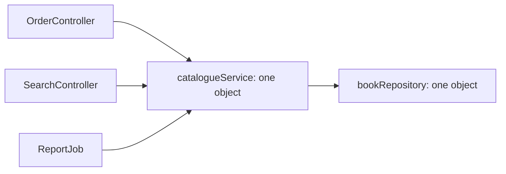

# Singleton scope, eager and lazy beans, thread safety

> **Before this lesson:** you can define beans both ways and inject them through constructors ([Wiring beans with @Bean methods and @Autowired](#/lesson/spring/spring-wiring-autowired)). You know what a thread is in outline; if not, read the first sections of [the Java track lesson on threads](#/lesson/java/java-threads-executors) or continue here, where the needed part is explained.

## In plain words

An office has one coffee machine in the kitchen. Everybody uses the same machine. That is cheap and convenient, and it works because the machine keeps nothing that belongs to one person: you press a button, you get your cup, and the machine is as it was before. Now imagine the machine had a single "favourite drink" setting that each person changed before pressing the button. With two people at the machine at the same moment, somebody gets the wrong drink.

A Spring bean's **scope** is the rule that says how many instances of the bean exist and how long each lives. The default scope is **singleton**: one instance for the whole application, shared by everyone, like the coffee machine. This lesson covers what that means, when the instance is created (at start-up or on first use), and the consequence that causes real production bugs: a shared instance must not keep per-user data in its fields.

"Are Spring beans thread-safe?" is among the most frequently asked Spring interview questions. By the end of this lesson you will be able to answer it precisely.

## What "singleton" means in Spring

You have already seen it without the name: asking the context twice for a bean returns the same object.

```java
// src/main/java/com/bookshop/catalogue/CatalogueService.java
@Service
public class CatalogueService {
    public CatalogueService() {
        System.out.println("CatalogueService created");
    }
}
```

```java
var context = new AnnotationConfigApplicationContext(AppConfig.class);
CatalogueService first = context.getBean(CatalogueService.class);
CatalogueService second = context.getBean(CatalogueService.class);
System.out.println(first == second);
```

```text
CatalogueService created
true
```

The constructor message appears once, and `==` (which compares object identity) prints `true`. Every bean that injects `CatalogueService` receives a reference to this one object.

Two clarifications prevent common confusion.

**1. One instance per bean *name*, not per class.** Spring's singleton is tied to the bean definition. Two `@Bean` methods returning the same class give two singletons:

```java
@Configuration
public class ClockConfig {
    @Bean Clock utcClock()    { return Clock.systemUTC(); }
    @Bean Clock madridClock() { return Clock.system(ZoneId.of("Europe/Madrid")); }
}
```

Both are singleton beans. There are two `Clock` objects because there are two bean names.

**2. It is not the "singleton design pattern".** The classic pattern uses a private constructor and a static method so that no second instance can exist anywhere in the program. A Spring singleton is an ordinary class with a public constructor. Nothing stops you from writing `new CatalogueService()`; Spring only guarantees that *the context* holds one instance per name.

| | Singleton design pattern | Spring singleton scope |
|---|---|---|
| Enforced by | the class itself (private constructor, static accessor) | the container |
| Uniqueness | one per class, per class loader | one per bean name, per application context |
| Testability | hard: global state, cannot be replaced | easy: pass any instance to the constructor |

> [!INTERVIEW]
> "Is a Spring singleton the same as the Gang-of-Four singleton?" No. The pattern guarantees one instance per class through language tricks. Spring guarantees one instance per bean definition within one context; the class stays a normal class, and several singleton beans of the same class can coexist.

You can state the scope explicitly, although it is the default:

```java
@Service
@Scope(ConfigurableBeanFactory.SCOPE_SINGLETON)     // same as leaving it out
public class CatalogueService { }
```

## Sharing: what it implies

Because there is one instance, a field of a singleton bean is shared by every user of the bean.



A web server handles many requests at once by running each on its own **thread**. A thread is an independent sequence of steps executing inside the program; ten simultaneous requests mean ten threads, all inside the same process, all able to reach the same objects. All ten call methods on the same `CatalogueService` object at the same time.

That is harmless as long as the bean is **stateless**: its fields are set once at construction and never change afterwards. Dependencies held in `final` fields are exactly that.

It becomes a bug when a singleton has **mutable state**: a field that is written during normal operation. Then two threads can interleave their reads and writes. The resulting wrong behaviour is called a **race condition**: the outcome depends on the unpredictable timing of the threads.

## A race condition you can run

The simulation interleaves the steps of two "threads" by hand so that the result is the same every time you run it. A singleton service keeps the current customer in a field: a classic mistake.

```python-run
class GreetingService:                      # ONE instance shared by all requests
    def __init__(self):
        self.current_customer = None        # mutable state in a singleton: the bug

    def set_customer(self, name):
        self.current_customer = name

    def greeting(self):
        return f"Hello {self.current_customer}, here is your order history"

service = GreetingService()                 # the singleton

def request(name):                          # each request is a little step-by-step script
    service.set_customer(name)
    yield                                   # the thread is paused here by the scheduler
    result = service.greeting()
    print(f"request of {name:5} received: {result}")
    yield

ana, ben = request("Ana"), request("Ben")

# The scheduler happens to interleave the two requests like this:
next(ana)        # Ana: set_customer("Ana")
next(ben)        # Ben: set_customer("Ben")   <- overwrites the shared field
next(ana)        # Ana: greeting()            <- reads Ben's name!
next(ben)        # Ben: greeting()
```

Each `yield` marks a point where a real operating system may pause one thread and run another. With the interleaving shown, Ana is greeted as Ben and is about to be shown Ben's order history. No exception is thrown. The bug appears only under simultaneous load, which is why it survives testing and surfaces in production.

Now the fix: pass the data as a method parameter so that it lives on each thread's own call stack instead of in the shared object.

```python-run
class GreetingService:                      # stateless: nothing to overwrite
    def greeting(self, customer):
        return f"Hello {customer}, here is your order history"

service = GreetingService()

def request(name):
    yield
    print(f"request of {name:5} received: {service.greeting(name)}")
    yield

ana, ben = request("Ana"), request("Ben")
next(ana); next(ben); next(ana); next(ben)
```

Same interleaving, correct output. Method parameters and local variables belong to the calling thread; they are never shared.

## The rules for singleton beans

1. **Fields hold collaborators and configuration, not conversation data.** Injected beans and values that never change: fine. "The current user", "the order being processed", "the running total of this request": never.
2. **Make fields `final`.** Constructor injection gives you this for free. A `final` field cannot be reassigned, which removes the most common way to introduce shared mutable state.
3. **Per-call data travels through parameters and return values.**
4. **If shared mutable state is truly required** (a cache, a counter of all visits), use tools built for concurrent access: `AtomicLong`, `ConcurrentHashMap`, or `synchronized` blocks. Then the class is stateful by design and you have accepted the responsibility.

```java
// wrong: mutable per-request state in a singleton
@Service
public class CheckoutService {
    private Order currentOrder;                    // shared by all threads

    public void start(Order order) { this.currentOrder = order; }
    public int total() { return currentOrder.quantity() * 1250; }
}

// right: stateless
@Service
public class CheckoutService {
    private final PriceCalculator calculator;      // immutable collaborator

    public CheckoutService(PriceCalculator calculator) { this.calculator = calculator; }

    public int total(Order order) {                // data comes in as a parameter
        return calculator.totalCents(order);
    }
}
```

> [!INTERVIEW]
> "Are Spring singleton beans thread-safe?" Spring guarantees that the bean is created once and published safely. It does **not** make your class thread-safe. A singleton is safe when it is stateless or its state is immutable; if it has mutable fields, you must synchronise access yourself or choose another scope. Typical services, repositories and controllers are stateless and therefore safe.

> [!WARNING]
> Classic hidden offenders in singleton beans: a `SimpleDateFormat` field (not thread-safe; use `DateTimeFormatter`), a plain `HashMap` used as a cache (use `ConcurrentHashMap`), a `StringBuilder` or `ArrayList` field that methods append to, and a counter declared as `int count` incremented with `count++` (use `AtomicInteger`).

## When is the singleton created? Eager versus lazy

By default Spring creates every singleton **eagerly**: while the context starts, before any request is served.

```java
@Service
public class RecommendationService {
    public RecommendationService() {
        System.out.println("RecommendationService created");
    }
}
```

```java
var context = new AnnotationConfigApplicationContext(AppConfig.class);
System.out.println("context started");
```

```text
RecommendationService created
context started
```

The bean exists before `main` continues. Add `@Lazy` and the creation is postponed until somebody first needs the bean:

```java
@Service
@Lazy
public class RecommendationService { ... }
```

```java
var context = new AnnotationConfigApplicationContext(AppConfig.class);
System.out.println("context started");
context.getBean(RecommendationService.class);
System.out.println("got the bean");
```

```text
context started
RecommendationService created
got the bean
```

| | Eager (default) | Lazy (`@Lazy`) |
|---|---|---|
| Created | at context start-up | on first use |
| Start-up time | longer | shorter |
| First request that uses it | fast | pays the creation cost |
| Configuration error in the bean | found at start-up | found when first used, possibly in production at night |
| Memory for unused beans | used | saved |

Eager is the default for a good reason: errors appear when you deploy, not when a customer triggers the faulty path. Choose lazy for a bean that is expensive to create and rarely needed, for example a report generator used once a month.

Spring Boot offers a global switch, `spring.main.lazy-initialization=true`, which makes every bean lazy. It shortens start-up during development; in production it moves failures from deployment time to request time, so use it with care.

### A lazy bean needed by an eager bean

`@Lazy` on a class means "do not create me for my own sake at start-up". If an eager bean lists the lazy bean as a constructor parameter, Spring has no choice: it must create the lazy bean to construct the eager one.

```python-run
DEFINITIONS = [                                   # registration order
    {"name": "invoiceService",  "lazy": False, "needs": ["pdfRenderer"]},
    {"name": "pdfRenderer",     "lazy": True,  "needs": ["fontLibrary"]},
    {"name": "fontLibrary",     "lazy": True,  "needs": []},
    {"name": "monthlyReport",   "lazy": True,  "needs": ["fontLibrary"]},
    {"name": "catalogueService","lazy": False, "needs": []},
]
by_name = {d["name"]: d for d in DEFINITIONS}
created = []

def create(name, reason):
    if name in created:
        return
    for dependency in by_name[name]["needs"]:
        create(dependency, f"needed by {name}")
    created.append(name)
    print(f"  created {name:17} ({reason})")

print("start-up:")
for definition in DEFINITIONS:
    if not definition["lazy"]:
        create(definition["name"], "eager singleton")

print("later, somebody calls getBean('monthlyReport'):")
create("monthlyReport", "first use")
```

`pdfRenderer` and `fontLibrary` are marked lazy, yet both are created at start-up because the eager `invoiceService` needs them. Only `monthlyReport`, which nothing eager depends on, waits for its first use. The practice problem [Eager and lazy initialisation order](#/problem/spring-lazy-eager-order) is built on this rule.

To keep a dependency lazy even though its consumer is eager, put `@Lazy` on the **injection point**. Spring then injects a proxy that creates the real bean when a method is first called on it:

```java
@Service
public class InvoiceService {
    private final PdfRenderer renderer;

    public InvoiceService(@Lazy PdfRenderer renderer) {    // proxy now, real bean on first call
        this.renderer = renderer;
    }
}
```

## Singleton scope with @Bean

Everything above applies to `@Bean` methods too. `@Lazy` and `@Scope` are placed beside `@Bean`:

```java
@Configuration
public class ReportConfig {

    @Bean
    @Lazy
    MonthlyReportGenerator monthlyReportGenerator(FontLibrary fonts) {
        return new MonthlyReportGenerator(fonts);
    }
}
```

## Practise in real Java

The judge has the JDK only, without Spring jars, so in these exercises you write in real Java 21 the mechanism that Spring provides. That is the level interview questions probe.

- [Java: singleton, prototype and lazy beans](#/problem/spring-java-scopes-lazy): singleton, prototype and lazy beans created through factory functions.

## Pitfalls

- **State in a singleton.** The headline bug of this lesson. Review every non-final field of a `@Service`, `@Repository` or `@Controller` with suspicion.
- **"It worked on my machine."** Race conditions need simultaneous requests. A developer clicking alone never triggers them. Load tests or code review catch them.
- **Believing `@Lazy` on a class guarantees late creation.** An eager dependant forces creation.
- **Global lazy initialisation hiding broken configuration.** A bean with a missing dependency starts fine and fails on first use.
- **Expecting a new instance from each `getBean`.** That is prototype scope, covered next.
- **Using a singleton as a cache with a `HashMap`.** Concurrent writes can corrupt a `HashMap` or lose updates; use `ConcurrentHashMap` or Spring's cache abstraction.
- **Several application contexts.** Tests or parent/child set-ups may create more than one context; "one instance" means one per context.

## Cheat sheet

| Annotation / property | Meaning |
|---|---|
| (no `@Scope`) | singleton: one instance per bean name per context |
| `@Scope("singleton")` | the same, written out |
| `@Lazy` on a class or `@Bean` method | create on first use instead of at start-up |
| `@Lazy` on an injection point | inject a proxy; create the target on first method call |
| `spring.main.lazy-initialization=true` | make all beans lazy (Spring Boot) |
| `final` fields + constructor injection | the standard recipe for a thread-safe, stateless bean |
| `AtomicLong`, `ConcurrentHashMap`, `synchronized` | tools when shared mutable state is unavoidable |

## Summary

- Scope decides how many instances of a bean exist. The default, singleton, means one per bean name per context.
- Spring's singleton is a container guarantee, not the singleton design pattern.
- Every user and every thread shares the instance, so singleton beans must be stateless or immutable; per-request data belongs in parameters.
- Spring does not make your beans thread-safe; it only creates them once.
- Singletons are created eagerly at start-up by default, which surfaces configuration errors early. `@Lazy` postpones creation until first use, unless an eager bean needs the lazy one.

## Glossary

- **Eager initialisation**: creating a bean while the context starts.
- **Immutable**: unable to change after construction.
- **Lazy initialisation**: creating a bean when it is first needed.
- **Mutable state**: data in an object that can change over time.
- **Race condition**: a bug whose outcome depends on the timing of concurrent threads.
- **Scope**: the rule governing the number and lifetime of a bean's instances.
- **Singleton scope**: one shared instance per bean definition per application context.
- **Stateless**: having no fields that change after construction.
- **Thread**: an independent path of execution within a program.
- **Thread-safe**: behaving correctly when used by several threads at once.

```quiz
[
  {"q": "A configuration class has two @Bean methods that both return a Clock. How many Clock instances does the context hold?",
   "options": ["One, because Clock is a singleton", "Two, one singleton per bean name", "None until getBean is called", "It fails to start"],
   "answer": 1,
   "explain": "Singleton scope is per bean definition (name), not per class. Two definitions give two instances."},
  {"q": "Which field makes a singleton @Service unsafe under concurrent requests?",
   "options": ["private final OrderRepository repository;", "private final int pageSize;", "private Order currentOrder;", "private static final Logger log = ...;"],
   "answer": 2,
   "explain": "A non-final field written per request is shared mutable state: one thread can overwrite it while another is still using it."},
  {"q": "What is the best answer to: are Spring singleton beans thread-safe?",
   "options": ["Yes, Spring synchronises all bean methods", "No, never", "Only if the bean is stateless or protects its mutable state; Spring itself does not add thread safety", "Only in Spring Boot"],
   "answer": 2,
   "explain": "Spring creates the bean once. Whether concurrent use is safe depends entirely on how the class handles state."},
  {"q": "In the first simulation, why does Ana receive Ben's greeting?",
   "options": ["The print statement is wrong", "Both requests write the same field of the shared instance, and Ben's write lands before Ana's read", "Python lists are not ordered", "Generators cannot be paused"],
   "answer": 1,
   "explain": "The single shared field is overwritten between Ana's write and Ana's read. That interleaving is a race condition."},
  {"q": "When is a default (non-lazy) singleton bean created?",
   "options": ["When getBean is first called", "When the application context starts", "When the JVM shuts down", "Each time it is injected"],
   "answer": 1,
   "explain": "Eager creation at start-up is the default, so that configuration mistakes are found immediately."},
  {"q": "PdfRenderer is annotated @Lazy. The eager InvoiceService takes a PdfRenderer constructor parameter (without @Lazy on the parameter). When is PdfRenderer created?",
   "options": ["Never", "On the first call of a PdfRenderer method", "At start-up, because the eager bean needs it to be constructed", "When the context closes"],
   "answer": 2,
   "explain": "Constructor injection requires a real instance. @Lazy on the class only prevents creation for its own sake."},
  {"q": "What is a disadvantage of making every bean lazy?",
   "options": ["Start-up becomes slower", "Beans are created twice", "Configuration errors show up at first use instead of at start-up", "Singletons become prototypes"],
   "answer": 2,
   "explain": "Lazy creation trades fail-fast behaviour for quicker start-up: a broken bean is discovered only when something first asks for it."}
]
```

> **Source:** Spilcă, *Spring Start Here*, ch. 5 (singleton bean scope, eager and lazy instantiation). Documentation: https://docs.spring.io/spring-framework/reference/core/beans/factory-scopes.html and https://docs.spring.io/spring-framework/reference/core/beans/dependencies/factory-lazy-init.html
