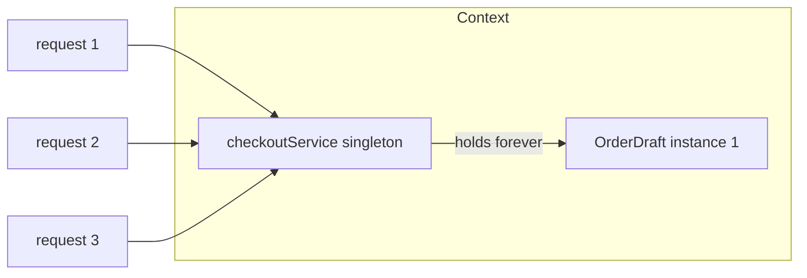
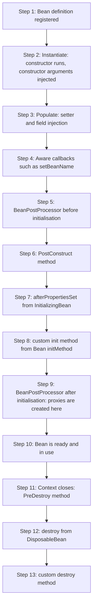

# Prototype scope and the bean lifecycle

> **Before this lesson:** you understand singleton scope, why singleton beans must be stateless, and the difference between eager and lazy creation ([Singleton scope, eager and lazy beans, thread safety](#/lesson/spring/spring-singleton-scope)).

## In plain words

The office coffee machine is shared: one machine for everybody. Paper cups are different. Each person takes a fresh cup from the dispenser, writes their name on it, uses it, and throws it away themselves. Nobody shares a cup, and the dispenser does not keep track of where the cups went.

A **prototype**-scoped bean is a paper cup. Every time somebody asks Spring for it, Spring makes a brand-new instance, hands it over and forgets about it. Because each caller has a private instance, a prototype bean may hold per-use data in its fields.

The second half of this lesson follows one bean from birth to death: the **bean lifecycle**. Spring calls certain methods at fixed moments (after creation, before shutdown), much as a building has a commissioning check before people move in and a decommissioning procedure before demolition. Knowing the order of these callbacks tells you where set-up and clean-up code belongs, and "explain the bean lifecycle" is a staple interview request.

## Declaring a prototype bean

```java
// src/main/java/com/bookshop/order/OrderDraft.java
package com.bookshop.order;

import org.springframework.beans.factory.config.ConfigurableBeanFactory;
import org.springframework.context.annotation.Scope;
import org.springframework.stereotype.Component;

import java.util.ArrayList;
import java.util.List;

@Component
@Scope(ConfigurableBeanFactory.SCOPE_PROTOTYPE)       // the constant equals the text "prototype"
public class OrderDraft {

    private final List<String> isbns = new ArrayList<>();    // mutable state: fine here

    public OrderDraft() {
        System.out.println("OrderDraft created");
    }

    public void add(String isbn) { isbns.add(isbn); }
    public int size() { return isbns.size(); }
}
```

```java
var context = new AnnotationConfigApplicationContext(AppConfig.class);
System.out.println("context started");

OrderDraft first = context.getBean(OrderDraft.class);
OrderDraft second = context.getBean(OrderDraft.class);
first.add("9780441172719");

System.out.println(first == second);
System.out.println(first.size() + " / " + second.size());
```

```text
context started
OrderDraft created
OrderDraft created
false
1 / 0
```

Three observations:

1. Nothing was created at start-up. Prototype beans are never created eagerly; there is nobody to give the instance to.
2. Each `getBean` ran the constructor again. `==` prints `false`: two separate objects.
3. Adding a book to `first` did not affect `second`. Each has its own list.

With `@Bean` the annotation sits next to the method:

```java
@Bean
@Scope("prototype")
OrderDraft orderDraft() {
    return new OrderDraft();          // Spring calls this method once per request for the bean
}
```

| | Singleton | Prototype |
|---|---|---|
| Instances | one per bean name | a new one for every request to the container |
| Created | at start-up (unless lazy) | when requested |
| Held by the container afterwards | yes | no |
| Mutable per-use state | dangerous | fine |
| Destruction callbacks | called at shutdown | never called by Spring |
| Typical use | services, repositories, controllers | rare: stateful helpers, builders, per-task objects |

## The trap: a prototype inside a singleton

This is the single most important fact about prototype scope and a classic interview question. "A new instance for every request **to the container**" does not mean "a new instance for every method call".

```java
@Service                                    // singleton
public class CheckoutService {

    private final OrderDraft draft;          // prototype

    public CheckoutService(OrderDraft draft) {
        this.draft = draft;
    }

    public int addAndCount(String isbn) {
        draft.add(isbn);
        return draft.size();
    }
}
```

```java
CheckoutService checkout = context.getBean(CheckoutService.class);
System.out.println(checkout.addAndCount("111"));
System.out.println(checkout.addAndCount("222"));
```

```text
OrderDraft created
1
2
```

The singleton `CheckoutService` is constructed once. At that moment Spring asks the container for one `OrderDraft`, creates it and injects it. Afterwards the singleton keeps that one reference forever. Every customer's checkout appends to the same draft. The prototype has effectively become a singleton, with mutable state, shared across threads.



The counting model makes the rule concrete. An instance is created each time the *container is asked*; injection at construction time is one such ask.

```python-run
DEFINITIONS = {
    "checkoutService": {"scope": "singleton", "needs": ["orderDraft", "priceCalculator"]},
    "orderDraft":      {"scope": "prototype", "needs": ["clock"]},
    "priceCalculator": {"scope": "singleton", "needs": []},
    "clock":           {"scope": "singleton", "needs": []},
}
count = {name: 0 for name in DEFINITIONS}
singletons = set()

def obtain(name):
    definition = DEFINITIONS[name]
    if definition["scope"] == "singleton":
        if name in singletons:
            return                      # reuse
        singletons.add(name)
    count[name] += 1                    # a new instance is created
    for dependency in definition["needs"]:
        obtain(dependency)              # inject = ask the container

for name, definition in DEFINITIONS.items():        # start-up: eager singletons
    if definition["scope"] == "singleton":
        obtain(name)
print("after start-up:          ", count)

for _ in range(3):
    obtain("checkoutService")           # three requests use the singleton
print("after 3 checkout calls:  ", count)

for _ in range(3):
    obtain("orderDraft")                # three direct requests for the prototype
print("after 3 getBean(draft):  ", count)
```

After start-up there is already one `orderDraft`: the one injected into the singleton. Using the singleton three times creates no further drafts. Only asking the container directly creates new ones. The practice problem [Count instances: singleton versus prototype](#/problem/spring-scope-count) extends this model.

### Getting a fresh prototype each time

The singleton must go back to the container whenever it wants a new instance. Three clean ways:

**1. `ObjectProvider<T>` (recommended).**

```java
@Service
public class CheckoutService {

    private final ObjectProvider<OrderDraft> drafts;       // a handle to the container

    public CheckoutService(ObjectProvider<OrderDraft> drafts) {
        this.drafts = drafts;
    }

    public int checkout(List<String> isbns) {
        OrderDraft draft = drafts.getObject();             // new instance on every call
        isbns.forEach(draft::add);
        return draft.size();
    }
}
```

`ObjectProvider` is a small Spring interface; `getObject()` performs the container lookup at that moment. The draft lives in a local variable, so each call and each thread has its own.

**2. A scoped proxy.**

```java
@Component
@Scope(value = "prototype", proxyMode = ScopedProxyMode.TARGET_CLASS)
public class OrderDraft { ... }
```

Spring injects a proxy into the singleton, and the proxy fetches a new target for **every method call**. That is rarely what you want for a stateful object (`add` and `size` would hit different instances), so this option suits web scopes better than prototypes.

**3. `@Lookup` method injection.** An abstract or overridable method annotated `@Lookup` is implemented by Spring to return a fresh bean on each call. It works, but is less explicit than `ObjectProvider`.

> [!INTERVIEW]
> "What happens when you inject a prototype bean into a singleton?" The prototype is created once, when the singleton is built, and that same instance is reused for the singleton's whole life. To get a new instance per use, inject `ObjectProvider<T>` (or use `@Lookup`, or a scoped proxy) so that the lookup happens at call time.

> [!TIP]
> Before reaching for prototype scope, ask whether a plain `new OrderDraft()` would do. If the object needs no injected dependencies and no Spring features, it does not need to be a bean. Prototype scope is useful when the per-use object itself needs injection.

## The bean lifecycle

For a singleton, Spring performs these steps in order.



The parts you will use yourself are steps 2, 6 and 11. The rest explains how Spring's own features hook in.

- **Instantiate.** Spring calls the constructor, supplying constructor arguments.
- **Populate.** Remaining dependencies (`@Autowired` fields and setters) are set.
- **Initialisation callbacks.** Three equivalent mechanisms exist for "run this once the bean is fully wired". If a bean uses several, they run in this fixed order: the `@PostConstruct` method, then `afterPropertiesSet()` of the `InitializingBean` interface, then the method named in `@Bean(initMethod = "...")`.
- **Post-processors.** A `BeanPostProcessor` is a special bean that gets to inspect, and possibly replace, every other bean before and after its initialisation. The "after" step is where Spring wraps a bean in a proxy for transactions, security or your own aspects. That detail matters in the next module: the object in the context can be a wrapper around your object.
- **Destruction callbacks.** When the context closes, singletons are destroyed in the **reverse** of their creation order, so that a bean is shut down before the beans it depends on. Per bean the order is: `@PreDestroy`, then `destroy()` of `DisposableBean`, then the custom destroy method.

A bean using the annotation style:

```java
// src/main/java/com/bookshop/catalogue/SearchIndex.java
package com.bookshop.catalogue;

import jakarta.annotation.PostConstruct;
import jakarta.annotation.PreDestroy;
import org.springframework.stereotype.Component;

@Component
public class SearchIndex {

    private final BookRepository books;

    public SearchIndex(BookRepository books) {
        this.books = books;
        System.out.println("1. constructor: dependencies are available as parameters");
    }

    @PostConstruct
    void build() {
        System.out.println("2. @PostConstruct: fully wired, building the index");
    }

    @PreDestroy
    void flush() {
        System.out.println("3. @PreDestroy: context is closing, writing the index to disk");
    }
}
```

```java
var context = new AnnotationConfigApplicationContext(AppConfig.class);
System.out.println("-- application running --");
context.close();
```

```text
1. constructor: dependencies are available as parameters
2. @PostConstruct: fully wired, building the index
-- application running --
3. @PreDestroy: context is closing, writing the index to disk
```

For a class you cannot annotate, name the methods on the `@Bean`:

```java
@Bean(initMethod = "start", destroyMethod = "stop")
MessageListenerPool listenerPool() {
    return new MessageListenerPool();
}
```

> [!NOTE]
> For `@Bean` methods Spring *infers* a destroy method: if the returned object has a public `close()` or `shutdown()` method, it is called automatically when the context closes. That is how connection pools and thread pools declared with `@Bean` are released without any extra code. Write `destroyMethod = ""` to switch the inference off.

### Lifecycle order across several beans

The next simulation logs creation and destruction for a small graph, with a prototype mixed in.

```python-run
BEANS = [
    {"name": "orderService", "scope": "singleton", "needs": ["connectionPool", "orderDraft"],
     "callbacks": ["postConstruct", "preDestroy"]},
    {"name": "connectionPool", "scope": "singleton", "needs": [],
     "callbacks": ["initMethod", "destroyMethod"]},
    {"name": "orderDraft", "scope": "prototype", "needs": [],
     "callbacks": ["postConstruct", "preDestroy"]},
]
INIT = ["postConstruct", "afterPropertiesSet", "initMethod"]
DESTROY = ["preDestroy", "destroy", "destroyMethod"]
by_name = {b["name"]: b for b in BEANS}
singletons, log = [], []

def obtain(name):
    bean = by_name[name]
    if bean["scope"] == "singleton" and name in singletons:
        return
    for dependency in bean["needs"]:
        obtain(dependency)
    log.append(f"{name}: constructor")
    if bean["scope"] == "singleton":
        singletons.append(name)                 # the container remembers singletons only
    log.extend(f"{name}: {cb}" for cb in INIT if cb in bean["callbacks"])

for bean in BEANS:
    if bean["scope"] == "singleton":
        obtain(bean["name"])
log.append("---- context.close() ----")
for name in reversed(singletons):
    log.extend(f"{name}: {cb}" for cb in DESTROY if cb in by_name[name]["callbacks"])

print("\n".join(log))
```

Read the output from top to bottom:

- `connectionPool` is constructed and initialised first because `orderService` needs it.
- `orderDraft` is created for injection and gets its `postConstruct`. It is not remembered.
- On close, `orderService` is destroyed before `connectionPool`: reverse creation order. A service may still need its pool during shutdown, never the other way round.
- `orderDraft: preDestroy` never appears. **Spring does not call destruction callbacks on prototype beans**, because it keeps no reference to them. If a prototype holds a resource such as a file handle, the code that obtained the bean must release it.

The practice problem [Bean lifecycle callback order](#/problem/spring-lifecycle-order) asks you to produce this log for arbitrary input.

### Closing the context

Destruction callbacks run only if the context is closed properly.

- In plain Spring call `context.close()`, or use try-with-resources, or call `context.registerShutdownHook()` so that the callbacks run when the JVM exits normally.
- Spring Boot registers the shutdown hook for you. Stopping the application with Ctrl+C or a normal termination signal triggers an orderly shutdown. Killing the process forcibly (`kill -9`) or pulling the plug does not, so never rely on `@PreDestroy` for anything that must not be lost.

## Pitfalls

- **Prototype injected into a singleton.** One instance, shared for ever. Use `ObjectProvider`.
- **Expecting `@PreDestroy` on prototypes.** It is never called by the container.
- **Heavy work in constructors.** A constructor that opens network connections makes the class hard to test and can run before other parts are ready. Put start-up actions in `@PostConstruct`.
- **Calling a proxied feature of the same bean from `@PostConstruct`.** Proxies are applied *after* initialisation callbacks, so, for example, a `@Transactional` method called on `this` inside `@PostConstruct` runs without a transaction.
- **Mixing all three callback styles.** Legal, ordered, and confusing. Pick the annotations for your classes and `initMethod`/`destroyMethod` for library classes.
- **Missing `jakarta.annotation` dependency in plain Spring.** Without the Jakarta Annotations API on the classpath the code does not compile; an old `javax.annotation.PostConstruct` import compiles in some set-ups but is silently ignored by Spring 6.
- **Leaking prototypes.** Storing every prototype instance in a list inside a singleton keeps them alive for ever and fills memory.

## Cheat sheet

| Annotation / type | Meaning |
|---|---|
| `@Scope("prototype")` | new instance per container request; not tracked afterwards |
| `ObjectProvider<T>` | inject a handle; `getObject()` asks the container at call time |
| `@Lookup` | method that Spring overrides to return a bean on each call |
| `proxyMode = ScopedProxyMode.TARGET_CLASS` | inject a proxy that resolves the scoped target per call |
| `@PostConstruct` | initialisation callback (first of the three) |
| `InitializingBean.afterPropertiesSet()` | initialisation callback (second) |
| `@Bean(initMethod = "x")` | initialisation callback (third) |
| `@PreDestroy` | destruction callback (first) |
| `DisposableBean.destroy()` | destruction callback (second) |
| `@Bean(destroyMethod = "x")` | destruction callback (third); inferred for `close`/`shutdown` |
| `BeanPostProcessor` | hook that can modify or wrap every bean |

## Summary

- Prototype scope creates a new instance each time the container is asked, creates nothing at start-up and does not track the instances.
- Injected into a singleton, a prototype is created once and then shared; use `ObjectProvider<T>` to obtain a fresh one per use.
- A bean's life: instantiate, inject, initialise (`@PostConstruct` → `afterPropertiesSet` → init method), post-process (proxies), use, destroy (`@PreDestroy` → `destroy` → destroy method).
- Singletons are destroyed in reverse creation order when the context closes; prototypes receive no destruction callbacks.
- Close the context properly, or the destruction phase never happens.

## Glossary

- **Bean lifecycle**: the sequence of steps from a bean's creation to its destruction.
- **`BeanPostProcessor`**: a bean that Spring calls for every other bean before and after initialisation.
- **Destruction callback**: a method called when the context shuts down.
- **Initialisation callback**: a method called once after a bean has been created and injected.
- **`ObjectProvider`**: a Spring interface for looking up a bean on demand.
- **Prototype scope**: a scope in which every request to the container yields a new instance.
- **Scoped proxy**: a proxy that locates the correct scoped instance on each method call.
- **Shutdown hook**: code the JVM runs when it exits normally; Spring uses one to close the context.

```quiz
[
  {"q": "A prototype bean is defined but nothing requests it. How many instances exist after start-up?",
   "options": ["One", "Zero", "One per singleton bean", "It depends on @Lazy"],
   "answer": 1,
   "explain": "Prototypes are created only on demand. Start-up creates eager singletons and whatever they need."},
  {"q": "A singleton service receives a prototype OrderDraft through its constructor. The service's method is called 100 times. How many OrderDraft instances were created for this service?",
   "options": ["100", "1", "0", "2"],
   "answer": 1,
   "explain": "Injection happens once, when the singleton is constructed. The same draft instance is reused on every call."},
  {"q": "Which gives a singleton a fresh prototype instance on each use?",
   "options": ["Marking the singleton @Lazy", "Injecting ObjectProvider<OrderDraft> and calling getObject()", "Adding @Primary to the prototype", "Declaring the field static"],
   "answer": 1,
   "explain": "ObjectProvider defers the lookup to call time, so the container is asked, and creates a new instance, on every getObject()."},
  {"q": "In which order do initialisation callbacks run on one bean?",
   "options": ["init method, afterPropertiesSet, @PostConstruct", "@PostConstruct, afterPropertiesSet, init method", "afterPropertiesSet, @PostConstruct, init method", "The order is undefined"],
   "answer": 1,
   "explain": "Annotation first, then the InitializingBean interface, then the custom init method declared on @Bean."},
  {"q": "orderService depends on connectionPool. When the context closes, which is destroyed first?",
   "options": ["connectionPool", "orderService", "Both at the same time", "Neither; singletons are never destroyed"],
   "answer": 1,
   "explain": "Destruction is the reverse of creation. The dependant goes first so that it can still use its dependency while shutting down."},
  {"q": "A prototype bean has a @PreDestroy method that closes a file. When does Spring call it?",
   "options": ["When the context closes", "When the bean is garbage collected", "Never; Spring does not track prototype instances", "After each method call"],
   "answer": 2,
   "explain": "The container hands the instance over and forgets it. Releasing resources held by prototypes is the client's job."},
  {"q": "At which lifecycle step are proxies for features such as transactions normally created?",
   "options": ["Before the constructor runs", "In the constructor", "In BeanPostProcessor processing after initialisation", "When the context closes"],
   "answer": 2,
   "explain": "Post-processors may replace the bean with a proxy after its initialisation callbacks, which is why those callbacks run on the raw object."}
]
```

> **Source:** Spilcă, *Spring Start Here*, ch. 5 (prototype bean scope). Documentation: https://docs.spring.io/spring-framework/reference/core/beans/factory-scopes.html and https://docs.spring.io/spring-framework/reference/core/beans/factory-nature.html
