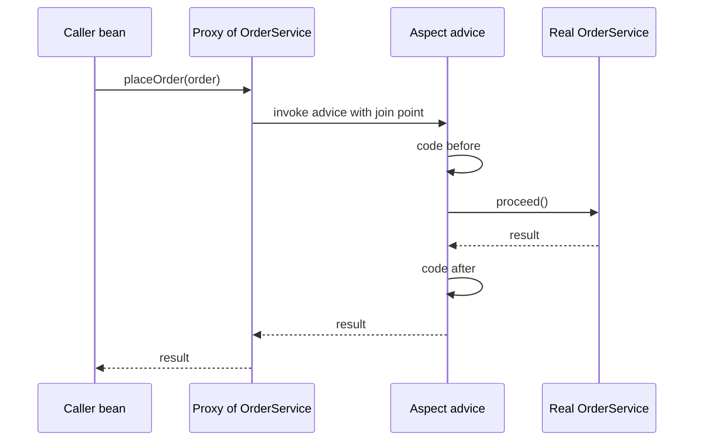
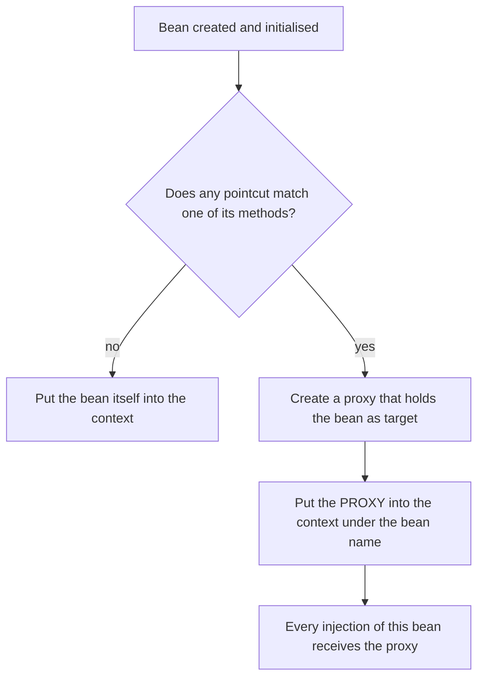
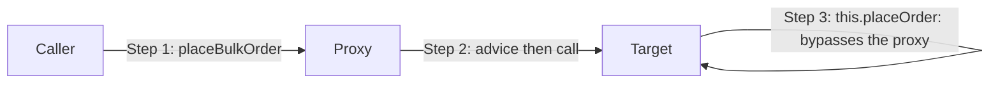

# How Spring AOP works: proxies and your first aspect

> **Before this lesson:** you know beans, scanning and constructor injection, and you have seen that a bean in the context may be wrapped by a post-processor ([Prototype scope and the bean lifecycle](#/lesson/spring/spring-prototype-lifecycle)).

## In plain words

A company director has a personal assistant. Every call to the director goes through the assistant, who notes the caller and the time, checks whether the caller is allowed through, connects the call, and afterwards writes a short summary. The director only talks business. Callers hardly notice the assistant: they dial the director's number and get an answer.

In Spring the director is your bean and the assistant is a **proxy**: an object that stands in front of your bean, receives every method call first, does some extra work and then forwards the call. The extra work (logging, timing, security checks, transactions) is written once in a separate class called an **aspect**, and Spring arranges for the proxy to run it around the methods you select.

This technique is **aspect-oriented programming**, AOP for short. You will write few aspects yourself, but you will use Spring features built on them every day: `@Transactional`, method security, caching, retries. Understanding the proxy explains their most surprising behaviours, and interviewers know that.

## The problem: the same code everywhere

Suppose the team wants every service method of the bookshop to log when it starts and how long it took.

```java
@Service
public class OrderService {

    private static final Logger log = LoggerFactory.getLogger(OrderService.class);

    public void placeOrder(Order order) {
        long start = System.nanoTime();
        log.info("placeOrder started");
        try {
            // ... the three lines of business logic ...
        } finally {
            log.info("placeOrder took {} ms", (System.nanoTime() - start) / 1_000_000);
        }
    }

    public void cancelOrder(long id) {
        long start = System.nanoTime();
        log.info("cancelOrder started");
        try {
            // ... business logic ...
        } finally {
            log.info("cancelOrder took {} ms", (System.nanoTime() - start) / 1_000_000);
        }
    }
}
```

The business logic is buried under repeated plumbing. Multiply by two hundred methods, then imagine the request "also log the arguments". A behaviour that is needed in many places and has nothing to do with the business rule of any one place is called a **cross-cutting concern**. Typical examples: logging, timing, security checks, transactions, caching, retrying.

AOP lets you write a cross-cutting concern once and declare where it applies.

## Vocabulary

| Term | Meaning | In the assistant analogy |
|---|---|---|
| **Aspect** | the class containing the extra behaviour | the assistant's job description |
| **Advice** | one piece of that behaviour, a method in the aspect | "note the caller and the time" |
| **Join point** | a moment in execution where advice can run; in Spring AOP always the execution of a bean method | one phone call |
| **Pointcut** | an expression selecting which join points get the advice | "all calls to the director, not to the canteen" |
| **Target object** | the bean whose methods are intercepted | the director |
| **Proxy** | the wrapper object Spring creates around the target | the assistant |
| **Weaving** | connecting aspects to targets; Spring does it at run time by creating proxies | hiring the assistant |

Summed up in one sentence: an *aspect* contains *advice* that runs at the *join points* selected by a *pointcut*, and Spring makes it happen by placing a *proxy* in front of the *target*.

## Build a proxy by hand

Before using Spring's machinery, build the idea yourself. In the model below, `make_proxy` returns a wrapper around any object. The wrapper intercepts every method call.

```python-run
import time

class OrderService:                               # the target: business logic only
    def place_order(self, isbn, quantity):
        print(f"    [target] placing order for {quantity} x {isbn}")
        return "order-42"

    def cancel_order(self, order_id):
        print(f"    [target] cancelling {order_id}")
        raise RuntimeError("order already shipped")

class Proxy:
    def __init__(self, target, advice):
        self._target, self._advice = target, advice

    def __getattr__(self, method_name):           # called for every attribute not found on the proxy
        real_method = getattr(self._target, method_name)
        def intercepted(*args):
            proceed = lambda: real_method(*args)  # "continue to the real method"
            return self._advice(method_name, args, proceed)
        return intercepted

def timing_advice(method_name, args, proceed):    # the aspect's logic, written ONCE
    start = time.perf_counter()
    print(f"  [aspect] {method_name}{args} started")
    try:
        return proceed()
    finally:
        elapsed_ms = (time.perf_counter() - start) * 1000
        print(f"  [aspect] {method_name} finished in {elapsed_ms:.2f} ms")

service = Proxy(OrderService(), timing_advice)    # what the "container" hands out

print("caller: place_order")
print("caller got:", service.place_order("9780441172719", 2))
print("caller: cancel_order")
try:
    service.cancel_order("order-42")
except RuntimeError as problem:
    print("caller got exception:", problem)
```

Read the pieces:

- `OrderService` has no logging code at all.
- `Proxy.__getattr__` runs whenever the caller uses a method the proxy does not define itself. It looks up the real method on the target and returns a small function, `intercepted`, in its place.
- `intercepted` packages "call the real method with these arguments" as `proceed` and hands control to the advice.
- `timing_advice` decides what happens before, whether and when to call `proceed()`, and what happens afterwards. The `finally` block runs even when the target raises an exception.
- The caller holds the proxy and cannot tell the difference: it calls `service.place_order(...)` as usual.

Spring AOP is this, industrial strength. The object you receive from the context, or by injection, is the proxy.



## The same thing in Spring

### Step 1: dependencies and switch

In Spring Boot add one starter; it brings Spring AOP and the AspectJ annotation library and switches proxying on automatically.

```xml
<!-- pom.xml -->
<dependency>
    <groupId>org.springframework.boot</groupId>
    <artifactId>spring-boot-starter-aop</artifactId>
</dependency>
```

In a plain Spring project add `spring-aspects` and put `@EnableAspectJAutoProxy` on a configuration class:

```java
@Configuration
@ComponentScan(basePackages = "com.bookshop")
@EnableAspectJAutoProxy              // not needed in Spring Boot
public class AppConfig { }
```

### Step 2: the target stays clean

```java
// src/main/java/com/bookshop/order/OrderService.java
@Service
public class OrderService {

    public String placeOrder(String isbn, int quantity) {
        System.out.println("    [target] placing order for " + quantity + " x " + isbn);
        return "order-42";
    }
}
```

### Step 3: the aspect

```java
// src/main/java/com/bookshop/aspects/TimingAspect.java
package com.bookshop.aspects;

import org.aspectj.lang.ProceedingJoinPoint;
import org.aspectj.lang.annotation.Around;
import org.aspectj.lang.annotation.Aspect;
import org.slf4j.Logger;
import org.slf4j.LoggerFactory;
import org.springframework.stereotype.Component;

@Aspect                                   // (1) this class contains advice
@Component                                // (2) and it must be a bean
public class TimingAspect {

    private static final Logger log = LoggerFactory.getLogger(TimingAspect.class);

    @Around("execution(* com.bookshop.order.*.*(..))")          // (3) the pointcut
    public Object time(ProceedingJoinPoint joinPoint) throws Throwable {   // (4)
        long start = System.nanoTime();
        String method = joinPoint.getSignature().toShortString();
        log.info("{} started", method);
        try {
            return joinPoint.proceed();                         // (5) call the real method
        } finally {
            log.info("{} finished in {} ms", method, (System.nanoTime() - start) / 1_000_000);
        }
    }
}
```

1. `@Aspect` marks the class as an aspect. It does **not** make it a bean.
2. `@Component` (or an `@Bean` method) puts it into the context. Forgetting this is the most common reason an aspect "does nothing".
3. `@Around("...")` declares an advice that wraps the method call. The text is the pointcut: *execution of any method, with any return type, of any class directly in the package `com.bookshop.order`, with any parameters*. Pointcut syntax is taken apart in the next lesson.
4. An around advice receives a `ProceedingJoinPoint`, which describes the intercepted call (method name, arguments, target) and has the method `proceed()`. The advice returns `Object` because it stands in for methods of any return type, and declares `throws Throwable` because the target may throw anything.
5. `joinPoint.proceed()` invokes the real method. Whatever it returns must be returned by the advice, or the caller receives `null`.

### Step 4: run

```java
var context = new AnnotationConfigApplicationContext(AppConfig.class);
OrderService service = context.getBean(OrderService.class);

System.out.println(service.getClass().getName());
String id = service.placeOrder("9780441172719", 2);
System.out.println("caller got: " + id);
```

```text
com.bookshop.order.OrderService$$SpringCGLIB$$0
INFO  TimingAspect : OrderService.placeOrder(..) started
    [target] placing order for 2 x 9780441172719
INFO  TimingAspect : OrderService.placeOrder(..) finished in 3 ms
caller got: order-42
```

The first line is the evidence. The object returned by `getBean(OrderService.class)` is not of class `OrderService` but of a generated subclass whose name ends in `$$SpringCGLIB$$0`. That is the proxy.

## How Spring creates the proxy

During start-up a post-processor looks at every bean. If some aspect's pointcut matches at least one method of the bean, the post-processor puts a proxy into the context instead of the raw object. Beans that no pointcut matches are left alone.



There are two proxy techniques:

| | JDK dynamic proxy | CGLIB proxy |
|---|---|---|
| How | a generated class that implements the target's **interfaces** | a generated **subclass** of the target class |
| Requires | the target implements at least one interface | the class and methods are not `final` |
| The proxy is an instance of | the interfaces only | the target class (and its interfaces) |
| Default | plain Spring, when the bean has interfaces | Spring Boot always |

Spring Boot defaults to CGLIB subclass proxies for every bean (the property `spring.aop.proxy-target-class` is `true`), which avoids surprises when injecting by concrete class.

Consequences you should memorise:

- **`final` classes and `final` methods cannot be proxied by subclassing**, because a subclass cannot override them. Advice is silently skipped for a `final` method.
- **`private` methods are never intercepted**: they cannot be called from outside the object, so no call ever passes through the proxy.
- With JDK proxies, injecting the concrete class fails because the proxy is not an instance of it. Inject the interface.

## The self-invocation pitfall

The proxy intercepts calls that arrive **from outside**. What happens when a method of the bean calls another method of the same bean?

```java
@Service
public class OrderService {

    public void placeBulkOrder(List<String> isbns) {
        for (String isbn : isbns) {
            placeOrder(isbn, 1);           // really: this.placeOrder(isbn, 1)
        }
    }

    public String placeOrder(String isbn, int quantity) { ... }
}
```

An outside caller invokes `placeBulkOrder` through the proxy, so the advice runs once for it. Inside, `placeOrder` is called on `this`, which is the real target object and not the proxy. Those inner calls go straight to the method. **No advice runs for them.**

```python-run
class OrderService:
    def place_bulk_order(self, isbns):
        for isbn in isbns:
            self.place_order(isbn)            # self is the TARGET, not the proxy
    def place_order(self, isbn):
        print(f"      [target] order {isbn}")

class LoggingProxy:
    def __init__(self, target):
        self._target = target
    def __getattr__(self, name):
        real = getattr(self._target, name)
        def intercepted(*args):
            print(f"  [advice] before {name}")
            return real(*args)
        return intercepted

service = LoggingProxy(OrderService())

print("outside caller -> place_order:")
service.place_order("111")

print("outside caller -> place_bulk_order:")
service.place_bulk_order(["222", "333"])
```

The advice line appears before `place_order` in the first call and before `place_bulk_order` in the second, but not before the two inner `place_order` calls. The reason is visible in the code: `self.place_order` never touches the proxy.



This matters far beyond logging. `@Transactional` is advice. A non-transactional method calling a `@Transactional` method of the same class gets **no transaction**. The case is studied in [@Transactional, rollback rules and the self-invocation pitfall](#/lesson/spring/spring-transactional), and the practice problem [Detect proxy self-invocation](#/problem/spring-self-invocation) trains the eye.

Ways out, best first:

1. Move the inner method to another bean and inject it. Calls between beans go through proxies.
2. Put the annotation or pointcut on the outer method, so that the entry point is advised.
3. As a last resort, inject the bean into itself (lazily) and call through that reference.

> [!INTERVIEW]
> "How does Spring AOP work?" At start-up a `BeanPostProcessor` replaces each bean matched by a pointcut with a proxy (CGLIB subclass or JDK interface proxy). Callers receive the proxy; it runs the advice chain and delegates to the target. Limits follow from this design: only Spring beans, only method execution, only calls from outside the object (no self-invocation), no `private` or `final` methods.

> [!WARNING]
> Spring AOP is "proxy-based AOP" and is deliberately limited. The full AspectJ tool can weave advice into the bytecode itself and therefore also intercepts self-calls, private methods, constructors and field access, at the cost of a more complex build. Unless a project says otherwise, "AOP in Spring" means the proxy kind.

## What aspects are good for, and what they are not

Good uses share one property: the behaviour is independent of the business logic it surrounds.

| Use | Ready-made in Spring |
|---|---|
| Transactions | `@Transactional` |
| Method-level security | `@PreAuthorize` |
| Caching results | `@Cacheable` |
| Retrying failed calls | `@Retryable` (Spring Retry) |
| Running a method on another thread | `@Async` |
| Timing and metrics | `@Timed` (Micrometer) |
| Logging, auditing | write your own aspect |

Bad uses: anything that changes the business outcome in a way the reader of the target method must know about. An aspect is invisible at the call site. A discount applied by an aspect is a discount that nobody can find. Use aspects for technical concerns and keep business rules in plain, visible code.

## Pitfalls

- **`@Aspect` without `@Component`.** The class is not a bean, so Spring never sees it.
- **Forgetting to return the result of `proceed()`.** The caller gets `null`, or a `NullPointerException` for a primitive return type.
- **Swallowing exceptions in around advice.** Catching and not rethrowing hides failures from the caller, and from transaction advice further out.
- **Self-invocation.** Inner calls on `this` are not advised.
- **`final` and `private`.** Not interceptable by proxies.
- **Objects created with `new`.** Not beans, not proxied.
- **Advising everything.** A pointcut matching every method of every bean slows start-up and each call, and can advise Spring's own infrastructure beans with strange results. Keep pointcuts narrow.

## Cheat sheet

| Annotation / type | Meaning |
|---|---|
| `@Aspect` | the class contains advice (must also be a bean) |
| `@Around("pointcut")` | advice that wraps the call and decides whether to proceed |
| `ProceedingJoinPoint` | describes the intercepted call; `proceed()` invokes the target |
| `joinPoint.getSignature()` | method name and declaring type |
| `joinPoint.getArgs()` | the arguments of the call |
| `@EnableAspectJAutoProxy` | switch on proxy creation (automatic in Boot with the AOP starter) |
| `spring-boot-starter-aop` | the starter that brings Spring AOP |
| `$$SpringCGLIB$$` in a class name | you are looking at a CGLIB proxy |

## Summary

- Cross-cutting concerns are behaviours needed in many places; AOP writes them once in an aspect.
- Spring implements AOP with proxies: the context holds a wrapper that runs advice and then calls your bean.
- An aspect is a bean annotated `@Aspect`; advice methods name a pointcut that selects methods.
- Around advice receives a `ProceedingJoinPoint` and must call `proceed()` and return its result.
- Proxies intercept only external calls to non-private, non-final methods of Spring beans. Calls on `this` bypass them.
- Many Spring features (`@Transactional`, security, caching) are aspects, so these rules apply to them too.

## Glossary

- **Advice**: the code an aspect runs at a join point.
- **Aspect**: a class that packages a cross-cutting concern.
- **AOP (aspect-oriented programming)**: a technique for separating cross-cutting concerns from business code.
- **CGLIB proxy**: a proxy implemented as a generated subclass of the target class.
- **Cross-cutting concern**: behaviour needed across many unrelated parts of an application.
- **JDK dynamic proxy**: a proxy implemented as a generated class implementing the target's interfaces.
- **Join point**: a point in execution where advice can apply; in Spring AOP, a method execution.
- **Pointcut**: an expression that selects join points.
- **Self-invocation**: a method calling another method of the same object through `this`.
- **Target object**: the original bean wrapped by a proxy.
- **Weaving**: linking aspects with the code they advise.

```quiz
[
  {"q": "What does getBean(OrderService.class) return when an aspect's pointcut matches OrderService?",
   "options": ["The OrderService object itself", "A proxy that wraps the OrderService object", "The aspect", "null"],
   "answer": 1,
   "explain": "A post-processor replaces the bean with a proxy. The proxy runs the advice and delegates to the real object."},
  {"q": "A class is annotated @Aspect but not @Component, and no @Bean method creates it. What happens?",
   "options": ["The advice runs normally", "Start-up fails", "Nothing: the aspect is not a bean, so its advice is never applied", "It applies only to static methods"],
   "answer": 2,
   "explain": "@Aspect is only a marker. Spring processes aspects that are beans in the context."},
  {"q": "In an @Around advice, what happens if proceed() is never called?",
   "options": ["The target method runs anyway", "The target method does not run", "A compilation error", "The method runs twice"],
   "answer": 1,
   "explain": "Around advice has full control. Without proceed() the real method is skipped and the caller gets whatever the advice returns."},
  {"q": "placeBulkOrder() calls placeOrder() of the same class. An aspect advises both. An outside caller invokes placeBulkOrder(). For which executions does the advice run?",
   "options": ["Both placeBulkOrder and every placeOrder", "Only placeBulkOrder", "Only placeOrder", "Neither"],
   "answer": 1,
   "explain": "The inner calls are made on this, the target object, and never pass through the proxy."},
  {"q": "Why can a final method not be advised with a CGLIB proxy?",
   "options": ["Final methods are too fast", "The proxy is a subclass and cannot override a final method", "Spring forbids final", "Final methods have no join points in Java"],
   "answer": 1,
   "explain": "CGLIB intercepts by overriding. A final method cannot be overridden, so calls go directly to the original."},
  {"q": "Which is a good candidate for an aspect?",
   "options": ["Calculating the order total", "Deciding whether a customer gets a discount", "Measuring how long service methods take", "Choosing which book to recommend"],
   "answer": 2,
   "explain": "Timing is a technical, cross-cutting concern independent of business rules. The other options are business logic that should stay visible."},
  {"q": "In the Python proxy, which line corresponds to joinPoint.proceed()?",
   "options": ["real_method = getattr(self._target, method_name)", "return proceed()", "print(...started)", "return intercepted"],
   "answer": 1,
   "explain": "proceed is the packaged call to the real method; invoking it inside the advice hands control to the target."}
]
```

> **Source:** Spilcă, *Spring Start Here*, ch. 6 (how aspects work; implementing aspects). Documentation: https://docs.spring.io/spring-framework/reference/core/aop/introduction-defn.html and https://docs.spring.io/spring-framework/reference/core/aop/proxying.html
