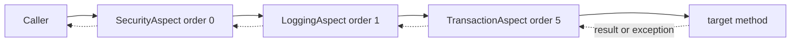

# Advice types, pointcut expressions and aspect order

> **Before this lesson:** you have written an `@Around` aspect and understand that Spring applies it through a proxy ([How Spring AOP works: proxies and your first aspect](#/lesson/spring/spring-aop-proxies)).

## In plain words

Airport security is a sequence of checkpoints around one event, boarding the plane. One desk only checks your ticket *before* you go in. One officer only acts *when something goes wrong*. One counter only stamps the passports of those who *arrived successfully*. And the gate agent stands *around* the whole thing: decides whether you board at all, and notes when you have boarded. Which travellers pass which checkpoint is written on signs: "all international flights", "only passengers marked for inspection". When several checkpoints exist, their order is fixed.

Spring AOP has the same three ingredients. **Advice types** say *when* relative to the method the extra code runs. **Pointcut expressions** are the signs that say *which methods*. **Aspect order** fixes who is outermost when several aspects wrap one method. This lesson covers all three, then models the complete chain so that you can predict any call log, a skill that pays off directly when you debug why a transaction or security check did not behave as expected.

## The five advice types

| Annotation | Runs | Can stop the call? | Can change the result? | Typical use |
|---|---|---|---|---|
| `@Before` | before the method | only by throwing an exception | no | checks, logging the start |
| `@AfterReturning` | after a normal return | no | no (it can read it) | auditing successful results |
| `@AfterThrowing` | after the method threw | no (the exception continues) | no | error reporting |
| `@After` | after the method, whatever happened | no | no | clean-up; like `finally` |
| `@Around` | before and after; it invokes the method itself | yes, by not calling `proceed()` | yes | timing, transactions, retries, caching |

`@Around` can do everything the other four do. The specialised ones are still worth using: they are shorter, they cannot forget `proceed()`, and their name tells the reader what the advice is for. A sensible rule: pick the weakest advice type that does the job.

One aspect showing all five on the same pointcut:

```java
// src/main/java/com/bookshop/aspects/AuditAspect.java
package com.bookshop.aspects;

import org.aspectj.lang.JoinPoint;
import org.aspectj.lang.ProceedingJoinPoint;
import org.aspectj.lang.annotation.*;
import org.springframework.stereotype.Component;

@Aspect
@Component
public class AuditAspect {

    @Pointcut("execution(* com.bookshop.order.OrderService.*(..))")
    void orderServiceMethods() { }                            // a named, reusable pointcut

    @Around("orderServiceMethods()")
    public Object around(ProceedingJoinPoint jp) throws Throwable {
        System.out.println("around: before proceed");
        Object result = jp.proceed();
        System.out.println("around: after proceed");          // skipped if proceed() throws
        return result;
    }

    @Before("orderServiceMethods()")
    public void before(JoinPoint jp) {
        System.out.println("before: " + jp.getSignature().getName());
    }

    @AfterReturning(pointcut = "orderServiceMethods()", returning = "result")
    public void afterReturning(Object result) {
        System.out.println("afterReturning: " + result);
    }

    @AfterThrowing(pointcut = "orderServiceMethods()", throwing = "error")
    public void afterThrowing(RuntimeException error) {
        System.out.println("afterThrowing: " + error.getMessage());
    }

    @After("orderServiceMethods()")
    public void after() {
        System.out.println("after (finally)");
    }
}
```

New elements:

- `@Pointcut` on an empty method gives an expression a name. Advice then refers to it as `orderServiceMethods()`, so the expression is written once.
- `JoinPoint` (without "Proceeding") is the read-only description of the call available to non-around advice.
- `returning = "result"` binds the method's return value to the advice parameter named `result`.
- `throwing = "error"` binds the exception. The parameter's **type also filters**: this advice runs only for `RuntimeException` and its subclasses.

Output for a call that succeeds, and for one that throws:

```text
around: before proceed
before: placeOrder
    [target] placing order
afterReturning: order-42
after (finally)
around: after proceed
```

```text
around: before proceed
before: cancelOrder
    [target] cancelling
afterThrowing: order already shipped
after (finally)
```

Within **one** aspect the order is fixed (since Spring Framework 5.2.7): `@Around` (first half), `@Before`, the method, then `@AfterReturning` or `@AfterThrowing`, then `@After`, then `@Around` (second half). In the failing case the second half of the around advice does not run, because `proceed()` threw and this advice has no `try`/`finally`.

> [!NOTE]
> `@After` runs in both cases, `@AfterReturning` only on success, `@AfterThrowing` only on failure. None of the three can stop an exception from reaching the caller. Only `@Around` can catch it and return something else.

## What around advice can change

```java
@Around("execution(* com.bookshop.catalogue.CatalogueService.search(String))")
public Object normalise(ProceedingJoinPoint jp) throws Throwable {
    String query = (String) jp.getArgs()[0];
    Object[] cleaned = { query.trim().toLowerCase() };     // 1. replace the arguments
    try {
        Object result = jp.proceed(cleaned);               // 2. call the target with them
        return result == null ? List.of() : result;        // 3. replace the return value
    } catch (IllegalStateException e) {
        return List.of();                                  // 4. turn an exception into a result
    }
}
```

That power is exactly why around advice should stay technical. Altering arguments and results behind the back of both caller and target is easy to write and very hard for the next developer to discover.

## Pointcut expressions

The most used designator is `execution`. Its shape:

```text
execution( [modifiers]  return-type  [declaring-type.]method-name(parameters)  [throws] )
```

The parts in square brackets are optional. Wildcards:

| Symbol | Meaning |
|---|---|
| `*` | any one item: any return type, or any characters within one name |
| `..` in a type pattern | this package and all sub-packages |
| `..` in the parameter list | any number of parameters (including none) of any type |

Examples, from broad to narrow:

| Expression | Selects |
|---|---|
| `execution(* com.bookshop..*.*(..))` | every method of every class in `com.bookshop` and below |
| `execution(* com.bookshop.order.*.*(..))` | every method of classes directly in `com.bookshop.order` |
| `execution(* com.bookshop..*Service.*(..))` | every method of classes whose name ends in `Service` |
| `execution(* com.bookshop.order.OrderService.place*(..))` | methods of `OrderService` starting with `place` |
| `execution(void com.bookshop..*.save*(..))` | `void` methods starting with `save` |
| `execution(* com.bookshop..*.*())` | methods without parameters |
| `execution(* com.bookshop..*.*(String, ..))` | methods whose first parameter is a `String` |
| `execution(* com.bookshop..*.*(*))` | methods with exactly one parameter |

Other designators:

| Designator | Selects methods… | Example |
|---|---|---|
| `within(type-pattern)` | of the matching classes | `within(com.bookshop.order..*)` |
| `@annotation(Type)` | that carry the annotation | `@annotation(com.bookshop.aspects.Audited)` |
| `@within(Type)` | of classes that carry the annotation | `@within(org.springframework.stereotype.Service)` |
| `bean(name-pattern)` | of beans with a matching name (Spring only) | `bean(*Service)` |
| `args(types)` | whose run-time arguments have the types | `args(String, ..)` |

Combine them with `&&`, `||` and `!`:

```java
@Pointcut("within(com.bookshop..*) && @within(org.springframework.stereotype.Service)")
void anyService() { }

@Pointcut("anyService() && !execution(* get*(..))")
void serviceMethodsExceptGetters() { }
```

The matcher below implements the `execution` subset used in the table. Type in your own expressions to build intuition before you rely on them in a real project.

```python-run
import re

def glob(pattern):
    out, i = "", 0
    while i < len(pattern):
        if pattern.startswith("..", i):
            out += r"\.(?:\w+\.)*"; i += 2          # a dot plus zero or more whole segments
        elif pattern[i] == "*":
            out += r"\w*"; i += 1                   # any characters inside one name
        else:
            out += re.escape(pattern[i]); i += 1
    return re.compile(out + r"\Z")

def params_match(wanted, actual):
    if not wanted:
        return not actual
    if wanted[0] == "..":
        return any(params_match(wanted[1:], actual[k:]) for k in range(len(actual) + 1))
    return bool(actual) and wanted[0] in ("*", actual[0]) and params_match(wanted[1:], actual[1:])

def matches(expression, method):
    ret, target, params = re.match(r"execution\((\S+)\s+([^\s(]+)\((.*)\)\)", expression).groups()
    type_pattern, _, name_pattern = target.rpartition(".")
    wanted = [p.strip() for p in params.split(",")] if params.strip() else []
    return bool(glob(ret).match(method["ret"]) and glob(type_pattern).match(method["cls"])
                and glob(name_pattern).match(method["name"]) and params_match(wanted, method["params"]))

METHODS = [
    {"ret": "String", "cls": "com.bookshop.order.OrderService", "name": "placeOrder", "params": ["String", "int"]},
    {"ret": "void",   "cls": "com.bookshop.order.OrderService", "name": "cancelOrder", "params": ["long"]},
    {"ret": "List",   "cls": "com.bookshop.catalogue.search.SearchService", "name": "search", "params": ["String"]},
    {"ret": "Clock",  "cls": "com.bookshop.config.ClockConfig", "name": "clock", "params": []},
]

for expression in ["execution(* com.bookshop..*.*(..))",
                   "execution(* com.bookshop.order.*.*(..))",
                   "execution(* com.bookshop..*Service.*(String, ..))",
                   "execution(void com.bookshop..*.*(*))"]:
    hits = [m["cls"].split(".")[-1] + "." + m["name"] for m in METHODS if matches(expression, m)]
    print(expression, "\n    ->", hits)
```

The practice problem [Match execution() pointcut expressions](#/problem/spring-pointcut-match) asks you to write this matcher.

## The cleanest pointcut: your own annotation

String patterns over package names break when somebody moves a class, and nothing at the method tells the reader that an aspect applies. A custom annotation solves both.

```java
// src/main/java/com/bookshop/aspects/Audited.java
package com.bookshop.aspects;

import java.lang.annotation.*;

@Retention(RetentionPolicy.RUNTIME)       // keep the annotation in the running program
@Target(ElementType.METHOD)               // allowed on methods
public @interface Audited {
    String value() default "";
}
```

`@Retention(RetentionPolicy.RUNTIME)` is essential. Without it the compiler discards the annotation and Spring can never see it.

```java
@Service
public class OrderService {

    @Audited("order placed")
    public String placeOrder(String isbn, int quantity) { ... }

    public void cancelOrder(long id) { ... }               // not audited
}
```

```java
@Aspect
@Component
public class AuditTrailAspect {

    private final AuditLog auditLog;

    public AuditTrailAspect(AuditLog auditLog) {            // aspects are beans: injection works
        this.auditLog = auditLog;
    }

    @AfterReturning(pointcut = "@annotation(audited)", returning = "result")
    public void record(JoinPoint jp, Audited audited, Object result) {
        auditLog.write(audited.value(), jp.getSignature().getName(), result);
    }
}
```

`@annotation(audited)` with a lower-case name refers to the advice parameter `audited`; Spring takes the annotation type from the parameter's type and passes in the actual annotation instance, so the advice can read `audited.value()`. This is how `@Transactional`, `@Cacheable` and `@PreAuthorize` are wired internally: an annotation as marker, an aspect that looks for it.

> [!TIP]
> Prefer annotation-based pointcuts for behaviour a developer should be aware of at the method (auditing, retrying, caching). Use package-based `execution` pointcuts for blanket technical concerns such as timing every service.

## Several aspects on one method: the chain

When more than one aspect matches a method, the proxy holds a chain. Think of nested boxes: the outermost aspect is entered first and left last.



Without instructions the order between different aspects is **undefined**: it can differ between runs or Spring versions. Fix it with `@Order`:

```java
@Aspect
@Component
@Order(1)                    // lower number = higher precedence = further OUT
public class LoggingAspect { ... }

@Aspect
@Component
@Order(2)
public class RetryAspect { ... }
```

Lower numbers wrap higher numbers. On the way in the lowest number runs first; on the way out it runs last.

Order changes behaviour, not only log lines. Consider logging and security. With security outermost, a refused call never reaches the logging aspect, so refused attempts are not logged. With logging outermost, every attempt is logged, including refused ones. Or consider retry and transaction: retry must be outside the transaction so that each attempt gets a fresh transaction; the other way round, the retry would repeat work inside a transaction already marked for rollback.

The simulation builds the nested chain for real and prints the call log. It handles both outcomes and an around advice that catches the exception.

```python-run
def build_chain(aspects, target):
    """Aspects sorted by order: the lowest order becomes the outermost wrapper."""
    call = target
    for aspect in sorted(aspects, key=lambda a: a["order"], reverse=True):   # wrap innermost first
        call = wrap(aspect, call)
    return call

def wrap(aspect, inner):
    name, advices = aspect["name"], aspect["advices"]
    def invoke(log):
        if "around" in advices:
            log.append(f"{name}: around-before")
        if "before" in advices:
            log.append(f"{name}: before")
        try:
            result = inner(log)
            if "afterReturning" in advices:
                log.append(f"{name}: afterReturning")
        except RuntimeError:
            if "afterThrowing" in advices:
                log.append(f"{name}: afterThrowing")
            if "after" in advices:
                log.append(f"{name}: after")
            if "around" in advices and aspect.get("catches"):
                log.append(f"{name}: around caught the exception, returns fallback")
                return "fallback"
            raise
        if "after" in advices:
            log.append(f"{name}: after")
        if "around" in advices:
            log.append(f"{name}: around-after")
        return result
    return invoke

def target_ok(log):
    log.append("TARGET: returns"); return "order-42"

def target_fails(log):
    log.append("TARGET: throws"); raise RuntimeError("out of stock")

ASPECTS = [
    {"name": "logging",  "order": 1, "advices": ["around", "after"]},
    {"name": "security", "order": 0, "advices": ["before"]},
    {"name": "tx",       "order": 5, "advices": ["around", "afterThrowing"]},
    {"name": "fallback", "order": 3, "advices": ["around"], "catches": True},
]

for title, target in [("SUCCESS", target_ok), ("FAILURE", target_fails)]:
    log = []
    try:
        outcome = build_chain(ASPECTS, target)(log)
    except RuntimeError as error:
        outcome = f"exception: {error}"
    print(title, "->", outcome)
    print("   " + "\n   ".join(log))
```

Study the FAILURE log. The exception leaves `tx` (order 5), which logs `afterThrowing`. It reaches `fallback` (order 3), whose around advice catches it and returns a fallback. From there outwards the call looks successful: `logging` prints its `after` and its `around-after` as if nothing had happened, and the caller receives `fallback`. An aspect placed outside a catching aspect never learns about the failure. Change the `order` values and predict the new log before running; the practice problem [AOP advice ordering: build the call log](#/problem/spring-advice-order) grades the same skill.

> [!INTERVIEW]
> "Two aspects apply to the same method. In which order do they run?" Undefined unless you declare it with `@Order` or by implementing `Ordered`. The lower order value has higher precedence: its before-part runs first and its after-part runs last, wrapping the others. Follow with an example where it matters: retry outside transaction, or security outside logging.

## Pitfalls

- **Relying on undeclared order.** It works on your machine and flips in production. Add `@Order` whenever two aspects can meet.
- **`@Order` on advice methods.** The annotation belongs on the aspect class. Advice methods of one aspect follow the fixed type order, and two advice methods of the same type in one aspect have no defined order; split them into separate aspects.
- **An annotation without runtime retention.** `@annotation(...)` never matches.
- **A pointcut that matches the aspect itself or infrastructure beans.** `execution(* *(..))` advises everything and can loop or break start-up. Always restrict with `within(com.yourcompany..*)`.
- **Wrong parameter binding names.** `returning = "result"` must equal the advice parameter name exactly, otherwise start-up fails with an "unbound pointcut parameter" style error.
- **Typed `returning`/`throwing` parameters filter silently.** `afterReturning(String result)` runs only when the method returns a `String`.
- **`@AfterThrowing` expected to swallow exceptions.** It cannot. Use `@Around` with try/catch.
- **Annotation on an interface method with class-based proxies.** `@annotation` looks at the method being executed on the target class; put custom annotations on the implementing method.

## Cheat sheet

| Annotation / element | Meaning |
|---|---|
| `@Before("pc")` | run before the method |
| `@AfterReturning(pointcut = "pc", returning = "r")` | run after normal return; `r` receives the value |
| `@AfterThrowing(pointcut = "pc", throwing = "e")` | run after an exception; `e` receives it |
| `@After("pc")` | run afterwards in all cases |
| `@Around("pc")` | wrap the call; must call `proceed()` and return the result |
| `@Pointcut("expr")` on an empty method | name an expression for reuse |
| `execution(ret type.method(params))` | select by signature pattern |
| `within(pkg..*)` | select by class location |
| `@annotation(A)` / `@within(A)` | select by annotation on method / class |
| `bean(name*)` | select by bean name |
| `&&`, `\|\|`, `!` | combine pointcuts |
| `@Order(n)` on the aspect | lower `n` = outer position in the chain |

## Summary

- Five advice types say when code runs: before, after returning, after throwing, after (finally), around.
- Use the weakest type that works; only `@Around` can stop the call, replace arguments or results, or catch exceptions.
- Pointcut expressions select methods by signature (`execution`), location (`within`), annotation (`@annotation`, `@within`) or bean name, and can be combined.
- A custom runtime annotation plus `@annotation` is the most readable and robust pointcut.
- Several aspects form a nested chain. Declare the nesting with `@Order`; lower values are further out.
- An exception caught by an inner around advice is invisible to outer aspects.

## Glossary

- **Advice chain**: the ordered list of advice a proxy runs around a method.
- **`@After` advice**: advice running after the method regardless of outcome.
- **Designator**: the keyword of a pointcut expression (`execution`, `within`, `@annotation`, …).
- **`JoinPoint`**: read-only description of the intercepted call.
- **Named pointcut**: a pointcut expression declared once with `@Pointcut` and referenced by name.
- **Precedence**: an aspect's position in the chain; higher precedence means further out.
- **`ProceedingJoinPoint`**: the join point type for around advice, with `proceed()`.
- **Retention**: how long an annotation survives; `RUNTIME` is needed for Spring to read it.

```quiz
[
  {"q": "Which advice type can prevent the target method from running without throwing an exception?",
   "options": ["@Before", "@After", "@Around", "@AfterReturning"],
   "answer": 2,
   "explain": "Only around advice controls the invocation: if it does not call proceed(), the target never runs."},
  {"q": "The target throws a RuntimeException. Which advice of the same aspect runs: @AfterReturning, @AfterThrowing, @After?",
   "options": ["All three", "@AfterThrowing and @After", "Only @After", "Only @AfterThrowing"],
   "answer": 1,
   "explain": "@AfterReturning is for normal returns only. @AfterThrowing handles the failure and @After runs in every case."},
  {"q": "What does execution(* com.bookshop.order.*.*(..)) select?",
   "options": ["All methods in com.bookshop.order and all its sub-packages", "All methods of classes directly in com.bookshop.order", "Only methods named order", "Only methods without parameters"],
   "answer": 1,
   "explain": "A single dot before the class wildcard means exactly that package. Sub-packages need the double dot: com.bookshop.order..*.*(..)."},
  {"q": "Aspect A has @Order(1) and aspect B has @Order(2). Both have around advice on the same method. What is the sequence?",
   "options": ["A before, B before, method, B after, A after", "B before, A before, method, A after, B after", "A before, B before, method, A after, B after", "Undefined"],
   "answer": 0,
   "explain": "The lower order value is the outer wrapper: entered first and exited last."},
  {"q": "Why must a custom marker annotation used with @annotation(...) have RetentionPolicy.RUNTIME?",
   "options": ["Otherwise it cannot be placed on methods", "Otherwise it is discarded at compile time and Spring cannot see it while the program runs", "Otherwise the project does not compile", "It makes the aspect faster"],
   "answer": 1,
   "explain": "Spring inspects annotations through reflection at run time. The default retention does not keep them available."},
  {"q": "In the chain simulation, the fallback aspect catches the exception. What do aspects further out observe?",
   "options": ["The original exception", "A normal return", "Nothing; they are skipped", "A different exception"],
   "answer": 1,
   "explain": "Once an around advice catches the exception and returns a value, the call looks successful to everything outside it."},
  {"q": "What can an @AfterThrowing advice do with the exception?",
   "options": ["Suppress it so the caller gets null", "Observe it; the exception still propagates to the caller", "Replace the return value", "Retry the method"],
   "answer": 1,
   "explain": "After-throwing advice is for reacting, such as logging or alerting. Suppressing or retrying requires around advice."}
]
```

> **Source:** Spilcă, *Spring Start Here*, ch. 6 (advice annotations, altering parameters and return values, the aspect execution chain). Documentation: https://docs.spring.io/spring-framework/reference/core/aop/ataspectj/advice.html and https://docs.spring.io/spring-framework/reference/core/aop/ataspectj/pointcuts.html
