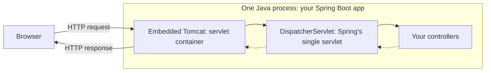
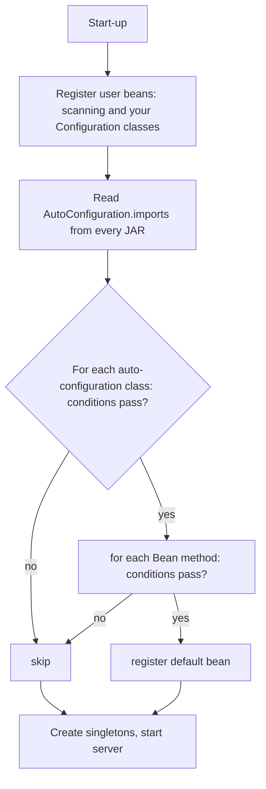

# Spring Boot: starters and auto-configuration

> **Before this lesson:** you can define beans with `@Bean` and with stereotype annotations, and you generated a Boot project once ([The Spring ecosystem and your first project](#/lesson/spring/spring-ecosystem-first-project)). You know what a web server does in outline; the essentials are repeated below.

## In plain words

Moving into an unfurnished flat means buying and assembling everything: bed, fridge, lamps, curtains, cables. A serviced apartment is different. You arrive with a suitcase and it already contains what a typical tenant needs. And it is polite about it: if you bring your own desk lamp, the apartment's lamp is not forced on you.

Plain Spring is the unfurnished flat: powerful, but you configure every piece. **Spring Boot** is the serviced apartment. Three ideas make it work:

- **Starters**: one dependency that brings a complete, compatible set of libraries for a purpose.
- **Auto-configuration**: Boot looks at which libraries are present and which beans you defined, and registers sensible default beans for everything else.
- **An embedded server**: the web server is a library inside your program, so the application is one runnable file.

"How does Spring Boot auto-configuration work?" is one of the most common Spring interview questions. After this lesson you will be able to answer it and, more usefully, to find out why a bean did or did not appear in your application.

## What a web application needs

A **web application** has two sides. The **client** (a browser or a mobile app) sends **HTTP requests**. The **server** side receives each request, runs some code and sends an **HTTP response** back.

A Java program does not understand HTTP by itself. Something must open a network port, read the bytes, parse them into a request object and call your code. That something is a **servlet container** such as Tomcat or Jetty. A **servlet** is a Java object the container hands requests to; the name comes from the Jakarta Servlet specification, the standard contract between containers and web code.



In the old days the container was installed on a machine first and applications were deployed *into* it as WAR files. Boot turns that inside out: the container is a dependency of your application and starts inside `main`.

## Without Boot: what you would write

To serve one page with plain Spring MVC you need, at minimum:

- a dozen dependencies with mutually compatible versions (Spring MVC, a servlet container, a JSON library, logging, validation);
- code that creates the servlet container and registers Spring's `DispatcherServlet` with it;
- a configuration class with `@EnableWebMvc`;
- bean definitions for a view resolver, message converters and so on;
- a packaging set-up.

None of it is hard, but all of it is the same in every project. Boot's motto for this is **convention over configuration**: follow the usual conventions and you configure nothing; deviate where you need to and configure only the deviation.

## Starters

A starter is a dependency descriptor with no code: it lists other dependencies.

```xml
<dependency>
    <groupId>org.springframework.boot</groupId>
    <artifactId>spring-boot-starter-web</artifactId>
</dependency>
```

That single entry pulls in Spring MVC, the Jackson JSON library, validation support hooks, logging, and embedded Tomcat, in versions tested together by the Boot team. The parent in your `pom.xml` supplies the version numbers (the bill of materials from the earlier lesson).

Starters matter for a second reason: **what is on the classpath steers auto-configuration**. Adding `spring-boot-starter-data-jpa` does not only download Hibernate; its presence is what makes Boot configure an `EntityManagerFactory`. Adding a starter is a statement of intent.

To swap a default, exclude one piece and add another:

```xml
<dependency>
    <groupId>org.springframework.boot</groupId>
    <artifactId>spring-boot-starter-web</artifactId>
    <exclusions>
        <exclusion>
            <groupId>org.springframework.boot</groupId>
            <artifactId>spring-boot-starter-tomcat</artifactId>
        </exclusion>
    </exclusions>
</dependency>
<dependency>
    <groupId>org.springframework.boot</groupId>
    <artifactId>spring-boot-starter-jetty</artifactId>
</dependency>
```

Boot notices that Jetty is present and Tomcat is not, and configures Jetty. No Java code changes.

## @SpringBootApplication taken apart

```java
// src/main/java/com/bookshop/BookshopApplication.java
package com.bookshop;

import org.springframework.boot.SpringApplication;
import org.springframework.boot.autoconfigure.SpringBootApplication;

@SpringBootApplication
public class BookshopApplication {
    public static void main(String[] args) {
        SpringApplication.run(BookshopApplication.class, args);
    }
}
```

`@SpringBootApplication` is a shortcut for three annotations you could write separately:

| Annotation | Effect |
|---|---|
| `@SpringBootConfiguration` | this class is a `@Configuration` class, so it may contain `@Bean` methods |
| `@ComponentScan` | scan the package of this class and all sub-packages for stereotype annotations |
| `@EnableAutoConfiguration` | switch on auto-configuration |

`SpringApplication.run(...)` then does roughly this:

1. creates the right kind of application context (a web-aware one, because servlet classes are on the classpath);
2. loads configuration properties from `application.properties`, environment variables and command-line arguments;
3. registers **your** beans through component scanning and your configuration classes;
4. applies **auto-configuration** to fill the gaps;
5. creates all singletons;
6. starts the embedded server and waits for requests.

The order of steps 3 and 4 is the heart of the matter: your definitions are known before Boot decides what to add.

## How auto-configuration works

An **auto-configuration class** is an ordinary `@Configuration` class shipped inside a library, with **conditions** attached. A condition is a yes/no test evaluated at start-up; the class or bean method is used only if all its conditions pass.

Here is a simplified version of the kind of class Boot ships for JDBC:

```java
@AutoConfiguration
@ConditionalOnClass(DataSource.class)                    // only if JDBC classes are on the classpath
public class DataSourceAutoConfiguration {

    @Bean
    @ConditionalOnMissingBean                            // only if the application has no DataSource bean
    DataSource dataSource(DataSourceProperties properties) {
        return properties.initializeDataSourceBuilder().build();
    }
}
```

Read the two conditions aloud: "If the application uses JDBC at all, and the developer has not defined a `DataSource` themselves, create a default one from the properties." That sentence is auto-configuration.

The most common conditions:

| Condition | Passes when |
|---|---|
| `@ConditionalOnClass(X.class)` | class `X` is on the classpath |
| `@ConditionalOnMissingClass("x.Y")` | class `x.Y` is not on the classpath |
| `@ConditionalOnBean(X.class)` | a bean of type `X` is already defined |
| `@ConditionalOnMissingBean(X.class)` | no bean of type `X` is defined (on a `@Bean` method the type defaults to the return type) |
| `@ConditionalOnProperty(name = "k", havingValue = "v")` | property `k` has value `v` |
| `@ConditionalOnWebApplication` | the application is a web application |
| `@Profile("x")` | profile `x` is active |

How does Boot find these classes? Every JAR that offers auto-configuration contains a text file named

```text
META-INF/spring/org.springframework.boot.autoconfigure.AutoConfiguration.imports
```

listing its auto-configuration class names, one per line. `@EnableAutoConfiguration` reads that file from every JAR on the classpath, which yields around 150 candidate classes in a typical application, and evaluates their conditions. Most fail their `@ConditionalOnClass` test immediately and cost almost nothing.



> [!INTERVIEW]
> "How does auto-configuration work?" `@SpringBootApplication` includes `@EnableAutoConfiguration`. It loads the auto-configuration classes listed in each JAR's `META-INF/spring/…AutoConfiguration.imports` file. Each is a normal configuration class guarded by `@Conditional…` annotations: on-class (library present), on-missing-bean (the user did not define one), on-property. They are processed after user configuration, so user beans win and Boot "backs off". Mention `--debug` and the conditions report as the way to inspect it.

## A model you can run

The simulation evaluates a handful of auto-configurations in order against a classpath, the user's beans and properties, then prints a report like Boot's own.

```python-run
AUTO_CONFIGS = [
    {"name": "DataSourceAutoConfiguration", "bean": "dataSource",
     "conditions": [("onClass", "javax.sql.DataSource"), ("onMissingBean", "dataSource")]},
    {"name": "JdbcTemplateAutoConfiguration", "bean": "jdbcTemplate",
     "conditions": [("onClass", "org.springframework.jdbc.core.JdbcTemplate"), ("onBean", "dataSource"),
                    ("onMissingBean", "jdbcTemplate")]},
    {"name": "JacksonAutoConfiguration", "bean": "objectMapper",
     "conditions": [("onClass", "com.fasterxml.jackson.databind.ObjectMapper"), ("onMissingBean", "objectMapper")]},
    {"name": "MongoAutoConfiguration", "bean": "mongoClient",
     "conditions": [("onClass", "com.mongodb.client.MongoClient")]},
    {"name": "TaskSchedulingAutoConfiguration", "bean": "taskScheduler",
     "conditions": [("onProperty", "shop.scheduling.enabled", "true")]},
]

def evaluate(classpath, user_beans, properties):
    beans = list(user_beans)                       # user configuration is processed first
    for config in AUTO_CONFIGS:
        failed = None
        for kind, *args in config["conditions"]:
            ok = {"onClass":       lambda: args[0] in classpath,
                  "onBean":        lambda: args[0] in beans,
                  "onMissingBean": lambda: args[0] not in beans,
                  "onProperty":    lambda: properties.get(args[0]) == args[1]}[kind]()
            if not ok:
                failed = f"{kind} {args[0]}"
                break
        if failed:
            print(f"  did not match: {config['name']:32} ({failed})")
        else:
            beans.append(config["bean"])
            print(f"  matched:       {config['name']:32} -> bean '{config['bean']}'")
    return beans

CLASSPATH = {"javax.sql.DataSource", "org.springframework.jdbc.core.JdbcTemplate",
             "com.fasterxml.jackson.databind.ObjectMapper"}

print("1) no user beans:")
print("  beans:", evaluate(CLASSPATH, [], {}))
print("2) the developer defines an objectMapper and a dataSource:")
print("  beans:", evaluate(CLASSPATH, ["objectMapper", "dataSource"], {"shop.scheduling.enabled": "true"}))
```

Points to take from the output:

- In run 1, `JdbcTemplateAutoConfiguration` passes its `onBean dataSource` condition thanks to the bean that the *previous auto-configuration* added. Conditions see the registry as it grows, so order matters. Real Boot orders these classes explicitly with `@AutoConfigureAfter`.
- In run 2, the two user beans make the corresponding auto-configurations **back off**, while `jdbcTemplate` is still auto-configured, now on top of the user's `dataSource`.
- Mongo is never configured because its driver class is absent. Add it to `CLASSPATH` and run again.

The practice problem [Auto-configuration: evaluate the conditions](#/problem/spring-conditional-autoconfig) asks you to implement this evaluator with the exact semantics of `@ConditionalOnProperty`.

## Overriding a default

There are three levels of customisation. Always try them in this order.

**1. Set a property.** Most auto-configured beans read their settings from properties.

```properties
# src/main/resources/application.properties
server.port=9090
spring.jackson.serialization.indent-output=true
spring.datasource.url=jdbc:postgresql://localhost:5432/bookshop
```

**2. Define your own bean.** Thanks to `@ConditionalOnMissingBean`, your bean replaces the default.

```java
// src/main/java/com/bookshop/config/ClockConfig.java
@Configuration
public class ClockConfig {

    @Bean
    Clock clock() {
        return Clock.system(ZoneId.of("Europe/Madrid"));
    }
}
```

**3. Exclude an auto-configuration entirely.**

```java
@SpringBootApplication(exclude = DataSourceAutoConfiguration.class)
public class BookshopApplication { }
```

> [!TIP]
> Many auto-configurations offer a *customizer* interface for small adjustments, so that you do not have to replace a whole bean. For example a `Jackson2ObjectMapperBuilderCustomizer` bean tweaks the JSON mapper while keeping all of Boot's defaults. Replacing the `ObjectMapper` bean outright silently drops those defaults.

## Seeing what Boot decided

Start the application with `--debug` (or the property `debug=true`) and Boot prints the **conditions evaluation report**:

```bash
java -jar target/bookshop-0.1.0.jar --debug
```

```text
============================
CONDITIONS EVALUATION REPORT
============================

Positive matches:
-----------------
   JacksonAutoConfiguration matched:
      - @ConditionalOnClass found required class 'com.fasterxml.jackson.databind.ObjectMapper' (OnClassCondition)

Negative matches:
-----------------
   DataSourceAutoConfiguration:
      Did not match:
         - @ConditionalOnClass did not find required class 'org.springframework.jdbc.datasource.embedded.EmbeddedDatabaseType' (OnClassCondition)
```

This report answers both everyday questions: "why is this bean here?" and "why is this bean not here?". The Actuator endpoint `/actuator/conditions` shows the same information for a running application.

## Writing your own conditional bean

The conditions are available to application code too. A typical use: a feature that can be switched off.

```java
// src/main/java/com/bookshop/notify/NotifierConfig.java
@Configuration
public class NotifierConfig {

    @Bean
    @ConditionalOnProperty(name = "shop.notifications.channel", havingValue = "sms")
    Notifier smsNotifier() {
        return new SmsNotifier();
    }

    @Bean
    @ConditionalOnMissingBean(Notifier.class)          // fallback when nothing else was configured
    Notifier consoleNotifier() {
        return (customer, message) -> System.out.println("[console] " + customer + ": " + message);
    }
}
```

With `shop.notifications.channel=sms` the SMS bean exists and the fallback backs off. Without the property only the console notifier is registered.

The semantics of `@ConditionalOnProperty` are worth knowing exactly:

| Declaration | Property absent | Property `false` | Property any other value |
|---|---|---|---|
| `name = "k"` | no match | no match | match |
| `name = "k", matchIfMissing = true` | match | no match | match |
| `name = "k", havingValue = "v"` | no match | no match | match only if the value equals `v` (ignoring case) |

> [!WARNING]
> `@ConditionalOnMissingBean` and `@ConditionalOnBean` depend on the order in which bean definitions are processed. Inside auto-configuration classes that order is controlled. In your own `@Configuration` classes it is not guaranteed, so a fallback bean may be evaluated before the bean it should yield to. Use these two conditions in application code sparingly, and prefer `@ConditionalOnProperty` or profiles there.

## The embedded server and its settings

Settings that would live in a server's own configuration files are ordinary properties:

```properties
server.port=8080
server.servlet.context-path=/shop
server.tomcat.threads.max=200
server.shutdown=graceful
spring.lifecycle.timeout-per-shutdown-phase=20s
```

`server.shutdown=graceful` makes the server stop accepting new requests on shutdown while letting running ones finish, within the timeout. `server.port=0` picks a random free port, which tests use to avoid clashes.

## Pitfalls

- **Main class in the wrong package.** Component scanning starts at the main class's package. Classes outside it are not found.
- **Defining a bean without knowing it replaces a default.** Your own `ObjectMapper`, `DataSource` or `SecurityFilterChain` bean switches the corresponding auto-configuration off, including conveniences you may have relied on.
- **A starter added "to be safe".** `spring-boot-starter-security` on the classpath secures every endpoint immediately; `spring-boot-starter-data-jpa` without a database URL stops start-up with "Failed to configure a DataSource".
- **Pinned versions.** A `<version>` on a Boot-managed dependency can break the tested combination.
- **Conditions in user configuration that depend on bean order.** See the warning above.
- **Old registration file.** Before Boot 2.7, auto-configurations were listed in `META-INF/spring.factories`. Boot 3 no longer reads auto-configurations from there. Old blog posts and old libraries still mention it.
- **Assuming magic.** Every auto-configured bean comes from a readable class. Open it in your editor (search for `…AutoConfiguration`) before guessing.

## Cheat sheet

| Annotation / item | Meaning |
|---|---|
| `@SpringBootApplication` | `@SpringBootConfiguration` + `@ComponentScan` + `@EnableAutoConfiguration` |
| `SpringApplication.run(App.class, args)` | create context, apply configuration, start server |
| `spring-boot-starter-*` | curated dependency set that also triggers matching auto-configuration |
| `@AutoConfiguration` | marks a library's auto-configuration class |
| `@ConditionalOnClass` / `OnMissingClass` | depends on the classpath |
| `@ConditionalOnBean` / `OnMissingBean` | depends on beans defined so far |
| `@ConditionalOnProperty` | depends on a configuration property |
| `META-INF/spring/…AutoConfiguration.imports` | file listing a JAR's auto-configuration classes |
| `--debug` | print the conditions evaluation report |
| `exclude = X.class` | switch one auto-configuration off |
| `server.port`, `server.shutdown` | embedded server settings |

## Summary

- Spring Boot removes repetitive set-up through starters, auto-configuration and an embedded server.
- A starter is a curated dependency list; what it puts on the classpath steers auto-configuration.
- `@SpringBootApplication` combines configuration, component scanning from the main class's package, and auto-configuration.
- Auto-configuration classes are normal configuration classes with conditions, discovered through an imports file in each JAR and applied after your own beans.
- Because of `@ConditionalOnMissingBean`, defining your own bean makes Boot's default back off.
- Customise with properties first, your own bean second, exclusion last; inspect decisions with `--debug`.

## Glossary

- **Auto-configuration**: conditional bean definitions shipped with libraries and applied automatically.
- **Back off**: an auto-configuration declining to create a bean because the application defined one.
- **Condition**: a start-up test deciding whether a configuration class or bean method is used.
- **Conditions evaluation report**: Boot's listing of which auto-configurations matched and why.
- **Convention over configuration**: sensible defaults that need configuration only for deviations.
- **Embedded server**: a servlet container running inside the application process.
- **Servlet**: a Java object that handles HTTP requests inside a servlet container.
- **Servlet container**: software (Tomcat, Jetty) that translates HTTP into calls on servlets.
- **Starter**: a Boot dependency bundling libraries for one capability.

```quiz
[
  {"q": "Which three annotations does @SpringBootApplication combine?",
   "options": ["@Component, @Service, @Repository", "@SpringBootConfiguration, @ComponentScan, @EnableAutoConfiguration", "@Configuration, @Bean, @Autowired", "@EnableWebMvc, @Controller, @RequestMapping"],
   "answer": 1,
   "explain": "It marks a configuration class, scans from that class's package, and enables auto-configuration."},
  {"q": "An application defines its own @Bean ObjectMapper. What does Boot's Jackson auto-configuration do for that bean?",
   "options": ["Fails with a duplicate bean error", "Creates a second ObjectMapper and marks it primary", "Backs off because of @ConditionalOnMissingBean", "Overwrites the user's bean"],
   "answer": 2,
   "explain": "Auto-configuration is evaluated after user configuration and its default bean is conditional on none being present."},
  {"q": "How does Boot 3 discover auto-configuration classes?",
   "options": ["By scanning every class on the classpath for @Configuration", "From META-INF/spring/org.springframework.boot.autoconfigure.AutoConfiguration.imports files in the JARs", "From application.properties", "From the pom.xml"],
   "answer": 1,
   "explain": "Each library lists its auto-configuration classes in that imports file; @EnableAutoConfiguration loads and filters them."},
  {"q": "A bean method is annotated @ConditionalOnProperty(name = \"shop.cache.enabled\") and the property is not set anywhere. Is the bean created?",
   "options": ["Yes", "No", "Only in the dev profile", "Start-up fails"],
   "answer": 1,
   "explain": "Without matchIfMissing = true, an absent property means the condition does not match."},
  {"q": "What is the quickest way to learn why an expected auto-configured bean is missing?",
   "options": ["Reinstall the dependencies", "Start with --debug and read the conditions evaluation report", "Add @Primary to all beans", "Delete application.properties"],
   "answer": 1,
   "explain": "The report lists each auto-configuration with the condition that matched or failed."},
  {"q": "In the simulation, why is jdbcTemplate auto-configured even when no user bean named dataSource exists?",
   "options": ["onBean conditions are ignored", "The DataSource auto-configuration ran earlier and registered dataSource, so the condition sees it", "jdbcTemplate needs no DataSource", "It is a bug in the model"],
   "answer": 1,
   "explain": "Conditions are evaluated against the registry as it grows, which is why the order of auto-configurations matters."},
  {"q": "What makes a Spring Boot web application runnable with a plain java -jar command?",
   "options": ["An application server must be installed first", "The servlet container is embedded as a library and started by SpringApplication.run", "The JDK contains Tomcat", "The operating system provides HTTP"],
   "answer": 1,
   "explain": "The embedded server is part of the fat JAR and starts inside the application's own process."}
]
```

> **Source:** Spilcă, *Spring Start Here*, ch. 7 (what a web app is; the magic of Spring Boot). Documentation: https://docs.spring.io/spring-boot/reference/using/auto-configuration.html and https://docs.spring.io/spring-boot/reference/features/developing-auto-configuration.html
