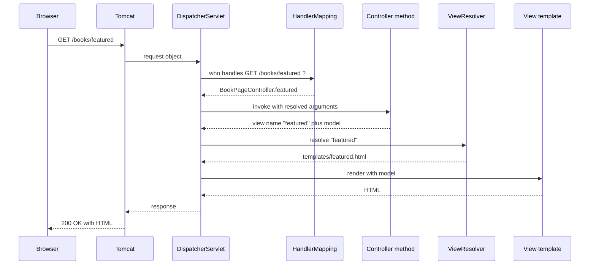
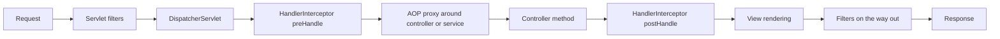

# Spring MVC: the request flow through DispatcherServlet

> **Before this lesson:** you have a Spring Boot project with `spring-boot-starter-web` and know that an embedded servlet container receives HTTP requests ([Spring Boot: starters and auto-configuration](#/lesson/spring/spring-boot-autoconfig)). Basic HTML helps; HTTP is explained here as far as needed.

## In plain words

A large office building has one reception desk. Every visitor comes through it. The receptionist looks at who the visitor wants to see, checks the directory, phones the right department and sends the visitor up. When the visitor returns with a document, the receptionist puts it in an envelope and hands it over at the door. Departments never deal with the front door, and the receptionist never does a department's work.

Spring MVC is built the same way. One object, the **`DispatcherServlet`**, is the reception desk for every HTTP request. It consults a directory (the **handler mapping**) to find which of your methods is responsible, calls that method (in a class called a **controller**), and turns whatever the method returns into the HTTP response: an HTML page or JSON.

This lesson follows one request through that pipeline, writes a first controller that returns an HTML page, and builds a small router model. The request flow is the most frequently drawn diagram in Spring interviews, and it is the map you will use whenever a request returns an unexpected 404.

## HTTP in two minutes

An HTTP **request** is a block of text sent by the client:

```text
GET /books/featured?lang=en HTTP/1.1
Host: localhost:8080
Accept: text/html
```

- **Method** (`GET`): what the client wants to do. `GET` reads, `POST` sends data to create something, `PUT` replaces, `DELETE` removes.
- **Path** (`/books/featured`): which resource.
- **Query string** (`?lang=en`): extra parameters as `name=value` pairs.
- **Headers** (`Accept: text/html`): metadata, here "I would like HTML".
- Optionally a **body**: data being sent, for example a filled-in form.

The **response** has a **status code** (200 OK, 404 Not Found, 500 Internal Server Error…), headers, and usually a body:

```text
HTTP/1.1 200 OK
Content-Type: text/html;charset=UTF-8

<html> ... </html>
```

## MVC: three roles

**MVC** stands for model-view-controller, a way of dividing the work of producing a page.

| Role | Job | In Spring |
|---|---|---|
| **Controller** | receives the request, asks the service layer for data, decides which view to show | a class annotated `@Controller` |
| **Model** | the data the page needs, as named values | a `Model` object: a map of attribute names to objects |
| **View** | turns the model into HTML | a template file, for example Thymeleaf |

The controller does not produce HTML, and the view does not fetch data. Each can change without the other.

## The request flow



Step by step:

1. **Tomcat** accepts the connection, parses the HTTP text into a request object and passes it to the one servlet Spring Boot registered for all paths: the `DispatcherServlet`.
2. The **`DispatcherServlet`** asks the **handler mapping**: which method is registered for this HTTP method and path? At start-up the mapping collected every method annotated with `@GetMapping`, `@PostMapping` and so on from all controller beans.
3. The dispatcher prepares the method's arguments (path variables, parameters, a `Model`, the request body) and **invokes the controller method**.
4. The method returns. For a page, the return value is a **view name** and the model is filled.
5. The **view resolver** turns the view name into a real template: `"featured"` becomes `classpath:/templates/featured.html`.
6. The **view** is rendered with the model, producing HTML.
7. The dispatcher writes the status, headers and HTML into the response; Tomcat sends it.

If step 2 finds nothing, the dispatcher answers `404 Not Found` and no controller code runs. If the path exists but not for that HTTP method, the answer is `405 Method Not Allowed`. If your method throws, the dispatcher looks for an exception handler and otherwise answers `500`.

> [!INTERVIEW]
> "Describe the flow of a request in Spring MVC." Servlet container → `DispatcherServlet` (front controller) → `HandlerMapping` finds the handler method → `HandlerAdapter` invokes it, resolving arguments → the method returns a view name plus model (or, for REST, an object) → `ViewResolver` and view render HTML (or an `HttpMessageConverter` writes JSON) → response. Add where filters, interceptors and exception handlers sit if asked to go deeper.

## The first page

### The template

Add the template engine starter:

```xml
<dependency>
    <groupId>org.springframework.boot</groupId>
    <artifactId>spring-boot-starter-thymeleaf</artifactId>
</dependency>
```

**Thymeleaf** is a template engine: it reads an HTML file containing special attributes, fills in values from the model and outputs plain HTML. Boot auto-configures it to look for templates in `src/main/resources/templates`.

```html
<!-- src/main/resources/templates/featured.html -->
<!DOCTYPE html>
<html xmlns:th="http://www.thymeleaf.org">
<head>
    <title>Featured books</title>
</head>
<body>
    <h1 th:text="${shopName}">Shop name goes here</h1>

    <p th:if="${books.isEmpty()}">Nothing featured today.</p>

    <ul>
        <li th:each="book : ${books}">
            <span th:text="${book.title()}">Title</span>
            (<span th:text="${book.priceCents() / 100.0}">0.00</span> EUR)
        </li>
    </ul>
</body>
</html>
```

- `xmlns:th=...` declares the `th:` prefix so that editors accept the attributes.
- `th:text="${shopName}"` replaces the element's text with the model attribute `shopName`. The text between the tags is a placeholder shown when the file is opened directly in a browser.
- `th:if` keeps the element only when the expression is true.
- `th:each="book : ${books}"` repeats the `<li>` once per element of the model attribute `books`.

### The controller

```java
// src/main/java/com/bookshop/catalogue/Book.java
package com.bookshop.catalogue;

public record Book(String isbn, String title, int priceCents) { }
```

```java
// src/main/java/com/bookshop/catalogue/BookPageController.java
package com.bookshop.catalogue;

import org.springframework.stereotype.Controller;
import org.springframework.ui.Model;
import org.springframework.web.bind.annotation.GetMapping;

import java.util.List;

@Controller                                           // (1)
public class BookPageController {

    private final CatalogueService catalogue;

    public BookPageController(CatalogueService catalogue) {   // (2)
        this.catalogue = catalogue;
    }

    @GetMapping("/books/featured")                    // (3)
    public String featured(Model model) {             // (4)
        List<Book> books = catalogue.featuredBooks();
        model.addAttribute("shopName", "The Paper Lantern");   // (5)
        model.addAttribute("books", books);
        return "featured";                            // (6)
    }
}
```

1. `@Controller` is a stereotype annotation: the class becomes a bean, and Spring MVC inspects it for request mappings.
2. A controller is an ordinary bean; the service is injected through the constructor.
3. `@GetMapping("/books/featured")` registers the method for `GET` requests to that path. It is a shorthand for `@RequestMapping(method = RequestMethod.GET, path = "/books/featured")`.
4. Declaring a `Model` parameter is enough for the dispatcher to supply one. You never create it.
5. `addAttribute(name, value)` places a value in the model under a name the template can use.
6. The returned `String` is the **view name**, not text for the browser. The view resolver adds the prefix `templates/` and the suffix `.html`.

```java
// src/main/java/com/bookshop/catalogue/CatalogueService.java
@Service
public class CatalogueService {
    public List<Book> featuredBooks() {
        return List.of(new Book("9780441172719", "Dune", 1250), new Book("9780141439587", "Emma", 800));
    }
}
```

Run the application and open `http://localhost:8080/books/featured`:

```text
The Paper Lantern

 • Dune (12.5 EUR)
 • Emma (8.0 EUR)
```

The layered architecture from [Dependency injection with abstractions and layered design](#/lesson/spring/spring-di-abstractions-layers) is now visible end to end: controller (web), service (business), with a repository to come.

### Static pages

Files that need no processing (plain HTML, CSS, images, JavaScript) go in `src/main/resources/static`. Boot serves them directly: `static/css/shop.css` is available at `/css/shop.css`, and `static/index.html` is the welcome page at `/`. No controller is involved.

## A model of the dispatcher

The following miniature reproduces the pipeline: a registry filled by decorators (the handler mapping), a dispatch function, a view resolver and a tiny template renderer.

```python-run
import re

ROUTES = []                                              # the handler mapping
TEMPLATES = {                                            # stand-in for src/main/resources/templates
    "featured": "<h1>{shopName}</h1><ul>{books}</ul>",
    "error/404": "<h1>404</h1><p>No handler for {path}</p>",
}

def get_mapping(path):                                   # like @GetMapping
    def register(handler):
        ROUTES.append(("GET", path, handler))
        return handler
    return register

def post_mapping(path):                                  # like @PostMapping
    def register(handler):
        ROUTES.append(("POST", path, handler))
        return handler
    return register

# ---------------- controllers (your code) ----------------
@get_mapping("/books/featured")
def featured(model):
    model["shopName"] = "The Paper Lantern"
    model["books"] = "".join(f"<li>{t}</li>" for t in ["Dune", "Emma"])
    return "featured"                                    # a view name

@post_mapping("/cart")
def add_to_cart(model):
    return "redirect:/books/featured"

# ---------------- the framework ----------------
def dispatch(method, path):
    path_known = False
    for route_method, route_path, handler in ROUTES:     # 1. handler mapping
        if route_path != path:
            continue
        path_known = True
        if route_method != method:
            continue
        model = {}
        view_name = handler(model)                       # 2. invoke the controller method
        if view_name.startswith("redirect:"):
            return 302, "Location: " + view_name[len("redirect:"):]
        template = TEMPLATES[view_name]                  # 3. view resolver
        return 200, template.format(**model)             # 4. render the view with the model
    if path_known:
        return 405, "Method Not Allowed"
    return 404, TEMPLATES["error/404"].format(path=path)

for request in [("GET", "/books/featured"), ("POST", "/cart"), ("DELETE", "/cart"), ("GET", "/nope")]:
    print(request, "->", dispatch(*request))
```

Follow one request through `dispatch`:

- the loop over `ROUTES` is the handler mapping;
- `handler(model)` is the invocation with a fresh model;
- `TEMPLATES[view_name]` is view resolution;
- `template.format(**model)` is rendering.

The model also shows the two failure answers: `405` when the path is registered for another method, `404` when the path is unknown. Add a route of your own and request it. The practice problem [Resolve a request to a handler method](#/problem/spring-request-mapping) extends the mapping with path variables and specificity rules.

## More about mappings

```java
@Controller
@RequestMapping("/books")                    // prefix for every method in the class
public class BookPageController {

    @GetMapping                              // GET /books
    public String list(Model model) { ... }

    @GetMapping("/featured")                 // GET /books/featured
    public String featured(Model model) { ... }

    @GetMapping({"/new", "/latest"})         // two paths, one method
    public String newest(Model model) { ... }
}
```

| Annotation | HTTP method |
|---|---|
| `@GetMapping` | GET |
| `@PostMapping` | POST |
| `@PutMapping` | PUT |
| `@PatchMapping` | PATCH |
| `@DeleteMapping` | DELETE |
| `@RequestMapping` | any, or those listed in `method = …` |

Two methods mapped to exactly the same HTTP method and path make start-up fail with "Ambiguous mapping", another fail-fast check.

When several patterns match one path, the most specific wins: `/books/featured` (a literal) beats `/books/{id}` (a variable), which beats `/books/**` (a catch-all).

## @Controller or @RestController?

A controller method's return value can mean two things.

| | `@Controller` | `@RestController` |
|---|---|---|
| A returned `String` is | a view name to render | the response body itself |
| A returned object is | (needs `@ResponseBody` to be written out) | converted to JSON and written to the body |
| Used for | server-rendered HTML pages | APIs consumed by programs |

`@RestController` is `@Controller` plus `@ResponseBody` on every method. Returning `"featured"` from a `@RestController` sends the eight characters `featured` to the browser, a mistake everyone makes once. REST controllers are the subject of [REST endpoints with @RestController and ResponseEntity](#/lesson/spring/spring-rest-controllers).

> [!NOTE]
> Server-rendered pages with templates are one of two common architectures. In the other, the browser runs a JavaScript application (React, Angular, Vue) that calls REST endpoints returning JSON, and Spring renders no HTML at all. Many job roles involve only the second, which is why this track treats templates briefly and REST thoroughly.

## Where other pieces sit

Three extension points surround the controller call. They are compared in detail in the interview module; here is the placement.



- A **filter** belongs to the servlet container and sees every request before Spring MVC does. Spring Security is a chain of filters.
- A **`HandlerInterceptor`** belongs to Spring MVC and runs around handler methods, knowing which handler was chosen.
- An **aspect** wraps bean method calls and knows nothing about HTTP.

## Pitfalls

- **Template not found.** The returned view name must match a file under `templates/` without the `.html` suffix. A typo gives a `TemplateInputException` and a 500 page.
- **Returning a view name from a `@RestController`.** The name is sent as text.
- **Missing Thymeleaf starter.** Without a template engine, returning a view name leads to a 404 or a "Circular view path" error.
- **Controller outside the scanned packages.** No bean, no mapping, 404 for every path. The start-up log lists nothing for it.
- **Whitelabel error page.** Boot's default error page appears for unhandled errors. Add `templates/error.html` (or `error/404.html`) to replace it.
- **Trailing slash.** Since Spring Framework 6, `/books/` no longer matches a mapping for `/books`.
- **State in the controller.** Controllers are singletons used by many threads at once. Per-request data belongs in method parameters and the model, never in fields.
- **Template caching during development.** Add `spring-boot-devtools` or set `spring.thymeleaf.cache=false` to see template edits without restarting.

## Cheat sheet

| Annotation / type | Meaning |
|---|---|
| `@Controller` | bean whose methods handle requests and return view names |
| `@RestController` | `@Controller` + `@ResponseBody`: return values are the response body |
| `@RequestMapping("/x")` on a class | common path prefix |
| `@GetMapping`, `@PostMapping`, … | map an HTTP method and path to a Java method |
| `Model` parameter | container for the data the view needs |
| `model.addAttribute("name", value)` | add a value for the template |
| returned `String` (in `@Controller`) | view name, resolved to `templates/<name>.html` |
| `"redirect:/path"` | answer with an HTTP redirect instead of rendering |
| `th:text`, `th:each`, `th:if` | Thymeleaf: output a value, loop, condition |
| `src/main/resources/static` | static files served as they are |
| `DispatcherServlet` | front controller for all requests |

## Summary

- Every request enters Spring MVC through the `DispatcherServlet`, which finds the handler method, invokes it and builds the response.
- The handler mapping is filled at start-up from `@GetMapping`-style annotations on controller beans; no match yields 404, a wrong HTTP method 405.
- A `@Controller` method fills a `Model` and returns a view name; the view resolver locates the template and the view renders HTML.
- Thymeleaf templates live in `templates/`, static files in `static/`.
- `@RestController` changes the meaning of return values to "response body".
- Controllers are singleton beans: inject services, keep no per-request state.

## Glossary

- **Controller**: a bean whose methods handle web requests.
- **`DispatcherServlet`**: Spring MVC's front controller, the single entry point for requests.
- **Front controller**: a design in which one component receives all requests and delegates.
- **Handler mapping**: the registry that maps requests to handler methods.
- **HTTP method**: the verb of a request (GET, POST, PUT, DELETE…).
- **Model**: named data passed from the controller to the view.
- **Status code**: the three-digit result of an HTTP response.
- **Template engine**: software that merges a template with data to produce output such as HTML.
- **View**: the component that renders the response from the model.
- **View resolver**: the component that maps a view name to a view.

```quiz
[
  {"q": "Which component receives every HTTP request first inside Spring MVC?",
   "options": ["The controller", "The ViewResolver", "The DispatcherServlet", "The Model"],
   "answer": 2,
   "explain": "The DispatcherServlet is the front controller: all requests pass through it before being routed to a handler method."},
  {"q": "A method in a @Controller class returns the String \"featured\". What does Spring do with it?",
   "options": ["Sends the text featured to the browser", "Treats it as a view name and renders templates/featured.html", "Redirects to /featured", "Throws an exception"],
   "answer": 1,
   "explain": "In a @Controller a returned String is a logical view name for the view resolver."},
  {"q": "A request arrives for a path that is mapped only with @GetMapping, but the request uses DELETE. Which status is returned?",
   "options": ["404 Not Found", "405 Method Not Allowed", "500 Internal Server Error", "200 OK"],
   "answer": 1,
   "explain": "The path is known but not for that HTTP method, which is exactly what 405 expresses."},
  {"q": "How does a controller method obtain a Model object?",
   "options": ["It creates one with new Model()", "It declares a Model parameter and the dispatcher supplies it", "It injects it through the constructor", "It reads it from application.properties"],
   "answer": 1,
   "explain": "Handler method arguments are resolved by Spring MVC per request. Declaring the parameter is enough."},
  {"q": "What is the difference between @Controller and @RestController?",
   "options": ["@RestController is not a bean", "@RestController adds @ResponseBody, so return values are written to the response body instead of being view names", "@Controller only handles POST", "There is none"],
   "answer": 1,
   "explain": "@RestController = @Controller + @ResponseBody. Use it for APIs returning data."},
  {"q": "In the Python dispatcher, which line plays the role of the view resolver?",
   "options": ["ROUTES.append(...)", "view_name = handler(model)", "template = TEMPLATES[view_name]", "return 404, ..."],
   "answer": 2,
   "explain": "Looking up the template by its logical name is what a view resolver does."},
  {"q": "Why must a controller not store the current request's data in a field?",
   "options": ["Fields are slower than parameters", "Controllers are singletons shared by concurrent requests, so the field would be overwritten", "Spring forbids fields in controllers", "Fields cannot hold strings"],
   "answer": 1,
   "explain": "One controller instance serves all threads. Shared mutable fields cause race conditions; use parameters and the model."}
]
```

> **Source:** Spilcă, *Spring Start Here*, ch. 7 (implementing a web app with Spring MVC). Documentation: https://docs.spring.io/spring-framework/reference/web/webmvc/mvc-servlet.html and https://docs.spring.io/spring-framework/reference/web/webmvc/mvc-controller.html
