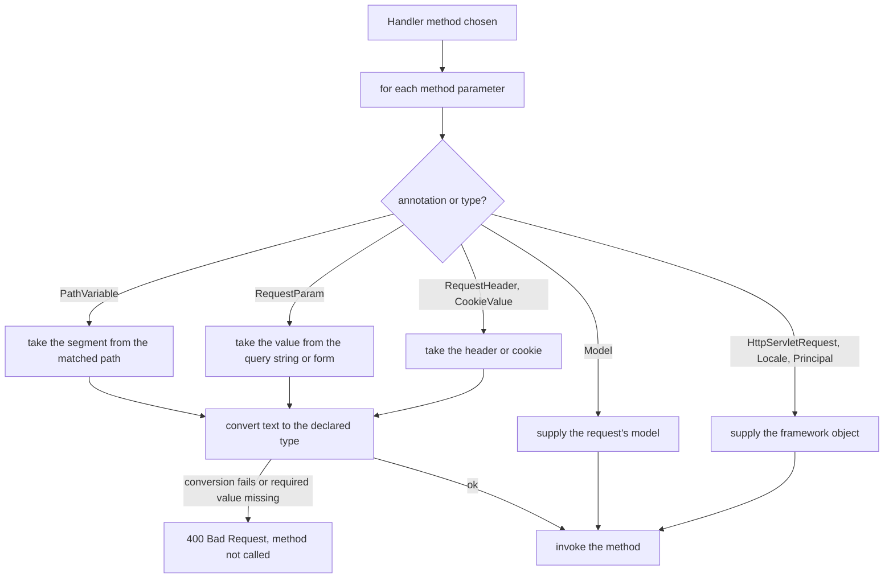

# Request parameters, path variables and the Model

> **Before this lesson:** you have written a `@Controller` whose method fills a `Model` and returns a view name, and you can follow a request through the `DispatcherServlet` ([Spring MVC: the request flow through DispatcherServlet](#/lesson/spring/spring-mvc-request-flow)).

## In plain words

Ordering in a café, you say two kinds of things. First, *what* you want: "the cheesecake". Second, adjustments: "a small slice, to take away". The cake is the thing itself; the rest are options about it.

A web request carries the same two kinds of information in its address. A **path variable** is part of the path and identifies the thing: in `/books/9780441172719`, the number says which book. **Request parameters** come after the question mark and adjust the request: in `/books?genre=scifi&page=2`, they filter and page a list.

A page that shows the same content to everybody is **static**. A page whose content depends on the request is **dynamic**. This lesson shows how a controller method reads both kinds of input, how Spring converts the text in the URL into Java types, what happens when the input is missing or wrong, and how the result reaches the template through the `Model`. Reading input correctly, and failing politely when it is bad, is daily work for a back-end developer.

## Where data can travel in a request

| Place | Example | Typical use | Annotation |
|---|---|---|---|
| Path | `/books/42` | identify one resource | `@PathVariable` |
| Query string | `/books?genre=scifi&page=2` | optional filters, sorting, paging | `@RequestParam` |
| Header | `Accept-Language: es` | metadata about the request | `@RequestHeader` |
| Cookie | `Cookie: theme=dark` | small values the browser sends back each time | `@CookieValue` |
| Body | form fields or JSON | larger or structured data | `@ModelAttribute`, `@RequestBody` |

This lesson handles the first two rows and touches the next two. Bodies come in [HTTP methods and HTML forms](#/lesson/spring/spring-http-methods-forms) and in the REST module.

## Request parameters

```java
// src/main/java/com/bookshop/catalogue/BookPageController.java
@Controller
public class BookPageController {

    private final CatalogueService catalogue;

    public BookPageController(CatalogueService catalogue) {
        this.catalogue = catalogue;
    }

    @GetMapping("/books")
    public String list(@RequestParam String genre, Model model) {
        model.addAttribute("genre", genre);
        model.addAttribute("books", catalogue.byGenre(genre));
        return "book-list";
    }
}
```

`@RequestParam String genre` tells Spring: find the request parameter called `genre` and pass its value here. The parameter name is taken from the Java parameter name. The request

```bash
curl "http://localhost:8080/books?genre=scifi"
```

calls `list("scifi", model)`.

```html
<!-- src/main/resources/templates/book-list.html -->
<!DOCTYPE html>
<html xmlns:th="http://www.thymeleaf.org">
<body>
    <h1>Books in <span th:text="${genre}">genre</span></h1>
    <ul>
        <li th:each="book : ${books}">
            <a th:href="@{/books/{isbn}(isbn=${book.isbn()})}" th:text="${book.title()}">title</a>
        </li>
    </ul>
</body>
</html>
```

`th:href="@{/books/{isbn}(isbn=...)}"` builds a link and inserts the book's ISBN into the path, which leads to the path-variable handler further down.

### Required, optional, default

By default a request parameter is **required**. Calling `/books` without it yields:

```text
HTTP/1.1 400 Bad Request

Required request parameter 'genre' for method parameter type String is not present
```

`400 Bad Request` means "the client sent something invalid". Your method was not called; Spring refused before reaching it.

Three ways to make a parameter optional:

```java
@GetMapping("/books")
public String list(
        @RequestParam(required = false) String genre,              // null when absent
        @RequestParam(defaultValue = "0") int page,                // 0 when absent
        @RequestParam(defaultValue = "20") int size,
        @RequestParam Optional<String> sort,                       // Optional.empty() when absent
        Model model) { ... }
```

- `required = false` passes `null` when the parameter is absent. This only works for object types; a primitive `int` cannot be `null`.
- `defaultValue = "0"` supplies a text default, which implies the parameter is optional. The default is written as a string because it goes through the same conversion as a real value.
- `Optional<String>` makes absence explicit in the type.

If the URL's name differs from the Java name, state it: `@RequestParam("q") String searchText` reads `?q=dune`.

### Type conversion

Everything in a URL is text. Spring converts it to the declared parameter type.

| Declared type | `?x=` value | Result |
|---|---|---|
| `int`, `long`, `Integer` | `42` | the number |
| `boolean` | `true`, `on`, `yes`, `1` (and `false`, `off`, `no`, `0`) | the truth value |
| `double`, `BigDecimal` | `19.99` | the number |
| `LocalDate` with `@DateTimeFormat(iso = ISO.DATE)` | `2026-03-01` | the date |
| an `enum` | `PAPERBACK` | the constant with that name |
| `List<Integer>` | `?id=1&id=2` or `?id=1,2` | `[1, 2]` |

When conversion fails, the answer is again 400 and your method is not called:

```bash
curl -i "http://localhost:8080/books?genre=scifi&page=two"
```

```text
HTTP/1.1 400 Bad Request

Failed to convert value of type 'java.lang.String' to required type 'int'; For input string: "two"
```

The simulation below reproduces the three stages (find the text, fall back or complain, convert) for a list of declared parameters.

```python-run
from urllib.parse import parse_qs

TRUE, FALSE = {"true", "on", "yes", "1"}, {"false", "off", "no", "0"}

def convert(name, kind, text):
    try:
        if kind == "String":
            return text
        if kind == "int":
            return int(text)
        if kind == "double":
            return float(text)
        if kind == "boolean" and text.lower() in TRUE | FALSE:
            return text.lower() in TRUE
    except ValueError:
        pass
    raise ValueError(f"400 Bad Request: failed to convert '{text}' to {kind} for parameter '{name}'")

def bind(declared, query_string):
    given = parse_qs(query_string, keep_blank_values=True)        # name -> list of values
    arguments = {}
    for name, kind, required, default in declared:
        text = given[name][0] if name in given else default       # 1. find the text, else the default
        if text is None:
            if required:                                          # 2. nothing: complain or pass None
                raise ValueError(f"400 Bad Request: required parameter '{name}' is not present")
            arguments[name] = None
            continue
        arguments[name] = convert(name, kind, text)               # 3. convert
    return arguments

DECLARED = [            # (name, type, required, defaultValue)
    ("genre", "String", True, None),
    ("page", "int", False, "0"),
    ("inStock", "boolean", False, None),
]

for query in ["genre=scifi&page=2&inStock=yes", "genre=classic", "page=1", "genre=scifi&page=two"]:
    try:
        print(f"?{query:32} -> {bind(DECLARED, query)}")
    except ValueError as problem:
        print(f"?{query:32} -> {problem}")
```

The four lines of output show a complete binding, the defaults applied, the missing required parameter, and a failed conversion. The practice problem [Bind and convert request parameters](#/problem/spring-param-binding) asks for a stricter version of this function.

## Path variables

```java
@GetMapping("/books/{isbn}")
public String detail(@PathVariable String isbn, Model model) {
    Book book = catalogue.findByIsbn(isbn);
    model.addAttribute("book", book);
    return "book-detail";
}
```

`{isbn}` in the mapping is a placeholder for one path segment. `@PathVariable String isbn` receives whatever stands there. A request to `/books/9780441172719` calls `detail("9780441172719", model)`.

Conversion works as for request parameters:

```java
@GetMapping("/orders/{orderId}/items/{line}")
public String orderLine(@PathVariable long orderId, @PathVariable int line, Model model) { ... }
```

`/orders/17/items/2` gives `orderId = 17`, `line = 2`. `/orders/abc/items/2` gives 400.

Differences from request parameters:

- A path variable is always present when the mapping matched. `/books/` (nothing after the slash) does not match `/books/{isbn}` and yields 404, not 400.
- One segment only. A variable does not match across slashes.
- You can restrict a variable with a regular expression: `@GetMapping("/books/{isbn:[0-9]{13}}")` matches only thirteen digits; other values fall through to 404.

### Which one should I use?

| Question about the value | Use |
|---|---|
| Does it identify the thing the URL is about? | path variable: `/books/{isbn}` |
| Is it mandatory for the URL to make sense? | path variable |
| Is it an optional filter, sort order or page number? | request parameter: `?genre=…&page=…` |
| Could there be many of them in any combination? | request parameters |

`/books/9780441172719` reads as "this book". `/books?isbn=9780441172719` reads as "search books by ISBN". Both work technically; the first expresses identity, and well-designed APIs follow that convention.

> [!INTERVIEW]
> "`@RequestParam` versus `@PathVariable`?" `@PathVariable` binds a segment of the URL path and identifies a resource; it is mandatory by nature. `@RequestParam` binds a query-string (or form) parameter, is required by default but can be optional or have a default, and suits filtering, sorting and paging. Both go through Spring's type conversion and produce 400 on a conversion error.

## Specific mappings beat general ones

```java
@GetMapping("/books/featured")
public String featured(Model model) { ... }

@GetMapping("/books/{isbn}")
public String detail(@PathVariable String isbn, Model model) { ... }
```

`GET /books/featured` matches both patterns. Spring picks the **most specific** one, the literal path, regardless of the order of the methods in the file. Without the literal mapping, the same request would call `detail` with `isbn = "featured"`.

## The Model in more depth

The `Model` is a map from names to objects that lives for one request. It carries data from the controller to the view.

```java
@GetMapping("/books")
public String list(@RequestParam(defaultValue = "all") String genre,
                   @RequestParam(defaultValue = "0") int page,
                   Model model) {
    model.addAttribute("genre", genre);
    model.addAttribute("books", catalogue.byGenre(genre, page));
    model.addAttribute("page", page);
    model.addAttribute("hasNext", catalogue.hasMore(genre, page));
    return "book-list";
}
```

```html
<p>Page <span th:text="${page + 1}">1</span></p>
<a th:if="${hasNext}" th:href="@{/books(genre=${genre}, page=${page + 1})}">Next</a>
```

`@{/books(genre=..., page=...)}` builds `/books?genre=scifi&page=1` with correct encoding of special characters.

Data needed by **every** page of a controller, such as the shop name in the header, can be added once with a method-level `@ModelAttribute`:

```java
@ModelAttribute("shopName")
String shopName() {
    return "The Paper Lantern";          // added to the model before every handler method of this controller
}
```

Put the same method in a class annotated `@ControllerAdvice` and it applies to all controllers.

> [!WARNING]
> Thymeleaf's `th:text` escapes HTML: a title containing `<script>` is shown as text and not executed. `th:utext` writes the value unescaped. Never use `th:utext` with anything a user typed, or you have built a cross-site scripting hole, where an attacker's script runs in other users' browsers.

## Headers and cookies

```java
@GetMapping("/welcome")
public String welcome(@RequestHeader(value = "Accept-Language", defaultValue = "en") String language,
                      @CookieValue(value = "visitor", required = false) String visitorId,
                      Model model) {
    model.addAttribute("language", language);
    model.addAttribute("returning", visitorId != null);
    return "welcome";
}
```

They follow the same rules as `@RequestParam`: required unless stated otherwise, with optional defaults and type conversion.

## How the dispatcher fills your parameters

Before invoking a handler method, the dispatcher goes through the method's parameters one by one and asks a list of **argument resolvers** "can you supply this one?".



That is why the order of parameters in your method is free: each is resolved by its annotation or type, not by position.

## Pitfalls

- **Primitive type with `required = false`.** `@RequestParam(required = false) int page` fails when the parameter is absent, because `null` cannot be put into an `int`. Use `Integer`, `Optional<Integer>` or a `defaultValue`.
- **Parameter names lost at compile time.** Spring reads parameter names from the compiled class. Boot's build plugins keep them (the `-parameters` compiler flag). In a hand-made build without that flag, write the name explicitly: `@RequestParam("genre")`.
- **Trusting input.** Path variables and parameters come from the outside world. Check ranges (`page >= 0`, `size <= 100`) and never paste them into SQL text.
- **Unencoded special characters.** A space or `&` inside a parameter value must be URL-encoded (`war%20and%20peace`). Thymeleaf's `@{...}` and HTTP client libraries do it for you; string concatenation does not.
- **Sensitive data in URLs.** Query strings end up in browser history, proxies and server logs. Passwords and tokens never belong there.
- **Path variable containing a dot or a slash.** A slash never matches one variable. Values with dots are handled correctly by current Spring versions, though older set-ups cut off what looked like a file extension.
- **Assuming a missing path variable gives 400.** It gives 404, because no mapping matched.

## Cheat sheet

| Annotation | Reads | Notes |
|---|---|---|
| `@RequestParam String q` | query or form parameter `q` | required by default |
| `@RequestParam(required = false) Integer n` | optional parameter | `null` when absent |
| `@RequestParam(defaultValue = "0") int page` | optional with default | default is text, then converted |
| `@RequestParam("q") String text` | parameter `q` into a differently named variable | |
| `@RequestParam List<Integer> id` | repeated or comma-separated values | |
| `@PathVariable long id` | `{id}` segment of the mapping | 404 if the path does not match |
| `@GetMapping("/x/{id:[0-9]+}")` | variable restricted by a regular expression | |
| `@RequestHeader("Name")` | a request header | |
| `@CookieValue("name")` | a cookie | |
| `Model` | data for the view | `addAttribute(name, value)` |
| `@ModelAttribute("name")` on a method | value added to the model for every handler | |

## Summary

- Path variables identify a resource inside the path; request parameters carry options in the query string.
- `@RequestParam` values are required unless you set `required = false`, a `defaultValue`, or use `Optional`.
- Spring converts the text to the declared Java type and answers 400 when a required value is missing or conversion fails, without calling your method.
- The most specific mapping wins when several match.
- The `Model` carries named values to the template; Thymeleaf escapes them by default.
- Handler parameters are filled by argument resolvers according to annotation and type, so their order does not matter.

## Glossary

- **Argument resolver**: the Spring MVC component that supplies a value for one handler method parameter.
- **Dynamic page**: a page whose content depends on the request.
- **Path variable**: a value taken from a segment of the URL path.
- **Query string**: the part of a URL after `?`, made of `name=value` pairs joined by `&`.
- **Request parameter**: a named value from the query string or a submitted form.
- **Static page**: a page that is the same for every request.
- **Type conversion**: turning request text into the Java type of a parameter.
- **URL encoding**: replacing special characters in a URL with `%` codes.
- **400 Bad Request**: the status for a request the server cannot accept as sent.

```quiz
[
  {"q": "A handler declares @RequestParam String genre. The client requests /books without parameters. What happens?",
   "options": ["The method runs with genre = null", "The method runs with genre = \"\"", "Spring answers 400 Bad Request without calling the method", "Spring answers 404 Not Found"],
   "answer": 2,
   "explain": "Request parameters are required by default. A missing one is rejected before the handler is invoked."},
  {"q": "Which declaration accepts a missing page parameter and uses 0?",
   "options": ["@RequestParam int page", "@RequestParam(required = false) int page", "@RequestParam(defaultValue = \"0\") int page", "@PathVariable int page"],
   "answer": 2,
   "explain": "defaultValue supplies text that is converted like a real value. required = false with a primitive fails because null cannot be assigned to int."},
  {"q": "The mapping is /books/{isbn}. What does a request to /books/ (nothing after the slash) return?",
   "options": ["400 Bad Request", "404 Not Found", "The handler is called with an empty string", "500"],
   "answer": 1,
   "explain": "A path variable needs a non-empty segment. The pattern does not match, so no handler is found."},
  {"q": "Both /books/featured and /books/{isbn} are mapped for GET. Which handler serves GET /books/featured?",
   "options": ["Whichever is declared first", "The one with the path variable", "The literal /books/featured mapping, because it is more specific", "Start-up fails with an ambiguous mapping"],
   "answer": 2,
   "explain": "Spring ranks matching patterns by specificity; a literal segment beats a variable."},
  {"q": "A client sends /books?genre=scifi&page=two to a handler with @RequestParam int page. Result?",
   "options": ["page is 0", "400 Bad Request because the text cannot be converted to int", "page is 2", "A NullPointerException in the handler"],
   "answer": 1,
   "explain": "Type conversion fails and Spring responds with 400 before the method is called."},
  {"q": "Which value is best expressed as a path variable?",
   "options": ["The sort order of a list", "The page number", "The identifier of the book being shown", "A search keyword"],
   "answer": 2,
   "explain": "Path variables identify the resource. Sorting, paging and searching are optional adjustments and belong in the query string."},
  {"q": "Why is th:text safer than th:utext for user-supplied values?",
   "options": ["It is faster", "It escapes HTML so injected tags are displayed as text instead of being executed", "It trims whitespace", "It validates the value"],
   "answer": 1,
   "explain": "Escaping prevents cross-site scripting. th:utext writes raw HTML and should never receive untrusted input."}
]
```

> **Source:** Spilcă, *Spring Start Here*, ch. 8 (implementing web apps with a dynamic view: request parameters and path variables). Documentation: https://docs.spring.io/spring-framework/reference/web/webmvc/mvc-controller/ann-methods/requestparam.html and https://docs.spring.io/spring-framework/reference/web/webmvc/mvc-controller/ann-requestmapping.html
