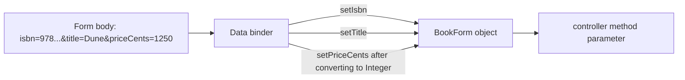
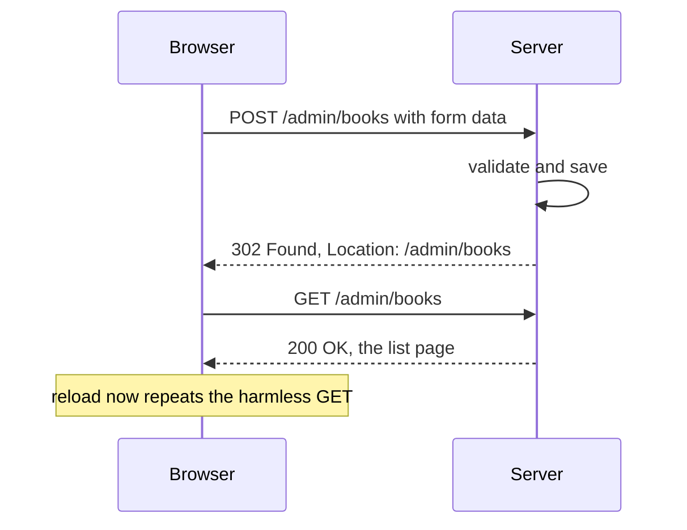

# HTTP methods and HTML forms

> **Before this lesson:** you can read request parameters and path variables in a `@Controller` and pass data to a Thymeleaf template through the `Model` ([Request parameters, path variables and the Model](#/lesson/spring/spring-request-data)).

## In plain words

At a library desk you can do different things with the same book. You can *look at* it, which changes nothing and can be repeated as often as you like. You can *donate* a new book, which adds something. You can *replace* a damaged copy, or ask for one to be *removed*. The librarian needs to know which of these you intend, because the consequences differ: looking twice is harmless, donating twice leaves two copies on the shelf.

HTTP expresses that intention with the **HTTP method**, also called the verb: GET to look, POST to add, PUT to replace, PATCH to change part, DELETE to remove. Until now our pages only looked. This lesson lets users *send* data with an HTML **form**, receives it in a controller, binds it to a Java object, validates it, and avoids the classic bug where pressing the browser's reload button places the same order twice.

Knowing the methods and two of their properties, *safe* and *idempotent*, is expected of anyone building web back ends, and the terms come up in most API design interviews.

## The HTTP methods

| Method | Intention | Has a body? | Safe? | Idempotent? |
|---|---|---|---|---|
| GET | read a resource | no | yes | yes |
| HEAD | like GET, headers only | no | yes | yes |
| POST | create something, or trigger an action | yes | no | **no** |
| PUT | create or completely replace at a known address | yes | no | yes |
| PATCH | change part of a resource | yes | no | not necessarily |
| DELETE | remove a resource | usually no | no | yes |
| OPTIONS | ask which methods are allowed | no | yes | yes |

Two definitions:

- **Safe**: the request does not change anything on the server. Browsers, crawlers and caches feel free to send safe requests at any time. A GET that deletes data is a disaster waiting for a search engine to follow the link.
- **Idempotent**: sending the same request several times leaves the server in the same state as sending it once. Deleting order 7 twice still leaves order 7 deleted. A client may retry an idempotent request after a network error without fear.

POST is neither. Two identical POSTs to "create an order" create two orders. That one fact drives the redirect technique later in this lesson.

```python-run
orders = {}                                   # the server's state: id -> order
next_id = [1]

def handle(method, path, body=None):
    if method == "GET" and path == "/orders":
        return 200, dict(orders)                                # safe: changes nothing
    if method == "POST" and path == "/orders":
        order_id = next_id[0]; next_id[0] += 1
        orders[order_id] = body                                 # new entry every time
        return 201, {"id": order_id}
    if method == "PUT" and path.startswith("/orders/"):
        orders[int(path.split("/")[2])] = body                  # same result however often it is sent
        return 200, body
    if method == "DELETE" and path.startswith("/orders/"):
        orders.pop(int(path.split("/")[2]), None)               # already gone? still gone.
        return 204, None
    return 405, None

def send_twice(method, path, body=None):
    before = dict(orders)
    handle(method, path, body)
    after_once = dict(orders)
    handle(method, path, body)
    after_twice = dict(orders)
    safe = before == after_once
    idempotent = after_once == after_twice
    print(f"{method:6} {path:10} safe={safe!s:5} idempotent={idempotent!s:5} state={after_twice}")

send_twice("POST", "/orders", "Dune x1")
send_twice("GET", "/orders")
send_twice("PUT", "/orders/1", "Dune x3")
send_twice("DELETE", "/orders/2")
```

The function `send_twice` checks both properties by comparing the server state before, after one request and after two. POST fails the idempotency check: the state after two requests has one more order than after one. Everything else passes.

> [!INTERVIEW]
> "What do safe and idempotent mean, and which methods have which property?" Safe = no server-side change (GET, HEAD, OPTIONS). Idempotent = repeating has the same effect as doing it once (the safe ones plus PUT and DELETE). POST is neither; PATCH is not guaranteed to be idempotent. Follow up with why it matters: retries, caching, and browsers warning before re-sending a form.

## What browsers can send

A plain HTML page can produce exactly two methods:

- **GET**: typing an address, clicking a link, or submitting `<form method="get">` (the fields become the query string);
- **POST**: submitting `<form method="post">` (the fields travel in the request body).

PUT, PATCH and DELETE are sent by JavaScript or by other programs, and are the daily bread of REST APIs ([REST endpoints with @RestController and ResponseEntity](#/lesson/spring/spring-rest-controllers)). For server-rendered pages, GET and POST do all the work.

## A form, end to end

The bookshop needs a page to add a book to the catalogue.

### Step 1: show the form (GET)

```java
// src/main/java/com/bookshop/catalogue/BookForm.java
package com.bookshop.catalogue;

public class BookForm {
    private String isbn;
    private String title;
    private Integer priceCents;

    public String getIsbn() { return isbn; }
    public void setIsbn(String isbn) { this.isbn = isbn; }
    public String getTitle() { return title; }
    public void setTitle(String title) { this.title = title; }
    public Integer getPriceCents() { return priceCents; }
    public void setPriceCents(Integer priceCents) { this.priceCents = priceCents; }
}
```

`BookForm` is a **form-backing object**: a class with one property per form field. It has a no-argument constructor and setters so that Spring can create it and fill it in.

```java
// src/main/java/com/bookshop/catalogue/BookAdminController.java
@Controller
@RequestMapping("/admin/books")
public class BookAdminController {

    private final CatalogueService catalogue;

    public BookAdminController(CatalogueService catalogue) {
        this.catalogue = catalogue;
    }

    @GetMapping("/new")
    public String showForm(Model model) {
        model.addAttribute("bookForm", new BookForm());      // an empty object for the form to bind to
        return "book-form";
    }
}
```

```html
<!-- src/main/resources/templates/book-form.html -->
<!DOCTYPE html>
<html xmlns:th="http://www.thymeleaf.org">
<body>
    <h1>Add a book</h1>

    <form th:action="@{/admin/books}" th:object="${bookForm}" method="post">
        <label>ISBN  <input type="text" th:field="*{isbn}"></label>
        <label>Title <input type="text" th:field="*{title}"></label>
        <label>Price in cents <input type="number" th:field="*{priceCents}"></label>
        <button type="submit">Save</button>
    </form>
</body>
</html>
```

- `method="post"` makes the browser send the fields in the body of a POST request.
- `th:action="@{/admin/books}"` is the address the form is sent to.
- `th:object="${bookForm}"` ties the form to the model attribute.
- `th:field="*{isbn}"` generates `name="isbn"`, `id="isbn"` and the current `value`. The asterisk syntax means "a property of the form object".

### Step 2: receive the form (POST)

Pressing Save makes the browser send:

```text
POST /admin/books HTTP/1.1
Content-Type: application/x-www-form-urlencoded

isbn=9780441172719&title=Dune&priceCents=1250
```

The body has the same `name=value&name=value` shape as a query string. That is why `@RequestParam` also reads form fields. Reading them one by one gets tedious, so Spring can fill a whole object:

```java
@PostMapping
public String create(@ModelAttribute BookForm bookForm) {
    catalogue.add(new Book(bookForm.getIsbn(), bookForm.getTitle(), bookForm.getPriceCents()));
    return "redirect:/admin/books";
}
```

`@ModelAttribute BookForm bookForm` tells Spring to create a `BookForm`, then for each request parameter find the property with the same name, convert the text to the property's type and call the setter. This process is called **data binding**. The object is also added to the model under the name `bookForm`.



The simulation shows what the binder does, including what it does with an unknown field and with a value that cannot be converted.

```python-run
from urllib.parse import parse_qsl

class BookForm:
    FIELD_TYPES = {"isbn": str, "title": str, "priceCents": int}
    def __init__(self):
        self.isbn = self.title = self.priceCents = None
    def __repr__(self):
        return f"BookForm(isbn={self.isbn!r}, title={self.title!r}, priceCents={self.priceCents!r})"

def bind(form_class, body):
    target, errors = form_class(), {}
    for name, text in parse_qsl(body, keep_blank_values=True):
        if name not in form_class.FIELD_TYPES:
            continue                                   # no matching property: ignored
        try:
            setattr(target, name, form_class.FIELD_TYPES[name](text))    # convert, then "call the setter"
        except ValueError:
            errors[name] = f"cannot convert '{text}'"  # recorded, not thrown
    return target, errors

for body in ["isbn=9780441172719&title=Dune&priceCents=1250",
             "isbn=1&title=War+and+Peace&priceCents=cheap&admin=true",
             "title=Only+a+title"]:
    form, errors = bind(BookForm, body)
    print(form, "| errors:", errors)
```

Note three behaviours that match Spring: `+` in a form body means a space; the unknown field `admin` is ignored; a conversion failure is *recorded* as an error for that field instead of aborting, provided the controller asks for the errors (next section). Fields that were not sent stay `null`.

### Step 3: validate

Never trust a form. Add the validation starter and annotate the form class:

```xml
<dependency>
    <groupId>org.springframework.boot</groupId>
    <artifactId>spring-boot-starter-validation</artifactId>
</dependency>
```

```java
import jakarta.validation.constraints.*;

public class BookForm {
    @Pattern(regexp = "[0-9]{13}", message = "ISBN must have 13 digits")
    private String isbn;

    @NotBlank(message = "Title is required")
    private String title;

    @NotNull @Positive
    private Integer priceCents;
    // getters and setters
}
```

```java
@PostMapping
public String create(@Valid @ModelAttribute BookForm bookForm, BindingResult result) {
    if (result.hasErrors()) {
        return "book-form";                 // show the form again, with messages and the user's input
    }
    catalogue.add(new Book(bookForm.getIsbn(), bookForm.getTitle(), bookForm.getPriceCents()));
    return "redirect:/admin/books";
}
```

- `@Valid` asks Spring to run the constraint annotations after binding.
- `BindingResult` collects binding and validation errors. It **must come directly after** the object it belongs to in the parameter list. With it present, your method is called even when there are errors, and you decide what to do. Without it, an invalid form yields a 400 error page.

```html
<label>Title <input type="text" th:field="*{title}"></label>
<span th:if="${#fields.hasErrors('title')}" th:errors="*{title}">error</span>
```

`th:errors` prints the messages for a field. Because `th:field` writes the current value back into the input, users do not lose what they typed.

## Post/Redirect/Get

The `create` method returned `"redirect:/admin/books"` instead of a view name. Why?

Suppose it rendered a "saved" page directly in response to the POST. The browser's address bar then shows the POST's address, and its last request *is* the POST. When the user presses reload, the browser sends that POST again and a second book or a second order is created. Browsers warn with a dialog about re-submitting form data that many users click through.

The cure is the **Post/Redirect/Get** pattern (PRG):



1. The POST does the work.
2. The server answers with a **redirect**: status 302 and a `Location` header naming another address.
3. The browser automatically sends a GET to that address and shows the result.

Reloading now repeats a safe GET. In Spring MVC a view name starting with `redirect:` produces step 2.

Data placed in the `Model` does not survive a redirect, because the redirect is a new request. To show a one-time message such as "Book saved" on the next page, use **flash attributes**:

```java
@PostMapping
public String create(@Valid @ModelAttribute BookForm bookForm, BindingResult result,
                     RedirectAttributes redirect) {
    if (result.hasErrors()) {
        return "book-form";
    }
    catalogue.add(new Book(bookForm.getIsbn(), bookForm.getTitle(), bookForm.getPriceCents()));
    redirect.addFlashAttribute("message", "Saved " + bookForm.getTitle());
    return "redirect:/admin/books";
}
```

A flash attribute is stored briefly on the server and appears in the model of exactly the next request.

> [!TIP]
> Rule of thumb for page controllers: a GET handler returns a view name; a successful POST handler returns a redirect; a POST handler with validation errors returns the form view again.

## GET or POST for a form?

| | `method="get"` | `method="post"` |
|---|---|---|
| Data travels | in the URL's query string | in the request body |
| Visible in address bar, history, logs | yes | no |
| Can be bookmarked and shared | yes | no |
| Size limit | a few thousand characters in practice | large |
| Use for | searches and filters that change nothing | anything that changes data; anything sensitive |

A search box is a GET form: `/books?q=dune` can be bookmarked and reloaded safely. A login or an order is a POST form.

> [!WARNING]
> POST hides data from the address bar, not from the network. Only HTTPS, which encrypts the connection, protects passwords and personal data in transit.

## Two security notes

**Cross-site request forgery (CSRF).** Because browsers attach cookies automatically, a malicious page could make a logged-in user's browser send a POST to your site. The defence is a secret token in a hidden form field that the attacker's page cannot know. Once Spring Security is on the classpath it checks this token on every POST, and Thymeleaf's `th:action` inserts the hidden field for you. This is another reason state changes must never happen on GET.

**Over-binding (mass assignment).** The binder sets every property for which a parameter arrives. If you bind directly to an object that has an `admin` or `price` property, an attacker can add `admin=true` to the form data. Bind to a dedicated form object that contains only the fields the user may set, as `BookForm` does, and copy the values across.

## Pitfalls

- **Rendering a view after a successful POST.** Reload duplicates the action. Redirect.
- **`BindingResult` in the wrong position.** It must immediately follow the validated parameter; otherwise Spring reports an error at request time.
- **Missing `@Valid`.** The constraint annotations on the form class are ignored.
- **Missing validation starter.** The annotations compile (if the API JAR is present) but nothing validates them.
- **No setters or no default constructor on the form object.** Binding has nothing to call and fields stay `null`. (Constructor binding for records exists, but the classic form style uses setters.)
- **Changing data in a GET handler.** Crawlers, link previews and browser pre-fetching will trigger it.
- **Field name mismatch.** The HTML `name` must equal the Java property name; `th:field` guarantees it.
- **Expecting model attributes after a redirect.** Use flash attributes.

## Cheat sheet

| Annotation / type | Meaning |
|---|---|
| `@GetMapping`, `@PostMapping` | handle GET / POST for a path |
| `@ModelAttribute Form form` | create the object and bind request parameters to its properties |
| `@Valid` | run Bean Validation on the bound object |
| `BindingResult` | binding and validation errors; directly after the validated parameter |
| `"redirect:/path"` | answer 302 so that the browser issues a GET (Post/Redirect/Get) |
| `RedirectAttributes.addFlashAttribute` | one-time data for the page after a redirect |
| `th:object`, `th:field`, `th:errors` | Thymeleaf form binding and error display |
| `@NotBlank`, `@NotNull`, `@Positive`, `@Pattern`, `@Size` | common constraints |

## Summary

- The HTTP method states the intention: GET reads, POST creates or triggers, PUT replaces, PATCH modifies, DELETE removes.
- Safe methods change nothing; idempotent methods can be repeated without further effect. POST is neither.
- HTML forms send GET (fields in the URL) or POST (fields in the body).
- `@ModelAttribute` binds form fields to an object; `@Valid` plus `BindingResult` validates and lets you re-display the form with messages.
- After a successful POST, redirect (Post/Redirect/Get) so that a reload does not repeat the action; use flash attributes for one-time messages.
- Bind to dedicated form objects, keep state changes out of GET, and rely on CSRF protection.

## Glossary

- **`BindingResult`**: the holder of errors found while binding and validating an object.
- **CSRF (cross-site request forgery)**: an attack that makes a user's browser send an unwanted request to a site where the user is logged in.
- **Data binding**: copying request parameters into the properties of an object, with type conversion.
- **Flash attribute**: a value kept for exactly one subsequent request, across a redirect.
- **Form-backing object**: the object whose properties correspond to a form's fields.
- **Idempotent**: having the same effect whether performed once or many times.
- **Over-binding (mass assignment)**: an attacker setting properties the form was never meant to expose.
- **Post/Redirect/Get**: answering a POST with a redirect so that the browser ends on a GET.
- **Redirect**: a response telling the browser to request another address.
- **Safe method**: an HTTP method that does not modify server state.

```quiz
[
  {"q": "Which HTTP method is neither safe nor idempotent?",
   "options": ["GET", "PUT", "DELETE", "POST"],
   "answer": 3,
   "explain": "POST changes state and repeating it repeats the effect, for example creating a second order."},
  {"q": "What does idempotent mean?",
   "options": ["The request has no body", "Repeating the request leaves the server in the same state as sending it once", "The request is encrypted", "The request cannot fail"],
   "answer": 1,
   "explain": "Idempotency is about the effect of repetition, which is what makes automatic retries acceptable."},
  {"q": "A POST handler saves an order and returns the view name \"confirmation\". The user reloads the page. What happens?",
   "options": ["Nothing; the page is cached", "The browser re-sends the POST and a second order may be created", "The server returns 405", "The form is cleared"],
   "answer": 1,
   "explain": "The last request was the POST, so reload repeats it. Post/Redirect/Get avoids this by ending on a GET."},
  {"q": "What does returning \"redirect:/admin/books\" from a controller method do?",
   "options": ["Renders templates/redirect.html", "Sends a 302 response with a Location header so the browser issues a GET to /admin/books", "Calls another controller method internally", "Returns JSON"],
   "answer": 1,
   "explain": "The redirect: prefix makes Spring MVC answer with a redirect instead of rendering a view."},
  {"q": "Where must the BindingResult parameter be placed?",
   "options": ["First in the parameter list", "Last in the parameter list", "Immediately after the @Valid object it reports on", "Anywhere"],
   "answer": 2,
   "explain": "Spring associates a BindingResult with the parameter directly before it. In another position it is not linked to the validated object."},
  {"q": "Why bind a form to a dedicated BookForm class instead of an object that also has an admin property?",
   "options": ["It is faster", "The binder sets every property for which a parameter arrives, so an attacker could add admin=true", "Thymeleaf requires it", "Records cannot be validated"],
   "answer": 1,
   "explain": "This over-binding risk is avoided by exposing only the properties users are allowed to set."},
  {"q": "A search form should be bookmarkable and safe to reload. Which method fits?",
   "options": ["POST", "GET", "DELETE", "PATCH"],
   "answer": 1,
   "explain": "A search changes nothing, and with GET the criteria are part of the URL, so the result page can be bookmarked and reloaded."}
]
```

> **Source:** Spilcă, *Spring Start Here*, ch. 8 (using the GET and POST HTTP methods). Documentation: https://docs.spring.io/spring-framework/reference/web/webmvc/mvc-controller/ann-methods/modelattrib-method-args.html and https://docs.spring.io/spring-framework/reference/core/validation/beanvalidation.html
