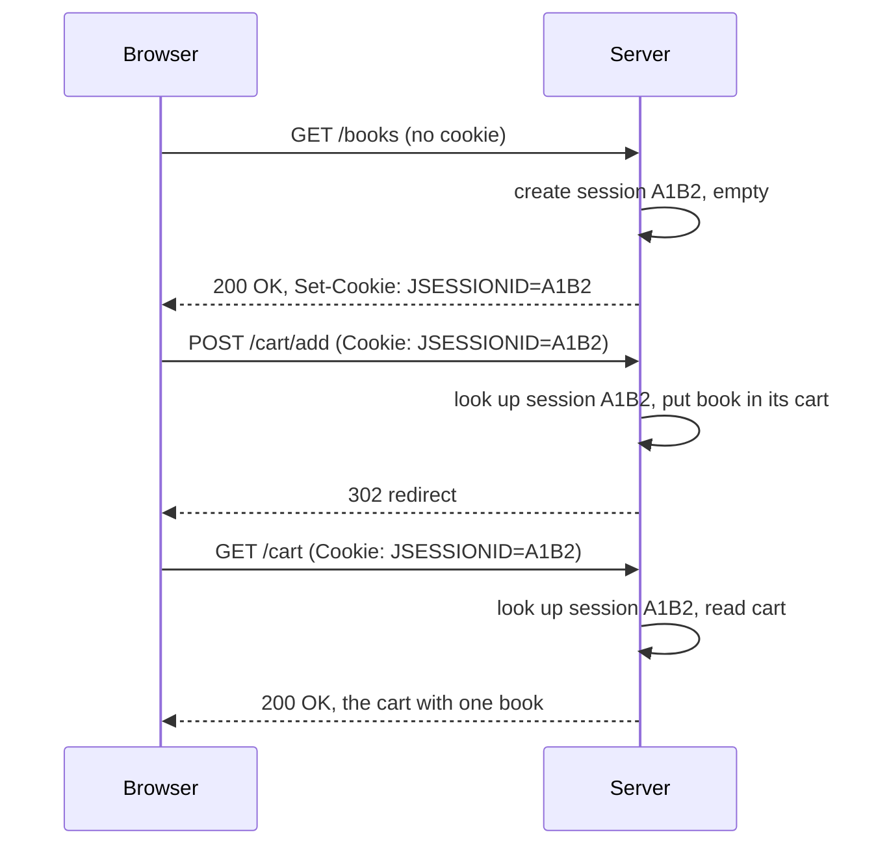
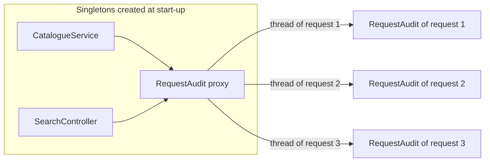

# Request and session scope

> **Before this lesson:** you know singleton and prototype scope and why a singleton must not hold per-user data ([Singleton scope, eager and lazy beans, thread safety](#/lesson/spring/spring-singleton-scope), [Prototype scope and the bean lifecycle](#/lesson/spring/spring-prototype-lifecycle)), and you can write controllers with forms ([HTTP methods and HTML forms](#/lesson/spring/spring-http-methods-forms)).

## In plain words

Think about a supermarket.

- The receipt paper for one checkout transaction exists only while that customer is being served. Next customer, new piece of paper.
- A shopping trolley belongs to one customer for the whole visit. They walk through many aisles with the same trolley, and it is returned when they leave.
- The notice board at the entrance is shared by everyone, all day.

Spring has a scope for each of these lifetimes in a web application. A **request-scoped** bean lives for one HTTP request (the receipt paper). A **session-scoped** bean lives for one user's visit, across many requests (the trolley). An **application-scoped** bean is shared by everyone (the notice board, next lesson).

These scopes give you a legitimate place for per-user state, which singletons must not hold. They also come with costs, and an interviewer asking about scopes usually wants to hear both the mechanism and the trade-offs.

## HTTP forgets everything

HTTP is **stateless**: every request stands alone, and the protocol itself carries no memory of earlier requests. When a customer adds a book to the cart and then opens the cart page, the server receives two unrelated requests.

To connect them, the server creates an **HTTP session**: a storage area on the server identified by a random session id. The id is sent to the browser in a **cookie**, a small named value that the browser stores and attaches to every later request to the same site. In Tomcat the cookie is called `JSESSIONID`.



The session ends when it is invalidated (logout) or when it has been idle longer than a timeout, thirty minutes by default in Boot.

## Request scope

A request-scoped bean is created the first time it is needed during a request and discarded when the response has been sent. Every request gets its own instance, so its fields are private to that request and, in the usual thread-per-request model, to one thread.

Use it for data gathered during one request that several beans need: an audit trail, a correlation id, the result of a calculation that is expensive to repeat.

```java
// src/main/java/com/bookshop/web/RequestAudit.java
package com.bookshop.web;

import org.springframework.stereotype.Component;
import org.springframework.web.context.annotation.RequestScope;

import java.util.ArrayList;
import java.util.List;
import java.util.UUID;

@Component
@RequestScope                                        // one instance per HTTP request
public class RequestAudit {

    private final String requestId = UUID.randomUUID().toString().substring(0, 8);
    private final List<String> events = new ArrayList<>();        // mutable state is fine here

    public void record(String event) { events.add(event); }
    public String requestId() { return requestId; }
    public List<String> events() { return events; }
}
```

`@RequestScope` is a shorthand for `@Scope(value = "request", proxyMode = ScopedProxyMode.TARGET_CLASS)`. The `proxyMode` part is what makes the next piece of code possible.

```java
// src/main/java/com/bookshop/catalogue/CatalogueService.java
@Service                                             // a singleton
public class CatalogueService {

    private final RequestAudit audit;                // a request-scoped bean injected into a singleton?!

    public CatalogueService(RequestAudit audit) {
        this.audit = audit;
    }

    public List<Book> search(String text) {
        audit.record("searched for '" + text + "'");
        return List.of(new Book("9780441172719", "Dune", 1250));
    }
}
```

```java
// src/main/java/com/bookshop/catalogue/SearchController.java
@Controller
public class SearchController {

    private final CatalogueService catalogue;
    private final RequestAudit audit;

    public SearchController(CatalogueService catalogue, RequestAudit audit) {
        this.catalogue = catalogue;
        this.audit = audit;
    }

    @GetMapping("/search")
    public String search(@RequestParam String q, Model model) {
        audit.record("controller entered");
        model.addAttribute("books", catalogue.search(q));
        model.addAttribute("requestId", audit.requestId());
        model.addAttribute("events", audit.events());
        return "search-results";
    }
}
```

Two different requests print two different request ids, and each sees only its own two events, although the controller and the service are singletons created long before any request existed.

### How a short-lived bean fits into a long-lived one

The singleton is built once at start-up. No request exists then, so no `RequestAudit` exists either. What Spring injects is a **scoped proxy**: an object with the same methods as `RequestAudit` that holds no data of its own. Each time a method is called on it, the proxy asks "which HTTP request is the current thread serving?", finds (or creates) the real `RequestAudit` belonging to that request, and forwards the call.



This is the same proxy idea as in the AOP module, used for a different purpose: routing instead of adding behaviour. The model below makes the mechanism concrete. A variable `current` plays the role of "the request this thread is serving", which Spring keeps in a thread-bound holder.

```python-run
import itertools

class RequestAudit:                                   # the real, request-scoped object
    ids = itertools.count(1)
    def __init__(self):
        self.request_id = next(RequestAudit.ids)
        self.events = []
        print(f"      (RequestAudit #{self.request_id} created)")
    def record(self, event):
        self.events.append(event)

current = {"request_store": None}                     # what the current thread is serving

class ScopedProxy:
    def __init__(self, bean_name, factory):
        self.bean_name, self.factory = bean_name, factory
    def _target(self):
        store = current["request_store"]
        if store is None:
            raise RuntimeError("ScopeNotActiveException: no thread-bound request")
        if self.bean_name not in store:               # first use in this request: create
            store[self.bean_name] = self.factory()
        return store[self.bean_name]
    def __getattr__(self, name):                      # every call is routed to the current target
        return getattr(self._target(), name)

class CatalogueService:                               # singleton
    def __init__(self, audit):
        self.audit = audit
    def search(self, text):
        self.audit.record(f"searched '{text}'")

audit_proxy = ScopedProxy("requestAudit", RequestAudit)      # built once, at "start-up"
service = CatalogueService(audit_proxy)

def handle_request(text):
    current["request_store"] = {}                     # request begins
    audit_proxy.record("controller entered")
    service.search(text)
    print(f"   request for {text!r}: id={audit_proxy.request_id} events={audit_proxy.events}")
    current["request_store"] = None                   # request ends: its beans are discarded

handle_request("dune")
handle_request("emma")

try:
    audit_proxy.record("called from a background job")
except RuntimeError as problem:
    print("  ", problem)
```

Observe:

- one `ScopedProxy` and one `CatalogueService` are created, once;
- each request causes one `RequestAudit` to be created, on first use, and both the controller code and the service reach the same one;
- outside a request there is nothing to route to. Real Spring throws `ScopeNotActiveException` in that situation, for example when a scheduled job or a start-up method calls a request-scoped bean.

> [!INTERVIEW]
> "How can a request-scoped bean be injected into a singleton?" Spring injects a scoped proxy (`proxyMode = TARGET_CLASS`, which `@RequestScope` and `@SessionScope` set by default). The proxy is a singleton; on every method call it looks up the real instance for the current request or session, via thread-bound request attributes, and delegates. Without the proxy, start-up fails because no request scope is active when the singleton is created.

## Session scope

A session-scoped bean is created on first use within an HTTP session and lives until that session ends. The textbook example is a shopping cart.

```java
// src/main/java/com/bookshop/cart/Cart.java
package com.bookshop.cart;

import org.springframework.stereotype.Component;
import org.springframework.web.context.annotation.SessionScope;

import java.io.Serializable;
import java.util.LinkedHashMap;
import java.util.Map;

@Component
@SessionScope                                        // one instance per HTTP session
public class Cart implements Serializable {

    private final Map<String, Integer> quantities = new LinkedHashMap<>();

    public synchronized void add(String isbn) {
        quantities.merge(isbn, 1, Integer::sum);     // add 1 to the quantity, starting from 0
    }

    public synchronized Map<String, Integer> items() {
        return Map.copyOf(quantities);
    }

    public synchronized void clear() { quantities.clear(); }
}
```

```java
// src/main/java/com/bookshop/cart/CartController.java
@Controller
@RequestMapping("/cart")
public class CartController {

    private final Cart cart;                         // scoped proxy again

    public CartController(Cart cart) {
        this.cart = cart;
    }

    @PostMapping("/add")
    public String add(@RequestParam String isbn) {
        cart.add(isbn);
        return "redirect:/cart";                     // Post/Redirect/Get
    }

    @GetMapping
    public String show(Model model) {
        model.addAttribute("items", cart.items());
        return "cart";
    }
}
```

Two browsers see two different carts. The same browser sees its cart grow from request to request:

```bash
curl -c jar.txt -b jar.txt -X POST -d "isbn=9780441172719" http://localhost:8080/cart/add
curl -c jar.txt -b jar.txt -X POST -d "isbn=9780441172719" http://localhost:8080/cart/add
curl -c jar.txt -b jar.txt http://localhost:8080/cart
```

```text
... 9780441172719 x 2 ...
```

The options `-c jar.txt -b jar.txt` make `curl` store and send cookies as a browser would. Leave them out and every call starts a new session with an empty cart.

Two details in `Cart` are deliberate:

- **`Serializable`.** Servers may write sessions to disk or copy them to other servers. Objects stored in a session should be convertible to bytes, which is what implementing `Serializable` allows.
- **`synchronized`.** One user can cause simultaneous requests in the same session: two browser tabs, a double click, a page firing several background calls. A session-scoped bean is therefore shared between threads, unlike a request-scoped one, and needs the same care as any shared mutable object.

### Ending the session

```java
@PostMapping("/logout")
public String logout(HttpSession session) {
    session.invalidate();                // discards the session and every session-scoped bean in it
    return "redirect:/";
}
```

Configure the idle timeout and cookie hardening in properties:

```properties
server.servlet.session.timeout=20m
server.servlet.session.cookie.http-only=true
server.servlet.session.cookie.secure=true
server.servlet.session.cookie.same-site=lax
```

`http-only` hides the cookie from JavaScript, `secure` sends it only over HTTPS, and `same-site` limits when other sites can trigger requests that carry it.

## Lifetimes side by side

```python-run
SCOPES = {"catalogue": "singleton", "requestAudit": "request", "cart": "session"}
count = {name: 0 for name in SCOPES}
count["catalogue"] = 1                                   # eager singleton
sessions = {}

EVENTS = [
    ("request", "ana", ["requestAudit", "cart", "catalogue", "requestAudit"]),
    ("request", "ana", ["cart", "requestAudit"]),
    ("request", "ben", ["cart"]),
    ("invalidate", "ana", []),
    ("request", "ana", ["cart"]),
]

for kind, session_id, used in EVENTS:
    if kind == "invalidate":
        sessions.pop(session_id, None)                   # logout: session beans are gone
        print(f"invalidate {session_id}")
        continue
    session_beans = sessions.setdefault(session_id, set())
    request_beans = set()                                # fresh for every request
    for name in used:
        store = {"singleton": None, "request": request_beans, "session": session_beans}[SCOPES[name]]
        if store is not None and name not in store:
            store.add(name)
            count[name] += 1
    print(f"request in session {session_id}: uses {used} -> totals {count}")
```

Ana's first request uses `requestAudit` twice and still creates one instance. Her second request creates another `requestAudit` and reuses her cart. Ben gets his own cart. After Ana logs out, her next request creates a new, empty cart. The practice problem [Request, session and application scope lifetimes](#/problem/spring-web-scope-lifetime) generalises this counter.

## The cost of sessions

Session scope is convenient and has real disadvantages.

1. **Memory.** Every active visitor occupies memory until the timeout, even if they left after one click. Ten megabytes of session data times ten thousand visitors is a problem. Keep sessions small: ids, not whole object graphs.
2. **Scaling.** With two server instances behind a load balancer, a session created on instance A is unknown to instance B. Options: *sticky sessions* (the load balancer always sends a user to the same instance, which loses the session when that instance restarts), or an external session store shared by all instances, for which the Spring Session project with Redis is the usual choice.
3. **Restarts.** Deploying a new version normally discards in-memory sessions; carts vanish.
4. **Security.** Whoever holds the session id is the user. Hence the cookie flags above, HTTPS, and issuing a new session id at login (Spring Security does this to prevent *session fixation*, where an attacker plants a known id before the victim logs in).

For these reasons many modern back ends are **stateless**: the server keeps no session at all. The client sends a signed token with every request, and data such as the cart is stored in the database. That design is described in [Spring Security basics and JWT resource servers](#/lesson/spring/spring-security-jwt). Session scope remains common in server-rendered applications and internal tools.

> [!WARNING]
> Do not store in the session what must not be lost. A cart that matters to revenue belongs in the database, keyed by customer or by a cart id in a cookie. The session is a cache of convenience, not a system of record.

## Pitfalls

- **Scoped bean used outside a request.** Calling a request- or session-scoped bean from `@PostConstruct`, a `@Scheduled` method or a thread you started yourself throws `ScopeNotActiveException`. Pass the needed values as method arguments instead.
- **No proxy.** `@Scope("request")` without `proxyMode` on a bean injected into a singleton fails at start-up. Use `@RequestScope`/`@SessionScope`, which include the proxy mode.
- **Request-scoped bean as a dumping ground.** Often a method parameter or a value returned from the service is clearer than hidden shared state.
- **Believing session beans are single-threaded.** Parallel requests of one user share the instance.
- **Large or non-serializable objects in session beans.** Memory pressure, and failures when the session is persisted or replicated.
- **Relying on the session with several instances and no shared store.** Users appear logged out or lose their cart at random.
- **`final` class or methods on a scoped bean.** The class-based proxy cannot override them.

## Cheat sheet

| Annotation / property | Meaning |
|---|---|
| `@RequestScope` | one instance per HTTP request; scoped proxy included |
| `@SessionScope` | one instance per HTTP session; scoped proxy included |
| `@Scope(value = "request", proxyMode = ScopedProxyMode.TARGET_CLASS)` | the long form |
| `HttpSession` handler parameter | direct access to the session; `invalidate()` ends it |
| `server.servlet.session.timeout` | idle time before a session expires |
| `server.servlet.session.cookie.*` | cookie flags: `http-only`, `secure`, `same-site` |
| `ScopeNotActiveException` | a scoped bean was used with no active request or session |
| `JSESSIONID` | the default session cookie name in Tomcat |

## Summary

- HTTP is stateless; a session, identified by a cookie, links a user's requests.
- Request scope gives one bean instance per request; session scope gives one per user session.
- Both are injected into singletons as scoped proxies that route every call to the instance of the current request or session.
- Request-scoped beans are confined to one request; session-scoped beans can be hit by parallel requests and must be thread-safe and serializable.
- Sessions cost memory, complicate scaling and need security care; keep them small or build stateless.

## Glossary

- **Cookie**: a small named value stored by the browser and sent with each request to the site.
- **HTTP session**: server-side storage tied to one client through a session id.
- **Request scope**: bean lifetime equal to one HTTP request.
- **Scoped proxy**: a proxy that forwards each call to the bean instance of the current scope.
- **Serializable**: convertible to a sequence of bytes for storage or transfer.
- **Session fixation**: an attack in which the victim is tricked into using a session id the attacker knows.
- **Session scope**: bean lifetime equal to one HTTP session.
- **Stateless**: keeping no memory of earlier requests.
- **Sticky session**: load balancing that always routes a client to the same server instance.

```quiz
[
  {"q": "How long does a request-scoped bean instance live?",
   "options": ["Until the application stops", "For one HTTP request", "For one user session", "For one method call"],
   "answer": 1,
   "explain": "It is created on first use within a request and discarded when that request completes."},
  {"q": "A singleton service has a constructor parameter of a @RequestScope type. What is injected at start-up?",
   "options": ["null", "The first request's instance", "A scoped proxy that looks up the current request's instance on every call", "Nothing; start-up fails"],
   "answer": 2,
   "explain": "@RequestScope includes proxyMode TARGET_CLASS. The proxy is created once and delegates per request."},
  {"q": "How does the server recognise that two requests belong to the same session?",
   "options": ["By the client's IP address", "By a session id sent in a cookie", "By the User-Agent header", "It cannot"],
   "answer": 1,
   "explain": "The server issues a session id cookie (JSESSIONID in Tomcat) and the browser returns it on every request."},
  {"q": "Why should a session-scoped Cart protect its state against concurrent access?",
   "options": ["Sessions are shared by all users", "The same user can send parallel requests that reach the same Cart instance on different threads", "Spring requires synchronized", "Serializable classes must be synchronized"],
   "answer": 1,
   "explain": "Several tabs or simultaneous background calls in one session hit the same session-scoped bean concurrently."},
  {"q": "A @Scheduled background job calls a method on a request-scoped bean. What happens?",
   "options": ["A new request is simulated", "The last request's instance is used", "ScopeNotActiveException, because no request is bound to that thread", "The bean behaves as a singleton"],
   "answer": 2,
   "explain": "Outside an HTTP request there is no request scope to resolve the target from."},
  {"q": "An application runs on two instances with in-memory sessions and a load balancer that alternates between them. What will users notice?",
   "options": ["Nothing", "Session data such as the cart appears and disappears depending on which instance answers", "Faster pages", "Double sessions with merged data"],
   "answer": 1,
   "explain": "Each instance has its own session store. Fix with sticky sessions, a shared session store, or a stateless design."},
  {"q": "In the first Python model, how many ScopedProxy objects are created for two requests?",
   "options": ["Two", "One", "None", "Four"],
   "answer": 1,
   "explain": "The proxy is a singleton created at start-up. Only the real RequestAudit targets are created per request."}
]
```

> **Source:** Spilcă, *Spring Start Here*, ch. 9 (request scope; session scope). Documentation: https://docs.spring.io/spring-framework/reference/core/beans/factory-scopes.html#beans-factory-scopes-other
