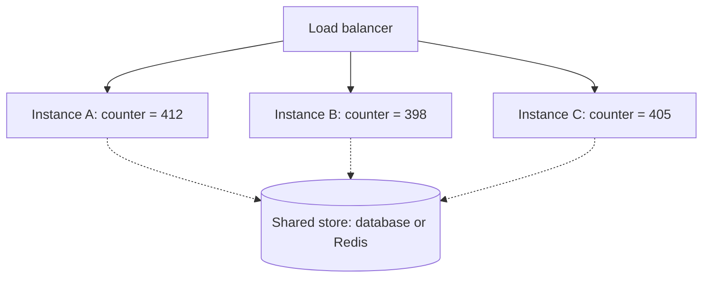
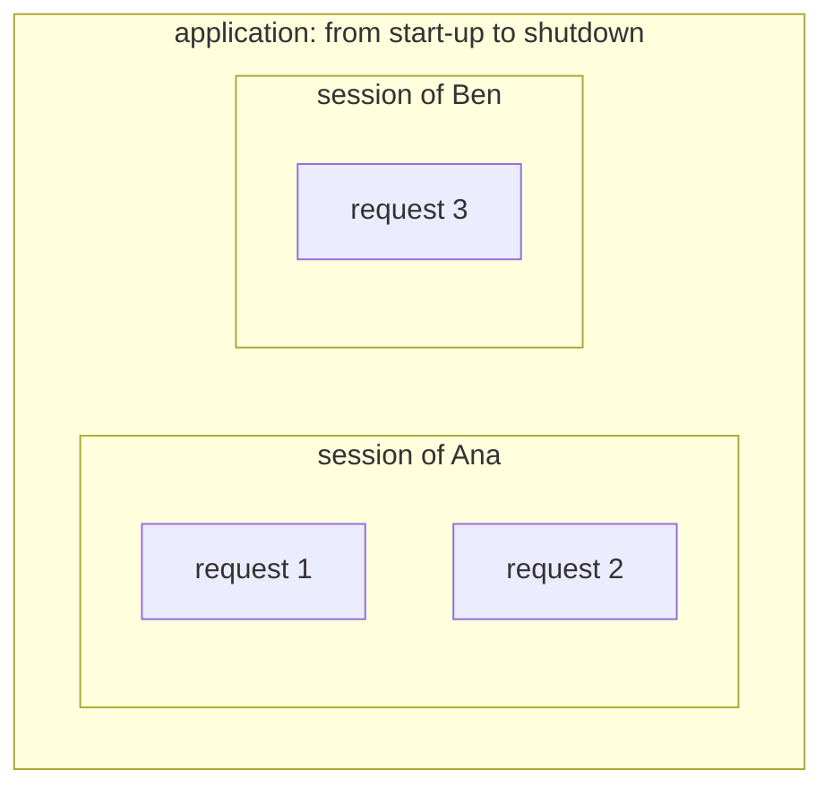
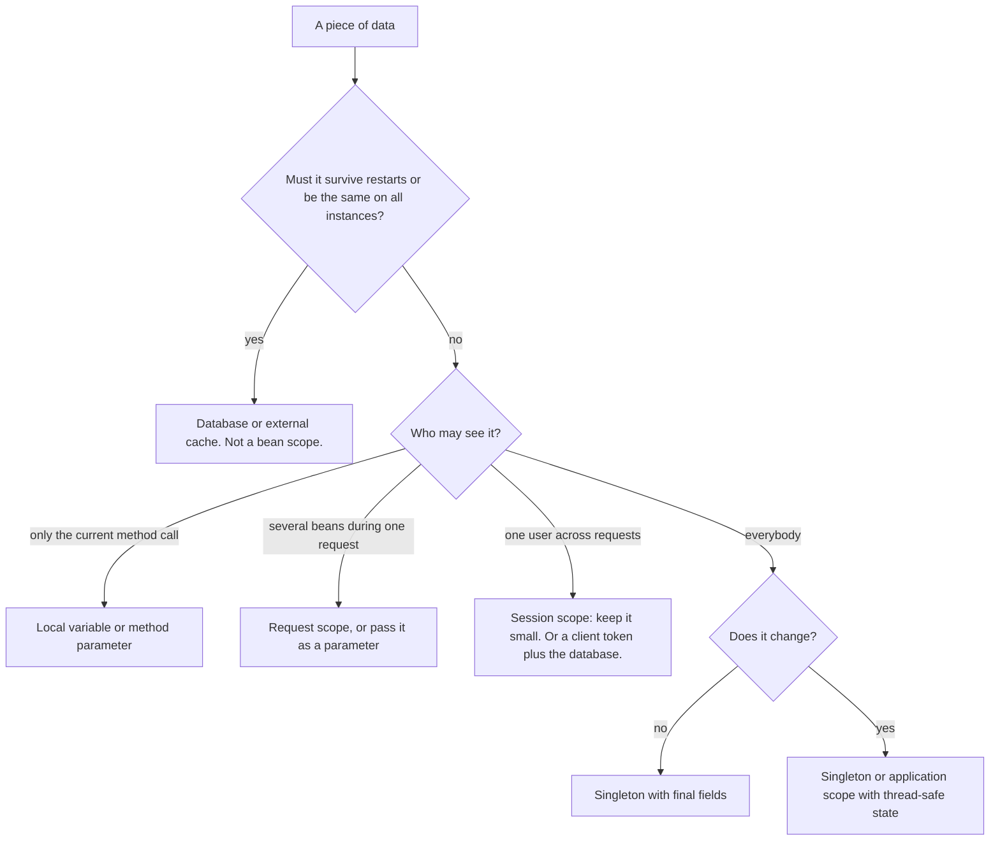

# Application scope and choosing a scope

> **Before this lesson:** you know request and session scope and the scoped proxy ([Request and session scope](#/lesson/spring/spring-request-session-scope)) and the thread-safety rules for shared beans ([Singleton scope, eager and lazy beans, thread safety](#/lesson/spring/spring-singleton-scope)).

## In plain words

In the supermarket picture from the last lesson, the receipt paper belonged to one transaction and the trolley to one customer. The third object was the notice board at the entrance: one board, for everybody, all day. Any customer can read it and any employee can pin something on it. Because everyone uses it at once, two people reaching for the same pin at the same moment need a rule about who goes first.

An **application-scoped** bean is that notice board. One instance exists for the whole web application and every request from every user reaches it. It is the widest web scope, and almost the same thing as a singleton.

That "almost" and the thread-safety rule are the first half of this lesson. The second half steps back and compares all the scopes you have met, so that given a piece of data you can say where it should live. That decision, more than any annotation, is what a reviewer or interviewer is checking.

## Application scope

```java
// src/main/java/com/bookshop/web/VisitCounter.java
package com.bookshop.web;

import org.springframework.stereotype.Component;
import org.springframework.web.context.annotation.ApplicationScope;

import java.util.concurrent.atomic.AtomicLong;

@Component
@ApplicationScope                               // one instance for the whole web application
public class VisitCounter {

    private final AtomicLong visits = new AtomicLong();

    public long increment() {
        return visits.incrementAndGet();        // atomic: safe when many threads call it at once
    }

    public long current() {
        return visits.get();
    }
}
```

```java
// src/main/java/com/bookshop/web/HomeController.java
@Controller
public class HomeController {

    private final VisitCounter counter;

    public HomeController(VisitCounter counter) {
        this.counter = counter;
    }

    @GetMapping("/")
    public String home(Model model) {
        model.addAttribute("visits", counter.increment());
        return "home";
    }
}
```

Open the page from two different browsers: the number keeps rising across both, because there is one counter for everybody. Compare with the session-scoped cart, where each browser had its own.

`@ApplicationScope` is shorthand for `@Scope(value = "application", proxyMode = ScopedProxyMode.TARGET_CLASS)`.

### How it differs from a singleton

| | Singleton | Application scope |
|---|---|---|
| One instance per | Spring application context | `ServletContext` (the servlet container's object representing the web application) |
| Created | eagerly at start-up | on first use |
| Where the instance is stored | inside the Spring context | as an attribute of the `ServletContext`, where non-Spring servlet code can read it too |
| Available without a web environment | yes | no |

In a normal Spring Boot application there is exactly one application context and one `ServletContext`, so the two behave alike. The difference matters only in unusual set-ups where several Spring contexts share one web application, or when plain servlet components need to see the object.

Practical conclusion: **use a singleton unless you have one of those reasons.** You should still recognise application scope, because it completes the family and because it appears in interviews next to request and session.

> [!INTERVIEW]
> "What is the difference between singleton and application scope?" A singleton is one instance per Spring `ApplicationContext`; an application-scoped bean is one instance per `ServletContext` and is exposed as a `ServletContext` attribute. With a single context per web application they are effectively equal, and singleton is the usual choice.

## Shared state must be protected

An application-scoped bean (and a singleton with mutable fields) is the most exposed kind of object: every thread of the server can reach it at the same time. The innocent-looking statement `count++` is three steps: read the value, add one, write it back. Two threads can interleave those steps.

```python-run
class UnsafeCounter:
    def __init__(self):
        self.count = 0

counter = UnsafeCounter()

def visit(name):                       # count++ split into its real steps
    seen = counter.count               # 1. read
    print(f"  {name} read {seen}")
    yield
    counter.count = seen + 1           # 2. add one  3. write back
    print(f"  {name} wrote {seen + 1}")
    yield

print("unsafe increment, two requests interleaved:")
ana, ben = visit("ana"), visit("ben")
next(ana); next(ben); next(ana); next(ben)
print("  two visits happened, counter says:", counter.count)

class AtomicCounter:                   # read-add-write as ONE indivisible step
    def __init__(self):
        self.count = 0
    def increment_and_get(self):
        self.count += 1                # in this model nothing can interrupt this line
        return self.count

safe = AtomicCounter()
print("atomic increment:")
for name in ["ana", "ben"]:
    print(f"  {name} got {safe.increment_and_get()}")
print("  two visits happened, counter says:", safe.count)
```

In the first half both requests read `0` before either writes, so both write `1`: one visit is lost. This is called a **lost update**. No error appears; the number is merely wrong, and only under load. The second half models an **atomic** operation, one that other threads can never observe half-done. In Java, `AtomicLong.incrementAndGet()` provides exactly that.

The tools, from simplest to most general:

| Need | Java tool |
|---|---|
| A counter | `AtomicInteger`, `AtomicLong`, or `LongAdder` under heavy contention |
| A shared map | `ConcurrentHashMap` (and its atomic methods `merge`, `compute`, `putIfAbsent`) |
| A reference replaced as a whole | `AtomicReference`, or a `volatile` field holding an immutable object |
| Several fields that must change together | `synchronized` methods or a `ReentrantLock` |

> [!WARNING]
> `synchronized` makes a bean correct and can make it slow: threads queue up for the lock. A lock held while calling a database or another service turns the whole application into a single lane. Keep shared mutable state small, and hold locks only around in-memory work.

## And when there are several servers?

Even a perfectly thread-safe `VisitCounter` counts only the visits of its own process. Run three instances of the application behind a load balancer and you have three counters, each showing about a third of the truth, all reset on every deployment.



State that must be correct across instances and survive restarts does not belong in any bean scope. It belongs in a shared store: a database row, or a cache server such as Redis. In-memory application-wide state is appropriate for things that are allowed to be per-instance and disposable: caches of reference data, rate-limit approximations, metrics that a monitoring system adds up afterwards.

## All scopes in one table

| Scope | Annotation | Instances | Lives until | Shared between threads? | Typical content |
|---|---|---|---|---|---|
| singleton | (default) | one per context | context closes | yes, by everyone | services, repositories, controllers: stateless logic |
| prototype | `@Scope("prototype")` | one per request to the container | caller drops it | no, unless the caller shares it | stateful helpers that need injection |
| request | `@RequestScope` | one per HTTP request | response sent | normally not | per-request context: audit trail, correlation id |
| session | `@SessionScope` | one per HTTP session | logout or timeout | yes, by one user's parallel requests | cart, wizard progress, preferences |
| application | `@ApplicationScope` | one per `ServletContext` | application stops | yes, by everyone | shared counters, caches |
| websocket | `@Scope("websocket")` | one per WebSocket session | connection closes | possibly | per-connection state |

A **WebSocket** is a long-lived two-way connection between browser and server; its scope is listed for completeness.

The web scopes nest by lifetime: many requests happen inside one session, and many sessions inside one application.



The simulation prints which instance each access reaches, so that the nesting becomes visible.

```python-run
import itertools
serial = itertools.count(1)

SCOPES = {"catalogueService": "singleton", "requestAudit": "request", "cart": "session",
          "visitCounter": "application"}
singleton_store = {name: f"{name}#{next(serial)}" for name, s in SCOPES.items() if s == "singleton"}
application_store, session_stores = {}, {}

def resolve(name, session_id, request_store):
    scope = SCOPES[name]
    store = {"singleton": singleton_store, "application": application_store,
             "session": session_stores.setdefault(session_id, {}), "request": request_store}[scope]
    if name not in store:
        store[name] = f"{name}#{next(serial)}"        # create on first use in that scope
    return store[name]

TRAFFIC = [("ana", 1), ("ana", 2), ("ben", 3), ("ana", 4)]
print(f"{'request':10}{'catalogueService':22}{'visitCounter':18}{'cart':12}{'requestAudit'}")
for session_id, number in TRAFFIC:
    request_store = {}
    row = [resolve(n, session_id, request_store) for n in ["catalogueService", "visitCounter", "cart", "requestAudit"]]
    print(f"{session_id + ' #' + str(number):10}{row[0]:22}{row[1]:18}{row[2]:12}{row[3]}")
```

Read the columns downwards. `catalogueService` and `visitCounter` show the same instance in every row. `cart` shows one instance for Ana's three requests and another for Ben. `requestAudit` is different in every row.

## Choosing where state lives

Start from the data, not from the annotations. Ask these questions in order.



Worked decisions for the bookshop:

| Data | Where | Why |
|---|---|---|
| The order being placed | method parameter | belongs to one call; nothing to share |
| Tax rate table loaded at start-up | `final` field of a singleton | same for all, never changes |
| Id used to correlate the log lines of one request | request scope (or a logging context) | several beans need it during one request |
| Items in the cart of an anonymous visitor | session scope, or a cart table keyed by a cookie | per user across requests; the second option survives restarts |
| Logged-in user's identity | Spring Security's context | the framework already manages it per request |
| Stock level of a book | database | must be correct across instances and durable |
| "Books sold today" on a dashboard | database query, perhaps cached | correctness matters more than speed |
| Cache of the ten featured books | singleton with a concurrent structure, or Spring's cache abstraction | shared, disposable, may differ slightly per instance |

Two rules summarise the table:

1. **Choose the narrowest lifetime that works.** Narrow state is easier to reason about and cannot leak between users. A parameter beats a request-scoped bean; a request-scoped bean beats a session-scoped one.
2. **Durable truth lives outside the process.** Bean scopes manage objects in memory. Anything the business would miss after a restart belongs in a store.

> [!TIP]
> Before introducing a web-scoped bean, try the plain version: pass the value as a method parameter, or return it. Scoped beans add hidden coupling (a method depends on "something the current request has collected"), which makes unit tests need more set-up. Use them when passing the value through many layers would be worse.

## Reading shared data without locks

A common pattern for application-wide, rarely changing data is to keep an **immutable snapshot** and replace it as a whole.

```java
// src/main/java/com/bookshop/catalogue/FeaturedBooksCache.java
@Component
public class FeaturedBooksCache {

    private final CatalogueService catalogue;
    private volatile List<Book> snapshot = List.of();        // immutable list, replaced atomically

    public FeaturedBooksCache(CatalogueService catalogue) {
        this.catalogue = catalogue;
    }

    @Scheduled(fixedDelay = 60_000)                          // every minute, on a background thread
    void refresh() {
        snapshot = List.copyOf(catalogue.featuredBooks());   // build the new list, then swap the reference
    }

    public List<Book> featured() {
        return snapshot;                                     // readers never block
    }
}
```

- `List.copyOf` creates a list that cannot be modified, so readers can never see a half-updated list.
- `volatile` guarantees that a thread reading the field sees the most recently written reference.
- `@Scheduled` runs a method periodically; it needs `@EnableScheduling` on a configuration class.

Readers get either the old complete list or the new complete list, without any lock. This is a singleton with safe shared state, which is the role people often have in mind when they reach for application scope.

## Pitfalls

- **`long count; count++` in a shared bean.** Lost updates under load. Use `AtomicLong`.
- **`HashMap` in a shared bean.** Concurrent modification can lose entries or corrupt the map. Use `ConcurrentHashMap`.
- **Check-then-act on a concurrent map.** `if (!map.containsKey(k)) map.put(k, v)` is two steps and therefore a race even on a `ConcurrentHashMap`. Use `putIfAbsent` or `computeIfAbsent`.
- **Treating in-memory state as the truth.** It is per instance and disappears on restart.
- **Holding a lock during I/O.** One slow database call blocks every thread waiting for the lock.
- **Application scope "to be safe".** A singleton does the job in an ordinary Boot application and is created eagerly, which finds errors sooner.
- **Unbounded growth.** A shared map that only ever receives entries is a memory leak. Give caches a size limit or an expiry.
- **Using a web-scoped bean in non-web code.** Background jobs and tests without a web context have no request, session or `ServletContext`.

## Cheat sheet

| Annotation / tool | Meaning |
|---|---|
| `@ApplicationScope` | one instance per `ServletContext`, created on first use |
| `@RequestScope`, `@SessionScope` | one per request / per session |
| `@Scope("prototype")` | one per container lookup |
| (none) | singleton |
| `AtomicLong`, `AtomicInteger` | thread-safe counters |
| `ConcurrentHashMap` | thread-safe map with atomic `merge`/`compute` |
| `volatile` + immutable object | lock-free publication of a snapshot |
| `synchronized` | mutual exclusion for compound updates |
| `@Scheduled` + `@EnableScheduling` | run a method periodically |

## Summary

- Application scope means one instance per web application, shared by all users; in a normal Boot application it behaves like a lazily created singleton, and a singleton is the usual choice.
- Anything shared by all threads must be immutable or use thread-safe constructs; `count++` loses updates.
- In-memory state is per process: with several instances or after a restart it is neither complete nor durable. Durable truth belongs in a database or shared cache.
- The web scopes nest: requests inside sessions inside the application.
- Pick the narrowest lifetime that works, and prefer parameters over scoped beans when practical.

## Glossary

- **Application scope**: bean lifetime equal to that of the web application's `ServletContext`.
- **Atomic operation**: an operation that other threads can only observe as not started or completed.
- **Immutable snapshot**: an unchangeable copy of data that is replaced as a whole when updated.
- **Lost update**: a write that is overwritten because two threads read the same old value.
- **`ServletContext`**: the servlet container's object representing one web application.
- **`volatile`**: a Java field modifier ensuring that all threads see the latest written value.
- **WebSocket**: a persistent two-way connection between client and server.

```quiz
[
  {"q": "Who shares an application-scoped bean instance?",
   "options": ["One HTTP request", "One user session", "All requests of all users of the web application", "One thread"],
   "answer": 2,
   "explain": "There is one instance per ServletContext, reachable from every request."},
  {"q": "In a typical Spring Boot application, what is the practical difference between singleton and application scope?",
   "options": ["Application scope is per user", "Almost none: singleton is one per Spring context and created eagerly; application scope is one per ServletContext and created on first use", "Singletons are not thread-shared", "Application scope survives restarts"],
   "answer": 1,
   "explain": "With a single context per web application they coincide, which is why singleton is normally used."},
  {"q": "Two threads execute count++ on a shared long field at the same time, starting from 0. Which final value is possible but wrong?",
   "options": ["2", "1", "3", "-1"],
   "answer": 1,
   "explain": "Both can read 0 and both write 1: a lost update. The correct result is 2."},
  {"q": "Which type makes a shared counter safe without explicit locking?",
   "options": ["long", "Long", "AtomicLong", "BigDecimal"],
   "answer": 2,
   "explain": "AtomicLong performs read-modify-write as one atomic operation."},
  {"q": "The application runs on three instances. Where should the stock level of a book live?",
   "options": ["In an application-scoped bean", "In a session-scoped bean", "In a singleton with an AtomicInteger", "In the database"],
   "answer": 3,
   "explain": "It must be consistent across instances and survive restarts, which no in-memory bean scope provides."},
  {"q": "Which principle should guide the choice of where state lives?",
   "options": ["Always use the widest scope so that data is available everywhere", "Use the narrowest lifetime that works", "Prefer session scope for everything per user", "Avoid method parameters"],
   "answer": 1,
   "explain": "Narrow lifetimes are easier to reason about and cannot leak between users or requests."},
  {"q": "Why is if (!map.containsKey(k)) map.put(k, v) unsafe even with a ConcurrentHashMap?",
   "options": ["containsKey is slow", "The check and the put are two separate steps, so another thread can act in between", "ConcurrentHashMap forbids put", "It throws an exception"],
   "answer": 1,
   "explain": "Each call is thread-safe on its own, but the combination is not atomic. putIfAbsent or computeIfAbsent performs both as one step."}
]
```

> **Source:** Spilcă, *Spring Start Here*, ch. 9 (application scope). Documentation: https://docs.spring.io/spring-framework/reference/core/beans/factory-scopes.html#beans-factory-scopes-application
