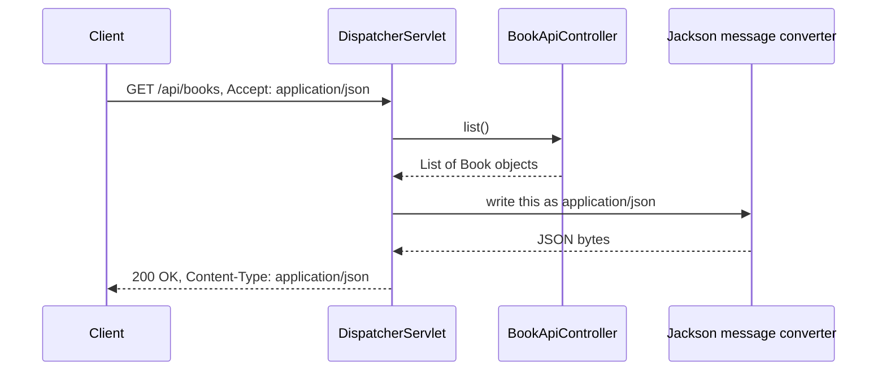

# REST endpoints with @RestController and ResponseEntity

> **Before this lesson:** you can map requests to controller methods, read path variables and request parameters, and you know the HTTP methods and what idempotent means ([Request parameters, path variables and the Model](#/lesson/spring/spring-request-data), [HTTP methods and HTML forms](#/lesson/spring/spring-http-methods-forms)).

## In plain words

A restaurant can serve its food in two ways. In the dining room each dish arrives on a plate, arranged and garnished for a person to look at. At the delivery hatch the same food goes out in plain labelled boxes, because the receiver is a courier who will pass it on. The kitchen is the same; only the presentation differs.

So far our controllers served the dining room: complete HTML pages for humans. Many clients are programs: a single-page JavaScript application, a mobile app, another company's server. They want the labelled box, meaning the data itself in a format that is easy for code to read, almost always **JSON**. A web interface designed for programs is called an **API** (application programming interface), and the dominant style for such APIs over HTTP is **REST**.

This lesson builds a REST API for the bookshop's catalogue with `@RestController`, shows how Java objects become JSON, and teaches you to control the status code and headers of the response with `ResponseEntity`. Building REST endpoints is the single most common task in Spring jobs.

## REST in four ideas

REST (representational state transfer) is a set of conventions for using HTTP as it was designed.

1. **Resources have addresses.** Each thing the API exposes (a book, an order, the collection of all books) has a URL made of nouns: `/api/books`, `/api/books/9780441172719`.
2. **HTTP methods are the verbs.** You do not invent `/api/getBook` or `/api/deleteBook`. You send GET or DELETE to the book's address.
3. **Representations travel.** Client and server exchange a *representation* of the resource, typically JSON.
4. **Status codes report the outcome.** The code says whether it worked and, if not, whose fault it was.

The standard mapping for a collection of books:

| Request | Meaning | Success status |
|---|---|---|
| `GET /api/books` | list books | 200 OK |
| `GET /api/books/{isbn}` | read one book | 200 OK (404 if unknown) |
| `POST /api/books` | create a book | 201 Created + `Location` header |
| `PUT /api/books/{isbn}` | replace a book | 200 OK or 204 No Content |
| `PATCH /api/books/{isbn}` | change some fields | 200 OK |
| `DELETE /api/books/{isbn}` | remove a book | 204 No Content |

Status codes come in families; the first digit carries the main message.

| Family | Meaning | Examples you will use |
|---|---|---|
| 2xx | success | 200 OK, 201 Created, 202 Accepted, 204 No Content |
| 3xx | look elsewhere | 301 Moved Permanently, 302 Found, 304 Not Modified |
| 4xx | the client did something wrong | 400 Bad Request, 401 Unauthorized, 403 Forbidden, 404 Not Found, 409 Conflict, 422 Unprocessable Content |
| 5xx | the server failed | 500 Internal Server Error, 503 Service Unavailable |

> [!INTERVIEW]
> "401 versus 403?" 401 Unauthorized means "I do not know who you are": credentials are missing or invalid, so authenticate and try again. 403 Forbidden means "I know who you are and you may not do this": repeating the request will not help. Mixing them up is a classic API mistake.

## From @Controller to @RestController

In a `@Controller`, a returned `String` is a view name. To send data instead, the method needs `@ResponseBody`, which says "write my return value into the body of the response". `@RestController` is `@Controller` with `@ResponseBody` applied to every method.

```java
// src/main/java/com/bookshop/catalogue/Book.java
package com.bookshop.catalogue;

public record Book(String isbn, String title, String author, int priceCents) { }
```

```java
// src/main/java/com/bookshop/catalogue/BookApiController.java
package com.bookshop.catalogue;

import org.springframework.web.bind.annotation.*;

import java.util.List;

@RestController                              // return values become the response body
@RequestMapping("/api/books")
public class BookApiController {

    private final BookService books;

    public BookApiController(BookService books) {
        this.books = books;
    }

    @GetMapping
    public List<Book> list() {
        return books.findAll();              // a Java List of records
    }
}
```

```bash
curl -i http://localhost:8080/api/books
```

```text
HTTP/1.1 200
Content-Type: application/json

[{"isbn":"9780441172719","title":"Dune","author":"Frank Herbert","priceCents":1250},
 {"isbn":"9780141439587","title":"Emma","author":"Jane Austen","priceCents":800}]
```

The method returned a `List<Book>`; the client received JSON text with status 200. Two pieces of machinery did that.

## How objects become JSON

The component that converts between Java objects and the bytes of an HTTP body is an **`HttpMessageConverter`**. Boot's web starter includes the **Jackson** library and registers a converter based on it. Jackson turns each record component (or each getter of a regular class) into a JSON property.



Compare with the page flow from [Spring MVC: the request flow through DispatcherServlet](#/lesson/spring/spring-mvc-request-flow): the view resolver and template are gone; a message converter takes their place.

Which converter is used depends on **content negotiation**. The client's `Accept` header lists the formats it understands; the server picks one it can produce. With only Jackson's JSON support present, the answer is JSON. If the client insists on a format the server cannot write, the response is `406 Not Acceptable`. You can restrict an endpoint explicitly:

```java
@GetMapping(produces = MediaType.APPLICATION_JSON_VALUE)
public List<Book> list() { ... }
```

A **media type** (also called content type or MIME type) is a label such as `application/json` or `text/html` that names a data format. The model below performs the negotiation for a few `Accept` headers.

```python-run
def negotiate(accept_header, producible):
    entries = []
    for position, raw in enumerate((accept_header or "*/*").split(",")):
        parts = [p.strip().lower() for p in raw.split(";")]
        quality = 1.0
        for parameter in parts[1:]:
            if parameter.startswith("q="):
                quality = float(parameter[2:])
        if quality > 0:
            specificity = 2 if parts[0] == "*/*" else 1 if parts[0].endswith("/*") else 0
            entries.append((-quality, specificity, position, parts[0]))
    for _, _, _, wanted in sorted(entries):          # best quality first, then most specific
        for candidate in producible:
            same_type = wanted.endswith("/*") and candidate.split("/")[0] == wanted[:-2]
            if wanted in ("*/*", candidate) or same_type:
                return candidate
    return "406 Not Acceptable"

SERVER_CAN_WRITE = ["application/json", "application/xml"]

for header in [None, "application/json", "application/xml, application/json;q=0.5",
               "text/html, application/*;q=0.8", "image/png"]:
    print(f"Accept: {str(header):45} -> {negotiate(header, SERVER_CAN_WRITE)}")
```

The `q=` values are the client's preferences from 0 to 1 (default 1). The third line shows XML winning because JSON was given a lower preference; the last line shows the 406 case. The practice problem [Content negotiation with the Accept header](#/problem/spring-content-negotiation) asks you to implement this.

### Shaping the JSON

| Need | How |
|---|---|
| Rename a property | `@JsonProperty("price_cents")` on the component or getter |
| Hide a property | `@JsonIgnore` |
| Omit `null` values | `@JsonInclude(JsonInclude.Include.NON_NULL)` on the class, or `spring.jackson.default-property-inclusion=non_null` |
| Dates as ISO text | default in Boot for `java.time` types: `"2026-03-01T10:15:30"` |
| Different naming style | `spring.jackson.property-naming-strategy=SNAKE_CASE` |

## Controlling the response with ResponseEntity

Returning a plain object always gives status 200 and default headers. A proper API needs more: 201 after creation, 404 for unknown ids, 204 for an empty success. `ResponseEntity<T>` is an object describing the whole response: status, headers and body.

```java
// src/main/java/com/bookshop/catalogue/BookApiController.java
@RestController
@RequestMapping("/api/books")
public class BookApiController {

    private final BookService books;

    public BookApiController(BookService books) {
        this.books = books;
    }

    @GetMapping
    public List<Book> list(@RequestParam(required = false) String author) {
        return author == null ? books.findAll() : books.findByAuthor(author);
    }

    @GetMapping("/{isbn}")
    public ResponseEntity<Book> one(@PathVariable String isbn) {
        return books.find(isbn)                               // Optional<Book>
                .map(ResponseEntity::ok)                      // found: 200 with the book as body
                .orElse(ResponseEntity.notFound().build());   // not found: 404 without body
    }

    @PostMapping
    public ResponseEntity<Book> create(@RequestBody Book book) {
        Book saved = books.add(book);
        URI location = URI.create("/api/books/" + saved.isbn());
        return ResponseEntity.created(location).body(saved);  // 201 + Location header + body
    }

    @PutMapping("/{isbn}")
    public ResponseEntity<Book> replace(@PathVariable String isbn, @RequestBody Book book) {
        return ResponseEntity.ok(books.replace(isbn, book));
    }

    @DeleteMapping("/{isbn}")
    public ResponseEntity<Void> delete(@PathVariable String isbn) {
        books.remove(isbn);
        return ResponseEntity.noContent().build();            // 204, nothing in the body
    }
}
```

Reading the new parts:

- `books.find(isbn)` returns an `Optional<Book>`: a container that either holds a book or is empty. `.map(ResponseEntity::ok)` turns a present book into a 200 response; `.orElse(...)` supplies the 404 when it is empty.
- `ResponseEntity.created(location)` sets status 201 and the `Location` header, which tells the client the address of the new resource.
- `@RequestBody Book book` asks Spring to read the request body and convert the JSON into a `Book`. The same message converter works in the other direction. Request bodies and their validation are the subject of the next lesson.
- `ResponseEntity<Void>` documents a response without a body.

Try it:

```bash
curl -i -X POST http://localhost:8080/api/books \
     -H "Content-Type: application/json" \
     -d '{"isbn":"9780345391803","title":"The Hitchhiker'\''s Guide to the Galaxy","author":"Douglas Adams","priceCents":999}'
```

```text
HTTP/1.1 201
Location: /api/books/9780345391803
Content-Type: application/json

{"isbn":"9780345391803","title":"The Hitchhiker's Guide to the Galaxy","author":"Douglas Adams","priceCents":999}
```

```bash
curl -i http://localhost:8080/api/books/0000000000000
```

```text
HTTP/1.1 404
Content-Length: 0
```

```bash
curl -i -X DELETE http://localhost:8080/api/books/9780345391803
```

```text
HTTP/1.1 204
```

Useful factory methods:

| Call | Status |
|---|---|
| `ResponseEntity.ok(body)` | 200 |
| `ResponseEntity.created(uri).body(body)` | 201 with `Location` |
| `ResponseEntity.accepted().build()` | 202 |
| `ResponseEntity.noContent().build()` | 204 |
| `ResponseEntity.badRequest().body(problem)` | 400 |
| `ResponseEntity.notFound().build()` | 404 |
| `ResponseEntity.status(HttpStatus.CONFLICT).body(problem)` | any status |
| `.header("X-Total-Count", "42")` | add a header (chain before `body`/`build`) |

When the status is fixed and success is the only path, an annotation is lighter:

```java
@PostMapping
@ResponseStatus(HttpStatus.CREATED)          // always 201 when the method returns normally
public Book create(@RequestBody Book book) {
    return books.add(book);
}
```

> [!TIP]
> Return the plain object when the answer is always 200. Use `@ResponseStatus` for one fixed non-200 success code. Use `ResponseEntity` when the status or headers depend on what happened. Error statuses are best produced by exceptions and a central handler, shown in the next lesson, so that controller methods contain only the success path.

## A tiny REST server model

To connect the pieces, here is the whole request-response cycle in a few lines: routing by method and path, a handler returning status, headers and body, and serialisation to JSON at the edge.

```python-run
import json

BOOKS = {"9780441172719": {"isbn": "9780441172719", "title": "Dune", "priceCents": 1250}}

def list_books(_, body):
    return 200, {}, list(BOOKS.values())

def get_book(isbn, body):
    return (200, {}, BOOKS[isbn]) if isbn in BOOKS else (404, {}, None)

def create_book(_, body):
    if body["isbn"] in BOOKS:
        return 409, {}, {"detail": "a book with this ISBN already exists"}
    BOOKS[body["isbn"]] = body
    return 201, {"Location": "/api/books/" + body["isbn"]}, body

def delete_book(isbn, body):
    BOOKS.pop(isbn, None)                      # idempotent: deleting twice is fine
    return 204, {}, None

ROUTES = {("GET", False): list_books, ("POST", False): create_book,
          ("GET", True): get_book, ("DELETE", True): delete_book}

def dispatch(method, path, json_body=None):
    segments = path.strip("/").split("/")                     # ["api", "books"] or ["api", "books", isbn]
    has_id = len(segments) == 3
    handler = ROUTES.get((method, has_id))
    if handler is None:
        return "405 Method Not Allowed"
    body = json.loads(json_body) if json_body else None       # message converter: JSON -> object
    status, headers, result = handler(segments[2] if has_id else None, body)
    text = "" if result is None else json.dumps(result)       # message converter: object -> JSON
    return f"{status} {headers} {text}".strip()

new_book = '{"isbn": "9780141439587", "title": "Emma", "priceCents": 800}'
for request in [("GET", "/api/books"), ("POST", "/api/books", new_book), ("POST", "/api/books", new_book),
                ("GET", "/api/books/9780141439587"), ("DELETE", "/api/books/9780141439587"),
                ("GET", "/api/books/9780141439587"), ("PUT", "/api/books")]:
    print(request[0], request[1], "->", dispatch(*request))
```

Each handler returns the three parts of a response, exactly what a `ResponseEntity` holds. Notice the second POST: creating a book whose ISBN exists answers `409 Conflict`. And the final GET after DELETE correctly reports 404.

## Designing the API well

- **Nouns in paths, plural for collections:** `/api/books/{isbn}/reviews`, not `/api/getReviewsForBook`.
- **Nest only to show ownership,** and not deeper than one or two levels.
- **Filtering, sorting and paging are query parameters:** `/api/books?author=Austen&sort=title&page=0&size=20`.
- **Do not expose your database rows.** A response class separate from the internal entity lets the database change without breaking clients. Such classes are called **DTOs**, data transfer objects, and records suit them well.
- **Version when you break compatibility:** `/api/v1/books`, or a version in a header.
- **Be consistent.** The same error format, naming style and paging parameters everywhere.

> [!WARNING]
> Returning internal objects directly is the fastest way to leak data. A `Customer` object with a `passwordHash` field becomes JSON with a `passwordHash` property unless someone remembers `@JsonIgnore`. A dedicated response record that lists exactly the public fields cannot leak what it does not contain.

## Pitfalls

- **Always 200.** Returning `200 OK` with `{"error": "not found"}` forces every client to parse bodies to detect failure. Use the status line.
- **`@Controller` instead of `@RestController`.** A returned object is treated as model data and Spring looks for a view; a returned `String` is treated as a view name.
- **A class without accessors.** Jackson serialises through getters or record components. A class with private fields and no getters produces `{}` or an error.
- **Missing `Content-Type` on a POST.** A JSON body sent without `Content-Type: application/json` is rejected with `415 Unsupported Media Type`.
- **Verbs in URLs and GET requests that modify data.** They break caching, retries and the expectations of every HTTP tool.
- **Null from a controller method.** Returning `null` yields 200 with an empty body, which rarely means what you intended. Return 404 or 204 explicitly.
- **Trailing slashes and case.** `/api/books/` and `/api/Books` do not match `/api/books`.
- **Business logic in the controller.** The controller translates between HTTP and the service; rules belong in the service layer.

## Cheat sheet

| Annotation / type | Meaning |
|---|---|
| `@RestController` | `@Controller` + `@ResponseBody` on every method |
| `@ResponseBody` | write the return value to the response body |
| `@RequestBody` | read the request body into the parameter |
| `@GetMapping`, `@PostMapping`, `@PutMapping`, `@PatchMapping`, `@DeleteMapping` | map by HTTP method |
| `produces = "application/json"` / `consumes = …` | restrict response / request media types |
| `ResponseEntity<T>` | status + headers + body |
| `@ResponseStatus(HttpStatus.CREATED)` | fixed success status for a method |
| `HttpMessageConverter` | converts objects to and from body bytes (Jackson for JSON) |
| `@JsonProperty`, `@JsonIgnore`, `@JsonInclude` | shape the JSON |
| `Accept` / `Content-Type` headers | format the client wants / format of the body sent |

## Summary

- A REST API exposes resources at noun-based URLs, uses HTTP methods as verbs, exchanges representations (JSON) and reports outcomes with status codes.
- `@RestController` writes return values to the response body; a message converter (Jackson) turns objects into JSON.
- Content negotiation matches the client's `Accept` header against what the server can produce.
- `ResponseEntity` gives full control over status, headers and body: 201 with `Location` for creation, 204 for empty success, 404 for unknown resources.
- Keep controllers thin, return purpose-built response objects, and let the status code speak.

## Glossary

- **API**: an interface through which programs use a service.
- **Content negotiation**: choosing the response format from the client's preferences and the server's abilities.
- **DTO (data transfer object)**: an object shaped for exchange with clients.
- **Endpoint**: one combination of HTTP method and URL that an API handles.
- **`HttpMessageConverter`**: Spring's converter between Java objects and HTTP bodies.
- **Jackson**: the JSON library Spring Boot uses by default.
- **Media type**: a label naming a data format, such as `application/json`.
- **Representation**: the form in which a resource is transferred, for example a JSON document.
- **Resource**: anything an API exposes at an address.
- **REST**: an architectural style that uses HTTP's methods, addresses and status codes as designed.

```quiz
[
  {"q": "What does @RestController add to @Controller?",
   "options": ["Security", "@ResponseBody on every handler method", "A database connection", "Automatic validation"],
   "answer": 1,
   "explain": "Return values are written to the response body through a message converter instead of being interpreted as view names."},
  {"q": "Which response is the conventional answer to a successful POST that creates a resource?",
   "options": ["200 OK with no headers", "201 Created with a Location header", "204 No Content", "302 Found"],
   "answer": 1,
   "explain": "201 signals creation, and Location gives the address of the new resource."},
  {"q": "A client requests GET /api/books/000 and no such book exists. What should the API return?",
   "options": ["200 with an empty object", "200 with {\"error\": \"not found\"}", "404 Not Found", "500 Internal Server Error"],
   "answer": 2,
   "explain": "The resource does not exist, which is a client-side addressing problem expressed by 404."},
  {"q": "Which component turns a returned Java object into JSON?",
   "options": ["The ViewResolver", "An HttpMessageConverter backed by Jackson", "The DataSource", "Thymeleaf"],
   "answer": 1,
   "explain": "Message converters translate between objects and body bytes; Boot registers a Jackson-based one for JSON."},
  {"q": "The client sends Accept: image/png to an endpoint that can only produce JSON. Result?",
   "options": ["JSON anyway with status 200", "406 Not Acceptable", "415 Unsupported Media Type", "404 Not Found"],
   "answer": 1,
   "explain": "406 means the server cannot produce any format the client accepts. 415 concerns the format of the request body."},
  {"q": "When is ResponseEntity the right return type?",
   "options": ["Always, for every method", "When the status code or headers depend on the outcome", "Only for DELETE", "Never; use @ResponseStatus"],
   "answer": 1,
   "explain": "Plain objects suffice for a constant 200; ResponseEntity is for responses whose status or headers vary."},
  {"q": "What is the difference between 401 and 403?",
   "options": ["They are interchangeable", "401: not authenticated; 403: authenticated but not allowed", "401 is a server error", "403 means the resource does not exist"],
   "answer": 1,
   "explain": "401 asks the client to authenticate. 403 says the identified caller lacks permission."}
]
```

> **Source:** Spilcă, *Spring Start Here*, ch. 10 (REST services, implementing an endpoint, managing the HTTP response). Documentation: https://docs.spring.io/spring-framework/reference/web/webmvc/mvc-controller/ann-methods/responseentity.html and https://docs.spring.io/spring-framework/reference/web/webmvc/mvc-config/message-converters.html
