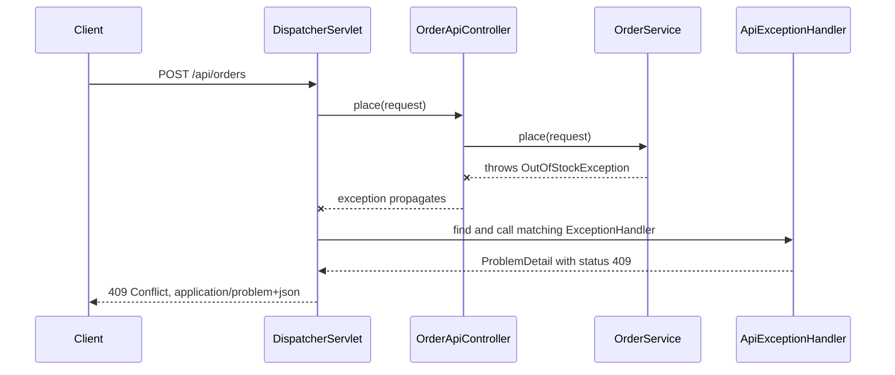

# Request bodies, validation and error handling with @RestControllerAdvice

> **Before this lesson:** you can write a `@RestController` that returns JSON and sets the status with `ResponseEntity` ([REST endpoints with @RestController and ResponseEntity](#/lesson/spring/spring-rest-controllers)). You know Java exceptions, including the difference between checked and unchecked ([Exception handling](#/lesson/java/java-exceptions-basics)).

## In plain words

A parcel office accepts parcels at a counter. The clerk first checks the form: is the address filled in, is the weight a positive number, is the postcode the right length? A form with mistakes is handed back at once, with every mistake circled, before the parcel goes anywhere. Later something else may go wrong: the destination does not exist, or the van breaks down. For those cases the office has one complaints desk that answers every customer in the same polite, standard format, whatever department the problem came from.

An API needs the same two things. **Validation** checks incoming data at the door and reports all problems precisely. **Centralised error handling** turns every failure, from every controller, into a consistent response with the correct status code. This lesson covers reading a JSON body with `@RequestBody`, validating it with constraint annotations, and building the complaints desk with `@RestControllerAdvice`.

APIs are judged by how they fail. A client developer integrating with your service spends more time reading your error responses than your success responses, and interviewers reliably ask how you handle exceptions in a REST service.

## Reading a JSON body

```java
// src/main/java/com/bookshop/order/OrderRequest.java
package com.bookshop.order;

public record OrderRequest(String customerEmail, String isbn, Integer quantity) { }
```

```java
// src/main/java/com/bookshop/order/OrderApiController.java
@RestController
@RequestMapping("/api/orders")
public class OrderApiController {

    private final OrderService orders;

    public OrderApiController(OrderService orders) {
        this.orders = orders;
    }

    @PostMapping
    public ResponseEntity<OrderConfirmation> place(@RequestBody OrderRequest request) {
        OrderConfirmation confirmation = orders.place(request);
        return ResponseEntity
                .created(URI.create("/api/orders/" + confirmation.orderId()))
                .body(confirmation);
    }
}
```

`@RequestBody` tells Spring to take the body of the HTTP request, hand it to a message converter and pass the resulting object to the method. With JSON, Jackson matches property names to record components.

```bash
curl -i -X POST http://localhost:8080/api/orders \
     -H "Content-Type: application/json" \
     -d '{"customerEmail":"ana@example.com","isbn":"9780441172719","quantity":2}'
```

Things that go wrong before your method runs, and what Spring answers:

| Problem | Status | Exception behind it |
|---|---|---|
| Body is not valid JSON, or a value has the wrong type (`"quantity":"two"`) | 400 | `HttpMessageNotReadableException` |
| No body at all | 400 | `HttpMessageNotReadableException` |
| `Content-Type` header missing or not supported | 415 | `HttpMediaTypeNotSupportedException` |

A property missing from the JSON is **not** an error for Jackson: the component is set to `null`. Checking for that is validation's job.

> [!NOTE]
> Request records such as `OrderRequest` are DTOs: they describe what the client may send, nothing more. A field like `totalPriceCents` or `status` is absent on purpose, so that a client cannot set it.

## Validation with constraint annotations

**Jakarta Bean Validation** is a standard set of annotations that declare rules on fields, with a library (Hibernate Validator) that checks them. Add the starter:

```xml
<dependency>
    <groupId>org.springframework.boot</groupId>
    <artifactId>spring-boot-starter-validation</artifactId>
</dependency>
```

```java
// src/main/java/com/bookshop/order/OrderRequest.java
package com.bookshop.order;

import jakarta.validation.constraints.*;

public record OrderRequest(
        @NotBlank @Email String customerEmail,
        @NotNull @Pattern(regexp = "[0-9]{13}", message = "must be 13 digits") String isbn,
        @NotNull @Min(1) @Max(50) Integer quantity) { }
```

```java
@PostMapping
public ResponseEntity<OrderConfirmation> place(@Valid @RequestBody OrderRequest request) { ... }
```

`@Valid` is the switch. Without it the annotations on the record are decoration. With it, Spring validates the object after conversion; if any rule fails, it throws `MethodArgumentNotValidException` and your method is not called.

Common constraints:

| Annotation | Valid when |
|---|---|
| `@NotNull` | the value is not `null` |
| `@NotEmpty` | a string, collection or array is not `null` and not empty |
| `@NotBlank` | a string contains at least one non-whitespace character |
| `@Size(min, max)` | length of a string or size of a collection is within bounds |
| `@Min(n)`, `@Max(n)` | a number is at least / at most `n` |
| `@Positive`, `@PositiveOrZero` | a number is > 0 / ≥ 0 |
| `@Email` | the text looks like an e-mail address |
| `@Pattern(regexp)` | the whole text matches the regular expression |
| `@Past`, `@Future` | a date is before / after now |
| `@Valid` on a field | validate the nested object too |

One rule surprises everybody once: **`null` is considered valid by every constraint except the `Not…` family.** `@Min(1) Integer quantity` accepts a missing quantity. The reasoning is that "optional, but if present then at least 1" must be expressible. For "mandatory and at least 1" combine `@NotNull @Min(1)`.

The model below is a small validator with that null rule built in.

```python-run
import re

def check(rule, value):
    kind = rule[0]
    if kind == "NotNull":
        return None if value is not None else "must not be null"
    if kind == "NotBlank":
        return None if isinstance(value, str) and value.strip() else "must not be blank"
    if value is None:
        return None                                    # null passes every other constraint
    if kind == "Min":
        return None if value >= rule[1] else f"must be greater than or equal to {rule[1]}"
    if kind == "Max":
        return None if value <= rule[1] else f"must be less than or equal to {rule[1]}"
    if kind == "Email":
        return None if re.fullmatch(r"[^@\s]+@[^@\s]+", value) else "must be a well-formed email address"
    if kind == "Pattern":
        return None if re.fullmatch(rule[1], value) else f'must match "{rule[1]}"'

ORDER_REQUEST = {
    "customerEmail": [("NotBlank",), ("Email",)],
    "isbn": [("NotNull",), ("Pattern", "[0-9]{13}")],
    "quantity": [("NotNull",), ("Min", 1), ("Max", 50)],
}

def validate(constraints, body):
    errors = []
    for field in sorted(constraints):
        for rule in constraints[field]:
            message = check(rule, body.get(field))
            if message:
                errors.append({"field": field, "message": message})    # collect ALL, do not stop
    return (400, errors) if errors else (200, [])

for body in [{"customerEmail": "ana@example.com", "isbn": "9780441172719", "quantity": 2},
             {"customerEmail": "ana(at)example.com", "isbn": "978", "quantity": 0},
             {}]:
    print(validate(ORDER_REQUEST, body))
```

The second body produces three errors, one per field. The empty body produces three as well, but only from the `Not…` rules: `Email`, `Pattern`, `Min` and `Max` all pass on `null`. Validation never stops at the first problem; the client gets the complete list in one round trip. The practice problem [Bean Validation: collect field errors](#/problem/spring-bean-validation) extends this checker.

To validate plain parameters (path variables, request parameters), put the constraint on the parameter itself:

```java
@GetMapping("/{id}")
public OrderView one(@PathVariable @Positive long id) { ... }
```

In current Spring versions a violation here results in a 400 response through `HandlerMethodValidationException`.

## What a good error response looks like

Without further work, Boot answers a validation failure with a generic JSON document (`timestamp`, `status`, `error`, `path`). It is not wrong, but clients cannot see *which field* is at fault. There is an Internet standard for error bodies, **Problem Details** (RFC 9457), with these members:

| Member | Meaning |
|---|---|
| `type` | a URI identifying the kind of problem |
| `title` | short human-readable summary of the kind |
| `status` | the HTTP status code |
| `detail` | explanation of this occurrence |
| `instance` | the request path or an id of this occurrence |
| extra members | anything else useful, for example a list of field errors |

Spring models it with the class `ProblemDetail`, sent with the media type `application/problem+json`. The setting `spring.mvc.problemdetails.enabled=true` makes Boot use this format for the exceptions Spring MVC itself raises.

## The complaints desk: @RestControllerAdvice

A class annotated `@RestControllerAdvice` contains methods annotated `@ExceptionHandler`. When any controller method throws, the dispatcher looks for a handler method whose declared exception type fits, calls it, and writes its return value as the response.

```java
// src/main/java/com/bookshop/web/ApiExceptionHandler.java
package com.bookshop.web;

import com.bookshop.order.BookNotFoundException;
import com.bookshop.order.OutOfStockException;
import org.slf4j.Logger;
import org.slf4j.LoggerFactory;
import org.springframework.http.HttpStatus;
import org.springframework.http.ProblemDetail;
import org.springframework.web.bind.MethodArgumentNotValidException;
import org.springframework.web.bind.annotation.ExceptionHandler;
import org.springframework.web.bind.annotation.RestControllerAdvice;

import java.util.List;
import java.util.Map;

@RestControllerAdvice                                        // applies to every @RestController
public class ApiExceptionHandler {

    private static final Logger log = LoggerFactory.getLogger(ApiExceptionHandler.class);

    @ExceptionHandler(MethodArgumentNotValidException.class)                       // (1)
    ProblemDetail invalid(MethodArgumentNotValidException e) {
        List<Map<String, String>> errors = e.getBindingResult().getFieldErrors().stream()
                .map(f -> Map.of("field", f.getField(), "message", String.valueOf(f.getDefaultMessage())))
                .toList();
        ProblemDetail problem = ProblemDetail.forStatusAndDetail(HttpStatus.BAD_REQUEST, "Validation failed");
        problem.setProperty("errors", errors);                                     // extra member
        return problem;
    }

    @ExceptionHandler(BookNotFoundException.class)                                 // (2)
    ProblemDetail notFound(BookNotFoundException e) {
        return ProblemDetail.forStatusAndDetail(HttpStatus.NOT_FOUND, e.getMessage());
    }

    @ExceptionHandler(OutOfStockException.class)                                   // (3)
    ProblemDetail outOfStock(OutOfStockException e) {
        ProblemDetail problem = ProblemDetail.forStatusAndDetail(HttpStatus.CONFLICT, e.getMessage());
        problem.setProperty("available", e.available());
        return problem;
    }

    @ExceptionHandler(Exception.class)                                             // (4)
    ProblemDetail unexpected(Exception e) {
        log.error("Unhandled exception", e);                                       // details go to the log
        return ProblemDetail.forStatusAndDetail(HttpStatus.INTERNAL_SERVER_ERROR,
                "Something went wrong on our side.");                              // not to the client
    }
}
```

1. Validation failures become 400 with a list of field errors.
2. A domain exception becomes 404.
3. Another becomes 409 Conflict, with an extra property.
4. A catch-all for everything unforeseen: log the full details, send a neutral message.

When a handler returns a `ProblemDetail`, Spring takes the response status from it. The exceptions are ordinary unchecked exceptions thrown by the service layer:

```java
// src/main/java/com/bookshop/order/BookNotFoundException.java
public class BookNotFoundException extends RuntimeException {
    public BookNotFoundException(String isbn) {
        super("No book with ISBN " + isbn);
    }
}
```

```java
// in OrderService
public OrderConfirmation place(OrderRequest request) {
    Book book = books.find(request.isbn())
            .orElseThrow(() -> new BookNotFoundException(request.isbn()));
    if (stock.available(book.isbn()) < request.quantity()) {
        throw new OutOfStockException(book.isbn(), stock.available(book.isbn()));
    }
    ...
}
```

The controller now contains only the success path. Results:

```bash
curl -s -X POST http://localhost:8080/api/orders -H "Content-Type: application/json" \
     -d '{"customerEmail":"ana(at)example.com","isbn":"978","quantity":0}'
```

```text
HTTP/1.1 400
Content-Type: application/problem+json

{"type":"about:blank","title":"Bad Request","status":400,"detail":"Validation failed",
 "instance":"/api/orders",
 "errors":[{"field":"customerEmail","message":"must be a well-formed email address"},
           {"field":"isbn","message":"must be 13 digits"},
           {"field":"quantity","message":"must be greater than or equal to 1"}]}
```

```text
HTTP/1.1 404
{"type":"about:blank","title":"Not Found","status":404,"detail":"No book with ISBN 9780000000000","instance":"/api/orders"}
```



## How the handler is chosen

Several handlers may fit one exception: `OutOfStockException` is also a `RuntimeException` and an `Exception`. The rule: **the handler declared for the closest type in the inheritance chain wins.** A handler for the exact class beats one for its parent, which beats one for `Exception`. Declaration order in the file plays no part.

Two further sources of a status exist when no handler method applies:

- An exception class annotated `@ResponseStatus(HttpStatus.NOT_FOUND)` produces that status.
- Throwing `ResponseStatusException(HttpStatus.NOT_FOUND, "…")` does the same without a dedicated class.

If nothing applies at all, the response is 500.

```python-run
PARENT = {"Throwable": None, "Exception": "Throwable", "RuntimeException": "Exception",
          "ShopException": "RuntimeException", "BookNotFoundException": "ShopException",
          "OutOfStockException": "ShopException", "PaymentDeclinedException": "ShopException",
          "IllegalArgumentException": "RuntimeException", "IOException": "Exception"}

HANDLERS = {"BookNotFoundException": 404, "ShopException": 422, "Exception": 500}     # @ExceptionHandler
ANNOTATED = {"PaymentDeclinedException": 402, "IOException": 503}                     # @ResponseStatus

def resolve(thrown, handlers):
    lineage, cls = [], thrown
    while cls:                                   # thrown class, parent, grandparent, ...
        lineage.append(cls); cls = PARENT[cls]
    for cls in lineage:                          # 1. closest @ExceptionHandler
        if cls in handlers:
            return handlers[cls], f"handler for {cls}"
    for cls in lineage:                          # 2. closest @ResponseStatus annotation
        if cls in ANNOTATED:
            return ANNOTATED[cls], f"@ResponseStatus on {cls}"
    return 500, "default"

for thrown in ["BookNotFoundException", "OutOfStockException", "PaymentDeclinedException",
               "IllegalArgumentException", "IOException"]:
    print(f"{thrown:26} with catch-all   -> {resolve(thrown, HANDLERS)}")
without_catch_all = {k: v for k, v in HANDLERS.items() if k != "Exception"}
for thrown in ["IOException", "IllegalArgumentException"]:
    print(f"{thrown:26} without catch-all-> {resolve(thrown, without_catch_all)}")
```

`PaymentDeclinedException` is answered by the `ShopException` handler (422), not by its own `@ResponseStatus(402)`: a matching handler always takes priority over the annotation. Remove the catch-all and `IOException` falls through to its annotation. The practice problem [Map an exception to an HTTP status](#/problem/spring-exception-status) asks for this lookup.

> [!INTERVIEW]
> "How do you handle exceptions in a Spring REST API?" Throw meaningful (unchecked) exceptions from services; map them to responses in one `@RestControllerAdvice` class with `@ExceptionHandler` methods; return a consistent body, ideally RFC 9457 `ProblemDetail`; keep a catch-all for `Exception` that logs the stack trace and returns a generic 500 without internals. Mention that the most specific handler wins and that validation errors arrive as `MethodArgumentNotValidException`.

> [!TIP]
> Extend `ResponseEntityExceptionHandler` in your advice class to inherit handlers for all of Spring MVC's own exceptions (unreadable body, unsupported media type, missing parameter…) in Problem Details format, and override only what you want to change.

## Which status for which failure?

| Situation | Status |
|---|---|
| Malformed JSON, wrong types, failed bean validation | 400 Bad Request |
| No or invalid credentials | 401 Unauthorized |
| Authenticated but not permitted | 403 Forbidden |
| The addressed resource does not exist | 404 Not Found |
| The request conflicts with current state (duplicate, out of stock, stale version) | 409 Conflict |
| Well-formed and valid in shape, but violates a business rule | 422 Unprocessable Content (some teams use 400 or 409) |
| Too many requests | 429 Too Many Requests |
| A bug or unexpected failure in the server | 500 Internal Server Error |
| A dependency is down or the server is overloaded | 503 Service Unavailable |

The dividing line between 4xx and 5xx matters operationally: 4xx means "the caller must change something", 5xx means "we must fix something". Monitoring usually alerts on 5xx only.

> [!WARNING]
> Never send exception messages or stack traces of unexpected errors to the client. They reveal class names, SQL, file paths and library versions, which is a gift to attackers. Log them on the server with a correlation id and return the id in the response so that support can find the log entry.

## Pitfalls

- **Forgetting `@Valid`.** The constraints are silently ignored.
- **Forgetting the validation starter.** No validator on the classpath, nothing is checked.
- **Expecting `@Min`/`@Size`/`@Email` to reject `null`.** Add `@NotNull` or `@NotBlank`.
- **Constraints on a nested object without `@Valid` on the field.** The nested object is not visited.
- **Catching exceptions in every controller method.** Duplicated try/catch blocks that drift apart; this is what the advice class replaces.
- **A catch-all that hides everything.** Handling `Exception` without logging makes failures invisible.
- **Using exceptions for normal outcomes.** "No search results" is a 200 with an empty list, not an exception.
- **`@ControllerAdvice` without `@ResponseBody`.** In a REST API use `@RestControllerAdvice`; the plain variant tries to resolve return values as views.
- **Errors raised in filters.** Exceptions thrown before the dispatcher (for example in a servlet filter) do not reach `@ExceptionHandler` methods.

## Cheat sheet

| Annotation / type | Meaning |
|---|---|
| `@RequestBody` | convert the request body to the parameter's type |
| `@Valid` | validate the parameter with Bean Validation |
| `@NotNull`, `@NotBlank`, `@Size`, `@Min`, `@Max`, `@Email`, `@Pattern` | constraints |
| `MethodArgumentNotValidException` | thrown when a `@Valid @RequestBody` object fails validation |
| `HttpMessageNotReadableException` | unreadable or mistyped body |
| `@RestControllerAdvice` | global exception handling for REST controllers |
| `@ExceptionHandler(X.class)` | method handling `X` and its subclasses |
| `ProblemDetail` | RFC 9457 error body (`type`, `title`, `status`, `detail`, `instance`) |
| `@ResponseStatus` on an exception class | fallback status when no handler matches |
| `ResponseStatusException` | exception carrying a status, for ad-hoc use |
| `spring.mvc.problemdetails.enabled=true` | Problem Details for Spring MVC's built-in exceptions |

## Summary

- `@RequestBody` converts JSON to an object; unreadable input is rejected with 400 before your code runs.
- `@Valid` plus constraint annotations checks the object and reports all violations; `null` passes every constraint except the `Not…` ones.
- Services throw meaningful exceptions; one `@RestControllerAdvice` class maps them to statuses and a uniform body.
- The handler for the closest exception type wins; `@ResponseStatus` on an exception is a fallback; otherwise 500.
- Use Problem Details for a standard error format, choose 4xx versus 5xx by who must act, and never leak internals.

## Glossary

- **Bean Validation**: the Jakarta standard for declaring and checking constraints with annotations.
- **Constraint**: a rule a value must satisfy, such as `@NotBlank`.
- **`@ExceptionHandler`**: marks a method that converts an exception into a response.
- **Field error**: a validation failure attached to one property.
- **Problem Details**: the RFC 9457 standard JSON format for HTTP API errors.
- **`@RestControllerAdvice`**: a bean whose exception handlers apply to all REST controllers.
- **Validation**: checking that input satisfies declared rules before using it.
- **4xx / 5xx**: client-caused versus server-caused error status families.

```quiz
[
  {"q": "A record component is declared @Min(1) Integer quantity and the JSON body has no quantity property. Is the object valid?",
   "options": ["No, @Min rejects null", "Yes, null passes @Min; add @NotNull to require it", "It depends on the JSON library", "Jackson throws an exception"],
   "answer": 1,
   "explain": "Only the Not… constraints fail on null. All others treat null as valid so that optional fields can be expressed."},
  {"q": "What happens when @Valid is omitted from a @RequestBody parameter whose class has constraint annotations?",
   "options": ["Validation still runs", "The constraints are ignored and the method is called with whatever arrived", "The application does not start", "Spring returns 415"],
   "answer": 1,
   "explain": "@Valid triggers validation. Without it the annotations have no effect at the controller boundary."},
  {"q": "Which exception does Spring MVC throw when a @Valid @RequestBody object violates a constraint?",
   "options": ["IllegalArgumentException", "MethodArgumentNotValidException", "HttpMessageNotReadableException", "NullPointerException"],
   "answer": 1,
   "explain": "It carries a BindingResult with the field errors and maps to 400 by default."},
  {"q": "Handlers exist for ShopException and for Exception. A BookNotFoundException (subclass of ShopException) is thrown. Which handler runs?",
   "options": ["The Exception handler, because it is the most general", "The ShopException handler, because it is the closest type", "Both", "Neither; 500 is returned"],
   "answer": 1,
   "explain": "Spring picks the handler whose exception type is nearest to the thrown class in the hierarchy."},
  {"q": "What should the catch-all handler for Exception do?",
   "options": ["Return the stack trace to help the client", "Log the details on the server and return a generic 500 body", "Return 200 with an error flag", "Rethrow the exception"],
   "answer": 1,
   "explain": "Internals must not leak to clients, but the failure must be recorded for the team."},
  {"q": "A client sends well-formed JSON for an order of a book that is out of stock. Which status family is appropriate?",
   "options": ["2xx", "3xx", "4xx", "5xx"],
   "answer": 2,
   "explain": "The server works correctly; the request cannot be fulfilled in the current state. 409 or 422 are typical."},
  {"q": "What is ProblemDetail?",
   "options": ["A logging framework", "Spring's representation of the RFC 9457 standard error body", "A validation annotation", "A servlet filter"],
   "answer": 1,
   "explain": "It models type, title, status, detail and instance, plus custom properties, and is sent as application/problem+json."}
]
```

> **Source:** Spilcă, *Spring Start Here*, ch. 10 (managing exceptions at the controller level; using a request body). Documentation: https://docs.spring.io/spring-framework/reference/web/webmvc/mvc-ann-rest-exceptions.html and https://docs.spring.io/spring-framework/reference/web/webmvc/mvc-controller/ann-validation.html
