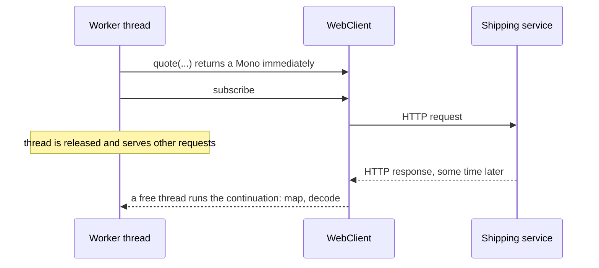
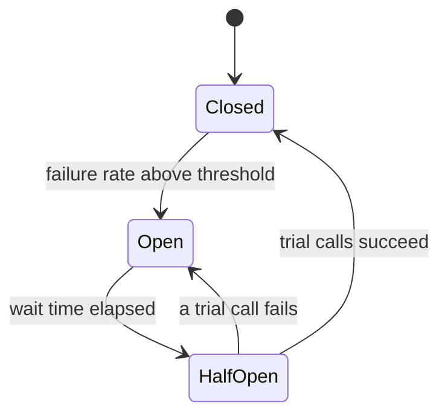

# WebClient, timeouts and resilient calls

> **Before this lesson:** you can call a REST endpoint with `RestClient` and know what "blocking" means ([Calling REST endpoints: RestTemplate, RestClient and OpenFeign](#/lesson/spring/spring-rest-clients)). Lambda expressions should look familiar ([Lambdas](#/lesson/java/java-lambdas)).

## In plain words

A waiter can work in two ways. In the first, the waiter takes one table's order, walks to the kitchen, and stands at the hatch until the food is ready. Nothing else gets done in the meantime; serving ten tables at once needs ten waiters. In the second, the waiter hands the order to the kitchen, receives a numbered ticket and immediately moves on to the next table. When the kitchen rings the bell for a ticket, whichever waiter is free carries the plates out. Two waiters can look after thirty tables, because nobody stands idle.

The first style is **blocking**: the thread that sent an HTTP request waits for the answer. `RestTemplate` and `RestClient` work this way. The second is **non-blocking**: the request is sent, the thread goes off to do other work, and the continuation ("when the answer arrives, do this") runs later. Spring's non-blocking HTTP client is **`WebClient`**, built on a style of programming called **reactive**.

This lesson teaches enough reactive vocabulary to read and write `WebClient` calls, shows when it is worth it, and then covers what every client needs regardless of style when the network misbehaves: timeouts, retries with backoff, and circuit breakers. Remote calls are where production systems fail, so interviewers probe this area hard.

## Why waiting is expensive

While a thread waits for a remote answer it does no work, yet it still occupies memory (roughly a megabyte of stack for a classic thread) and a slot in the server's thread pool. Tomcat's pool has 200 threads by default. If every request waits two seconds on a slow service, the server can complete at most about 100 requests per second, however fast the CPU is; the rest queue up.

The simulation compares the two styles on one "CPU". It uses Python's `asyncio`, a non-blocking toolkit, with `sleep` standing in for network waits.

```python-run
import asyncio, time

async def remote_call(name, seconds):
    await asyncio.sleep(seconds)                 # waiting for the network: the worker is free meanwhile
    return f"{name} done"

async def blocking_style(calls):
    results = []
    for name, seconds in calls:                  # one after another: each wait holds up the next call
        results.append(await remote_call(name, seconds))
    return results

async def non_blocking_style(calls):
    tasks = [remote_call(name, seconds) for name, seconds in calls]
    return await asyncio.gather(*tasks)          # all waits overlap

CALLS = [("payment", 0.3), ("stock", 0.2), ("shipping", 0.25)]

async def main():
    for label, style in [("one after another", blocking_style), ("overlapping", non_blocking_style)]:
        start = time.perf_counter()
        results = await style(CALLS)
        print(f"{label:18} {time.perf_counter() - start:.2f} s  {results}")

await main()                                 # this page's runner allows await at the top level
```

Sequential waiting takes the sum of the three delays, about 0.75 seconds. Overlapping takes about as long as the slowest call, 0.3 seconds, and a single worker handled all three. That is the promise of non-blocking I/O: time spent waiting does not consume a thread.

## Reactive vocabulary

**Reactive programming** describes a computation as a pipeline that data flows through when it becomes available. Spring uses the Project Reactor library, which has two central types:

| Type | Represents | Analogy |
|---|---|---|
| `Mono<T>` | a result that will arrive later: zero or one `T`, or an error | a ticket for one dish |
| `Flux<T>` | a stream of zero to many `T` arriving over time | a conveyor belt of dishes |

Both are **publishers**. Three facts about them explain most beginner confusion:

1. **Nothing happens until someone subscribes.** Building a `Mono` only describes the work. Returning it from a WebFlux controller makes Spring subscribe; in other code you call `subscribe(...)` or `block()`.
2. **You transform, you do not wait.** In place of `var x = call(); use(x);` you write `call().map(x -> use(x))`. The lambda runs when the value arrives.
3. **Errors travel down the pipeline** as signals. You handle them with operators such as `onErrorResume` in place of `try`/`catch`.

Common operators:

| Operator | Purpose |
|---|---|
| `map(f)` | transform the value synchronously |
| `flatMap(f)` | transform with a function that itself returns a `Mono`/`Flux` (another asynchronous step) |
| `filter(p)` | keep values that satisfy a condition |
| `zip(a, b)` / `Mono.zip` | wait for several publishers and combine their results |
| `timeout(d)` | fail if nothing arrives within `d` |
| `retryWhen(spec)` | resubscribe after an error according to a policy |
| `onErrorResume(f)` | replace an error with a fallback publisher |
| `doOnNext(f)`, `doOnError(f)` | side effects such as logging |
| `block()` | subscribe and wait for the result (leaves the non-blocking world) |

## WebClient

Add the reactive web starter. In an application that also has `spring-boot-starter-web`, Spring MVC stays in charge of serving requests and you gain `WebClient` as a client library.

```xml
<dependency>
    <groupId>org.springframework.boot</groupId>
    <artifactId>spring-boot-starter-webflux</artifactId>
</dependency>
```

```java
// src/main/java/com/bookshop/shipping/ShippingClientConfig.java
@Configuration
public class ShippingClientConfig {

    @Bean
    WebClient shippingWebClient(WebClient.Builder builder,
                                @Value("${shipping.base-url}") String baseUrl) {
        return builder
                .baseUrl(baseUrl)
                .defaultHeader(HttpHeaders.ACCEPT, MediaType.APPLICATION_JSON_VALUE)
                .build();
    }
}
```

`WebClient.Builder` is provided by Boot with its defaults applied. The fluent chain resembles `RestClient`, which was modelled on it:

```java
// src/main/java/com/bookshop/shipping/ShippingQuote.java
public record ShippingQuote(String carrier, int costCents, int days) { }
```

```java
// src/main/java/com/bookshop/shipping/ShippingClient.java
@Component
public class ShippingClient {

    private final WebClient client;

    public ShippingClient(WebClient shippingWebClient) {
        this.client = shippingWebClient;
    }

    public Mono<ShippingQuote> quote(String postcode, int weightGrams) {
        return client.get()
                .uri(uri -> uri.path("/v1/quotes")
                               .queryParam("postcode", postcode)
                               .queryParam("weight", weightGrams)
                               .build())
                .retrieve()                                           // describe the exchange
                .onStatus(HttpStatusCode::is4xxClientError,
                          response -> Mono.error(new InvalidAddressException(postcode)))
                .bodyToMono(ShippingQuote.class)                      // a Mono: nothing sent yet
                .timeout(Duration.ofSeconds(2));
    }
}
```

The method returns immediately with a `Mono<ShippingQuote>`: a description of "ask for a quote, map 4xx to our exception, decode the JSON, give up after two seconds". The request is sent only when something subscribes.

### Using it in a reactive application

In a WebFlux application the controller returns the publisher and the framework subscribes, without tying up a thread while waiting:

```java
@GetMapping("/api/shipping/quote")
public Mono<ShippingQuote> quote(@RequestParam String postcode, @RequestParam int weight) {
    return shippingClient.quote(postcode, weight);
}
```

### Combining calls

The real benefit appears when several calls can overlap:

```java
public Mono<CheckoutSummary> summary(Order order) {
    Mono<ShippingQuote> shipping = shippingClient.quote(order.postcode(), order.weightGrams());
    Mono<TaxQuote> tax = taxClient.quote(order.country(), order.subtotalCents());

    return Mono.zip(shipping, tax)                                   // both run concurrently
            .map(pair -> new CheckoutSummary(order.subtotalCents(),
                                             pair.getT1().costCents(),
                                             pair.getT2().taxCents()));
}
```

`Mono.zip` subscribes to both and emits once both have answered. The total time is that of the slower call.

### Using it in a blocking application

Inside a Spring MVC application you can bridge with `block()`:

```java
ShippingQuote quote = shippingClient.quote("28013", 450).block(Duration.ofSeconds(3));
```

The calling thread now waits, so nothing is gained over `RestClient` for a single call, and the code carries reactive complexity for no benefit. The legitimate reasons to use `WebClient` from MVC code are overlapping several calls (zip them, then block once) or consuming a stream.

> [!WARNING]
> Never call `block()` on a thread that belongs to the reactive runtime (inside a WebFlux handler, or inside a `map`/`flatMap` lambda). Those few threads serve every request; blocking one stalls many requests at once. Reactor detects common cases and throws `IllegalStateException: block()/blockFirst()/blockLast() are blocking, which is not supported in thread reactor-http-nio-…`.



## When to use which

| Situation | Choice |
|---|---|
| Ordinary Spring MVC service making occasional calls | `RestClient` |
| Several independent remote calls per request that can overlap | `WebClient` with `zip`, or `RestClient` with virtual threads |
| Server-sent events or other streamed responses | `WebClient` (`bodyToFlux`) |
| The whole application is reactive (WebFlux, reactive database driver) | `WebClient` |
| Very large numbers of concurrent, mostly idle connections | reactive stack, or virtual threads |

**Virtual threads**, standard since Java 21 and enabled in Boot with `spring.threads.virtual.enabled=true`, are lightweight threads that the JVM parks cheaply while they wait. They let blocking code scale much further and have taken over a good part of the territory for which reactive programming used to be the only answer. They are covered in [Actuator, Docker images and virtual threads](#/lesson/spring/spring-actuator-docker-vthreads).

> [!INTERVIEW]
> "RestClient or WebClient?" `RestClient` is synchronous and fits Spring MVC code: simple control flow, normal stack traces, normal try/catch. `WebClient` is non-blocking and returns `Mono`/`Flux`; it suits reactive applications, streaming and fan-out calls, at the cost of a steeper learning curve and harder debugging. Calling `block()` on every `WebClient` result in an MVC application gains nothing. With virtual threads available, blocking code scales well enough for most services.

## Making remote calls resilient

The network between two services fails in ways local method calls never do: answers arrive late, not at all, or only sometimes. Resilience means limiting the damage.

### Timeouts

Three different waits exist:

| Timeout | Limits | Typical value |
|---|---|---|
| connection timeout | establishing the TCP connection | 1 to 3 s |
| read / response timeout | waiting for (more of) the response | set a little above the remote service's slow-but-normal response time |
| overall timeout | the whole operation including retries | what your own caller is willing to wait |

A missing timeout converts somebody else's slowness into your outage.

### Retries with backoff

Some failures are **transient**: a connection reset, a 503 from an instance that is restarting. Trying again often succeeds. Do it carefully:

- retry only failures that can plausibly go away (network errors, 502, 503, 504, perhaps 429), never 400 or 404;
- retry only **idempotent** operations, or use an idempotency key;
- limit the number of attempts;
- wait between attempts, and wait longer each time (**exponential backoff**), so that a struggling service is not hammered;
- add randomness to the waits (**jitter**), so that many clients do not all retry at the same instant.

```java
return client.get().uri("/v1/quotes?postcode={p}", postcode)
        .retrieve()
        .bodyToMono(ShippingQuote.class)
        .timeout(Duration.ofSeconds(2))
        .retryWhen(Retry.backoff(3, Duration.ofMillis(200))          // up to 3 retries: 200, 400, 800 ms
                        .jitter(0.5)
                        .filter(e -> e instanceof TimeoutException || isServerError(e)))
        .onErrorResume(e -> Mono.just(ShippingQuote.unavailable()));  // fallback after giving up
```

The policy in runnable form, with a remote service that fails a set number of times:

```python-run
import random

def call_with_retry(operation, max_retries=3, first_delay_ms=200, factor=2, jitter=0.0, retryable=(503, 504)):
    delay, waited, log = first_delay_ms, 0, []
    for attempt in range(1, max_retries + 2):               # first try + retries
        status = operation(attempt)
        log.append(f"attempt {attempt}: {status}")
        if status < 400:
            return "success", waited, log
        if status not in retryable:
            return f"gave up: {status} is not retryable", waited, log
        if attempt > max_retries:
            break
        pause = delay * (1 + random.uniform(-jitter, jitter))
        log.append(f"   wait {pause:.0f} ms")
        waited += pause
        delay *= factor                                     # exponential backoff
    return "gave up: retries exhausted", waited, log

def flaky(fail_times, failure=503):
    return lambda attempt: failure if attempt <= fail_times else 200

random.seed(7)
for title, operation in [("recovers after 2 failures", flaky(2)),
                         ("stays down", flaky(99)),
                         ("client error", flaky(99, failure=400))]:
    outcome, waited, log = call_with_retry(operation, jitter=0.3)
    print(f"{title}: {outcome}, total wait {waited:.0f} ms")
    print("   " + "\n   ".join(log))
```

Compare the three cases: recovery on the third attempt; four attempts with growing pauses before giving up; and an immediate stop on 400, because repeating an invalid request cannot help. Set `jitter=0.0` to see the plain 200, 400, 800 progression. The practice problem [Retry with exponential backoff](#/problem/spring-retry-backoff) asks you to compute such a schedule exactly.

### Circuit breakers

When a dependency is down for minutes, retrying every request only adds load and makes every user wait for the timeout. A **circuit breaker** watches the failure rate and, above a threshold, **opens**: calls fail immediately without touching the network. After a pause it lets a few trial calls through (**half-open**); if they succeed it **closes** again.



In Spring this usually comes from the Resilience4j library, through `spring-cloud-starter-circuitbreaker-resilience4j` or Resilience4j's own Boot starter with annotations such as `@CircuitBreaker(name = "shipping", fallbackMethod = "defaultQuote")`. Those annotations are implemented as aspects, so the proxy rules from [How Spring AOP works: proxies and your first aspect](#/lesson/spring/spring-aop-proxies) apply.

### Fallbacks and bulkheads

A **fallback** is what you return when the dependency is unavailable: a cached value, a default ("shipping cost calculated at dispatch"), or a clear error. A **bulkhead** limits how many concurrent calls may go to one dependency, so that one slow service cannot consume all threads or connections. The name comes from the partitions that stop one leak from flooding a whole ship.

> [!TIP]
> Decide the user-visible behaviour first: "if shipping quotes are down, can the customer still check out?" Then choose the mechanisms. A fallback hides a failure from the user; it must not hide it from monitoring, so count and log every fallback.

## Pitfalls

- **Forgetting to subscribe.** A `Mono` that is created and ignored sends nothing. No error, no request.
- **`block()` on reactive threads.** Stalls the event loop or throws.
- **Using `WebClient` plus `block()` everywhere "because it is modern".** All of the complexity, none of the benefit.
- **Retrying non-idempotent calls.** Duplicate payments and duplicate orders.
- **Retrying without backoff or limit.** A brief outage becomes a self-inflicted flood, known as a *retry storm*.
- **Timeouts longer than the caller's own timeout.** Your caller has given up while you still wait and retry.
- **Stack traces without your code in them.** Reactive pipelines run on different threads, so traces show Reactor internals. The `checkpoint()` operator and Reactor's debug agent help.
- **Thread-bound context lost.** Values kept per thread (logging context, security context in some set-ups, request-scoped beans) do not automatically follow a reactive pipeline to another thread.

## Cheat sheet

| Type / operator | Meaning |
|---|---|
| `WebClient` + `WebClient.Builder` | non-blocking HTTP client and its Boot builder |
| `Mono<T>` / `Flux<T>` | zero-or-one / zero-to-many asynchronous results |
| `.retrieve().bodyToMono(T.class)` / `bodyToFlux` | describe the exchange and decoding |
| `.onStatus(predicate, fn)` | map error statuses to error signals |
| `map` / `flatMap` | synchronous / asynchronous transformation |
| `Mono.zip(a, b)` | run concurrently and combine |
| `.timeout(Duration)` | fail if too slow |
| `.retryWhen(Retry.backoff(n, d).jitter(j))` | retries with exponential backoff and jitter |
| `.onErrorResume(fn)` | fallback |
| `.block()` | wait for the result; never on reactive threads |
| Resilience4j `@CircuitBreaker`, `@Retry`, `@Bulkhead`, `@TimeLimiter` | resilience patterns as annotations |

## Summary

- Blocking clients hold a thread while waiting; non-blocking clients release it and continue when the response arrives.
- `WebClient` is Spring's non-blocking client. It returns `Mono` (one result) or `Flux` (a stream), which do nothing until subscribed.
- Use it in reactive applications, for streaming, or to overlap several calls; in ordinary MVC code `RestClient` is simpler, and virtual threads cover much of the scaling need.
- Every remote call needs timeouts. Retries must be limited, spaced with backoff and jitter, and restricted to idempotent operations and transient errors.
- Circuit breakers, fallbacks and bulkheads keep one failing dependency from taking your service down with it.

## Glossary

- **Backoff**: increasing the wait between successive retries.
- **Bulkhead**: a limit on concurrent use of one dependency to contain failures.
- **Circuit breaker**: a component that stops calls to a failing dependency for a while.
- **Fallback**: an alternative result used when a call fails.
- **`Flux`**: a Reactor publisher of zero to many items.
- **Jitter**: randomness added to wait times to spread retries out.
- **`Mono`**: a Reactor publisher of at most one item.
- **Non-blocking**: not holding a thread while waiting for input or output.
- **Reactive programming**: composing asynchronous data flows as pipelines of operators.
- **Retry storm**: a surge of load caused by many clients retrying at once.
- **Subscribe**: to start a reactive pipeline and receive its results.
- **Transient failure**: a failure likely to disappear if the operation is repeated.
- **Virtual thread**: a lightweight JVM-managed thread that is cheap to block.

```quiz
[
  {"q": "What does client.get().uri(...).retrieve().bodyToMono(Quote.class) do when it is executed without anything subscribing?",
   "options": ["Sends the request and discards the answer", "Nothing is sent; it only builds a description of the call", "Throws an exception", "Blocks the thread"],
   "answer": 1,
   "explain": "Reactive publishers are lazy. The HTTP request is made only on subscription."},
  {"q": "What is the difference between Mono and Flux?",
   "options": ["Mono is blocking, Flux is not", "Mono emits at most one item, Flux emits zero to many", "Mono is for GET, Flux for POST", "There is none"],
   "answer": 1,
   "explain": "Mono models a single future result; Flux models a stream of results over time."},
  {"q": "In a Spring MVC application, a single WebClient call is immediately followed by block(). Compared with RestClient this gives:",
   "options": ["Much higher throughput", "No real benefit, and more complexity", "Automatic retries", "Lower memory use"],
   "answer": 1,
   "explain": "The calling thread waits either way. WebClient pays off when calls overlap, when streaming, or in a fully reactive stack."},
  {"q": "Which failure is reasonable to retry automatically?",
   "options": ["400 Bad Request", "404 Not Found", "503 Service Unavailable on an idempotent GET", "A validation error"],
   "answer": 2,
   "explain": "503 is typically transient and a GET is idempotent. Client errors will fail again in the same way."},
  {"q": "Why add exponential backoff and jitter to retries?",
   "options": ["To make the code shorter", "To avoid hammering a struggling service and to stop many clients retrying at the same instant", "To increase the success status", "Because HTTP requires it"],
   "answer": 1,
   "explain": "Growing, randomised pauses give the service time to recover and spread the retry load."},
  {"q": "A circuit breaker is open. What happens to a call?",
   "options": ["It is sent with a longer timeout", "It fails immediately (or uses the fallback) without calling the remote service", "It is queued until the service recovers", "It is retried three times"],
   "answer": 1,
   "explain": "Open means short-circuit: no network call is made until the breaker moves to half-open and trial calls succeed."},
  {"q": "In the first simulation, why does the overlapping style take about 0.3 s instead of 0.75 s?",
   "options": ["It skips two calls", "The waits overlap, so the total is roughly the longest single wait", "It uses three CPUs", "Sleeping is faster in asyncio"],
   "answer": 1,
   "explain": "Non-blocking waits do not occupy the worker, so all three run concurrently and finish when the slowest does."}
]
```

> **Source:** Spilcă, *Spring Start Here*, ch. 11 (calling REST endpoints using WebClient). Documentation: https://docs.spring.io/spring-framework/reference/web/webflux-webclient.html and https://docs.spring.io/spring-boot/reference/io/rest-client.html
