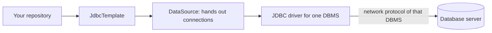
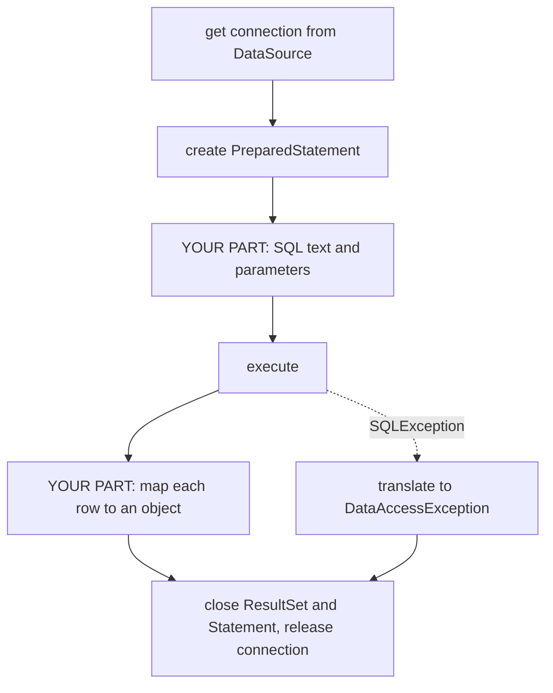

# JDBC, DataSource and JdbcTemplate

> **Before this lesson:** you can write services and repositories as Spring beans and expose them through REST ([Dependency injection with abstractions and layered design](#/lesson/spring/spring-di-abstractions-layers), [REST endpoints with @RestController and ResponseEntity](#/lesson/spring/spring-rest-controllers)). You can read simple SQL such as `SELECT`, `INSERT` and `WHERE`; the [SQL track](#/track/sql) teaches it from zero.

## In plain words

To phone someone abroad you need three things: a phone that works with the foreign network, the number, and an open line. Opening the line takes a while (dialling, connecting, saying hello), so if you call the same office all day you would much prefer a switchboard that keeps a few lines open and hands you one whenever you need to talk.

An application talks to a **database** the same way. The **JDBC driver** is the phone that speaks one particular database's network language. The **connection** is the open line. The **`DataSource`** is the switchboard: the object you ask for a line. And **`JdbcTemplate`** is a helpful assistant who dials, reads out your question, writes down the answer and hangs up properly, so that you only say what you want to ask.

Almost every business application stores its data in a relational database. This lesson explains the layers between your Java code and the database, shows the plain JDBC code Spring saves you from, and builds a repository for the bookshop with `JdbcTemplate`. Understanding these layers is what lets you read a stack trace that ends in `SQLException`, and interviewers expect you to know what a `DataSource` is.

## The layers between your code and the database

A **relational database** stores data in tables of rows and columns and is queried with SQL. The program that manages it (PostgreSQL, MySQL, Oracle…) is a **DBMS**, a database management system, usually running as a separate server.



| Layer | What it is | Who provides it |
|---|---|---|
| **JDBC** (Java Database Connectivity) | the standard interfaces in `java.sql` and `javax.sql`: `Connection`, `PreparedStatement`, `ResultSet`, `DataSource` | the JDK |
| **JDBC driver** | the implementation of those interfaces for one DBMS | the database vendor, as a JAR |
| **`DataSource`** | a factory for connections; in practice a connection pool | a pool library such as HikariCP |
| **`JdbcTemplate`** | a helper that runs SQL through a `DataSource` and cleans up | Spring |

Because your code is written against the JDBC interfaces, changing the database means changing the driver JAR and the connection address, not rewriting the repositories. It is the interface-as-contract idea from module 4 applied by the JDK.

## Plain JDBC: the code you do not want to write

To appreciate the helper, look at one query without it.

```java
// plain JDBC, for illustration only
public List<Book> findByAuthor(String author) {
    String sql = "SELECT isbn, title, author, price_cents FROM book WHERE author = ?";
    List<Book> result = new ArrayList<>();
    try (Connection connection = dataSource.getConnection();                // 1. borrow a connection
         PreparedStatement statement = connection.prepareStatement(sql)) {  // 2. prepare the SQL
        statement.setString(1, author);                                     // 3. bind the parameter
        try (ResultSet rows = statement.executeQuery()) {                   // 4. execute
            while (rows.next()) {                                           // 5. walk through the rows
                result.add(new Book(rows.getString("isbn"), rows.getString("title"),
                                    rows.getString("author"), rows.getInt("price_cents")));
            }
        }
    } catch (SQLException e) {                                              // 6. checked exception
        throw new RuntimeException(e);
    }                                                                       // 7. close everything, always
    return result;
}
```

Of these lines, only the SQL text, the parameter and the row-to-object conversion are specific to this query. The rest is ceremony that must be repeated for every query, and each omission is a real bug: a connection that is not closed is never returned to the pool, and after a few hundred such leaks the application freezes. `SQLException` is a **checked** exception, so every caller is forced to deal with it even though almost none can do anything useful.

## JdbcTemplate: the same query, without the ceremony

`JdbcTemplate` applies a design idea called the **template method**: the fixed steps live in the helper; you plug in the parts that vary.



A runnable model shows the division of labour. The fake connection prints what happens to it, so you can check that it is released even when the query fails.

```python-run
class FakeConnection:
    TABLE = [{"isbn": "111", "title": "Dune", "author": "Herbert"},
             {"isbn": "222", "title": "Emma", "author": "Austen"},
             {"isbn": "333", "title": "Persuasion", "author": "Austen"}]
    def execute(self, sql, params):
        print(f"    execute: {sql}  params={params}")
        if "FROM book" not in sql:
            raise IOError("relation does not exist")           # the driver's low-level error
        return [row for row in self.TABLE if row["author"] == params[0]]

class DataSource:
    def __init__(self):
        self.borrowed = 0
    def get_connection(self):
        self.borrowed += 1
        print("    connection borrowed")
        return FakeConnection()
    def release(self, connection):
        self.borrowed -= 1
        print("    connection released")

class DataAccessException(Exception):
    pass

class JdbcTemplate:
    def __init__(self, data_source):
        self.data_source = data_source
    def query(self, sql, row_mapper, *params):
        connection = self.data_source.get_connection()         # fixed step
        try:
            rows = connection.execute(sql, params)             # fixed step, YOUR sql and params
            return [row_mapper(row) for row in rows]           # YOUR row mapper
        except IOError as low_level:
            raise DataAccessException(f"bad SQL grammar: {low_level}") from low_level   # translation
        finally:
            self.data_source.release(connection)               # fixed step: ALWAYS

data_source = DataSource()
jdbc = JdbcTemplate(data_source)

print("a normal query:")
titles = jdbc.query("SELECT * FROM book WHERE author = ?", lambda row: row["title"], "Austen")
print("    result:", titles)

print("a broken query:")
try:
    jdbc.query("SELECT * FROM boook WHERE author = ?", lambda row: row["title"], "Austen")
except DataAccessException as problem:
    print("    caught:", problem)
print("connections still borrowed:", data_source.borrowed)
```

The caller supplies three things: SQL, a function that converts one row, and parameters. `JdbcTemplate.query` does everything else, and the `finally` block guarantees the release. After the failing query the counter of borrowed connections is back to zero. That guarantee, repeated for every call in a large code base, is the main value of the class.

## Setting it up in Spring Boot

```xml
<!-- pom.xml -->
<dependency>
    <groupId>org.springframework.boot</groupId>
    <artifactId>spring-boot-starter-jdbc</artifactId>
</dependency>
<dependency>
    <groupId>com.h2database</groupId>
    <artifactId>h2</artifactId>
    <scope>runtime</scope>
</dependency>
```

- `spring-boot-starter-jdbc` brings `JdbcTemplate`, transaction support and the HikariCP connection pool.
- **H2** is a small database written in Java that can run inside your application's memory. With it on the classpath and no further configuration, Boot auto-configures an in-memory database: ideal for learning and tests, gone when the application stops. `runtime` scope means the code compiles without it and only needs it when running, because your code uses JDBC interfaces and never the driver's own classes.

Boot runs two files from `src/main/resources` at start-up when an embedded database is used:

```sql
-- src/main/resources/schema.sql
CREATE TABLE book (
    isbn        VARCHAR(13)  PRIMARY KEY,
    title       VARCHAR(200) NOT NULL,
    author      VARCHAR(100) NOT NULL,
    price_cents INT          NOT NULL
);
```

```sql
-- src/main/resources/data.sql
INSERT INTO book (isbn, title, author, price_cents) VALUES ('9780441172719', 'Dune', 'Frank Herbert', 1250);
INSERT INTO book (isbn, title, author, price_cents) VALUES ('9780141439587', 'Emma', 'Jane Austen', 800);
```

That is the whole set-up. Auto-configuration sees the JDBC classes and the H2 driver, creates a `DataSource` bean, and, because a `DataSource` exists, a `JdbcTemplate` bean (the chain from [Spring Boot: starters and auto-configuration](#/lesson/spring/spring-boot-autoconfig)).

> [!NOTE]
> `schema.sql` is fine for a first project. Real projects evolve the database schema with a **migration tool** such as Flyway or Liquibase: numbered SQL scripts kept in version control and applied in order, so that every environment reaches the same structure. Boot runs them automatically when the library is on the classpath.

## A repository with JdbcTemplate

```java
// src/main/java/com/bookshop/catalogue/Book.java
public record Book(String isbn, String title, String author, int priceCents) { }
```

```java
// src/main/java/com/bookshop/catalogue/BookRepository.java
package com.bookshop.catalogue;

import org.springframework.jdbc.core.JdbcTemplate;
import org.springframework.jdbc.core.RowMapper;
import org.springframework.stereotype.Repository;

import java.util.List;
import java.util.Optional;

@Repository
public class BookRepository {

    private final JdbcTemplate jdbc;

    public BookRepository(JdbcTemplate jdbc) {                 // injected: auto-configured by Boot
        this.jdbc = jdbc;
    }

    private static final RowMapper<Book> BOOK_MAPPER = (rs, rowNum) ->           // (1)
            new Book(rs.getString("isbn"), rs.getString("title"),
                     rs.getString("author"), rs.getInt("price_cents"));

    public List<Book> findAll() {
        return jdbc.query("SELECT isbn, title, author, price_cents FROM book ORDER BY title", BOOK_MAPPER);
    }

    public List<Book> findByAuthor(String author) {
        return jdbc.query("SELECT isbn, title, author, price_cents FROM book WHERE author = ?",   // (2)
                          BOOK_MAPPER, author);
    }

    public Optional<Book> findByIsbn(String isbn) {
        return jdbc.query("SELECT isbn, title, author, price_cents FROM book WHERE isbn = ?",
                          BOOK_MAPPER, isbn)
                   .stream().findFirst();                                         // (3)
    }

    public int count() {
        return jdbc.queryForObject("SELECT COUNT(*) FROM book", Integer.class);  // (4)
    }

    public void save(Book book) {
        jdbc.update("INSERT INTO book (isbn, title, author, price_cents) VALUES (?, ?, ?, ?)",   // (5)
                    book.isbn(), book.title(), book.author(), book.priceCents());
    }

    public int changePrice(String isbn, int newPriceCents) {
        return jdbc.update("UPDATE book SET price_cents = ? WHERE isbn = ?", newPriceCents, isbn);
    }

    public int delete(String isbn) {
        return jdbc.update("DELETE FROM book WHERE isbn = ?", isbn);
    }
}
```

1. A `RowMapper<Book>` converts the current row of a `ResultSet` into a `Book`. It is called once per row. `rs.getString("isbn")` reads the column named `isbn`. Declaring it once as a constant lets all queries share it.
2. `query(sql, rowMapper, args…)` returns a `List`. Each `?` is a **placeholder**; the arguments after the mapper fill them in order.
3. A lookup by key returns zero or one row; turning the list into an `Optional` avoids `null`.
4. `queryForObject(sql, Type.class)` is for exactly one row with one column. It throws `EmptyResultDataAccessException` for zero rows, so use it only for queries such as `COUNT(*)` that always return a row.
5. `update` runs any data-changing statement (`INSERT`, `UPDATE`, `DELETE`) and returns the number of affected rows, which tells you whether an update or delete hit anything.

The repository drops into the service and controller from earlier lessons without changes to them:

```bash
curl -s http://localhost:8080/api/books
```

```text
[{"isbn":"9780441172719","title":"Dune","author":"Frank Herbert","priceCents":1250},
 {"isbn":"9780141439587","title":"Emma","author":"Jane Austen","priceCents":800}]
```

## Placeholders are a security feature

Never build SQL by gluing user input into the text.

```java
// DANGEROUS
jdbc.query("SELECT * FROM book WHERE author = '" + author + "'", BOOK_MAPPER);
```

If a request supplies the author `x' OR '1'='1`, the text sent to the database becomes `… WHERE author = 'x' OR '1'='1'`, which is true for every row. Other inputs can delete tables or read other users' data. This attack is **SQL injection**, year after year among the most damaging web vulnerabilities.

```python-run
def concatenated(author):
    return "SELECT * FROM book WHERE author = '" + author + "'"

def parameterised(author):
    return "SELECT * FROM book WHERE author = ?", (author,)

for user_input in ["Austen", "x' OR '1'='1", "x'; DROP TABLE book; --"]:
    print("input:        ", user_input)
    print("  concatenated:", concatenated(user_input))
    sql, params = parameterised(user_input)
    print("  placeholder: ", sql, "   values sent separately:", params)
```

With concatenation the input becomes part of the *command*. With a placeholder the command text never changes; the value travels separately and the database treats it purely as data, however odd it looks. An author literally named `x' OR '1'='1` matches nothing, as it should.

> [!WARNING]
> Placeholders work for **values** only. Table names, column names and `ORDER BY` directions cannot be bound with `?`. If a sort column comes from the client, map it through a fixed list of allowed names in Java; never paste it into the SQL.

### Named parameters

Several `?` in a row are easy to mix up. `NamedParameterJdbcTemplate`, also auto-configured, uses names:

```java
@Repository
public class BookSearchRepository {

    private final NamedParameterJdbcTemplate jdbc;

    public BookSearchRepository(NamedParameterJdbcTemplate jdbc) { this.jdbc = jdbc; }

    public List<Book> search(String author, int maxPriceCents) {
        String sql = """
                SELECT isbn, title, author, price_cents
                FROM book
                WHERE author = :author AND price_cents <= :maxPrice
                """;
        return jdbc.query(sql, Map.of("author", author, "maxPrice", maxPriceCents), BOOK_MAPPER);
    }
}
```

Spring Framework 6.1 added `JdbcClient`, a fluent facade over both templates that reads well and is what new code tends to use:

```java
List<Book> books = jdbcClient.sql("SELECT * FROM book WHERE author = :author")
        .param("author", author)
        .query(Book.class)             // maps columns to record components by name
        .list();
```

## Exceptions: from SQLException to DataAccessException

Each database reports errors with its own numeric codes inside a checked `SQLException`. Spring translates them into a hierarchy of **unchecked** exceptions rooted at `DataAccessException`, identical for every database:

| Exception | Meaning |
|---|---|
| `DuplicateKeyException` | a primary-key or unique constraint was violated |
| `DataIntegrityViolationException` | another constraint failed (not-null, foreign key, value too long) |
| `EmptyResultDataAccessException` | one row was expected, none came |
| `IncorrectResultSizeDataAccessException` | one row was expected, several came |
| `BadSqlGrammarException` | the SQL is invalid or a table/column does not exist |
| `CannotGetJdbcConnectionException` | no connection could be obtained |
| `QueryTimeoutException` | the statement ran too long |

Because they are unchecked, only code that can react needs to catch them:

```java
public Book add(Book book) {
    try {
        repository.save(book);
        return book;
    } catch (DuplicateKeyException e) {
        throw new BookAlreadyExistsException(book.isbn());     // mapped to 409 by the advice class
    }
}
```

> [!INTERVIEW]
> "What does `JdbcTemplate` do for you compared with plain JDBC?" It obtains and releases the connection, creates and closes statements and result sets, iterates rows with your `RowMapper`, and translates checked, vendor-specific `SQLException`s into Spring's unchecked `DataAccessException` hierarchy. You supply only SQL, parameters and row mapping. It also takes part in Spring-managed transactions by using the connection bound to the current transaction.

## Where JdbcTemplate fits

| Approach | You write | Good when |
|---|---|---|
| Plain JDBC | everything | almost never in application code |
| `JdbcTemplate` / `JdbcClient` | SQL and row mapping | you want full control over SQL; reporting queries; simple schemas |
| Spring Data JDBC | repository interfaces; SQL generated for simple cases | straightforward aggregates without an ORM's complexity |
| Spring Data JPA (Hibernate) | entity classes and repository interfaces | rich object models, lots of CRUD |

**CRUD** stands for create, read, update, delete. **ORM** (object-relational mapping) means a library that maps objects to tables automatically. The last two rows are the subject of module 14. Many applications mix approaches: JPA for everyday CRUD and `JdbcTemplate` for the few hand-tuned queries.

## Pitfalls

- **String concatenation in SQL.** SQL injection. Use placeholders.
- **`queryForObject` when the row may be missing.** It throws `EmptyResultDataAccessException`. Use `query(...)` and take the first element.
- **`SELECT *` with a `RowMapper`.** Adding or renaming a column silently breaks the mapping at run time. List the columns.
- **Column name versus property name.** `price_cents` in the table, `priceCents` in Java: the mapper must use the column name.
- **Ignoring the update count.** `UPDATE … WHERE isbn = ?` that matches no row returns 0 and throws nothing. Check the return value when the row must exist.
- **Row-by-row inserts in a loop.** A thousand round trips. `jdbc.batchUpdate(sql, listOfArgumentArrays)` sends them together.
- **Creating `JdbcTemplate` with `new` per call.** It is thread-safe once configured; inject the singleton.
- **Assuming H2 behaves exactly like production.** SQL dialects differ. Test against the real database type before release (see the testing module).

## Cheat sheet

| Type / method | Meaning |
|---|---|
| `DataSource` | factory for database connections; a pool in practice |
| `JdbcTemplate` | runs SQL, handles resources, translates exceptions |
| `query(sql, rowMapper, args…)` | returns a `List<T>` |
| `queryForObject(sql, Type.class, args…)` | exactly one value or row |
| `update(sql, args…)` | `INSERT`/`UPDATE`/`DELETE`; returns affected rows |
| `batchUpdate(sql, batchArgs)` | many statements in one round trip |
| `RowMapper<T>` | `(ResultSet rs, int rowNum) -> T` |
| `NamedParameterJdbcTemplate` | `:name` parameters |
| `JdbcClient` | fluent API over both (Spring 6.1+) |
| `DataAccessException` | root of Spring's unchecked persistence exceptions |
| `schema.sql`, `data.sql` | scripts Boot runs at start-up for embedded databases |
| `spring-boot-starter-jdbc` | starter: `JdbcTemplate`, HikariCP, transactions |

## Summary

- JDBC is the JDK's standard database interface; a driver implements it for one DBMS; a `DataSource` hands out connections.
- Plain JDBC needs repetitive, error-prone resource handling and checked exceptions.
- `JdbcTemplate` keeps the fixed steps and asks you only for SQL, parameters and a `RowMapper`; it always releases the connection.
- Always pass values through placeholders (`?` or `:name`); concatenating input into SQL enables injection.
- Spring converts `SQLException` into the unchecked, database-independent `DataAccessException` hierarchy.
- With `spring-boot-starter-jdbc` and a driver on the classpath, Boot auto-configures the `DataSource` and `JdbcTemplate`.

## Glossary

- **CRUD**: create, read, update, delete: the four basic data operations.
- **Connection**: an open communication session between application and database.
- **`DataSource`**: the JDBC interface for an object that provides connections.
- **DBMS**: database management system, the software that runs a database.
- **H2**: a lightweight Java database often used in memory for development and tests.
- **JDBC**: Java Database Connectivity, the standard API for relational databases.
- **JDBC driver**: the vendor-specific implementation of the JDBC interfaces.
- **Migration tool**: software that applies versioned schema changes (Flyway, Liquibase).
- **ORM**: object-relational mapping, automatic mapping between objects and tables.
- **Placeholder**: a `?` or `:name` in SQL whose value is supplied separately.
- **`RowMapper`**: a function that converts one result row into an object.
- **SQL injection**: an attack that smuggles SQL commands in through input data.

```quiz
[
  {"q": "What is a DataSource?",
   "options": ["A SQL file", "An object that provides database connections", "A table in the database", "A JSON converter"],
   "answer": 1,
   "explain": "DataSource is the JDBC interface for a connection factory; in applications it is normally a connection pool."},
  {"q": "Which part of a query do you still write yourself when using JdbcTemplate?",
   "options": ["Opening and closing the connection", "Closing the ResultSet", "The SQL, its parameters and the row mapping", "Translating SQLException"],
   "answer": 2,
   "explain": "The template handles resources and exception translation; you supply what varies."},
  {"q": "Why is \"SELECT * FROM book WHERE author = '\" + author + \"'\" dangerous?",
   "options": ["It is slower", "User input becomes part of the SQL command, enabling SQL injection", "It does not compile", "JdbcTemplate forbids string SQL"],
   "answer": 1,
   "explain": "Crafted input can change the meaning of the statement. Placeholders send values separately as data."},
  {"q": "jdbc.update(\"DELETE FROM book WHERE isbn = ?\", isbn) returns 0. What does that mean?",
   "options": ["An error occurred", "No row matched; nothing was deleted", "The table was dropped", "The delete is pending"],
   "answer": 1,
   "explain": "update returns the number of affected rows. Zero is not an exception; check it when a row must exist."},
  {"q": "Which method fits SELECT COUNT(*) FROM book?",
   "options": ["update", "queryForObject(sql, Integer.class)", "batchUpdate", "execute with a RowMapper"],
   "answer": 1,
   "explain": "The query always returns exactly one row with one column, which is the case queryForObject is designed for."},
  {"q": "What kind of exception is Spring's DataAccessException?",
   "options": ["A checked exception that every caller must declare", "An unchecked exception hierarchy independent of the database vendor", "An Error", "A subclass of SQLException"],
   "answer": 1,
   "explain": "Spring translates vendor-specific checked SQLExceptions into a consistent runtime hierarchy."},
  {"q": "In the Python model, why is the connection released even when the query fails?",
   "options": ["The fake connection releases itself", "The release is in a finally block of the template", "The exception is swallowed", "It is not released"],
   "answer": 1,
   "explain": "The template's finally block always runs, which is exactly the guarantee JdbcTemplate gives for real connections."}
]
```

> **Source:** Spilcă, *Spring Start Here*, ch. 12 (what a data source is; using JdbcTemplate). Documentation: https://docs.spring.io/spring-framework/reference/data-access/jdbc/core.html and https://docs.spring.io/spring-boot/how-to/data-initialization.html
