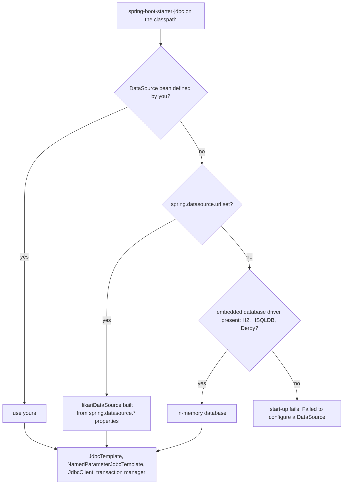
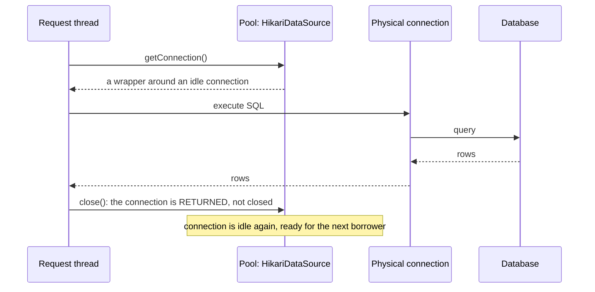

# Configuring the DataSource and connection pools

> **Before this lesson:** you can query a database with `JdbcTemplate` using Boot's auto-configured in-memory H2 database ([JDBC, DataSource and JdbcTemplate](#/lesson/spring/spring-jdbc-template)), and you understand how auto-configuration backs off when you define your own bean ([Spring Boot: starters and auto-configuration](#/lesson/spring/spring-boot-autoconfig)).

## In plain words

A city bike-sharing station has ten bikes. A rider takes one, uses it and brings it back; then the next rider takes it. Ten bikes can serve hundreds of riders a day, because each ride is short. Trouble starts in three situations: more riders arrive at once than there are bikes, so some must wait; riders keep bikes for hours, so the station runs dry although few people are riding; or someone never returns a bike, and the station slowly empties for good.

A **connection pool** is that station, with database connections as the bikes. Opening a connection is slow (a network handshake, a login, memory reserved on the database server), so the application opens a fixed number at start-up and lends them out. Every query borrows one for a few milliseconds and returns it.

This lesson moves the bookshop from the toy in-memory database to a real one, shows where the connection settings live, how to define a `DataSource` yourself, and how a pool behaves under load. "Connection is not available, request timed out" is one of the most common production errors in Java back ends; knowing the three bike-station situations lets you diagnose it. Pool sizing is also a recurring interview topic.

## Pointing the application at a real database

Swap the H2 dependency for the driver of your database. With PostgreSQL:

```xml
<!-- pom.xml -->
<dependency>
    <groupId>org.springframework.boot</groupId>
    <artifactId>spring-boot-starter-jdbc</artifactId>
</dependency>
<dependency>
    <groupId>org.postgresql</groupId>
    <artifactId>postgresql</artifactId>
    <scope>runtime</scope>
</dependency>
```

Then tell Boot where the database is:

```properties
# src/main/resources/application.properties
spring.datasource.url=jdbc:postgresql://localhost:5432/bookshop
spring.datasource.username=bookshop_app
spring.datasource.password=${DB_PASSWORD}
```

| Property | Meaning |
|---|---|
| `spring.datasource.url` | the **JDBC URL**: `jdbc:` + database type + host, port and database name |
| `spring.datasource.username` | the database account |
| `spring.datasource.password` | its password; here taken from the environment variable `DB_PASSWORD` |
| `spring.datasource.driver-class-name` | normally unnecessary; Boot derives the driver from the URL |

Nothing else changes. `JdbcTemplate` and your repositories keep working, because they depend on the `DataSource` abstraction and not on H2. With a non-embedded database Boot no longer runs `schema.sql` automatically; set `spring.sql.init.mode=always` to keep that behaviour, or better, use a migration tool.

The same settings in YAML, an alternative file format that shows the hierarchy by indentation:

```yaml
# src/main/resources/application.yml
spring:
  datasource:
    url: jdbc:postgresql://localhost:5432/bookshop
    username: bookshop_app
    password: ${DB_PASSWORD}
```

> [!WARNING]
> Never commit real passwords. `${DB_PASSWORD}` is a placeholder resolved from the environment when the application starts, so the secret lives in the deployment platform and not in the source repository. A password that has been pushed to a Git repository once must be considered leaked and be changed.

### Different databases for different environments

A developer's laptop, the test server and production each have their own database. Profiles select a set of properties per environment:

```properties
# application-dev.properties
spring.datasource.url=jdbc:postgresql://localhost:5432/bookshop_dev
spring.datasource.username=dev
spring.datasource.password=dev
```

```properties
# application-prod.properties
spring.datasource.url=jdbc:postgresql://db.internal:5432/bookshop
spring.datasource.username=bookshop_app
spring.datasource.password=${DB_PASSWORD}
```

```bash
java -jar bookshop.jar --spring.profiles.active=prod
```

Profiles are covered in full in [Configuration properties, profiles and logging](#/lesson/spring/spring-config-profiles-logging).

## What Boot auto-configures



The failure at the bottom right is a classic first-day error: a JDBC or JPA starter was added, but no URL is configured and no embedded database is available.

The `DataSource` Boot creates is a **HikariCP** pool. HikariCP is a small, fast connection-pool library and the default choice in Spring Boot.

## How a pool works



Two details matter:

- The object you receive is a wrapper. Calling `close()` on it gives the connection back to the pool; the physical connection stays open. This is why code written for plain JDBC works unchanged with a pool.
- When all connections are in use, `getConnection()` **waits** in a queue. If no connection becomes free within the *connection timeout*, the caller receives an exception.

The main HikariCP settings:

| Property (`spring.datasource.hikari.…`) | Meaning | Default |
|---|---|---|
| `maximum-pool-size` | most connections the pool will ever hold | 10 |
| `minimum-idle` | idle connections to keep ready | same as the maximum (a fixed-size pool) |
| `connection-timeout` | how long a borrower waits before failing | 30000 ms |
| `idle-timeout` | how long an unused connection above `minimum-idle` is kept | 600000 ms |
| `max-lifetime` | maximum age of a connection before it is replaced | 1800000 ms |
| `leak-detection-threshold` | log a warning if a connection is held longer than this | 0 (off) |
| `pool-name` | the name shown in logs and metrics | `HikariPool-1` |

```properties
spring.datasource.hikari.maximum-pool-size=10
spring.datasource.hikari.connection-timeout=5000
spring.datasource.hikari.max-lifetime=1500000
spring.datasource.hikari.leak-detection-threshold=20000
```

Set `max-lifetime` a little below any timeout at which the database or a firewall cuts idle connections; otherwise the pool hands out connections that are already dead.

## A pool under load

The simulation serves a list of requests with a pool. Each request arrives at some time and holds its connection for some duration. Times are in milliseconds.

```python-run
import heapq

def simulate(pool_size, timeout, requests):
    free_at = [0] * pool_size                    # for each connection: when it is next free
    heapq.heapify(free_at)
    report = []
    for arrival, hold in requests:               # first come, first served
        start = max(arrival, free_at[0])         # earliest moment a connection is available
        waited = start - arrival
        if waited > timeout:
            report.append((arrival, hold, None, timeout))        # gave up; never held a connection
            continue
        heapq.heapreplace(free_at, start + hold)
        report.append((arrival, hold, start, waited))
    return report

def show(title, pool_size, timeout, requests):
    print(title)
    failures = 0
    for arrival, hold, start, waited in simulate(pool_size, timeout, requests):
        if start is None:
            failures += 1
            print(f"  arrives {arrival:4}  needs {hold:4} ms  -> TIMEOUT after waiting {waited} ms")
        else:
            print(f"  arrives {arrival:4}  needs {hold:4} ms  -> starts {start:4}, waited {waited:3} ms")
    print(f"  => {failures} failed\n")

fast = [(t * 10, 20) for t in range(8)]                     # 8 requests, each query takes 20 ms
show("pool of 2, quick queries:", 2, 100, fast)

one_slow = [(0, 400)] + fast                                # one slow report query joins in
show("pool of 2, plus one 400 ms query:", 2, 100, one_slow)

show("same traffic, pool of 4:", 4, 100, one_slow)
```

Three lessons from the output:

1. **A small pool goes a long way when queries are quick.** Two connections serve eight overlapping requests with short waits.
2. **One slow borrower hurts everyone.** The 400 ms query occupies half of the pool; the remaining connection cannot keep up, waits grow, and requests time out. In production this appears as a sudden wave of `SQLTransientConnectionException: HikariPool-1 - Connection is not available, request timed out` although the database itself is healthy.
3. **A larger pool hides the problem.** With four connections the same traffic passes. That is sometimes the right fix and often not, as the next section explains.

The practice problem [Simulate a connection pool with a timeout](#/problem/spring-connection-pool) asks you to write this simulation.

## How large should the pool be?

Intuition says "more connections, more throughput". For databases it is usually the opposite beyond a small number. A database server has a limited number of CPU cores and disks; with hundreds of active connections it spends its time switching between them, and each connection also costs memory on the server. HikariCP's own guidance is a formula of the form *connections ≈ (core count of the database server × 2) + number of spindle disks*, which lands in the low tens for typical machines.

Checklist:

- **Start with the default of 10** and measure.
- **Count all instances.** Four application instances with a pool of 20 open 80 connections. The database has its own limit (`max_connections`, 100 by default in PostgreSQL), shared with every other client.
- **Watch the metrics.** Hikari reports active, idle and *pending* (waiting) threads. Pending threads above zero for long stretches means borrowers are queuing.
- **Fix slow queries and long holds first.** If connections are held for seconds, no pool size will be enough.

> [!INTERVIEW]
> "Your service logs 'Connection is not available, request timed out after 30000ms'. How do you investigate?" The pool is exhausted, so find out why connections are not coming back: slow queries, long transactions (especially ones that call remote services while holding a connection), a connection leak, or plainly more concurrent demand than the pool size. Check pool metrics (active versus pending), enable `leak-detection-threshold`, look at slow-query logs. Enlarging the pool is the last step, bounded by the database's connection limit across all instances.

### What holds a connection for too long

- **Slow SQL**: missing indexes, huge result sets.
- **Transactions that span slow non-database work.** A method annotated `@Transactional` keeps one connection from its first line to its last. Calling a payment provider inside it parks a connection for the duration of the HTTP call. The next module returns to this.
- **Open Session in View.** With JPA, Boot by default keeps the persistence session, and with it possibly a connection, open while the response is rendered. Many teams set `spring.jpa.open-in-view=false`.
- **Leaks**: code that obtains a connection by hand and misses `close()` on some path. `JdbcTemplate` cannot leak; hand-written JDBC can.

## Defining the DataSource yourself

Properties cover most needs. Define the bean yourself when you need construction logic, for example reading credentials from a secrets service, or when the application talks to more than one database.

```java
// src/main/java/com/bookshop/config/DataSourceConfig.java
package com.bookshop.config;

import com.zaxxer.hikari.HikariDataSource;
import org.springframework.beans.factory.annotation.Value;
import org.springframework.context.annotation.Bean;
import org.springframework.context.annotation.Configuration;

import javax.sql.DataSource;

@Configuration
public class DataSourceConfig {

    @Bean
    DataSource dataSource(@Value("${bookshop.db.url}") String url,
                          @Value("${bookshop.db.username}") String username,
                          @Value("${bookshop.db.password}") String password) {
        HikariDataSource dataSource = new HikariDataSource();
        dataSource.setJdbcUrl(url);
        dataSource.setUsername(username);
        dataSource.setPassword(password);
        dataSource.setMaximumPoolSize(10);
        dataSource.setConnectionTimeout(5_000);
        dataSource.setPoolName("bookshop-pool");
        return dataSource;
    }
}
```

- The return type is the interface `javax.sql.DataSource`. (This `javax` package belongs to the JDK and was not renamed to `jakarta`.)
- Because a `DataSource` bean now exists, Boot's `DataSourceAutoConfiguration` backs off, while `JdbcTemplate` is still auto-configured on top of your bean.
- `HikariDataSource` has a `close()` method; Spring calls it automatically at shutdown, closing all connections cleanly.

A shorter variant keeps the property-driven style and binds everything under a prefix:

```java
@Bean
@ConfigurationProperties("bookshop.datasource")
HikariDataSource dataSource() {
    return DataSourceBuilder.create().type(HikariDataSource.class).build();
}
```

With this, `bookshop.datasource.jdbc-url`, `bookshop.datasource.username` and `bookshop.datasource.maximum-pool-size` are applied to the bean. Note the property is `jdbc-url` here, because the values are bound directly onto Hikari's own setters.

### Two databases

```java
@Configuration
public class TwoDataSourcesConfig {

    @Bean
    @Primary                                             // default for injection by type
    @ConfigurationProperties("bookshop.datasource.main")
    HikariDataSource mainDataSource() {
        return DataSourceBuilder.create().type(HikariDataSource.class).build();
    }

    @Bean
    @ConfigurationProperties("bookshop.datasource.reporting")
    HikariDataSource reportingDataSource() {
        return DataSourceBuilder.create().type(HikariDataSource.class).build();
    }

    @Bean
    JdbcTemplate reportingJdbcTemplate(@Qualifier("reportingDataSource") DataSource dataSource) {
        return new JdbcTemplate(dataSource);
    }
}
```

`@Primary` and `@Qualifier` from [Circular dependencies, @Primary and @Qualifier](#/lesson/spring/spring-circular-primary-qualifier) do their job here: most code receives the main database; the reporting repository asks for `reportingJdbcTemplate` by qualifier. A typical reason is a read-only replica for heavy reports, so that they cannot exhaust the pool that serves customers.

> [!TIP]
> Give every pool a `pool-name`. Logs and metrics then say `bookshop-reporting` and not `HikariPool-2`, which makes an exhausted pool obvious at a glance.

## Checking the connection at start-up and at run time

- Hikari opens a connection during start-up by default; wrong credentials or an unreachable host stop the application immediately, in keeping with fail-fast.
- With Actuator on the classpath, `/actuator/health` includes a `db` component that runs a validation query, and `/actuator/metrics/hikaricp.connections.active` (also `.idle`, `.pending`, `.timeout`) exposes pool behaviour for dashboards and alerts. See [Actuator, Docker images and virtual threads](#/lesson/spring/spring-actuator-docker-vthreads).

## Pitfalls

- **"Failed to configure a DataSource: 'url' attribute is not specified".** A data starter without a URL or embedded database. Add the configuration, or remove the starter.
- **Passwords in the repository.** Use environment variables or a secret manager.
- **Pool size multiplied by instances exceeds the database limit.** New instances then fail to start with "too many connections".
- **`max-lifetime` longer than the infrastructure's idle cut-off.** Sporadic "connection is closed" errors after quiet periods.
- **Raising the pool size to cure slow queries.** It moves the queue from the pool into the database and makes things slower.
- **Returning a `DataSource` without a pool.** `DriverManagerDataSource` opens a new physical connection for every request; fine for a quick test, far too slow for production.
- **`url` versus `jdbc-url`.** `spring.datasource.url` is Boot's property; when you bind a prefix directly onto `HikariDataSource`, the name is `jdbc-url`.
- **H2 in production by accident.** If the profile with the real URL is not active, Boot may quietly start an in-memory database and all data vanishes on restart. Mark the H2 dependency `test` scope once a real database is used.

## Cheat sheet

| Property / type | Meaning |
|---|---|
| `spring.datasource.url` / `username` / `password` | where and how to connect |
| `spring.datasource.hikari.maximum-pool-size` | upper bound of connections |
| `spring.datasource.hikari.connection-timeout` | maximum wait for a free connection |
| `spring.datasource.hikari.max-lifetime` | maximum age of a pooled connection |
| `spring.datasource.hikari.leak-detection-threshold` | warn about connections held too long |
| `spring.sql.init.mode=always` | run `schema.sql`/`data.sql` on non-embedded databases |
| `HikariDataSource` | the pool implementation Boot uses |
| `DataSourceBuilder` | helper to create a `DataSource` programmatically |
| `@ConfigurationProperties("prefix")` on a `@Bean` method | bind properties onto the returned object |
| `@Primary` / `@Qualifier` | choose between several `DataSource` beans |
| `hikaricp.connections.*` metrics | active, idle, pending, timeouts |

## Summary

- A real database needs a driver dependency and `spring.datasource.*` properties; repositories do not change.
- Keep credentials out of source control and vary settings per environment with profiles.
- Boot creates a HikariCP pool: a fixed set of open connections that are borrowed and returned.
- When all connections are busy, borrowers wait up to the connection timeout and then fail. The usual causes are slow queries, long transactions, leaks or too little capacity.
- Bigger pools are rarely the answer; databases perform best with a modest number of connections, and the limit is shared across all instances.
- Define your own `DataSource` bean for custom construction or several databases; auto-configuration backs off and the rest still works.

## Glossary

- **Connection leak**: a borrowed connection that is never returned to the pool.
- **Connection pool**: a managed set of reusable open database connections.
- **Connection timeout**: the longest a caller waits for a pooled connection.
- **HikariCP**: the connection pool library Spring Boot uses by default.
- **JDBC URL**: the address string that tells a driver how to reach a database.
- **Pool exhaustion**: the state in which every pooled connection is in use.
- **Read replica**: a copy of a database that serves read-only queries.
- **Secret manager**: a service that stores credentials outside code and configuration files.
- **YAML**: a configuration file format that expresses hierarchy by indentation.

```quiz
[
  {"q": "Why do applications use a connection pool?",
   "options": ["Databases refuse single connections", "Opening a connection is slow and costly, so a set of open connections is reused", "To encrypt the traffic", "To avoid writing SQL"],
   "answer": 1,
   "explain": "Establishing a connection involves network and authentication work. Reusing open connections removes that cost from every query."},
  {"q": "What happens when code calls close() on a connection obtained from a pool?",
   "options": ["The physical connection is closed", "The connection is returned to the pool and stays open", "Nothing", "The pool shuts down"],
   "answer": 1,
   "explain": "The pool hands out a wrapper whose close() releases the connection for reuse."},
  {"q": "All connections are in use and another thread calls getConnection(). What happens?",
   "options": ["It fails immediately", "A new connection is always opened", "It waits up to the connection timeout, then throws if none became free", "It reuses a busy connection"],
   "answer": 2,
   "explain": "Borrowers queue. If the wait exceeds connection-timeout, Hikari throws SQLTransientConnectionException."},
  {"q": "In the simulation, why does one 400 ms query cause other requests to time out?",
   "options": ["It locks the table", "It occupies one of the two connections for a long time, halving capacity so the queue grows", "It breaks the pool", "It uses all CPU"],
   "answer": 1,
   "explain": "A long hold removes a connection from circulation; the remaining capacity cannot serve the arrival rate within the timeout."},
  {"q": "Four instances of a service each have maximum-pool-size=30. The database allows 100 connections. What is the risk?",
   "options": ["None", "The instances can demand 120 connections in total, exceeding the database limit", "Queries become slower by 30 percent", "The pool shrinks automatically"],
   "answer": 1,
   "explain": "Pool sizes add up across instances and must fit under the database's limit, with room for other clients."},
  {"q": "You define your own @Bean DataSource. What does Boot do?",
   "options": ["Fails with a duplicate bean error", "Ignores your bean", "Its DataSource auto-configuration backs off; JdbcTemplate is still auto-configured on your DataSource", "Creates a second pool"],
   "answer": 2,
   "explain": "The default is conditional on no DataSource bean existing; dependent auto-configurations use yours."},
  {"q": "Where should a production database password come from?",
   "options": ["application.properties committed to Git", "A constant in a Java class", "The environment or a secret manager, referenced by a placeholder", "The README"],
   "answer": 2,
   "explain": "Secrets must not live in source control. A placeholder such as a reference to an environment variable keeps them outside the code base."}
]
```

> **Source:** Spilcă, *Spring Start Here*, ch. 12 (customizing the configuration of the data source). Documentation: https://docs.spring.io/spring-boot/reference/data/sql.html and https://docs.spring.io/spring-boot/how-to/data-access.html
