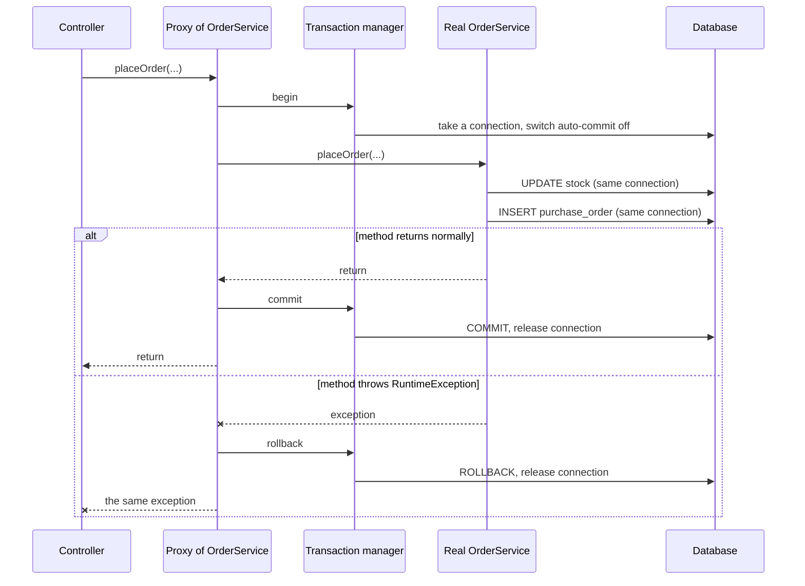
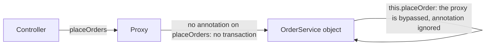

# @Transactional, rollback rules and the self-invocation pitfall

> **Before this lesson:** you can write a repository with `JdbcTemplate` ([JDBC, DataSource and JdbcTemplate](#/lesson/spring/spring-jdbc-template)) and you understand that Spring applies aspects through proxies, including the self-invocation limit ([How Spring AOP works: proxies and your first aspect](#/lesson/spring/spring-aop-proxies)). Checked versus unchecked exceptions should be familiar ([Exception handling](#/lesson/java/java-exceptions-basics)).

## In plain words

Moving money between two accounts takes two steps: subtract from one, add to the other. If the power fails after the first step, money has vanished. Banks therefore treat the pair as one unit: either both steps happen, or the books are restored to exactly how they were before. There is no "half a transfer".

A **transaction** is such a unit of work in a database: a group of changes that succeed together or are undone together. Finishing successfully is called **commit**; undoing everything is called **rollback**.

In Spring you draw the border of that unit with one annotation, `@Transactional`, on a method: everything the method does to the database is committed when it returns and rolled back when it fails. It looks trivial, and it works through the proxy mechanism you already know, which gives it three sharp edges: it reacts only to certain exceptions, it does nothing for calls inside the same object, and it does nothing when you catch the exception yourself. Those edges cause real data corruption in real projects, and they are among the most asked Spring interview questions.

## The problem, concretely

Placing an order in the bookshop touches two tables: reduce the stock of the book, and insert the order.

```sql
-- src/main/resources/schema.sql
CREATE TABLE stock (
    isbn     VARCHAR(13) PRIMARY KEY,
    quantity INT NOT NULL CHECK (quantity >= 0)
);

CREATE TABLE purchase_order (
    id       BIGINT GENERATED ALWAYS AS IDENTITY PRIMARY KEY,
    customer VARCHAR(100) NOT NULL,
    isbn     VARCHAR(13)  NOT NULL,
    quantity INT          NOT NULL
);
```

```java
// src/main/java/com/bookshop/order/OrderService.java  -- first, WITHOUT a transaction
@Service
public class OrderService {

    private final StockRepository stock;
    private final OrderRepository orders;

    public OrderService(StockRepository stock, OrderRepository orders) {
        this.stock = stock;
        this.orders = orders;
    }

    public void placeOrder(String customer, String isbn, int quantity) {
        stock.decrease(isbn, quantity);                 // UPDATE stock SET quantity = quantity - ? ...
        orders.insert(customer, isbn, quantity);        // INSERT INTO purchase_order ...
    }
}
```

By default each JDBC statement is committed the moment it finishes; this mode is called **auto-commit**. If `orders.insert` fails, perhaps because the customer name is too long for the column, the stock has already been reduced and stays reduced. The shop now believes it has fewer books than it has, and no order exists to explain why. Data that contradicts itself like this is called **inconsistent**.

## The four promises of a transaction: ACID

| Letter | Property | Meaning |
|---|---|---|
| A | **Atomicity** | all changes of the transaction happen, or none |
| C | **Consistency** | the database moves from one valid state to another; constraints hold |
| I | **Isolation** | concurrent transactions do not see each other's unfinished work (to a configurable degree) |
| D | **Durability** | once committed, changes survive crashes |

This lesson is about atomicity. Isolation is the second half of the next lesson.

## Adding @Transactional

```java
// src/main/java/com/bookshop/order/OrderService.java
import org.springframework.transaction.annotation.Transactional;

@Service
public class OrderService {

    // constructor as before

    @Transactional
    public void placeOrder(String customer, String isbn, int quantity) {
        stock.decrease(isbn, quantity);
        orders.insert(customer, isbn, quantity);
    }
}
```

One annotation. If `orders.insert` throws, the stock update is undone as though it never happened. Use the annotation from `org.springframework.transaction.annotation`; the similar `jakarta.transaction.Transactional` is also understood by Spring but offers fewer options.

With `spring-boot-starter-jdbc` (or the JPA starter) Boot auto-configures everything needed: a **transaction manager** bean, which knows how to begin, commit and roll back on a `DataSource`, and the aspect that reacts to the annotation.

## What happens behind the annotation

`@Transactional` is advice applied by a proxy, exactly like the aspects of module 6.



Three facts to carry away:

1. The transaction **begins before** your method body runs and **ends after** it returns or throws. The decision between commit and rollback is made by the proxy, based on how the method ended.
2. All repository calls inside use the **same connection**. The transaction manager binds it to the current thread, and `JdbcTemplate` (or JPA) picks it up from there. That is how separate repositories take part in one transaction without passing a connection around.
3. The exception still reaches the caller. Rolling back does not swallow it.

The following model implements this proxy. The "database" keeps committed rows and a per-transaction buffer of pending rows.

```python-run
class Database:
    def __init__(self):
        self.committed, self.pending, self.in_tx = [], [], False
    def write(self, row):
        (self.pending if self.in_tx else self.committed).append(row)    # auto-commit when no transaction
    def begin(self):    self.in_tx, self.pending = True, []
    def commit(self):   self.committed += self.pending; self.in_tx = False
    def rollback(self): self.pending = []; self.in_tx = False

class CheckedException(Exception): pass          # stands for IOException, SQLException, your own checked ones
class UncheckedException(Exception): pass        # stands for RuntimeException and subclasses

def transactional(db, rollback_for=(UncheckedException,)):
    def decorate(method):
        def proxy(*args):
            db.begin()
            try:
                result = method(*args)
            except Exception as error:
                if isinstance(error, rollback_for):
                    db.rollback(); print("   proxy: ROLLBACK because of", type(error).__name__)
                else:
                    db.commit();   print("   proxy: COMMIT although", type(error).__name__, "was thrown")
                raise
            db.commit(); print("   proxy: COMMIT")
            return result
        return proxy
    return decorate

def run(title, db, call):
    print(title)
    try:
        call()
    except Exception as error:
        print("   caller received", type(error).__name__)
    print("   committed rows:", db.committed, "\n")

def body(db, failure=None):
    db.write("stock -1")
    if failure:
        raise failure
    db.write("order inserted")

db = Database(); run("no transaction, failure in the middle:", db, lambda: body(db, UncheckedException()))
db = Database(); run("@Transactional, success:", db, lambda: transactional(db)(body)(db))
db = Database(); run("@Transactional, unchecked exception:", db, lambda: transactional(db)(body)(db, UncheckedException()))
db = Database(); run("@Transactional, CHECKED exception:", db, lambda: transactional(db)(body)(db, CheckedException()))
db = Database(); run("@Transactional(rollbackFor = Exception.class), checked exception:", db,
                     lambda: transactional(db, rollback_for=(Exception,))(body)(db, CheckedException()))
```

Read the five cases. The first shows the inconsistent state without a transaction. The third shows the rollback. The fourth is the surprise this lesson exists for: with a checked exception the proxy **commits** the half-finished work.

## Rollback rules

By default Spring rolls back when the exception leaving the method is

- a `RuntimeException` or one of its subclasses (the **unchecked** exceptions), or
- an `Error`.

It **commits** when a **checked** exception leaves the method. The idea, inherited from older enterprise Java conventions, is that a checked exception is an expected business outcome the caller will handle, while an unchecked one signals something broken.

```java
@Transactional
public void importCatalogue(Path file) throws IOException {
    books.deleteAll();
    List<Book> parsed = parser.parse(file);      // throws IOException halfway: checked
    books.saveAll(parsed);
}
```

If `parse` throws `IOException`, the `deleteAll` is **committed**. The catalogue is now empty.

Change the rule with attributes:

```java
@Transactional(rollbackFor = Exception.class)                    // roll back for checked exceptions too
public void importCatalogue(Path file) throws IOException { ... }

@Transactional(noRollbackFor = OutOfStockException.class)        // commit despite this unchecked exception
public void placeOrder(...) { ... }
```

When several rules could apply, the one whose class is closest to the thrown exception in the inheritance chain wins. The practice problem [Rollback rules: checked versus unchecked](#/problem/spring-rollback-rules) makes you implement that decision.

> [!INTERVIEW]
> "For which exceptions does `@Transactional` roll back?" By default for unchecked exceptions (`RuntimeException`, `Error`), not for checked ones. Configure with `rollbackFor` / `noRollbackFor`. Many teams either use only unchecked exceptions in transactional code or standardise on `rollbackFor = Exception.class`. Add that the exception must actually leave the method through the proxy for any rule to apply.

## Three ways to lose the transaction silently

### 1. Catching the exception inside the method

```java
@Transactional
public void placeOrder(String customer, String isbn, int quantity) {
    try {
        stock.decrease(isbn, quantity);
        orders.insert(customer, isbn, quantity);      // throws
    } catch (RuntimeException e) {
        log.warn("order failed", e);                  // swallowed
    }
}
```

The proxy sees a method that returned normally, so it commits. The stock update is permanent. The proxy cannot know about an exception that never reaches it. If you must catch, rethrow, or mark the transaction explicitly:

```java
} catch (RuntimeException e) {
    TransactionAspectSupport.currentTransactionStatus().setRollbackOnly();
}
```

### 2. Self-invocation

```java
@Service
public class OrderService {

    public void placeOrders(List<OrderRequest> requests) {         // NOT transactional
        for (OrderRequest r : requests) {
            placeOrder(r.customer(), r.isbn(), r.quantity());      // this.placeOrder(...): bypasses the proxy
        }
    }

    @Transactional
    public void placeOrder(String customer, String isbn, int quantity) { ... }
}
```

A controller calls `placeOrders` through the proxy. That method is not annotated, so no transaction starts. Inside, `placeOrder` is invoked on `this`, the raw object, so the advice never runs. Each statement auto-commits; a failure leaves reduced stock without an order. Nothing in the logs warns you.



Fixes, in order of preference:

1. Put `@Transactional` on the method that is called from outside, if one transaction for the whole batch is what you want.
2. Move `placeOrder` into another bean (for example `SingleOrderService`) and inject it. Calls between beans pass through the proxy, giving one transaction per order.
3. Use `TransactionTemplate` for an explicit programmatic transaction around the inner block:

```java
private final TransactionTemplate tx;      // built from the PlatformTransactionManager

public void placeOrders(List<OrderRequest> requests) {
    for (OrderRequest r : requests) {
        tx.executeWithoutResult(status -> doPlaceOrder(r));     // one transaction per iteration
    }
}
```

### 3. Methods the proxy cannot intercept

- `private` methods: never called through the proxy.
- `final` methods and `final` classes: the class-based proxy cannot override them.
- Objects created with `new`: not beans, no proxy.
- Methods called during `@PostConstruct` on the bean itself: the proxy does not exist yet.
- Since Spring Framework 6, `protected` and package-visible methods are advised with class-based proxies, but `public` remains the convention and the only kind that works with interface-based proxies.

> [!WARNING]
> None of these three failures produces an error or a log line. The code runs, tests with a single happy-path call pass, and the data is corrupted only when something fails halfway in production. When reviewing transactional code, ask of every `@Transactional` method: who calls it, through which reference?

## Where to put the annotation

- **On service methods.** A service method is a use case, and a use case is the natural unit that must succeed or fail as a whole. Repositories are too fine-grained (one statement each); controllers are too coarse and mix in HTTP concerns.
- **On the class** to make every public method transactional, with method-level annotations overriding for special cases:

```java
@Service
@Transactional(readOnly = true)                 // default for the class: read-only transactions
public class CatalogueService {

    public List<Book> search(String text) { ... }          // read-only

    @Transactional                               // overrides: read-write
    public void changePrice(String isbn, int newPriceCents) { ... }
}
```

`readOnly = true` is a hint: the JDBC driver and the database may optimise, and with JPA the persistence layer skips change detection. It is not a security mechanism.

Other attributes:

| Attribute | Meaning |
|---|---|
| `rollbackFor`, `noRollbackFor` | which exceptions trigger rollback |
| `readOnly` | hint that no writes will happen |
| `timeout` | seconds after which the transaction is rolled back |
| `propagation` | behaviour when a transaction already exists (next lesson) |
| `isolation` | visibility between concurrent transactions (next lesson) |

## Keep transactions short

A transaction holds a database connection, and often row locks, from its first statement to its end.

```java
@Transactional
public void checkout(Order order) {
    orders.save(order);
    paymentGateway.pay(order);          // remote HTTP call: 2 seconds, sometimes 30
    orders.markPaid(order.id());
}
```

For the duration of the payment call, one pooled connection is parked and the order row may be locked. Under load this is how the pool from [Configuring the DataSource and connection pools](#/lesson/spring/spring-datasource-pools) runs dry. Restructure so that slow, non-database work happens outside: save the order as `PENDING` in one transaction, call the provider with no transaction open, record the result in a second transaction. There is another reason: a database rollback cannot undo an HTTP call. If the payment succeeded and the following update fails, the money is taken and the order row is gone.

> [!TIP]
> To do something only after a successful commit, such as sending the confirmation e-mail, publish an application event inside the transaction and handle it in a method annotated `@TransactionalEventListener` (its default phase is after commit). The e-mail is then never sent for an order that was rolled back.

## Checking that a transaction is really active

When in doubt, look instead of assuming.

```properties
logging.level.org.springframework.transaction.interceptor=TRACE
logging.level.org.springframework.jdbc.datasource.DataSourceTransactionManager=DEBUG
```

```text
DEBUG DataSourceTransactionManager : Creating new transaction with name [com.bookshop.order.OrderService.placeOrder]
DEBUG DataSourceTransactionManager : Initiating transaction rollback
```

In code, `TransactionSynchronizationManager.isActualTransactionActive()` returns whether the current thread has a transaction. A unit test that makes the second step fail and then asserts that the first step's change is absent is the definitive proof.

## Pitfalls

- **Checked exception, default rules.** Commit of partial work. Use `rollbackFor` or unchecked exceptions.
- **Catch and swallow.** The proxy commits.
- **Self-invocation.** No transaction for the inner method.
- **Private or final methods, objects made with `new`.** Annotation ignored.
- **`@Transactional` on a `@Controller`.** It works technically but keeps the transaction open during response conversion and blurs the layers.
- **Remote calls or long computations inside the transaction.** Connections and locks are held; rollback cannot undo the remote effect.
- **A new thread inside the method.** Transactions are bound to the thread; work started on another thread, including `@Async` methods, is outside the transaction.
- **Assuming test behaviour equals production.** In Spring tests, `@Transactional` on a test method rolls back at the end by default, which can hide commit-time problems.

## Cheat sheet

| Annotation / type | Meaning |
|---|---|
| `@Transactional` | run the method in a transaction: commit on return, roll back on unchecked exception |
| `@Transactional(rollbackFor = Exception.class)` | also roll back for checked exceptions |
| `@Transactional(noRollbackFor = X.class)` | commit despite `X` |
| `@Transactional(readOnly = true)` | read-only hint |
| `@Transactional(timeout = 5)` | roll back if longer than 5 seconds |
| `PlatformTransactionManager` | begins, commits, rolls back; auto-configured by Boot |
| `TransactionTemplate` | programmatic transactions |
| `TransactionAspectSupport.currentTransactionStatus().setRollbackOnly()` | force rollback without throwing |
| `@TransactionalEventListener` | react to an event after commit |
| `TransactionSynchronizationManager.isActualTransactionActive()` | is a transaction active on this thread? |

## Summary

- A transaction groups database changes into an all-or-nothing unit; without one, each statement commits on its own and a failure halfway leaves inconsistent data.
- `@Transactional` makes a proxy begin a transaction before the method, and commit or roll back afterwards depending on how the method ended.
- Default rule: roll back on unchecked exceptions and errors, commit on checked exceptions. Adjust with `rollbackFor` and `noRollbackFor`.
- The proxy only acts when the exception reaches it and when the call came through it: swallowed exceptions, self-invocation, private or final methods and non-beans all bypass the transaction without any warning.
- Annotate service methods, keep transactions short, keep remote calls outside, and verify with logging or a failing test.

## Glossary

- **ACID**: atomicity, consistency, isolation, durability: the guarantees of a transaction.
- **Atomicity**: all-or-nothing execution of a group of changes.
- **Auto-commit**: the JDBC mode in which every statement is its own transaction.
- **Commit**: making a transaction's changes permanent.
- **Inconsistent data**: stored data that violates the rules of the business.
- **Rollback**: undoing all changes of a transaction.
- **Rollback rule**: the configuration that decides which exceptions cause rollback.
- **Self-invocation**: a call to another method of the same object, which bypasses the proxy.
- **Transaction**: a unit of work that is committed or rolled back as a whole.
- **Transaction manager**: the Spring component that begins, commits and rolls back transactions.

```quiz
[
  {"q": "A @Transactional method (default settings) throws IOException after performing an UPDATE. What happens to the UPDATE?",
   "options": ["It is rolled back", "It is committed, because IOException is a checked exception", "It stays pending forever", "The application stops"],
   "answer": 1,
   "explain": "By default only unchecked exceptions and errors trigger rollback. Add rollbackFor to include checked exceptions."},
  {"q": "A @Transactional method catches a RuntimeException from a repository call, logs it and returns normally. What does the proxy do?",
   "options": ["Rolls back, because an exception occurred", "Commits, because the method returned normally", "Throws a new exception", "Retries the method"],
   "answer": 1,
   "explain": "The proxy decides from what leaves the method. A swallowed exception is invisible to it."},
  {"q": "placeOrders() is not annotated and calls this.placeOrder(), which is @Transactional. A controller calls placeOrders(). Is placeOrder() transactional?",
   "options": ["Yes", "No: the internal call bypasses the proxy, so the annotation has no effect", "Only for the first iteration", "Only in Spring Boot"],
   "answer": 1,
   "explain": "Self-invocation goes directly to the target object. No advice, no transaction."},
  {"q": "How do two different repositories called from one @Transactional service method share the transaction?",
   "options": ["Each opens its own connection and they are merged at the end", "The transaction manager binds one connection to the thread and both use it", "They cannot", "Through a static variable in JdbcTemplate"],
   "answer": 1,
   "explain": "The connection is thread-bound for the duration of the transaction, and Spring's data access classes fetch it from there."},
  {"q": "Where is @Transactional normally placed?",
   "options": ["On repository methods only", "On service methods, which represent use cases", "On entity classes", "On the main class"],
   "answer": 1,
   "explain": "A use case is the unit that must succeed or fail as a whole, and it lives in the service layer."},
  {"q": "Why should a remote HTTP call not sit inside a @Transactional method when avoidable?",
   "options": ["HTTP is forbidden in services", "The connection and locks are held for the whole call, and a rollback cannot undo the remote effect", "It makes JSON invalid", "Transactions time out after one second"],
   "answer": 1,
   "explain": "Long transactions exhaust the pool and block others, and database rollback has no power over other systems."},
  {"q": "In the Python model, which run leaves 'stock -1' committed without 'order inserted'?",
   "options": ["@Transactional with an unchecked exception", "@Transactional with a checked exception and default rules", "@Transactional with rollback_for=(Exception,)", "@Transactional success"],
   "answer": 1,
   "explain": "With default rules the proxy commits when a checked exception passes through, keeping the partial work. The no-transaction run has the same result for a different reason."}
]
```

> **Source:** Spilcă, *Spring Start Here*, ch. 13 (transactions; how transactions work in Spring; using transactions). Documentation: https://docs.spring.io/spring-framework/reference/data-access/transaction/declarative/annotations.html and https://docs.spring.io/spring-framework/reference/data-access/transaction/declarative/rolling-back.html
