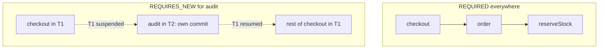
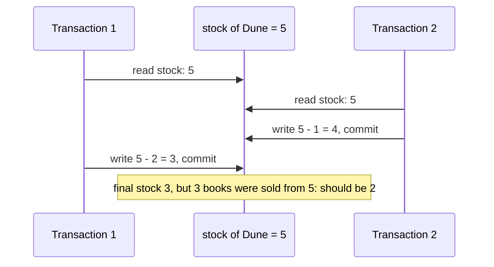

# Propagation and isolation

> **Before this lesson:** you know what `@Transactional` does, when it rolls back, and how the proxy decides ([@Transactional, rollback rules and the self-invocation pitfall](#/lesson/spring/spring-transactional)).

## In plain words

Two questions were left open by the last lesson.

**First question: what happens when one transactional method calls another?** Picture a group booking a trip together. Usually a newcomer joins the existing booking: if the trip is cancelled, it is cancelled for everyone. Sometimes a person insists on a separate booking that stands whatever happens to the group. Sometimes the rule is "you may only come if a group already exists", or "you must travel alone". Spring calls this choice **propagation**: how a method relates to a transaction that may already be running.

**Second question: what do two transactions running at the same time see of each other?** Picture two editors working on the same shared document. Should one see the other's half-typed sentence? Should a paragraph change under your eyes while you are reading it? Strict separation is safest and slowest; loose separation is fast and lets oddities through. This choice is the **isolation level**.

Both are attributes of `@Transactional`. Their defaults are right most of the time, which is why developers often meet them first in a production incident or an interview. This lesson makes both predictable.

## Part 1: propagation

### Physical and logical transactions

Keep two notions apart:

- The **physical transaction** is the real thing in the database: one connection, one `COMMIT` or `ROLLBACK`.
- Every `@Transactional` method entered through a proxy is a **logical transaction**, a participant. Several logical transactions can share one physical transaction.

Only the method that *started* the physical transaction commits or rolls it back. A participant that fails can do one thing: mark the shared transaction **rollback-only**, a flag meaning "this must not be committed".

### The seven propagation values

| Propagation | A transaction already exists | No transaction exists |
|---|---|---|
| `REQUIRED` (default) | join it | start a new one |
| `REQUIRES_NEW` | suspend it, start an independent one, resume the outer afterwards | start a new one |
| `NESTED` | set a savepoint inside it | start a new one |
| `SUPPORTS` | join it | run without a transaction |
| `MANDATORY` | join it | throw `IllegalTransactionStateException` |
| `NOT_SUPPORTED` | suspend it, run without a transaction | run without a transaction |
| `NEVER` | throw `IllegalTransactionStateException` | run without a transaction |

A **savepoint** is a marker inside a transaction that the database can roll back to without abandoning the whole transaction.

```java
@Transactional(propagation = Propagation.REQUIRES_NEW)
public void record(AuditEntry entry) { ... }
```

### REQUIRED: one for all

```java
@Service
public class CheckoutService {

    private final OrderService orders;
    private final StockService stock;

    @Transactional                               // starts the physical transaction T1
    public void checkout(Cart cart) {
        orders.create(cart);                     // @Transactional -> joins T1
        stock.reserve(cart);                     // @Transactional -> joins T1
    }
}
```

All three methods share T1. If `stock.reserve` throws, the exception passes through its proxy, which marks T1 rollback-only, then through `checkout`'s proxy, which rolls T1 back. The order row created earlier disappears too. This is what you want nine times out of ten.

### The surprise: catching does not save a joined transaction

```java
@Transactional
public void checkout(Cart cart) {
    orders.create(cart);
    try {
        stock.reserve(cart);                     // REQUIRED: joins; throws OutOfStockException
    } catch (OutOfStockException e) {
        log.warn("continuing without reservation");
    }
    notifications.queue(cart);
}
```

The developer intends: "if reserving fails, carry on". What happens:

1. `stock.reserve` throws. Its proxy marks the shared transaction rollback-only and rethrows.
2. `checkout` catches the exception and finishes normally.
3. `checkout`'s proxy tries to commit, finds the rollback-only mark, rolls everything back and throws **`UnexpectedRollbackException`** ("Transaction silently rolled back because it has been marked as rollback-only").

The order is gone and the caller receives an exception nobody threw explicitly. The rule: **an exception that has crossed the boundary of a joined `@Transactional` method has doomed the whole transaction, no matter who catches it afterwards.**

Ways to obtain the intended behaviour:

- make the failure not cross a transactional boundary (have `reserve` return a result object in place of throwing);
- give the inner method its own scope with `REQUIRES_NEW` or `NESTED`;
- declare `noRollbackFor = OutOfStockException.class` on the inner method.

### REQUIRES_NEW: independent

```java
@Service
public class AuditService {
    @Transactional(propagation = Propagation.REQUIRES_NEW)
    public void record(String event) { ... }       // commits on its own
}
```

The outer transaction is suspended, a second physical transaction T2 runs on a **second connection**, commits or rolls back by itself, and then the outer resumes. The classic use is an audit log that must be kept even when the business operation fails.

Costs: two connections are held at once (under load this can exhaust the pool, even deadlock it when every thread holds one connection and waits for a second), and T2 cannot see T1's uncommitted changes.

### NESTED: a savepoint

`NESTED` stays inside the same physical transaction but sets a savepoint first. If the nested method fails, only the work since the savepoint is undone; the outer transaction is not marked rollback-only and can continue, provided the caller catches the exception. If the outer transaction later rolls back, the nested work goes with it. It works with JDBC transaction managers; JPA support is limited.

| | `REQUIRED` | `REQUIRES_NEW` | `NESTED` |
|---|---|---|---|
| Physical transactions | 1 | 2 | 1 |
| Connections held | 1 | 2 | 1 |
| Inner fails and the caller catches it | everything rolls back at the end | inner rolled back, outer continues | inner rolled back to savepoint, outer continues |
| Outer fails after the inner succeeded | everything rolled back | inner stays committed | everything rolled back |

### See it run

The model executes a tree of method calls. Each method writes one row, calls its children, and may fail; `caught` means the caller wraps the call in try/catch.

```python-run
class Failure(Exception): pass

class Tx:
    def __init__(self): self.rows, self.rollback_only = [], False

def run(root):
    permanent = []

    def body(node, tx):
        (tx.rows if tx else permanent).append(node["name"])       # write one row
        for child in node.get("calls", []):
            try:
                call(child, tx)
            except Failure:
                if not child.get("caught"):
                    raise
        if node.get("fails"):
            raise Failure("RuntimeException")

    def in_new_transaction(node):
        tx = Tx()
        body(node, tx)                                            # an exception discards tx.rows
        if tx.rollback_only:
            raise Failure("UnexpectedRollbackException")
        permanent.extend(tx.rows)                                 # commit

    def call(node, tx):
        mode = node.get("propagation", "REQUIRED")
        if mode == "REQUIRES_NEW" or tx is None:
            in_new_transaction(node)
        elif mode == "NESTED":
            savepoint = len(tx.rows)
            try:
                body(node, tx)
            except Failure:
                del tx.rows[savepoint:]                           # roll back to the savepoint only
                raise
        else:                                                     # REQUIRED joining an existing transaction
            try:
                body(node, tx)
            except Failure:
                tx.rollback_only = True                           # doom the shared transaction
                raise

    try:
        call(root, None)
        error = None
    except Failure as failure:
        error = str(failure)
    return permanent, error

for inner in ["REQUIRED", "NESTED", "REQUIRES_NEW"]:
    tree = {"name": "checkout", "calls": [
        {"name": "order"},
        {"name": "reserveStock", "propagation": inner, "fails": True, "caught": True},
        {"name": "notify"}]}
    rows, error = run(tree)
    print(f"reserveStock is {inner:12} -> rows: {rows}  error: {error}")

tree = {"name": "checkout", "fails": True, "calls": [{"name": "audit", "propagation": "REQUIRES_NEW"}]}
print("outer fails after REQUIRES_NEW audit ->", run(tree))
```

The first three lines are the same scenario, a failing and caught `reserveStock`, with only the propagation changed. With `REQUIRED` nothing survives and the caller gets `UnexpectedRollbackException`. With `NESTED` or `REQUIRES_NEW` the rest of the checkout commits. The last line shows the audit row surviving a failed checkout. The practice problem [Transaction propagation over a call tree](#/problem/spring-tx-propagation) adds the remaining propagation values.



> [!INTERVIEW]
> "Explain `REQUIRED` versus `REQUIRES_NEW`." `REQUIRED` joins the caller's transaction or starts one; all participants commit or roll back together, and an exception crossing a participant's boundary marks the transaction rollback-only even if caught later (`UnexpectedRollbackException`). `REQUIRES_NEW` suspends the caller's transaction and runs in a separate one on a second connection, so its outcome is independent, at the price of pool usage. Mention `NESTED` (savepoints) and that all of this needs calls through the proxy.

The remaining values are guards: `MANDATORY` on a repository method documents "never call me without a transaction"; `NEVER` and `NOT_SUPPORTED` keep long-running or non-database work out of transactions; `SUPPORTS` suits read methods that do not care.

## Part 2: isolation

### What can go wrong between concurrent transactions

| Anomaly | What happens |
|---|---|
| **Dirty read** | T2 reads a change that T1 has not committed; T1 then rolls back, so T2 used data that never existed |
| **Non-repeatable read** | T1 reads a row twice and gets different values, because T2 changed it and committed in between |
| **Phantom read** | T1 runs the same range query twice and gets different *sets of rows*, because T2 inserted or deleted matching rows and committed |
| **Lost update** | T1 and T2 both read a value, both compute a new one from it, both write; the second write overwrites the first |

A timeline of the lost update, the one with the most painful consequences:



### The isolation levels

The SQL standard defines four levels by which anomalies they exclude.

| Isolation level | Dirty read | Non-repeatable read | Phantom read |
|---|---|---|---|
| `READ_UNCOMMITTED` | possible | possible | possible |
| `READ_COMMITTED` | prevented | possible | possible |
| `REPEATABLE_READ` | prevented | prevented | possible |
| `SERIALIZABLE` | prevented | prevented | prevented |

Stricter levels cost more: the database holds more locks or aborts more transactions with serialization errors that the application must retry. Throughput falls.

```java
@Transactional(isolation = Isolation.REPEATABLE_READ)
public void reserve(String isbn, int quantity) { ... }
```

Spring's default is `Isolation.DEFAULT`: use whatever the database is configured with. That is `READ_COMMITTED` in PostgreSQL, Oracle and SQL Server, and `REPEATABLE_READ` in MySQL's InnoDB engine. Real databases also deviate from the table in the safe direction; PostgreSQL's `REPEATABLE_READ`, for instance, prevents phantoms too. Check your database's documentation before relying on a level.

The simulation replays the non-repeatable read at two levels. Under `READ_COMMITTED` each statement sees the latest committed data; under `REPEATABLE_READ` a transaction keeps reading from the snapshot taken at its first read.

```python-run
def replay(level):
    committed = {"stock": 5}
    snapshot = {}                                   # T1's private view under REPEATABLE_READ
    log = []

    def t1_read():
        if level == "REPEATABLE_READ":
            if not snapshot:
                snapshot.update(committed)          # snapshot taken at the first read
            return snapshot["stock"]
        return committed["stock"]                   # READ_COMMITTED: always the latest committed value

    first = t1_read();              log.append(f"T1 reads stock = {first}")
    committed["stock"] = 4;         log.append("T2 writes stock = 4 and commits")
    second = t1_read();             log.append(f"T1 reads stock = {second}")
    verdict = "non-repeatable read" if first != second else "repeatable"
    return log, verdict

for level in ["READ_COMMITTED", "REPEATABLE_READ"]:
    log, verdict = replay(level)
    print(level)
    for line in log:
        print("   ", line)
    print("   =>", verdict)
```

Same schedule, two outcomes. The practice problem [Spot the isolation anomalies in a schedule](#/problem/spring-isolation-anomaly) trains you to recognise all four anomalies in an arbitrary interleaving.

### Preventing lost updates in practice

Raising the isolation level is one tool, and often not the best one. The common techniques:

**1. Do the arithmetic in SQL.** One atomic statement leaves no gap between read and write:

```java
int changed = jdbc.update(
        "UPDATE stock SET quantity = quantity - ? WHERE isbn = ? AND quantity >= ?", quantity, isbn, quantity);
if (changed == 0) {
    throw new OutOfStockException(isbn);
}
```

**2. Optimistic locking.** Add a `version` column. Every update says "set version = version + 1 where version = the one I read". If someone else updated first, zero rows match and the application knows it lost the race. With JPA a field annotated `@Version` does this automatically and throws `ObjectOptimisticLockingFailureException`; the usual reaction is to reload and retry, or to tell the user. "Optimistic" because it assumes conflicts are rare and only detects them.

**3. Pessimistic locking.** Lock the row while reading it: `SELECT … FOR UPDATE`, or `@Lock(LockModeType.PESSIMISTIC_WRITE)` on a Spring Data repository method. Other transactions wait until you commit. Reliable when conflicts are frequent, at the cost of waiting and the risk of deadlocks.

| | Optimistic | Pessimistic |
|---|---|---|
| Mechanism | version check at update time | lock at read time |
| On conflict | exception; retry | the other transaction waits |
| Best when | conflicts are rare | conflicts are frequent or retries are expensive |

> [!TIP]
> Reach for an atomic SQL update or optimistic locking before changing isolation levels. They target the specific rows that matter, whereas a stricter isolation level slows every query in the transaction.

> [!WARNING]
> A **deadlock** occurs when transaction A holds a lock B needs while B holds a lock A needs. The database picks a victim and aborts it with an error. Reduce the risk by always touching tables and rows in the same order, keeping transactions short, and being prepared to retry the aborted one.

## Pitfalls

- **Catching an exception from a `REQUIRED` participant and expecting to commit.** `UnexpectedRollbackException`.
- **`REQUIRES_NEW` in a loop under load.** Two connections per thread; the pool runs dry or deadlocks.
- **Expecting `REQUIRES_NEW` to see the outer transaction's uncommitted data.** It is a separate transaction; it sees only committed data and can block on rows the outer one has locked.
- **Propagation attributes on self-invoked methods.** Without the proxy, `REQUIRES_NEW` is merely decoration.
- **Assuming the default isolation is the same everywhere.** It depends on the database.
- **Read-modify-write in Java under `READ_COMMITTED`.** Lost updates. Use an atomic update or locking.
- **`SERIALIZABLE` everywhere "to be safe".** Throughput collapses and serialization failures must be retried.
- **`NESTED` with JPA.** Often unsupported; check before relying on it.

## Cheat sheet

| Attribute / annotation | Meaning |
|---|---|
| `propagation = REQUIRED` | join or create (default) |
| `propagation = REQUIRES_NEW` | always a separate transaction; outer suspended |
| `propagation = NESTED` | savepoint within the current transaction |
| `propagation = SUPPORTS` / `NOT_SUPPORTED` | join if present / never run in one |
| `propagation = MANDATORY` / `NEVER` | require an existing transaction / forbid one |
| `isolation = READ_COMMITTED` | no dirty reads |
| `isolation = REPEATABLE_READ` | also no non-repeatable reads |
| `isolation = SERIALIZABLE` | as if transactions ran one after another |
| `UnexpectedRollbackException` | commit attempted on a transaction marked rollback-only |
| `@Version` (JPA) | optimistic locking |
| `@Lock(PESSIMISTIC_WRITE)` / `SELECT … FOR UPDATE` | pessimistic locking |

## Summary

- Propagation decides how a transactional method relates to an existing transaction. `REQUIRED`, the default, joins it; all participants share one fate.
- A failure crossing a joined method's boundary marks the transaction rollback-only; catching the exception later does not undo that.
- `REQUIRES_NEW` runs independently on a second connection; `NESTED` uses a savepoint inside the same transaction.
- Isolation decides what concurrent transactions see. Levels trade the anomalies dirty read, non-repeatable read and phantom read against performance; the default comes from the database.
- Lost updates are best prevented with atomic SQL updates, optimistic locking (`@Version`) or pessimistic locking, not by blanket strict isolation.

## Glossary

- **Deadlock**: two transactions each waiting for a lock the other holds.
- **Dirty read**: reading another transaction's uncommitted change.
- **Isolation level**: the degree to which concurrent transactions are shielded from each other.
- **Logical transaction**: one `@Transactional` scope participating in a physical transaction.
- **Lost update**: a write overwritten because two transactions based their writes on the same old read.
- **Non-repeatable read**: reading the same row twice in a transaction and getting different values.
- **Optimistic locking**: detecting conflicting updates with a version check.
- **Pessimistic locking**: preventing conflicts by locking rows when they are read.
- **Phantom read**: a repeated range query returning a different set of rows.
- **Physical transaction**: the actual database transaction on one connection.
- **Propagation**: the rule for how a method joins, suspends or requires a transaction.
- **Rollback-only**: a mark on a transaction that forces it to roll back at completion.
- **Savepoint**: a point within a transaction to which a partial rollback can return.

```quiz
[
  {"q": "Method A (@Transactional) calls method B (@Transactional, default propagation) on another bean. How many physical transactions are there?",
   "options": ["Two", "One: B joins A's transaction", "None", "One per SQL statement"],
   "answer": 1,
   "explain": "REQUIRED joins the existing transaction; both methods share one connection and one commit."},
  {"q": "A calls B (REQUIRED). B throws a RuntimeException, A catches it and returns normally. What is the outcome?",
   "options": ["Everything commits", "Only B's work is rolled back", "Everything is rolled back and A's caller gets UnexpectedRollbackException", "Only A's work is rolled back"],
   "answer": 2,
   "explain": "B's proxy marked the shared transaction rollback-only. A's proxy then cannot commit and reports the unexpected rollback."},
  {"q": "An audit entry must be stored even if the business transaction fails. Which propagation fits the audit method?",
   "options": ["REQUIRED", "SUPPORTS", "REQUIRES_NEW", "MANDATORY"],
   "answer": 2,
   "explain": "REQUIRES_NEW commits independently of the caller's transaction."},
  {"q": "What is a practical cost of REQUIRES_NEW?",
   "options": ["It disables rollback", "It holds a second connection while the outer transaction is suspended", "It forces SERIALIZABLE isolation", "It cannot write data"],
   "answer": 1,
   "explain": "The suspended outer transaction keeps its connection while the inner one takes another, doubling pool usage for that thread."},
  {"q": "Which anomaly does READ_COMMITTED prevent?",
   "options": ["Phantom read", "Non-repeatable read", "Dirty read", "Lost update in all cases"],
   "answer": 2,
   "explain": "READ_COMMITTED only guarantees that you never read uncommitted data."},
  {"q": "Two transactions read stock = 5, then each writes its own computed value. What is this called and what is a good fix?",
   "options": ["Dirty read; use READ_UNCOMMITTED", "Lost update; use an atomic UPDATE ... SET quantity = quantity - ? or optimistic locking", "Phantom read; add an index", "Deadlock; increase the pool size"],
   "answer": 1,
   "explain": "The read-modify-write gap lets one write overwrite the other. Closing the gap in SQL or detecting the conflict with a version column solves it."},
  {"q": "Which isolation level does Spring use when none is specified?",
   "options": ["Always READ_COMMITTED", "Always SERIALIZABLE", "The database's own default", "No isolation at all"],
   "answer": 2,
   "explain": "Isolation.DEFAULT defers to the database: READ_COMMITTED in PostgreSQL and Oracle, REPEATABLE_READ in MySQL InnoDB."}
]
```

> **Source:** Spilcă, *Spring Start Here*, ch. 13 (using transactions in Spring apps). Documentation: https://docs.spring.io/spring-framework/reference/data-access/transaction/declarative/tx-propagation.html and https://docs.spring.io/spring-framework/reference/data-access/transaction/declarative/annotations.html
