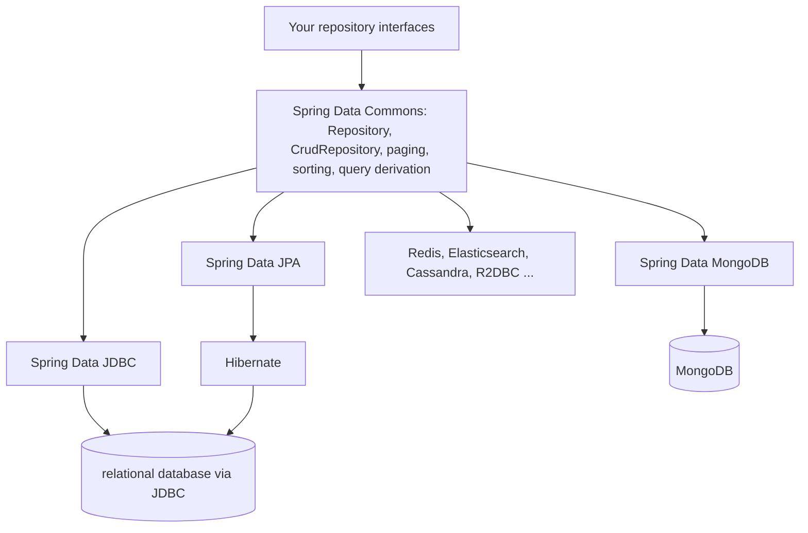
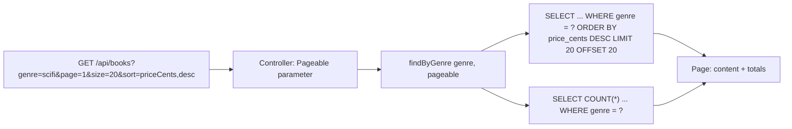

# Spring Data repositories: derived queries and @Query

> **Before this lesson:** you can write a repository by hand with `JdbcTemplate` and wrap service methods in transactions ([JDBC, DataSource and JdbcTemplate](#/lesson/spring/spring-jdbc-template), [@Transactional, rollback rules and the self-invocation pitfall](#/lesson/spring/spring-transactional)). You know that Spring can generate implementations of interfaces through proxies ([Calling REST endpoints: RestTemplate, RestClient and OpenFeign](#/lesson/spring/spring-rest-clients)).

## In plain words

In a large library you do not walk into the stacks yourself. You fill in a request slip: "all books by Austen, cheapest first". A librarian who knows the shelving system fetches them. You say *what* you want in a fixed, simple format; the librarian works out *how*.

Writing repositories with `JdbcTemplate` meant walking into the stacks: for every table you wrote the same `SELECT … WHERE id = ?`, the same `INSERT`, the same row mapper. **Spring Data** is the librarian. You write a Java **interface** that lists the operations you need. For standard operations such as save and find-by-id you write nothing at all. For others you write a method whose *name* is the request slip, for example `findByAuthorOrderByPriceCentsAsc`, and Spring Data reads the name and builds the query. When a name would get too long, you attach the query text with `@Query`.

Spring Data is used in the great majority of Spring Boot applications. Being able to read and write derived query methods, and knowing where their limits are, is everyday work and a predictable interview subject.

## What Spring Data is

**Spring Data** is a family of modules that offer one programming model, the repository interface, over many storage technologies.



The shared part defines the interfaces; each module supplies the implementation for its store. This lesson uses **Spring Data JDBC**, the simplest relational module: it maps objects to rows directly, with no caching layer and no lazy loading. The next lesson covers **Spring Data JPA**, the most widely used one. Everything about repositories and query methods applies to both.

```xml
<!-- pom.xml -->
<dependency>
    <groupId>org.springframework.boot</groupId>
    <artifactId>spring-boot-starter-data-jdbc</artifactId>
</dependency>
```

## The repository interfaces

| Interface | Adds |
|---|---|
| `Repository<T, ID>` | nothing: a marker meaning "this is a Spring Data repository" |
| `CrudRepository<T, ID>` | `save`, `saveAll`, `findById`, `existsById`, `findAll`, `count`, `deleteById`, `delete`, `deleteAll` |
| `ListCrudRepository<T, ID>` | the same, with `List` return types in place of `Iterable` |
| `PagingAndSortingRepository<T, ID>` | `findAll(Sort)` and `findAll(Pageable)` |
| `JpaRepository<T, ID>` (JPA module only) | list-returning CRUD, paging, plus `flush`, `saveAndFlush`, batch deletes |

`T` is the type of the stored objects and `ID` the type of their identifier. Extend the smallest interface that offers what you need. Extending the bare `Repository` and declaring only chosen methods is a good way to expose a deliberately limited contract, for example a repository without any delete.

## The first repository

```sql
-- src/main/resources/schema.sql
CREATE TABLE book (
    id          BIGINT GENERATED ALWAYS AS IDENTITY PRIMARY KEY,
    isbn        VARCHAR(13)  NOT NULL UNIQUE,
    title       VARCHAR(200) NOT NULL,
    author      VARCHAR(100) NOT NULL,
    genre       VARCHAR(40)  NOT NULL,
    price_cents INT          NOT NULL,
    in_stock    BOOLEAN      NOT NULL
);
```

```java
// src/main/java/com/bookshop/catalogue/Book.java
package com.bookshop.catalogue;

import org.springframework.data.annotation.Id;

public record Book(@Id Long id, String isbn, String title, String author, String genre,
                   int priceCents, boolean inStock) { }
```

- `@Id` marks the identifier. With a database-generated key the value is `null` for a new object; `save` then performs an `INSERT` and returns a copy carrying the generated id. A non-null id means `UPDATE`.
- By convention the class `Book` maps to the table `book`, and the property `priceCents` to the column `price_cents`. Override with `@Table("…")` and `@Column("…")` when names differ.

```java
// src/main/java/com/bookshop/catalogue/BookRepository.java
package com.bookshop.catalogue;

import org.springframework.data.repository.ListCrudRepository;

public interface BookRepository extends ListCrudRepository<Book, Long> {
}
```

That is the complete file. There is no implementing class and no annotation. At start-up Spring Data finds interfaces that extend `Repository` in the packages below the main class, creates a proxy implementation of each, and registers it as a bean.

```java
// src/main/java/com/bookshop/catalogue/CatalogueService.java
@Service
public class CatalogueService {

    private final BookRepository books;

    public CatalogueService(BookRepository books) {          // the generated proxy is injected
        this.books = books;
    }

    @Transactional
    public Book add(String isbn, String title, String author, String genre, int priceCents) {
        return books.save(new Book(null, isbn, title, author, genre, priceCents, true));
    }

    public Book find(long id) {
        return books.findById(id)                            // Optional<Book>
                    .orElseThrow(() -> new BookNotFoundException(id));
    }

    public List<Book> all() {
        return books.findAll();
    }
}
```

`findById` returns `Optional<Book>`, forcing the caller to decide what "not found" means.

## Derived query methods

Declare a method in the interface and Spring Data builds the query from its name.

```java
public interface BookRepository extends ListCrudRepository<Book, Long> {

    List<Book> findByAuthor(String author);

    Optional<Book> findByIsbn(String isbn);

    List<Book> findByGenreAndInStockTrue(String genre);

    List<Book> findByPriceCentsLessThanEqualOrderByPriceCentsAsc(int maxPriceCents);

    List<Book> findByTitleContainingIgnoreCase(String fragment);

    List<Book> findTop3ByGenreOrderByPriceCentsDesc(String genre);

    long countByGenre(String genre);

    boolean existsByIsbn(String isbn);
}
```

For `findByGenreAndInStockTrue("scifi")` Spring Data generates SQL along the lines of:

```sql
SELECT id, isbn, title, author, genre, price_cents, in_stock
FROM book
WHERE genre = ? AND in_stock = TRUE
```

A method name has three parts:

```text
findTop3  By  GenreAndPriceCentsLessThan  OrderBy  PriceCentsDesc
└subject┘     └────── predicate ───────┘           └─ ordering ─┘
```

**Subject**: `find…By` (also `read…By`, `get…By`, `query…By`), `count…By`, `exists…By`, `delete…By`. `First` or `Top` plus an optional number limits the result; `Distinct` removes duplicates.

**Predicate**: property names combined with `And` / `Or`, each optionally followed by a keyword:

| Keyword | Example | Condition |
|---|---|---|
| (none), `Is`, `Equals` | `findByAuthor` | `author = ?` |
| `Not` | `findByGenreNot` | `genre <> ?` |
| `LessThan`, `LessThanEqual`, `GreaterThan`, `GreaterThanEqual` | `findByPriceCentsLessThan` | `price_cents < ?` |
| `Between` | `findByPriceCentsBetween(a, b)` | `price_cents BETWEEN ? AND ?` |
| `Like`, `Containing`, `StartingWith`, `EndingWith` | `findByTitleContaining` | `title LIKE '%…%'` |
| `In`, `NotIn` | `findByGenreIn(Collection)` | `genre IN (…)` |
| `IsNull`, `IsNotNull` | `findByAuthorIsNull` | `author IS NULL` |
| `True`, `False` | `findByInStockTrue` | `in_stock = TRUE` |
| `IgnoreCase` | `findByAuthorIgnoreCase` | case-insensitive comparison |
| `After`, `Before` | `findByPublishedAfter(date)` | date comparison |

`And` binds more tightly than `Or`: `findByAOrBAndC` means `a OR (b AND c)`.

**Ordering**: `OrderBy` followed by properties with `Asc` or `Desc`.

Parameters are matched to conditions by position. The return type decides the shape: `List<T>`, `Optional<T>`, a plain `T` (`null` when absent), `Stream<T>`, `Page<T>`, `long`, `boolean`.

A method name that does not parse, or names a property the class does not have, makes **start-up fail** with a message such as `No property 'autor' found for type 'Book'`. Typos are caught before the first request.

## A model: from method name to query

The next program is a miniature of the mechanism. A proxy intercepts any method call, parses the name with regular expressions and filters a list of rows.

```python-run
import re

BOOKS = [
    {"title": "Dune", "author": "Herbert", "genre": "scifi", "priceCents": 1250, "inStock": True},
    {"title": "Neuromancer", "author": "Gibson", "genre": "scifi", "priceCents": 1500, "inStock": False},
    {"title": "Emma", "author": "Austen", "genre": "classic", "priceCents": 800, "inStock": True},
    {"title": "Persuasion", "author": "Austen", "genre": "classic", "priceCents": 900, "inStock": True},
]

KEYWORDS = {                                  # keyword -> (number of arguments, test)
    "LessThan":    (1, lambda value, a: value < a[0]),
    "GreaterThan": (1, lambda value, a: value > a[0]),
    "Containing":  (1, lambda value, a: a[0] in value),
    "True":        (0, lambda value, a: value is True),
    "":            (1, lambda value, a: value == a[0]),
}

def field(prop):
    return prop[0].lower() + prop[1:]

def parse(method_name):
    subject, rest = re.match(r"(find|count|exists)By(.*)", method_name).groups()
    predicate, _, ordering = rest.partition("OrderBy")
    groups = []
    for or_part in re.split(r"Or(?=[A-Z])", predicate):               # Or splits first...
        conditions = []
        for part in re.split(r"And(?=[A-Z])", or_part):               # ...so And binds tighter
            keyword = next(k for k in KEYWORDS if k and part.endswith(k)) \
                      if any(k and part.endswith(k) for k in KEYWORDS) else ""
            prop = part[:len(part) - len(keyword)] if keyword else part
            conditions.append((field(prop), keyword))
        groups.append(conditions)
    order = re.findall(r"([A-Z]\w*?)(Asc|Desc)", ordering)
    return subject, groups, order

class RepositoryProxy:
    def __init__(self, rows):
        self.rows = rows
    def __getattr__(self, method_name):                               # any method name is accepted
        subject, groups, order = parse(method_name)
        def query(*args):
            args, selected = list(args), []
            plan = [[(f, k, [args.pop(0) for _ in range(KEYWORDS[k][0])]) for f, k in g] for g in groups]
            for row in self.rows:
                if any(all(KEYWORDS[k][1](row[f], a) for f, k, a in g) for g in plan):
                    selected.append(row)
            for prop, direction in reversed(order):
                selected.sort(key=lambda r: r[field(prop)], reverse=(direction == "Desc"))
            if subject == "count":  return len(selected)
            if subject == "exists": return bool(selected)
            return [r["title"] for r in selected]
        print(f"{method_name}\n   parsed as: {groups} order {order}")
        return query

books = RepositoryProxy(BOOKS)
print("  ->", books.findByAuthor("Austen"))
print("  ->", books.findByGenreAndInStockTrue("scifi"))
print("  ->", books.findByPriceCentsLessThanOrderByPriceCentsDesc(1300))
print("  ->", books.findByTitleContainingOrAuthor("mancer", "Herbert"))
print("  ->", books.countByGenre("classic"))
```

`RepositoryProxy` has no query methods at all. `__getattr__` receives whatever name is called, `parse` splits it into subject, OR-groups of AND-ed conditions and ordering, and `query` evaluates it. Real Spring Data does the parsing once at start-up, validates each property against the entity class, and produces SQL instead of filtering in memory. The practice problem [Derived queries: from method name to filter](#/problem/spring-derived-query) asks you to build a more complete parser.

## When the name gets too long: @Query

`findByGenreAndInStockTrueAndPriceCentsLessThanEqualOrderByPriceCentsAscTitleAsc` is legal and unreadable. Beyond two or three conditions, write the query yourself.

```java
public interface BookRepository extends ListCrudRepository<Book, Long> {

    @Query("""
            SELECT * FROM book
            WHERE genre = :genre AND in_stock = TRUE AND price_cents <= :maxPrice
            ORDER BY price_cents, title
            """)
    List<Book> affordableInGenre(@Param("genre") String genre, @Param("maxPrice") int maxPriceCents);

    @Modifying
    @Query("UPDATE book SET price_cents = :price WHERE isbn = :isbn")
    int changePrice(@Param("isbn") String isbn, @Param("price") int priceCents);

    @Query("SELECT author, COUNT(*) AS titles FROM book GROUP BY author ORDER BY titles DESC")
    List<AuthorCount> titlesPerAuthor();
}
```

```java
public record AuthorCount(String author, long titles) { }
```

- With `@Query` the method name is free; choose one that describes the intent.
- `:genre` is a named parameter bound by `@Param("genre")`. When the code is compiled with the `-parameters` flag, as Boot's build does, `@Param` can be omitted if the names match.
- `@Modifying` is required for statements that change data. Such methods may return `int` or `long` (affected rows), `boolean` or `void`.
- A result does not have to be the entity: the last method maps each row to a small record. Such a purpose-built result type is called a **projection**.
- In Spring Data JDBC the text is plain SQL. In Spring Data JPA it is JPQL, the object query language of the next lesson, unless you set `nativeQuery = true`.

> [!WARNING]
> Query text in `@Query` is not checked by the Java compiler. In Spring Data JPA, JPQL is validated at start-up; native SQL, and SQL in Spring Data JDBC, is only checked when it first runs. Every `@Query` method deserves a test that executes it against a real database.

## Sorting and paging

Returning ten thousand rows to show twenty is wasteful. Declare a `Pageable` parameter and the repository fetches one page.

```java
public interface BookRepository extends ListCrudRepository<Book, Long>, PagingAndSortingRepository<Book, Long> {

    Page<Book> findByGenre(String genre, Pageable pageable);

    List<Book> findByAuthor(String author, Sort sort);
}
```

```java
Pageable secondPage = PageRequest.of(1, 20, Sort.by("priceCents").descending().and(Sort.by("title")));
Page<Book> page = books.findByGenre("scifi", secondPage);

page.getContent();          // up to 20 books
page.getTotalElements();    // total matching rows (costs an extra COUNT query)
page.getTotalPages();
page.hasNext();
```

- `PageRequest.of(page, size, sort)` describes the page. **Page numbers start at 0.**
- A `Page` carries the content plus totals. For that it runs a second query, `SELECT COUNT(*)`. When you only need "is there a next page?", return `Slice<Book>`, which fetches one extra row and skips the count.
- In a controller, declaring a `Pageable` parameter makes Spring MVC build it from `?page=1&size=20&sort=priceCents,desc`.



> [!TIP]
> Always cap the page size on a public API (Spring's default maximum is 2000; set `spring.data.web.pageable.max-page-size`). A client asking for `size=1000000` should not be able to load a whole table into memory. For very deep paging, offsets become slow; switch to keyset pagination ("rows after the last id I saw").

## Transactions in repositories

The built-in CRUD methods are already transactional: reads run in a read-only transaction and writes in a read-write one. When a service method annotated `@Transactional` calls several repository methods, they join the service's transaction through the default `REQUIRED` propagation, so the whole use case commits or rolls back together. Your own `@Modifying` queries should be called from a transactional service method, or carry `@Transactional` themselves.

## Derived query, @Query, or JdbcTemplate?

| Situation | Choice |
|---|---|
| Standard create, read, update, delete | inherited repository methods |
| One to three simple conditions | derived query method |
| Longer conditions, joins, aggregates | `@Query` |
| Dynamic criteria chosen at run time (optional filters) | Query by Example, JPA Specifications, Querydsl or jOOQ |
| Bulk operations, reporting, vendor-specific SQL | `JdbcTemplate` / `JdbcClient`, in a custom repository fragment |

A repository can combine generated and hand-written code: declare an extra interface, for example `BookRepositoryCustom`, implement it in a class named `BookRepositoryCustomImpl` using `JdbcTemplate`, and let `BookRepository` extend both. Spring Data stitches them together behind the proxy.

> [!INTERVIEW]
> "How does Spring Data implement a repository interface with no implementation class?" At start-up it scans for interfaces extending `Repository`, and for each creates a proxy backed by a store-specific base class (`SimpleJpaRepository` for JPA). CRUD calls go to that base class. For other methods it selects a strategy once at start-up: a declared `@Query`, or a query derived by parsing the method name against the entity's properties. Invalid names or properties fail at start-up. The proxy also applies transactions and exception translation.

## Pitfalls

- **Monster method names.** Hard to read and easy to get wrong. Switch to `@Query`.
- **Property names, not column names.** Derived queries refer to the Java property (`priceCents`); `findByPrice_cents` does not exist.
- **`findBy…` returning a single object when several rows match.** `IncorrectResultSizeDataAccessException` at run time. Return a `List`, or use `findFirstBy…`.
- **Forgetting `@Modifying`.** An `UPDATE` or `DELETE` in `@Query` without it fails.
- **`findAll()` on a large table.** Loads every row. Use paging.
- **One-based page numbers.** `PageRequest.of(1, 20)` is the *second* page.
- **`Page` when `Slice` or `List` would do.** An unnecessary count query per request.
- **Repository interface outside the scanned packages.** No bean. Use `@EnableJdbcRepositories` or `@EnableJpaRepositories` with the right base package.
- **Calling `save` in a loop.** One statement per row; use `saveAll`, and configure batching for large volumes.
- **Business logic in repositories.** Repositories fetch and store; decisions belong in services.

## Cheat sheet

| Type / annotation | Meaning |
|---|---|
| `Repository<T, ID>` | marker for a Spring Data repository |
| `CrudRepository`, `ListCrudRepository` | standard CRUD methods |
| `PagingAndSortingRepository` | `findAll(Sort)`, `findAll(Pageable)` |
| `JpaRepository` | CRUD + paging + JPA extras |
| `findBy…`, `countBy…`, `existsBy…`, `deleteBy…` | derived query subjects |
| `And`, `Or`, `LessThan`, `Between`, `Containing`, `In`, `IsNull`, `True`, `IgnoreCase` | predicate keywords |
| `OrderByXAsc`, `First`, `Top3` | ordering and limiting |
| `@Query("…")`, `@Param("name")` | explicit query and its named parameters |
| `@Modifying` | marks an updating `@Query` |
| `Pageable`, `PageRequest.of(page, size, sort)` | paging request (zero-based) |
| `Page<T>` / `Slice<T>` | page with / without total count |
| `Sort.by("prop").descending()` | sort specification |
| `@Id` | identifier property |

## Summary

- Spring Data generates repository implementations from interfaces, with one model across many data stores.
- Extending `CrudRepository` (or a relative) gives standard operations with no code.
- Derived query methods encode a query in the method name: subject, predicate with keywords, optional ordering. They are validated at start-up.
- `@Query` supplies the query text for anything beyond simple conditions; `@Modifying` marks updates; results can be projections.
- `Pageable` and `Sort` parameters add paging and sorting; `Page` includes totals at the cost of a count query, and page numbers start at zero.
- Repository methods join the calling service's transaction.

## Glossary

- **Derived query**: a query generated from a repository method's name.
- **Entity**: a stored object with an identity, mapped to a table row.
- **Keyset pagination**: paging by "rows after the last key seen" instead of an offset.
- **`Page`**: one chunk of results together with total counts.
- **`Pageable`**: a request for a page: number, size and sort.
- **Projection**: a query result shaped differently from the entity, such as a few columns or an aggregate.
- **Repository**: an object that stores and retrieves entities, hiding the data access technology.
- **`Slice`**: one chunk of results with only the knowledge of whether more exist.
- **Spring Data**: Spring's family of modules providing repository support for various data stores.

```quiz
[
  {"q": "A project contains interface BookRepository extends ListCrudRepository<Book, Long> and no implementing class. What gets injected where BookRepository is required?",
   "options": ["Nothing; start-up fails", "A proxy implementation generated by Spring Data at start-up", "A class that the compiler generated", "null"],
   "answer": 1,
   "explain": "Spring Data scans for repository interfaces and registers a proxy bean for each, backed by a store-specific implementation."},
  {"q": "What does findByGenreAndInStockTrue(String genre) select?",
   "options": ["Books of the genre, or any book in stock", "Books of the genre that are in stock", "All books in stock", "Books whose genre is the text true"],
   "answer": 1,
   "explain": "And joins the two conditions; True is a keyword that needs no argument and tests the boolean property."},
  {"q": "The interface declares List<Book> findByAutor(String author) with a typo in the property name. When is the mistake detected?",
   "options": ["At compile time", "At start-up, when Spring Data parses the method name against Book's properties", "When the method is first called", "Never; it returns an empty list"],
   "answer": 1,
   "explain": "Derived queries are built when the context starts, and an unknown property stops the application with a clear message."},
  {"q": "How is findByAOrBAndC interpreted?",
   "options": ["(a OR b) AND c", "a OR (b AND c)", "a AND b AND c", "It is invalid"],
   "answer": 1,
   "explain": "The name is split on Or first, then each part on And, so And binds more tightly."},
  {"q": "What does PageRequest.of(1, 20) request?",
   "options": ["The first 20 rows", "Rows 21 to 40, because page numbers start at 0", "Row number 1 to row number 20", "20 pages"],
   "answer": 1,
   "explain": "Page indexes are zero-based: page 1 is the second page."},
  {"q": "Which annotation is required on an @Query method that executes an UPDATE?",
   "options": ["@Transactional only", "@Modifying", "@Param", "@Id"],
   "answer": 1,
   "explain": "@Modifying tells Spring Data that the statement changes data and returns an update count, not a result set."},
  {"q": "When is Slice a better return type than Page?",
   "options": ["When you need the total number of pages", "When you only need to know whether a next page exists and want to avoid the extra COUNT query", "When sorting is required", "Never"],
   "answer": 1,
   "explain": "A Page needs a count query to report totals. A Slice fetches one extra row to determine hasNext."}
]
```

> **Source:** Spilcă, *Spring Start Here*, ch. 14 (what Spring Data is; how it works; using Spring Data JDBC). Documentation: https://docs.spring.io/spring-data/commons/reference/repositories/query-methods-details.html and https://docs.spring.io/spring-data/relational/reference/jdbc/getting-started.html
