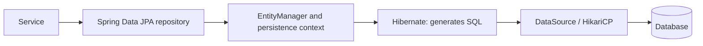
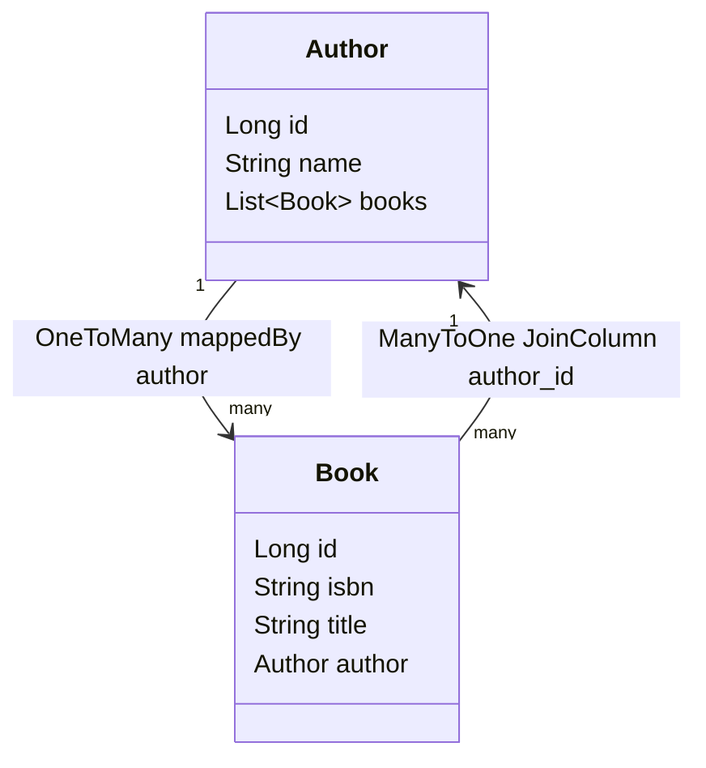
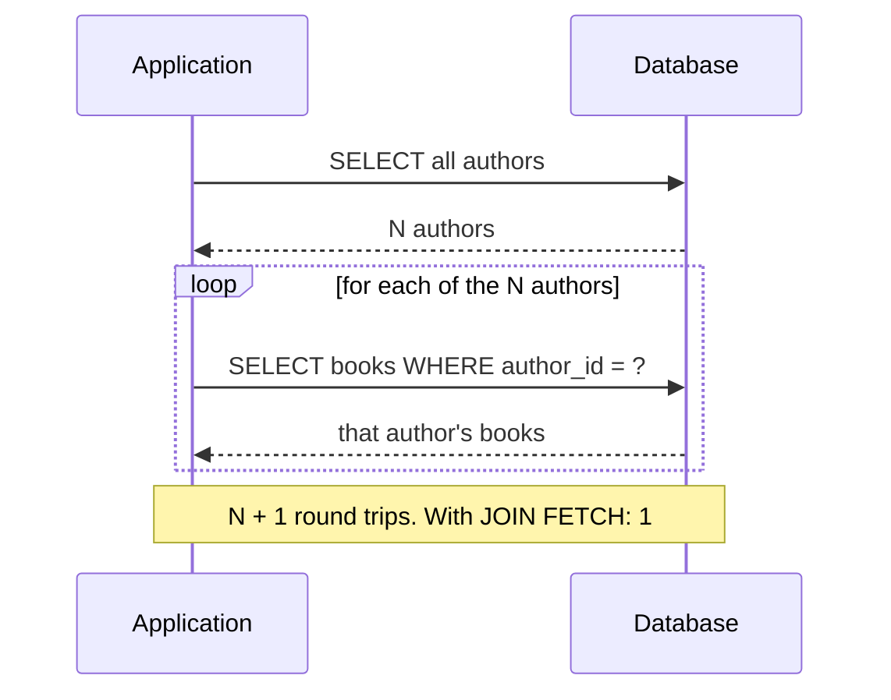

# JPA basics: entity mapping, relationships and the N+1 problem

> **Before this lesson:** you can write Spring Data repository interfaces with derived queries and `@Query` ([Spring Data repositories: derived queries and @Query](#/lesson/spring/spring-data-repositories)), and you understand transactions ([@Transactional, rollback rules and the self-invocation pitfall](#/lesson/spring/spring-transactional)).

## In plain words

Your Java program thinks in objects: an `Author` object holds a list of `Book` objects, and you walk from one to the other with a dot. A relational database thinks in tables: a row in `author`, rows in `book`, each with an `author_id` number pointing back. Moving between the two views by hand is translation work: every query result must be turned into objects, every changed object into `UPDATE` statements.

An **object-relational mapper**, ORM for short, is a professional interpreter between those two languages. You describe once how classes correspond to tables. From then on you work with objects, and the interpreter writes the SQL. **JPA** (Jakarta Persistence API) is the Java standard for such interpreters, **Hibernate** is the implementation Spring Boot uses, and **Spring Data JPA** puts the repository interfaces from the last lesson on top.

An interpreter saves enormous effort and can also say things you did not intend. The best-known example is the **N+1 problem**: code that looks like a harmless loop sends hundreds of queries. JPA is in most enterprise Spring projects, and "what is the N+1 problem and how do you fix it?" is close to a guaranteed interview question.

## The pieces and their names

| Term | Meaning |
|---|---|
| **JPA** | the specification: annotations such as `@Entity`, the `EntityManager` interface, the query language JPQL |
| **Hibernate** | the most used implementation of JPA |
| **Entity** | a class whose objects are stored as table rows |
| **`EntityManager`** | the JPA object through which entities are loaded and saved |
| **Persistence context** | the `EntityManager`'s set of currently managed entities; a first-level cache that lives for one transaction |
| **JPQL** | Jakarta Persistence Query Language: SQL-like, but written against entity classes and their properties |
| **Spring Data JPA** | repository interfaces implemented on top of the `EntityManager` |



```xml
<!-- pom.xml -->
<dependency>
    <groupId>org.springframework.boot</groupId>
    <artifactId>spring-boot-starter-data-jpa</artifactId>
</dependency>
```

Useful properties while learning:

```properties
spring.jpa.show-sql=true
spring.jpa.properties.hibernate.format_sql=true
spring.jpa.hibernate.ddl-auto=validate
spring.jpa.open-in-view=false
```

- `show-sql` prints every statement Hibernate sends. Keep it on while you study this lesson: seeing the SQL is how you learn what the interpreter is saying on your behalf.
- `ddl-auto` controls whether Hibernate creates or checks tables: `create-drop` and `update` are conveniences for experiments; `validate` only verifies that tables match the mapping; `none` does nothing. In production use `validate` or `none` with a migration tool.
- `open-in-view=false` is explained under lazy loading.

## Mapping an entity

```java
// src/main/java/com/bookshop/catalogue/Author.java
package com.bookshop.catalogue;

import jakarta.persistence.*;
import java.util.ArrayList;
import java.util.List;

@Entity                                               // (1)
@Table(name = "author")                               // (2)
public class Author {

    @Id                                               // (3)
    @GeneratedValue(strategy = GenerationType.IDENTITY)   // (4)
    private Long id;

    @Column(nullable = false, length = 100)           // (5)
    private String name;

    @OneToMany(mappedBy = "author")                   // (6)
    private List<Book> books = new ArrayList<>();

    protected Author() { }                            // (7)

    public Author(String name) { this.name = name; }

    public Long getId() { return id; }
    public String getName() { return name; }
    public List<Book> getBooks() { return books; }
}
```

1. `@Entity` declares that objects of this class are stored in the database. Note the package: `jakarta.persistence`, not the pre-Boot-3 `javax.persistence`.
2. `@Table` names the table. Without it the table name is derived from the class name.
3. `@Id` marks the primary key.
4. `@GeneratedValue` says the database assigns the key. `IDENTITY` uses an auto-increment column; `SEQUENCE` uses a database sequence and allows Hibernate to batch inserts.
5. `@Column` adjusts the column mapping. Without it a field maps to a column with the corresponding snake-case name (`priceCents` → `price_cents` under Boot's default naming).
6. `@OneToMany` declares the relationship to `Book`; explained below.
7. JPA requires a no-argument constructor (it may be `protected`), because Hibernate creates the object first and fills in the fields afterwards. For the same reason entities are ordinary classes, not records.

```java
// src/main/java/com/bookshop/catalogue/Book.java
@Entity
public class Book {

    @Id
    @GeneratedValue(strategy = GenerationType.IDENTITY)
    private Long id;

    @Column(nullable = false, unique = true, length = 13)
    private String isbn;

    private String title;

    private int priceCents;

    @Enumerated(EnumType.STRING)                      // store the enum's name, not its position
    private Genre genre;

    @ManyToOne(fetch = FetchType.LAZY)                // many books belong to one author
    @JoinColumn(name = "author_id")                   // the foreign-key column in the book table
    private Author author;

    @Version                                          // optimistic locking, see the previous lesson
    private long version;

    protected Book() { }

    public Book(String isbn, String title, int priceCents, Genre genre, Author author) {
        this.isbn = isbn; this.title = title; this.priceCents = priceCents;
        this.genre = genre; this.author = author;
    }

    public void changePrice(int newPriceCents) { this.priceCents = newPriceCents; }
    // getters
}
```

> [!WARNING]
> Use `@Enumerated(EnumType.STRING)`. The default, `ORDINAL`, stores the position of the enum constant (0, 1, 2…). Inserting a new constant in the middle of the enum later silently changes the meaning of every stored row.

## Relationships

In the database, the relationship is one column: `book.author_id`, a **foreign key** referring to `author.id`. In Java it can be navigated in both directions.



- `@ManyToOne` on `Book.author` is the **owning side**: it has the `@JoinColumn`, and its value is what Hibernate writes to the foreign-key column.
- `@OneToMany(mappedBy = "author")` on `Author.books` is the **inverse side**: `mappedBy` says "this collection mirrors the field named `author` in `Book`; do not create another column or table for it".

Consequence: adding a book to `author.getBooks()` without setting `book.author` saves nothing, because only the owning side is written. Keep both sides in step with a helper method:

```java
public void addBook(Book book) {
    books.add(book);
    book.setAuthor(this);
}
```

The four relationship annotations and their default **fetch type**, meaning when the related data is loaded:

| Annotation | Example | Default fetch |
|---|---|---|
| `@ManyToOne` | book → author | **EAGER** |
| `@OneToOne` | user → profile | **EAGER** |
| `@OneToMany` | author → books | LAZY |
| `@ManyToMany` | book ↔ tags | LAZY |

**EAGER** means "load it together with the owner, always". **LAZY** means "load it when the code first touches it". The widely followed rule is to declare **everything `LAZY`**, as `Book.author` does above, and to fetch related data explicitly in the queries that need it. An eager association is loaded in every query for that entity, including the many that never use it.

## Managed entities and dirty checking

```java
// src/main/java/com/bookshop/catalogue/BookRepository.java
public interface BookRepository extends JpaRepository<Book, Long> {
    Optional<Book> findByIsbn(String isbn);
}
```

```java
@Service
public class PricingService {

    private final BookRepository books;

    public PricingService(BookRepository books) { this.books = books; }

    @Transactional
    public void discount(String isbn, int percent) {
        Book book = books.findByIsbn(isbn).orElseThrow();                 // SELECT
        book.changePrice(book.getPriceCents() * (100 - percent) / 100);
        // no save() call
    }                                                                     // UPDATE at commit
}
```

There is no `save`, and the change still reaches the database. An entity loaded inside a transaction is **managed**: the persistence context remembers its original state. At commit Hibernate compares every managed entity with that snapshot and issues `UPDATE` statements for the differences. This is **dirty checking**.

It surprises newcomers in two ways. Changing a managed entity "to try something" writes to the database. And outside a transaction, changing an entity writes nothing, because nothing is tracking it; such an entity is **detached**.

| State | Meaning |
|---|---|
| transient | created with `new`, unknown to the persistence context |
| managed | loaded or saved in the current persistence context; changes are tracked |
| detached | was managed, but its persistence context is closed |
| removed | scheduled for deletion |

## Lazy loading

`book.getAuthor()` on a lazily mapped association returns a stand-in (a proxy again). The first call that needs real data, such as `getAuthor().getName()`, triggers a `SELECT`. That works only while the persistence context is open, which normally means inside the transaction.

```java
Book book = bookService.find(id);            // transaction ended when the service method returned
book.getAuthor().getName();                  // LazyInitializationException: no Session
```

`LazyInitializationException` is the most common JPA error. The cure is to load what is needed inside the transaction, ideally with a query that fetches it, and to return a DTO.

> [!NOTE]
> Boot's default `spring.jpa.open-in-view=true` keeps the persistence context open until the HTTP response has been written, so lazy loading still works in controllers and during JSON conversion. It hides the exception at the price of unplanned queries during rendering and a database connection held for the entire request. Boot logs a warning about it at start-up; most teams set it to `false`.

## The N+1 problem

The requirement: list every author with the number of their books.

```java
@Transactional(readOnly = true)
public List<String> authorSummaries() {
    List<Author> authors = authorRepository.findAll();                    // 1 query
    return authors.stream()
            .map(a -> a.getName() + ": " + a.getBooks().size() + " book(s)")   // 1 query PER author
            .toList();
}
```

With `show-sql` on:

```text
select a.id, a.name from author a
select b.* from book b where b.author_id = ?
select b.* from book b where b.author_id = ?
select b.* from book b where b.author_id = ?
... one line for every author ...
```

One query for the N authors, then one more per author when its lazy collection is touched: **N+1 queries**. With 500 authors that is 501 round trips where one would do. Each is fast; together they are slow, and the cost grows with the data, which is why the problem goes unnoticed with ten rows of test data and hurts in production.



Switching the collection to `EAGER` does not help. For a query such as `findAll`, Hibernate still loads the authors first and then immediately issues one select per author; you get the N+1 on every use of the entity, whether the books are needed or not.

### The fixes

**1. `JOIN FETCH` in JPQL**: tell Hibernate to load the association in the same query.

```java
public interface AuthorRepository extends JpaRepository<Author, Long> {

    @Query("select distinct a from Author a left join fetch a.books")
    List<Author> findAllWithBooks();
}
```

JPQL names the entity class (`Author`) and its property (`a.books`), not table and column. `left join fetch` loads authors and their books in one SQL join. `distinct` removes the duplicate author objects the join would otherwise produce (Hibernate 6 already de-duplicates entity results).

**2. `@EntityGraph`**: the same effect, declaratively, usable on derived queries.

```java
@EntityGraph(attributePaths = "books")
List<Author> findByNameStartingWith(String prefix);
```

**3. Batch fetching**: keep lazy loading, but load many collections per query.

```java
@OneToMany(mappedBy = "author")
@BatchSize(size = 50)
private List<Book> books = new ArrayList<>();
```

Touching one uninitialised collection loads it together with up to 49 others in a single `where author_id in (?, ?, …)` query. The setting `spring.jpa.properties.hibernate.default_batch_fetch_size=50` applies this globally and is a cheap, effective safety net.

**4. A projection**: do not load entities at all when you need a few values.

```java
public record AuthorBookCount(String name, long books) { }

@Query("select new com.bookshop.catalogue.AuthorBookCount(a.name, count(b)) " +
       "from Author a left join a.books b group by a.name")
List<AuthorBookCount> countBooksPerAuthor();
```

One query, no entities, no lazy loading, no dirty checking. For read-only screens this is usually the best option.

### Count it yourself

```python-run
import math

def count_queries(authors, strategy, touched, batch_size=1):
    queries = 1                                      # the query that loads the authors
    if strategy in ("join fetch", "projection"):
        return queries
    if strategy == "eager (select)":
        return queries + authors                     # one per author, needed or not
    loaded = [False] * authors
    for index in touched:                            # lazy: load on first touch
        if loaded[index]:
            continue
        queries += 1
        loaded[index] = True
        room = batch_size - 1                        # batch fetching: take others along
        for other in range(authors):
            if room == 0:
                break
            if not loaded[other]:
                loaded[other] = True
                room -= 1
    return queries

N = 500
everything = list(range(N))
few = [0, 1, 2]
print(f"{'strategy':22}{'touch all 500':>15}{'touch 3':>10}{'touch none':>12}")
for strategy, batch in [("lazy", 1), ("eager (select)", 1), ("lazy + batch 50", 50),
                        ("join fetch", 1), ("projection", 1)]:
    key = "lazy" if strategy.startswith("lazy") else strategy
    row = [count_queries(N, key, touched, batch) for touched in (everything, few, [])]
    print(f"{strategy:22}{row[0]:>15}{row[1]:>10}{row[2]:>12}")
```

Read the table by columns. When every collection is used, plain lazy loading costs 501 queries and batching brings it to 11. When only three are used, lazy loading is cheap (4) while eager still pays 501. When none is used, lazy costs a single query. `JOIN FETCH` is always 1, but always transfers all the books. No strategy is best everywhere, which is why the choice belongs in each query and not in the mapping. The practice problem [Count the queries: the N+1 problem and its fixes](#/problem/spring-n-plus-one) asks you to write this counter.

> [!INTERVIEW]
> "What is the N+1 problem and how do you solve it?" Loading N parent entities with one query and then triggering one extra query per parent for a lazily loaded association gives N+1 round trips. Detect it by logging SQL or counting statements in tests. Fix it per use case with `JOIN FETCH` or `@EntityGraph` (one query), batch fetching (`@BatchSize`, `default_batch_fetch_size`) to turn N into N/size, or DTO projections that avoid entities. Making the association `EAGER` does not solve it.

> [!TIP]
> Guard against regressions with a test that counts statements: enable Hibernate statistics (`spring.jpa.properties.hibernate.generate_statistics=true`) and assert on `getPrepareStatementCount()`, or use a small library that wraps the `DataSource` and asserts the number of selects.

## JPA or something simpler?

| | Spring Data JPA | Spring Data JDBC / `JdbcTemplate` |
|---|---|---|
| Dirty checking, lazy loading, caching | yes | no |
| SQL visibility | generated; must be inspected | explicit |
| Learning curve | steep | gentle |
| Strong at | rich domain models, lots of CRUD, relationships | simple aggregates, reporting, full SQL control |
| Typical trouble | N+1, `LazyInitializationException`, surprise updates | more hand-written mapping |

Neither is "better". Many systems use JPA for the write side and plain SQL or projections for complex reads.

## Pitfalls

- **N+1 queries.** Always look at the SQL log for new list screens.
- **`LazyInitializationException`.** Lazy data touched after the transaction ended. Fetch inside the transaction; return DTOs.
- **Returning entities from REST controllers.** Jackson walks every getter: lazy associations fire queries or throw, and bidirectional relationships (author → books → author…) recurse without end. Map to DTOs.
- **`JOIN FETCH` with pagination on a collection.** Hibernate cannot apply `LIMIT` in SQL to a joined collection; it loads *all* rows and pages in memory, with a warning (`HHH90003004`). Page the parents first, then fetch children for those ids, or use batch fetching.
- **Fetching two collections with `JOIN FETCH`.** A cartesian product, or `MultipleBagFetchException`.
- **`EnumType.ORDINAL`.** Fragile; use `STRING`.
- **Lombok `@Data` on entities.** Generated `equals`, `hashCode` and `toString` touch lazy associations and break collections that rely on a stable hash. Write these methods deliberately, based on the id or a business key.
- **`ddl-auto=update` in production.** Hibernate never drops or renames columns and can leave the schema in a half-migrated state. Use Flyway or Liquibase.
- **`save()` on managed entities.** Unnecessary; dirty checking already persists the change.
- **Large `IDENTITY` inserts.** Identity keys prevent JDBC batching in Hibernate; use `SEQUENCE` when inserting in bulk.

## Cheat sheet

| Annotation / setting | Meaning |
|---|---|
| `@Entity`, `@Table(name = …)` | class stored in a table |
| `@Id`, `@GeneratedValue(strategy = …)` | primary key and how it is generated |
| `@Column(nullable, unique, length, name)` | column details |
| `@Enumerated(EnumType.STRING)` | store enum names |
| `@ManyToOne(fetch = LAZY)` + `@JoinColumn` | owning side with the foreign key |
| `@OneToMany(mappedBy = "field")` | inverse side of a bidirectional relationship |
| `@ManyToMany` + `@JoinTable` | relationship through a link table |
| `@Version` | optimistic locking |
| `@Query("select … join fetch …")` | load an association in the same query |
| `@EntityGraph(attributePaths = "x")` | declarative fetch plan |
| `@BatchSize(size = n)` / `hibernate.default_batch_fetch_size` | load lazy associations in batches |
| `spring.jpa.show-sql`, `hibernate.format_sql` | print generated SQL |
| `spring.jpa.hibernate.ddl-auto` | schema handling: `validate`, `none`, `update`, `create-drop` |
| `spring.jpa.open-in-view=false` | close the persistence context with the transaction |

## Summary

- JPA maps classes to tables; Hibernate implements it; Spring Data JPA adds repositories.
- Entities need `@Entity`, an `@Id` and a no-argument constructor. Relationships have an owning side (with the foreign key) and optionally an inverse `mappedBy` side.
- Inside a transaction entities are managed: changes are detected and written at commit without calling `save`.
- Lazy associations load on first access and only while the persistence context is open; otherwise `LazyInitializationException`.
- Looping over parents and touching a lazy association yields N+1 queries. Fix per query with `JOIN FETCH`, `@EntityGraph`, batch fetching or projections; `EAGER` is not a fix.
- Log the SQL, keep associations lazy, return DTOs from the web layer, and manage the schema with migrations.

## Glossary

- **Detached entity**: an entity no longer tracked by a persistence context.
- **Dirty checking**: Hibernate's detection of changed managed entities at flush or commit time.
- **Entity**: a class mapped to a database table.
- **Fetch type**: when an association is loaded: `EAGER` (immediately) or `LAZY` (on access).
- **Foreign key**: a column whose value refers to the primary key of another table.
- **Hibernate**: the JPA implementation used by Spring Boot.
- **JPA**: Jakarta Persistence API, the Java standard for object-relational mapping.
- **JPQL**: the query language of JPA, expressed in entities and properties.
- **Managed entity**: an entity tracked by the current persistence context.
- **N+1 problem**: one query for N parents plus one query per parent for an association.
- **ORM**: object-relational mapping.
- **Owning side**: the side of a relationship that controls the foreign-key column.
- **Persistence context**: the set of entities an `EntityManager` currently manages.

```quiz
[
  {"q": "What is the relationship between JPA and Hibernate?",
   "options": ["They are competing frameworks", "JPA is the specification; Hibernate is an implementation of it", "Hibernate is the specification; JPA implements it", "JPA is a database"],
   "answer": 1,
   "explain": "JPA defines the annotations and interfaces. Hibernate is the provider Spring Boot uses to do the work."},
  {"q": "Inside a @Transactional method a loaded entity's field is changed and no save() is called. What happens at commit?",
   "options": ["Nothing is written", "Hibernate detects the change by dirty checking and issues an UPDATE", "An exception is thrown", "The entity is deleted"],
   "answer": 1,
   "explain": "Managed entities are compared with their loaded snapshot and differences are written automatically."},
  {"q": "In a bidirectional Author-Book relationship, which side writes the foreign key?",
   "options": ["The side with mappedBy", "The @ManyToOne side with @JoinColumn (the owning side)", "Both", "Neither; it is automatic"],
   "answer": 1,
   "explain": "mappedBy marks the inverse side, which is ignored for writing. The owning side's reference determines the foreign-key value."},
  {"q": "A service loads 200 authors with findAll() and calls getBooks().size() on each (lazy collection). How many queries run?",
   "options": ["1", "2", "200", "201"],
   "answer": 3,
   "explain": "One query for the authors plus one per author for the lazily loaded books: N + 1."},
  {"q": "Which change does NOT fix the N+1 problem for that code?",
   "options": ["A JPQL query with join fetch", "@EntityGraph(attributePaths = \"books\")", "Changing the collection to FetchType.EAGER", "A DTO projection with a grouped count"],
   "answer": 2,
   "explain": "EAGER on a collection makes Hibernate run the extra selects immediately for every load, needed or not. The other options reduce the number of queries."},
  {"q": "What causes LazyInitializationException?",
   "options": ["A lazy association is accessed after the persistence context (transaction) has closed", "The database is down", "The entity has no @Id", "Two transactions deadlock"],
   "answer": 0,
   "explain": "The proxy needs an open persistence context to load its data. Fetch what you need inside the transaction."},
  {"q": "Why should enum fields use @Enumerated(EnumType.STRING)?",
   "options": ["It is faster", "ORDINAL stores positions, so reordering or inserting constants corrupts the meaning of existing rows", "STRING uses less space", "ORDINAL is not supported by Hibernate"],
   "answer": 1,
   "explain": "Names survive changes to the enum's order; ordinals do not."}
]
```

> **Source:** Spilcă, *Spring Start Here*, ch. 14 (Spring Data and persistence), extended with JPA material. Documentation: https://docs.spring.io/spring-data/jpa/reference/jpa/getting-started.html and https://docs.spring.io/spring-boot/reference/data/sql.html#data.sql.jpa-and-spring-data
