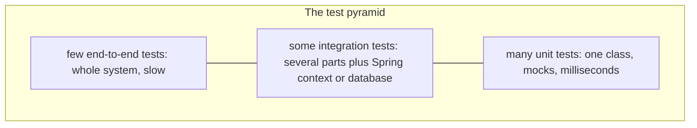

# Unit tests with JUnit and Mockito

> **Before this lesson:** you can write a service that depends on interfaces through its constructor ([Interfaces as contracts: decoupling your classes](#/lesson/spring/spring-interfaces-contracts), [Wiring beans with @Bean methods and @Autowired](#/lesson/spring/spring-wiring-autowired)). No testing experience is assumed.

## In plain words

A car factory does not wait until a car is finished to find out whether the brakes work. Each brake unit is clamped onto a test bench on its own. The bench stands in for the rest of the car: it supplies pressure where the pedal would be and measures what the brake does. The test takes seconds, needs no road, and when it fails you know it is the brake.

A **unit test** is that test bench for one piece of your code, usually one method of one class. Everything the class depends on, such as the database repository or the payment client, is replaced by a stand-in called a **mock**: a fake object that returns what you tell it to and remembers how it was called. The test then checks one behaviour and runs in milliseconds.

Automated tests are what let a team change code without fear, and they are part of the definition of "done" in almost every company. Employers expect a developer to write them as a matter of course, and Spring projects use the same two libraries everywhere: **JUnit** to run tests and **Mockito** to create mocks.

## What a test is

A test is a method that:

1. sets up a situation,
2. runs the code under test,
3. checks that the outcome is what was expected, and fails loudly otherwise.

Tests live in `src/test/java`, mirror the packages of the main code, and are run by the build tool (`./mvnw test`) and by your editor. They are not packaged into the application.

`spring-boot-starter-test`, present in every generated project, brings the libraries:

| Library | Role |
|---|---|
| **JUnit 5** (Jupiter) | finds and runs test methods; `@Test`, lifecycle annotations |
| **Mockito** | creates mocks, stubs their behaviour, verifies calls |
| **AssertJ** | readable assertions: `assertThat(x).isEqualTo(y)` |
| Spring Test and Spring Boot Test | starting application contexts in tests (next lesson) |

## The class under test

```java
// src/main/java/com/bookshop/order/OrderService.java
package com.bookshop.order;

@Service
public class OrderService {

    private final StockRepository stock;
    private final OrderRepository orders;
    private final Notifier notifier;

    public OrderService(StockRepository stock, OrderRepository orders, Notifier notifier) {
        this.stock = stock;
        this.orders = orders;
        this.notifier = notifier;
    }

    public Order placeOrder(String customer, String isbn, int quantity) {
        if (quantity <= 0) {
            throw new IllegalArgumentException("quantity must be positive");
        }
        int available = stock.available(isbn);
        if (available < quantity) {
            throw new OutOfStockException(isbn, available);
        }
        stock.decrease(isbn, quantity);
        Order saved = orders.save(new Order(null, customer, isbn, quantity));
        notifier.send(customer, "Thank you for ordering " + isbn);
        return saved;
    }
}
```

`StockRepository`, `OrderRepository` and `Notifier` are interfaces. The method has four behaviours worth testing:

| Scenario | Expected |
|---|---|
| quantity is zero or negative | `IllegalArgumentException`; nothing else happens |
| not enough stock | `OutOfStockException`; nothing saved, nobody notified |
| enough stock | stock decreased, order saved, customer notified, saved order returned |
| the notifier fails | (a design decision the test will force you to make) |

Listing scenarios before writing tests is half of the craft. Each row becomes one test method.

## The first test: no mocks needed

```java
// src/test/java/com/bookshop/order/OrderServiceTest.java
package com.bookshop.order;

import org.junit.jupiter.api.Test;
import static org.assertj.core.api.Assertions.assertThatThrownBy;
import static org.mockito.Mockito.mock;

class OrderServiceTest {

    @Test
    void rejectsNonPositiveQuantity() {
        OrderService service = new OrderService(mock(StockRepository.class),
                                                mock(OrderRepository.class),
                                                mock(Notifier.class));

        assertThatThrownBy(() -> service.placeOrder("ana@example.com", "9780441172719", 0))
                .isInstanceOf(IllegalArgumentException.class)
                .hasMessageContaining("positive");
    }
}
```

- `@Test` marks a method as a test. JUnit creates a new instance of the test class for every test method, so tests cannot disturb each other through fields.
- Test methods are `void`, take no arguments, and need not be `public`. The name describes the behaviour.
- `mock(StockRepository.class)` asks Mockito for a fake implementation of the interface.
- The service is created with **`new`**. No Spring context starts. This is the pay-off of constructor injection: the class is testable as plain Java.
- `assertThatThrownBy(…)` runs the lambda and checks the exception it throws.

## Arrange, act, assert

Well-written tests have three visually separate parts, often marked with comments `// given`, `// when`, `// then`:

```java
@Test
void placesOrderWhenStockIsSufficient() {
    // given (arrange): build the world this test needs
    StockRepository stock = mock(StockRepository.class);
    OrderRepository orders = mock(OrderRepository.class);
    Notifier notifier = mock(Notifier.class);
    when(stock.available("9780441172719")).thenReturn(5);                         // (1)
    when(orders.save(any(Order.class)))
            .thenReturn(new Order(42L, "ana@example.com", "9780441172719", 2));   // (2)
    OrderService service = new OrderService(stock, orders, notifier);

    // when (act): exactly one call to the code under test
    Order result = service.placeOrder("ana@example.com", "9780441172719", 2);

    // then (assert): check the outcome...
    assertThat(result.id()).isEqualTo(42L);
    // ...and the interactions that matter
    verify(stock).decrease("9780441172719", 2);                                   // (3)
    verify(notifier).send(eq("ana@example.com"), contains("9780441172719"));      // (4)
}
```

1. **Stubbing**: `when(call).thenReturn(value)` programs the mock: "when `available` is called with this ISBN, answer 5".
2. `any(Order.class)` is an **argument matcher**: it accepts any `Order`. The stub returns an order with id 42, as a database would.
3. **Verification**: `verify(stock).decrease(…)` fails the test unless that method was called exactly once with those arguments.
4. Matchers work in verification too. If one argument uses a matcher, all must (`eq(…)` wraps a literal value).

What does a mock do when called without a stub? It does nothing and returns a default: `0` for numbers, `false`, `null` for objects, empty collections and empty `Optional`s.

## How a mock works

A mock is a generated object that records every call and looks up canned answers. This small Python class shows the whole idea.

```python-run
class Mock:
    def __init__(self, name):
        self._name, self._stubs, self.calls = name, {}, []

    def when(self, method, *args):                       # stubbing: program an answer
        mock = self
        class Stub:
            def then_return(self, value): mock._stubs[(method, args)] = ("return", value)
            def then_raise(self, error):  mock._stubs[(method, args)] = ("raise", error)
        return Stub()

    def __getattr__(self, method):                       # any method call lands here
        def invoke(*args):
            self.calls.append((method, args))            # record the interaction
            kind, value = self._stubs.get((method, args), ("return", None))   # default answer: None
            if kind == "raise":
                raise value
            return value
        return invoke

    def verify(self, method, *args, times=1):            # verification
        actual = self.calls.count((method, args))
        assert actual == times, f"{self._name}.{method}{args}: expected {times} call(s), got {actual}"

class OutOfStock(Exception): pass

class OrderService:
    def __init__(self, stock, orders, notifier):
        self.stock, self.orders, self.notifier = stock, orders, notifier
    def place_order(self, customer, isbn, quantity):
        if self.stock.available(isbn) < quantity:
            raise OutOfStock(isbn)
        self.stock.decrease(isbn, quantity)
        self.orders.save(customer, isbn, quantity)
        self.notifier.send(customer, "Thank you")
        return "ok"

def test_places_order_when_stock_is_sufficient():
    stock, orders, notifier = Mock("stock"), Mock("orders"), Mock("notifier")       # given
    stock.when("available", "111").then_return(5)
    service = OrderService(stock, orders, notifier)
    assert service.place_order("ana", "111", 2) == "ok"                             # when
    stock.verify("decrease", "111", 2)                                              # then
    notifier.verify("send", "ana", "Thank you")

def test_refuses_when_out_of_stock():
    stock, orders, notifier = Mock("stock"), Mock("orders"), Mock("notifier")
    stock.when("available", "111").then_return(1)
    service = OrderService(stock, orders, notifier)
    try:
        service.place_order("ana", "111", 2)
        assert False, "expected OutOfStock"
    except OutOfStock:
        pass
    orders.verify("save", "ana", "111", 2, times=0)                                 # nothing was saved
    notifier.verify("send", "ana", "Thank you", times=0)

for test in [test_places_order_when_stock_is_sufficient, test_refuses_when_out_of_stock]:
    try:
        test(); print("PASS", test.__name__)
    except AssertionError as failure:
        print("FAIL", test.__name__, "->", failure)
```

`Mock.__getattr__` catches every method call, appends it to `calls`, and returns the stubbed answer or `None`. `verify` counts recorded calls. Now break the service: delete the line `self.stock.decrease(isbn, quantity)` and run again. The first test fails with a message that says exactly which call was missing. That feedback, seconds after the mistake, is what tests are for.

## Mockito with annotations

Creating mocks by hand in every test is repetitive. The Mockito extension for JUnit does it from annotations.

```java
// src/test/java/com/bookshop/order/OrderServiceTest.java
@ExtendWith(MockitoExtension.class)                    // let Mockito process the annotations
class OrderServiceTest {

    @Mock StockRepository stock;                       // a fresh mock for every test
    @Mock OrderRepository orders;
    @Mock Notifier notifier;

    @InjectMocks OrderService service;                 // created with the mocks above

    @Test
    void refusesOrderWhenStockIsInsufficient() {
        when(stock.available("9780441172719")).thenReturn(1);

        assertThatThrownBy(() -> service.placeOrder("ana@example.com", "9780441172719", 2))
                .isInstanceOf(OutOfStockException.class);

        verify(stock, never()).decrease(anyString(), anyInt());
        verifyNoInteractions(orders, notifier);
    }

    @Test
    void savesTheOrderWithTheRequestedQuantity() {
        when(stock.available("9780441172719")).thenReturn(5);
        when(orders.save(any())).thenAnswer(call -> call.getArgument(0));     // return what was passed in

        service.placeOrder("ana@example.com", "9780441172719", 2);

        ArgumentCaptor<Order> captor = ArgumentCaptor.forClass(Order.class);
        verify(orders).save(captor.capture());                                // grab the argument
        assertThat(captor.getValue().quantity()).isEqualTo(2);
        assertThat(captor.getValue().customer()).isEqualTo("ana@example.com");
    }
}
```

- `@ExtendWith(MockitoExtension.class)` plugs Mockito into JUnit. It has nothing to do with Spring; no application context is involved.
- `@Mock` creates a mock per field; `@InjectMocks` builds the object under test, passing the mocks to its constructor.
- `never()` and `verifyNoInteractions(…)` assert the absence of calls, the essential check for failure scenarios.
- `thenAnswer` computes the return value from the call.
- An `ArgumentCaptor` captures the object passed to a mock so that the test can inspect it.
- The extension uses **strict stubs**: a stub that a test defines and never uses fails the test with `UnnecessaryStubbingException`, which keeps tests free of leftovers.

Other tools you will meet:

| Mockito call | Purpose |
|---|---|
| `when(x.m()).thenThrow(new RuntimeException())` | make a dependency fail |
| `doThrow(…).when(mock).voidMethod()` | the same for `void` methods |
| `verify(mock, times(2)).m()` / `atLeastOnce()` / `never()` | check call counts |
| `inOrder(a, b)` | check the order of calls |
| `spy(realObject)` | wrap a real object, overriding only selected methods |

## Useful JUnit features

```java
class PriceCalculatorTest {

    private PriceCalculator calculator;

    @BeforeEach                                  // runs before every test method
    void setUp() {
        calculator = new PriceCalculator();
    }

    @ParameterizedTest                           // one test body, many inputs
    @CsvSource({
            "1250, 1, 1250",
            "1250, 3, 3750",
            "800,  0, 0"
    })
    void multipliesUnitPriceByQuantity(int unitCents, int quantity, int expected) {
        assertThat(calculator.totalCents(unitCents, quantity)).isEqualTo(expected);
    }

    @Test
    @DisplayName("gives 10% off from the tenth copy")
    void bulkDiscount() {
        assertThat(calculator.totalCents(1000, 10)).isEqualTo(9000);
    }
}
```

| Annotation | Meaning |
|---|---|
| `@BeforeEach` / `@AfterEach` | run before / after each test |
| `@BeforeAll` / `@AfterAll` | run once per class (static methods) |
| `@ParameterizedTest` + `@CsvSource`, `@ValueSource`, `@MethodSource` | data-driven tests |
| `@DisplayName` | readable name in reports |
| `@Nested` | group related tests in an inner class |
| `@Disabled` | skip, with a reason |

## What to mock, and what not

| Collaborator | In a unit test |
|---|---|
| Repositories, HTTP clients, mail senders, message brokers | mock: slow, external, non-deterministic |
| The clock, random numbers | inject and control (`Clock.fixed(…)`) |
| Value objects, records, collections | use the real thing |
| Pure helper classes without I/O | usually the real thing |
| The class under test itself | never mock |

A unit test with five mocks and ten `verify` lines repeats the implementation line by line. It breaks at every refactoring and proves little. Prefer checking **outcomes** (return value, exception, the one side effect that matters) over checking every interaction.



The **test pyramid** is a guideline for proportions: many fast unit tests at the base, fewer integration tests, very few end-to-end tests. Unit tests cannot find wiring mistakes, wrong SQL or a misconfigured endpoint, which is why the next lesson adds integration tests.

> [!INTERVIEW]
> "Unit test versus integration test?" A unit test exercises one class in isolation with its dependencies replaced by test doubles; it needs no Spring context, runs in milliseconds and pinpoints failures. An integration test exercises several real components together (Spring context, database, HTTP layer); it is slower and finds wiring, configuration and query errors. A healthy suite has many of the first and enough of the second.

> [!TIP]
> If a class is hard to unit-test (it needs a dozen mocks, or it creates its collaborators with `new`, or it calls static methods), the test is telling you something about the design. Constructor injection of a few focused dependencies makes testing easy; that is one of the reasons the earlier modules insisted on it.

## Properties of a good unit test

- **Fast**: milliseconds, so that thousands run on every build.
- **Isolated**: no network, no database, no file system, no dependence on test order.
- **Repeatable**: same result every time; no real clock, no random data without a fixed seed.
- **Self-checking**: it passes or fails by itself; nobody reads output.
- **Readable**: the name states the behaviour; given/when/then is visible; one reason to fail.

## Pitfalls

- **Starting Spring for a unit test.** `@SpringBootTest` on a test that only needs `new OrderService(…)` costs seconds per run and buys nothing.
- **Verifying everything.** Over-specified tests fail on harmless refactorings.
- **Mocking the class under test or value objects.** You end up testing the mock.
- **Unstubbed calls returning `null`.** A forgotten stub surfaces as a `NullPointerException` inside the code under test. Read the stack trace: the fix is in the test set-up.
- **Mixing matchers and raw values.** `verify(n).send("a", anyString())` is rejected; write `eq("a")`.
- **Assertions missing.** A test without an assertion or verification passes as long as nothing throws.
- **Shared mutable state between tests.** Static fields, files left behind. Order-dependent failures follow.
- **Testing private methods directly.** Test through the public behaviour; a private method that seems to need its own tests may want to be its own class.
- **JUnit 4 leftovers.** `org.junit.Test`, `@RunWith` and `@Before` belong to JUnit 4. JUnit 5 uses `org.junit.jupiter.api.Test`, `@ExtendWith` and `@BeforeEach`. Mixing imports gives tests that are silently not run.

## Cheat sheet

| Annotation / call | Meaning |
|---|---|
| `@Test` | a test method (JUnit 5: `org.junit.jupiter.api.Test`) |
| `@BeforeEach`, `@AfterEach` | set-up / tear-down per test |
| `@ParameterizedTest`, `@CsvSource` | run the same test with several inputs |
| `@ExtendWith(MockitoExtension.class)` | enable `@Mock` and `@InjectMocks` |
| `@Mock` | create a mock |
| `@InjectMocks` | create the object under test with the mocks |
| `mock(Type.class)` | create a mock programmatically |
| `when(m.call()).thenReturn(v)` / `thenThrow(e)` / `thenAnswer(fn)` | stub behaviour |
| `verify(m).call(args)`, `never()`, `times(n)` | verify interactions |
| `any()`, `anyString()`, `eq(v)` | argument matchers |
| `ArgumentCaptor<T>` | capture an argument for inspection |
| `assertThat(x).isEqualTo(y)` | AssertJ assertion |
| `assertThatThrownBy(() -> …).isInstanceOf(X.class)` | assert an exception |
| `./mvnw test` | run all tests |

## Summary

- A unit test checks one behaviour of one class in isolation and runs in milliseconds.
- JUnit runs the tests; Mockito provides mocks that return programmed answers and record calls; AssertJ expresses expectations.
- Structure every test as given / when / then, one scenario per test, including the failure paths.
- With constructor injection, the class under test is created with `new` and no Spring context is needed.
- Mock what is slow or external; use real objects for values; verify outcomes and the few interactions that matter.
- Unit tests form the wide base of the test pyramid; integration tests cover what mocks cannot.

## Glossary

- **Argument matcher**: a placeholder such as `any()` that accepts a range of argument values.
- **Arrange, act, assert (given, when, then)**: the three-part structure of a test.
- **Assertion**: a check that fails the test when an expectation is not met.
- **JUnit**: the standard Java framework for writing and running tests.
- **Mock**: a generated stand-in object that returns canned answers and records its calls.
- **Mockito**: the most used Java mocking library.
- **Stub (stubbing)**: programming a mock to answer a call in a certain way.
- **Test double**: any stand-in for a real collaborator in a test.
- **Test pyramid**: the guideline of many unit tests, fewer integration tests and few end-to-end tests.
- **Unit test**: a fast, isolated test of a small piece of code.
- **Verification**: checking that a mock was called as expected.

```quiz
[
  {"q": "Why can OrderService be unit-tested without starting Spring?",
   "options": ["Because it is annotated @Service", "Because its dependencies arrive through the constructor, so the test can create it with new and pass mocks", "Because JUnit starts Spring automatically", "It cannot"],
   "answer": 1,
   "explain": "Constructor injection makes the class plain Java from the test's point of view."},
  {"q": "What does when(stock.available(\"111\")).thenReturn(5) do?",
   "options": ["Calls the real database", "Programs the mock to return 5 when available(\"111\") is called", "Verifies that the method was called 5 times", "Throws an exception"],
   "answer": 1,
   "explain": "This is stubbing: defining the answer a mock gives to a particular call."},
  {"q": "A mock's method that returns an object is called without having been stubbed. What does it return?",
   "options": ["It throws an exception", "A random object", "null (or an empty collection or Optional for those types)", "The value of the last stub"],
   "answer": 2,
   "explain": "Unstubbed calls return type-appropriate defaults: null, 0, false, empty collections."},
  {"q": "Which statement checks that nothing was saved in a failure scenario?",
   "options": ["when(orders.save(any())).thenReturn(null)", "verify(orders, never()).save(any())", "assertThat(orders).isNull()", "mock(OrderRepository.class)"],
   "answer": 1,
   "explain": "verify with never() fails the test if the method was called at all."},
  {"q": "What are the three parts of a well-structured test?",
   "options": ["Compile, package, deploy", "Given (arrange), when (act), then (assert)", "Mock, stub, spy", "Before, during, after"],
   "answer": 1,
   "explain": "Set up the situation, perform one action on the code under test, check the outcome."},
  {"q": "Which collaborator is the best candidate for mocking in a unit test?",
   "options": ["A record holding an order's data", "A List", "A client that calls a payment provider over HTTP", "The class under test"],
   "answer": 2,
   "explain": "External, slow and non-deterministic collaborators are replaced. Values and collections are used directly."},
  {"q": "What is a risk of verifying every interaction with every mock?",
   "options": ["Tests become too fast", "Tests mirror the implementation and break on harmless refactorings", "Mockito stops working", "Coverage decreases"],
   "answer": 1,
   "explain": "Over-specified tests couple to how the code works instead of what it achieves."}
]
```

> **Source:** Spilcă, *Spring Start Here*, ch. 15 (writing correctly implemented tests; unit tests). Documentation: https://docs.spring.io/spring-boot/reference/testing/index.html and https://junit.org/junit5/docs/current/user-guide/
