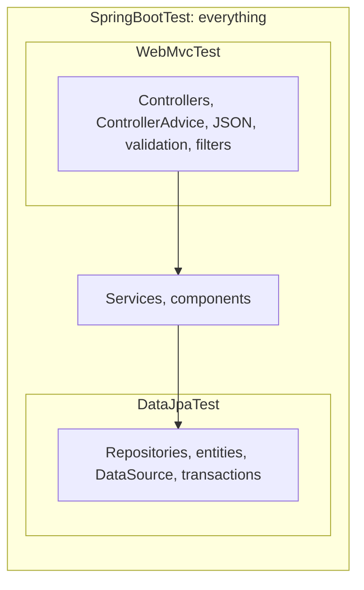

# Integration tests with @SpringBootTest and test slices

> **Before this lesson:** you can write unit tests with JUnit and Mockito ([Unit tests with JUnit and Mockito](#/lesson/spring/spring-unit-tests)) and you know the layers of a Spring application: controllers, services, repositories ([Dependency injection with abstractions and layered design](#/lesson/spring/spring-di-abstractions-layers)).

## In plain words

Every instrument in an orchestra can be in perfect tune and the concert can still go wrong: the violins start in a different bar than the horns, somebody has the wrong sheet music, a chair is missing. Tuning each instrument alone is the unit test. A rehearsal, where the musicians play together, is the **integration test**: it finds the mistakes that exist only *between* the parts.

In a Spring application the "between" is substantial: Is every bean wired? Does the URL lead to the right method? Is the JSON shaped as the client expects? Does the SQL run against the real table? Does the transaction roll back? Mocks cannot answer these, because the mocks were told by you how to behave.

A full rehearsal takes time, so orchestras also hold section rehearsals: strings only, brass only. Spring Boot offers the same: `@SpringBootTest` starts the whole application, while **test slices** such as `@WebMvcTest` and `@DataJpaTest` start one layer. Choosing the right kind of test for the risk in front of you is a skill that distinguishes experienced developers, and it is routinely asked about in interviews.

## Three sizes of Spring test

| Test type | What is started | Speed | Finds |
|---|---|---|---|
| Unit test (no Spring) | nothing: the class and mocks | milliseconds | logic errors in one class |
| Slice test (`@WebMvcTest`, `@DataJpaTest`, …) | the beans of one layer | around a second | mapping, serialisation, validation, query errors in that layer |
| `@SpringBootTest` | the entire application context | several seconds | wiring and configuration errors, cross-layer behaviour |



## @SpringBootTest: the whole application

```java
// src/test/java/com/bookshop/BookshopApplicationTests.java
package com.bookshop;

import org.junit.jupiter.api.Test;
import org.springframework.boot.test.context.SpringBootTest;

@SpringBootTest
class BookshopApplicationTests {

    @Test
    void contextLoads() {
    }
}
```

This generated test looks empty and is one of the most valuable in the project. `@SpringBootTest` searches upward from the test's package for the `@SpringBootApplication` class and starts the full context: component scanning, auto-configuration, every bean. If any bean cannot be created (a missing dependency, an ambiguous injection, a circular reference, a malformed property), the test fails. All the start-up errors from the first half of this track are caught here, before deployment.

A real integration test injects beans and exercises them:

```java
@SpringBootTest
class OrderFlowIntegrationTest {

    @Autowired OrderService orderService;          // the real bean, with real collaborators
    @Autowired StockRepository stock;

    @MockitoBean PaymentGateway paymentGateway;    // replaces the real bean in the context with a mock

    @Test
    void placingAnOrderReducesStock() {
        when(paymentGateway.pay(any())).thenReturn(new PaymentResponse("p-1", "AUTHORISED"));
        int before = stock.available("9780441172719");

        orderService.placeOrder("ana@example.com", "9780441172719", 2);

        assertThat(stock.available("9780441172719")).isEqualTo(before - 2);
    }
}
```

- In test classes field injection with `@Autowired` is normal; JUnit creates the test instance, so constructor arguments are less convenient.
- `@MockitoBean` puts a Mockito mock into the application context **in place of** the real bean, so every bean that depends on `PaymentGateway` receives the mock. Use it for things you cannot or must not call from a test: external HTTP services, e-mail, payment. It was introduced in Spring Boot 3.4 (Spring Framework 6.2) as the successor of `@MockBean`, which you will still find in older projects and which is deprecated.

### With the web server

By default `@SpringBootTest` starts no HTTP server. Two ways to test through HTTP:

```java
@SpringBootTest
@AutoConfigureMockMvc                                  // a simulated HTTP layer, no network
class BookApiTest {

    @Autowired MockMvc mvc;

    @Test
    void listsBooks() throws Exception {
        mvc.perform(get("/api/books"))
           .andExpect(status().isOk())
           .andExpect(jsonPath("$[0].title").value("Dune"));
    }
}
```

```java
@SpringBootTest(webEnvironment = SpringBootTest.WebEnvironment.RANDOM_PORT)   // real embedded server
class BookApiHttpTest {

    @Autowired TestRestTemplate rest;                  // HTTP client pre-configured for the random port

    @Test
    void returns404ForUnknownBook() {
        ResponseEntity<String> response = rest.getForEntity("/api/books/0000000000000", String.class);
        assertThat(response.getStatusCode()).isEqualTo(HttpStatus.NOT_FOUND);
    }
}
```

`MockMvc` calls the `DispatcherServlet` directly with a fabricated request object. It is fast, runs in the test's thread, and covers mapping, validation, exception handlers and JSON. `RANDOM_PORT` starts real Tomcat on a free port and sends real HTTP, which additionally covers the server and network layer.

## @WebMvcTest: only the web layer

To check a controller you do not need the database. `@WebMvcTest` starts a context containing only web-layer beans.

```java
// src/test/java/com/bookshop/catalogue/BookApiControllerTest.java
@WebMvcTest(BookApiController.class)                   // only this controller, plus web infrastructure
class BookApiControllerTest {

    @Autowired MockMvc mvc;

    @MockitoBean BookService books;                    // the controller's dependency is NOT loaded: mock it

    @Test
    void returnsTheBookAsJson() throws Exception {
        given(books.find("9780441172719"))
                .willReturn(Optional.of(new Book("9780441172719", "Dune", "Frank Herbert", 1250)));

        mvc.perform(get("/api/books/9780441172719").accept(MediaType.APPLICATION_JSON))
           .andExpect(status().isOk())
           .andExpect(content().contentType(MediaType.APPLICATION_JSON))
           .andExpect(jsonPath("$.title").value("Dune"))
           .andExpect(jsonPath("$.priceCents").value(1250));
    }

    @Test
    void returns404WhenTheBookDoesNotExist() throws Exception {
        given(books.find("0000000000000")).willReturn(Optional.empty());

        mvc.perform(get("/api/books/0000000000000"))
           .andExpect(status().isNotFound());
    }

    @Test
    void rejectsAnInvalidBody() throws Exception {
        mvc.perform(post("/api/books")
                        .contentType(MediaType.APPLICATION_JSON)
                        .content("""
                                 {"isbn": "123", "title": "", "priceCents": -5}
                                 """))
           .andExpect(status().isBadRequest())
           .andExpect(jsonPath("$.errors.length()").value(3));

        verifyNoInteractions(books);                   // the service was never reached
    }
}
```

- `mvc.perform(get(…))` builds and dispatches a request; `andExpect(…)` asserts on the response.
- `jsonPath("$.title")` navigates the JSON: `$` is the root, `.title` a property, `[0]` an array element.
- `given(…).willReturn(…)` is the same as `when(…).thenReturn(…)`, in a wording that reads well in the "given" section.

What these three tests verify, and no unit test could: the URL mapping, the path variable binding, the JSON property names, the status codes, the validation annotations and the error format from the `@RestControllerAdvice`.

What `@WebMvcTest` loads and does not load:

| Loaded | Not loaded |
|---|---|
| `@Controller`, `@RestController` (all, or those named) | `@Service`, `@Component` |
| `@ControllerAdvice` / `@RestControllerAdvice` | `@Repository`, Spring Data repositories |
| filters, `WebMvcConfigurer`, converters, `@JsonComponent` | `DataSource`, JPA |
| Jackson, validation, `MockMvc` | anything else you did not import |

Because services are absent, a controller that needs one cannot be created, and the context fails with `NoSuchBeanDefinitionException` until the test supplies it with `@MockitoBean`.

```python-run
APP = [
    {"name": "bookApiController", "kind": "controller", "needs": ["bookService"]},
    {"name": "orderApiController", "kind": "controller", "needs": ["orderService"]},
    {"name": "apiExceptionHandler", "kind": "controller-advice", "needs": []},
    {"name": "bookService", "kind": "service", "needs": ["bookRepository"]},
    {"name": "orderService", "kind": "service", "needs": ["orderRepository", "paymentGateway"]},
    {"name": "bookRepository", "kind": "repository", "needs": []},
    {"name": "orderRepository", "kind": "repository", "needs": []},
    {"name": "paymentGateway", "kind": "component", "needs": []},
]
SLICES = {"WebMvcTest": {"controller", "controller-advice"}, "DataJpaTest": {"repository"}}

def start(annotation, controllers=(), mocks=()):
    by_name = {b["name"]: b for b in APP}
    if annotation == "SpringBootTest":
        loaded = set(by_name)
    else:
        loaded = {b["name"] for b in APP if b["kind"] in SLICES[annotation]
                  and not (b["kind"] == "controller" and controllers and b["name"] not in controllers)}
    loaded -= set(mocks)                                   # a mock replaces the real bean
    missing = sorted({need for name in loaded for need in by_name[name]["needs"]
                      if need not in loaded and need not in mocks})
    verdict = "context starts" if not missing else f"FAILS: NoSuchBeanDefinitionException {missing}"
    print(f"@{annotation}{list(controllers) or ''} mocks={list(mocks)}")
    print(f"   real beans: {sorted(loaded)}\n   {verdict}\n")

start("WebMvcTest", controllers=["bookApiController"])
start("WebMvcTest", controllers=["bookApiController"], mocks=["bookService"])
start("WebMvcTest", mocks=["bookService"])
start("DataJpaTest")
start("SpringBootTest", mocks=["paymentGateway"])
```

The first call fails for want of `bookService`; the second supplies the mock. The third omits the controller filter, so `orderApiController` is loaded too and its dependency is missing: a reason to always name the controller in `@WebMvcTest(…)`. A slice never pulls in dependencies automatically. The practice problem [Test slices: which beans are loaded?](#/problem/spring-test-slice) builds on this model.

## @DataJpaTest: only the persistence layer

```java
// src/test/java/com/bookshop/catalogue/BookRepositoryTest.java
@DataJpaTest
class BookRepositoryTest {

    @Autowired BookRepository books;
    @Autowired TestEntityManager entityManager;

    @Test
    void findsBooksOfAnAuthorCheapestFirst() {
        Author austen = entityManager.persist(new Author("Jane Austen"));
        entityManager.persist(new Book("9780141439587", "Emma", 800, Genre.CLASSIC, austen));
        entityManager.persist(new Book("9780141439686", "Persuasion", 700, Genre.CLASSIC, austen));
        entityManager.flush();                                   // send the INSERTs now

        List<Book> result = books.findByAuthorNameOrderByPriceCentsAsc("Jane Austen");

        assertThat(result).extracting(Book::getTitle).containsExactly("Persuasion", "Emma");
    }
}
```

`@DataJpaTest`:

- loads entities, Spring Data JPA repositories, the `DataSource`, and nothing from the web or service layers;
- wraps **every test in a transaction that is rolled back** afterwards, so tests do not see each other's data;
- by default **replaces your configured database with an embedded in-memory one** if one is on the classpath;
- switches SQL logging on.

It is the right place to test derived queries, `@Query` text, mappings and constraints. Corresponding slices exist for other technologies: `@JdbcTest`, `@DataJdbcTest`, `@DataMongoTest`, `@JsonTest` (serialisation only), `@RestClientTest` (HTTP clients against a mock server).

### Test against the real database type

An in-memory H2 database is not PostgreSQL. SQL dialects, data types and locking behaviour differ, so a query can pass on H2 and fail in production. **Testcontainers** is a library that starts real databases in Docker containers from within a test.

```java
@DataJpaTest
@Testcontainers
@AutoConfigureTestDatabase(replace = AutoConfigureTestDatabase.Replace.NONE)    // keep the real DataSource
class BookRepositoryPostgresTest {

    @Container
    @ServiceConnection                                   // Boot points spring.datasource.* at the container
    static PostgreSQLContainer<?> postgres = new PostgreSQLContainer<>("postgres:16-alpine");

    @Autowired BookRepository books;

    @Test
    void uniqueIsbnIsEnforced() { ... }
}
```

`@ServiceConnection` (Boot 3.1 and later) reads the container's host, port and credentials and configures the `DataSource` accordingly. The test needs Docker on the machine that runs it.

> [!WARNING]
> Because `@DataJpaTest` rolls back, a test can pass although the same code would fail at commit time; some constraint violations and all optimistic-locking conflicts are detected only when Hibernate flushes. Call `entityManager.flush()` before asserting, or write the occasional test that commits.

## Context caching, and why mocks slow suites down

Starting a context costs seconds, so the Spring test framework **caches** contexts: test classes with identical configuration share one context for the whole build. The cache key includes the configuration classes, active profiles, properties, and the set of `@MockitoBean` fields.

Consequence: every *different* combination of mocked beans is a new configuration and a new context start. Twenty `@SpringBootTest` classes, each mocking a different bean, start twenty contexts.

- Keep the number of distinct configurations small; put shared mocks into a common base class.
- Prefer slices and unit tests where they are sufficient.
- Avoid `@DirtiesContext` (it discards the cached context) unless a test really corrupts shared state.

## Test configuration

```java
@SpringBootTest(properties = "shop.notifications.enabled=false")
@ActiveProfiles("test")                                 // also loads application-test.properties
class CheckoutIntegrationTest { ... }
```

```properties
# src/test/resources/application-test.properties
spring.datasource.url=jdbc:h2:mem:bookshop-test
payments.base-url=http://localhost:9999
```

Files under `src/test/resources` are visible only to tests. To add or replace beans for tests, write a `@TestConfiguration` class and `@Import` it.

## Choosing the test for the risk

| I want to be sure that… | Test with |
|---|---|
| a calculation or business rule is right | unit test |
| the service calls its collaborators correctly | unit test with mocks |
| the URL, status code, JSON and validation of an endpoint are right | `@WebMvcTest` |
| a query or mapping works | `@DataJpaTest` / `@JdbcTest`, ideally with Testcontainers |
| my HTTP client builds the right request and parses the response | `@RestClientTest` or a mock HTTP server |
| the application starts with all beans wired | `@SpringBootTest` `contextLoads` |
| a use case works across all layers | a few `@SpringBootTest` tests |
| security rules apply to endpoints | `@WebMvcTest` with `spring-security-test` (`@WithMockUser`) |

> [!INTERVIEW]
> "`@SpringBootTest` versus `@WebMvcTest`?" `@SpringBootTest` loads the full application context and is for integration tests across layers. `@WebMvcTest` is a slice: only MVC components (controllers, advice, converters, filters) plus `MockMvc`; services and repositories are not loaded and must be supplied with `@MockitoBean` (formerly `@MockBean`). It starts faster and focuses on the web contract. Mention `@DataJpaTest` as the persistence slice (transactional, rolled back, embedded database by default) and context caching.

> [!TIP]
> Give every project one `contextLoads` test and one "happy path through all layers" test first. Together they catch a remarkable share of deployment-breaking mistakes for very little effort.

## Pitfalls

- **`@SpringBootTest` for everything.** Slow suites that developers stop running.
- **`@WebMvcTest` without naming the controller.** All controllers load, each needing its dependencies mocked.
- **Forgetting the mock in a slice.** `NoSuchBeanDefinitionException` at context start; read which type is missing and add `@MockitoBean`.
- **`@Mock` where `@MockitoBean` is needed.** `@Mock` creates a mock outside the Spring context; the controller still has no bean. In Spring tests use `@MockitoBean`.
- **Believing H2 results for database-specific SQL.** Use Testcontainers for what matters.
- **`@Transactional` on tests that go through a real HTTP port.** The server handles the request on another thread, in another transaction; the test's rollback does not cover it and data stays in the database.
- **Many distinct mock combinations.** Context cache misses; long builds.
- **Order-dependent tests sharing database state.** Rely on rollback or clean up explicitly.
- **Asserting on whole JSON strings.** Brittle against property order and whitespace. Use `jsonPath` or a JSON comparison.

## Cheat sheet

| Annotation / type | Meaning |
|---|---|
| `@SpringBootTest` | start the full application context |
| `@SpringBootTest(webEnvironment = RANDOM_PORT)` | also start the embedded server on a free port |
| `@AutoConfigureMockMvc` | add `MockMvc` to a `@SpringBootTest` |
| `@WebMvcTest(X.class)` | web slice for controller `X` |
| `@DataJpaTest` / `@JdbcTest` / `@DataJdbcTest` | persistence slices; transactional with rollback |
| `@JsonTest`, `@RestClientTest` | JSON-only and HTTP-client slices |
| `@MockitoBean` (was `@MockBean`) | replace a bean in the context with a mock |
| `MockMvc` | call the MVC layer without a network |
| `TestRestTemplate` | HTTP client for `RANDOM_PORT` tests |
| `TestEntityManager` | persist test data in JPA slice tests |
| `@ActiveProfiles("test")` | activate a profile in the test |
| `@TestConfiguration` + `@Import` | extra beans for tests |
| `@Testcontainers`, `@Container`, `@ServiceConnection` | real services in Docker for tests |
| `@AutoConfigureTestDatabase(replace = NONE)` | keep the configured database in a slice |

## Summary

- Integration tests verify what unit tests cannot: wiring, configuration, mappings, serialisation and queries.
- `@SpringBootTest` starts everything; the empty `contextLoads` test alone catches most start-up errors.
- Slices start one layer: `@WebMvcTest` for controllers with `MockMvc`, `@DataJpaTest` for repositories with automatic rollback.
- Beans outside a slice are absent; replace needed ones with `@MockitoBean`.
- Test database-specific behaviour against the real database type with Testcontainers.
- Contexts are cached per configuration; every new combination of mocks costs another start-up.

## Glossary

- **Context caching**: reuse of a started application context across test classes with the same configuration.
- **Integration test**: a test in which several real components work together.
- **`jsonPath`**: an expression language for selecting parts of a JSON document.
- **`MockMvc`**: Spring's tool for sending simulated HTTP requests to the MVC layer.
- **`@MockitoBean`**: annotation that replaces a bean in the test context with a Mockito mock.
- **Slice test**: a test that loads only the beans of one layer.
- **Testcontainers**: a library that runs real dependencies such as databases in Docker for tests.
- **Test profile**: a profile holding configuration used only when testing.

```quiz
[
  {"q": "What does an empty contextLoads() test in a @SpringBootTest class verify?",
   "options": ["Nothing", "That the whole application context can start: all beans can be created and wired", "That all endpoints return 200", "That the database contains data"],
   "answer": 1,
   "explain": "Starting the full context exercises component scanning, auto-configuration and every injection point."},
  {"q": "A @WebMvcTest(BookApiController.class) fails with NoSuchBeanDefinitionException for BookService. Why?",
   "options": ["BookService has a bug", "The slice loads only web-layer beans; services must be provided, for example with @MockitoBean", "@WebMvcTest requires a database", "MockMvc is missing"],
   "answer": 1,
   "explain": "Slices do not load services or repositories and never pull dependencies in automatically."},
  {"q": "Which of these can a @WebMvcTest verify that a plain unit test of the controller class cannot?",
   "options": ["That the service method was called", "The URL mapping, JSON shape, validation and status codes", "The SQL of a repository", "That Tomcat starts"],
   "answer": 1,
   "explain": "MockMvc runs the request through the DispatcherServlet, argument resolution, validation, exception handling and message conversion."},
  {"q": "What happens to data written during a @DataJpaTest test method?",
   "options": ["It is committed", "It is rolled back when the test ends", "It is written to a file", "It is copied to production"],
   "answer": 1,
   "explain": "Each test runs in a transaction that is rolled back, keeping tests independent."},
  {"q": "Why use Testcontainers when @DataJpaTest already provides an in-memory database?",
   "options": ["It is faster", "The in-memory database differs from the production database in dialect and behaviour, so some errors only show on the real type", "H2 cannot store strings", "Testcontainers needs no Docker"],
   "answer": 1,
   "explain": "Testing against the same database engine as production removes a whole class of surprises."},
  {"q": "A suite has thirty @SpringBootTest classes, each declaring a different @MockitoBean. What is the likely effect?",
   "options": ["One shared context", "Thirty separate context start-ups, because the mock set is part of the cache key", "The tests are skipped", "Mocks are ignored"],
   "answer": 1,
   "explain": "Different bean overrides mean different configurations, so the context cache cannot be reused."},
  {"q": "What is the difference between @Mock and @MockitoBean?",
   "options": ["None", "@Mock creates a plain Mockito mock; @MockitoBean registers the mock in the Spring test context, replacing the real bean", "@MockitoBean is for static methods", "@Mock works only in Spring tests"],
   "answer": 1,
   "explain": "Only a mock inside the context is injected into other beans such as the controller under test."}
]
```

> **Source:** Spilcă, *Spring Start Here*, ch. 15 (implementing integration tests). Documentation: https://docs.spring.io/spring-boot/reference/testing/spring-boot-applications.html and https://docs.spring.io/spring-framework/reference/testing/annotations/integration-spring/annotation-mockitobean.html
