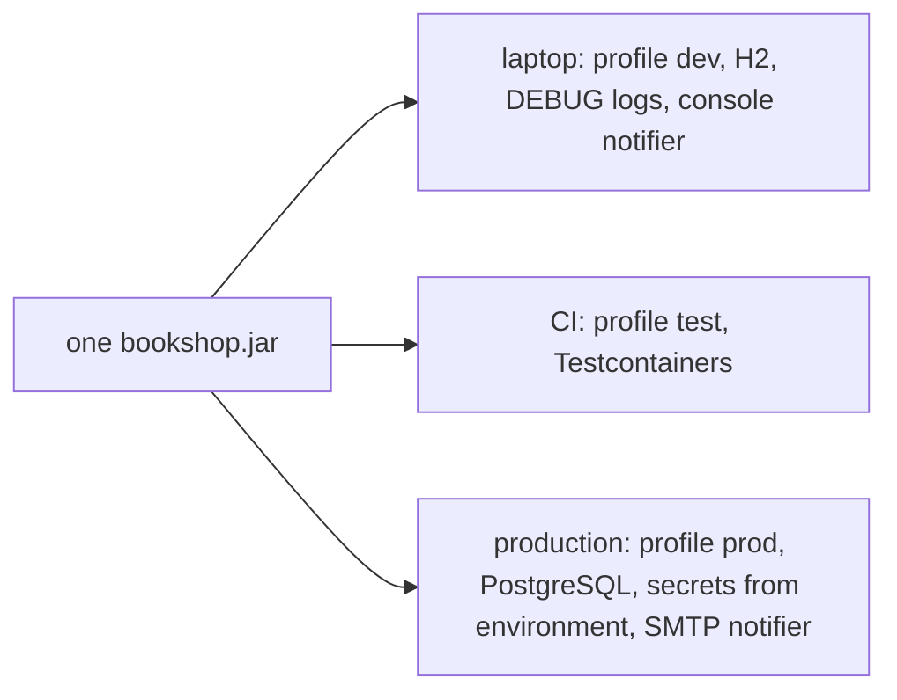

# Configuration properties, profiles and logging

> **Before this lesson:** you have used `application.properties` for settings such as `server.port` and `spring.datasource.url` ([Spring Boot: starters and auto-configuration](#/lesson/spring/spring-boot-autoconfig), [Configuring the DataSource and connection pools](#/lesson/spring/spring-datasource-pools)) and injected a value with `@Value` ([Wiring beans with @Bean methods and @Autowired](#/lesson/spring/spring-wiring-autowired)).

## In plain words

A touring band plays the same songs every night, but each venue is different: the size of the stage, the house lights, the power sockets. The band does not rewrite its music for each hall. It carries a sheet of settings per venue, and the sound engineer can still nudge a fader on the night. At the mixing desk, the knob touched last wins.

An application is the songs; **configuration** is the venue sheet. The same compiled JAR must run on a laptop, on a test server and in production, with a different database address, different passwords and different levels of chattiness in each. Spring Boot reads settings from several places in a fixed order of priority, groups environment-specific settings into **profiles**, and lets you bind them to typed Java objects.

The second half of the lesson is **logging**: the running diary an application keeps. When something breaks at three in the morning, logs are usually the only witness.

"Build once, configure per environment" is a core practice of professional deployment. Property precedence and profiles appear in most Spring Boot interviews, and you will touch configuration files in your first week on any project.

## Externalised configuration

A value typed into Java code can only change by recompiling. **Externalised configuration** means settings live outside the compiled code, so that one build artefact serves every environment.

The usual home is `src/main/resources/application.properties`:

```properties
# src/main/resources/application.properties
server.port=8080
shop.name=The Paper Lantern
shop.page-size=20
shop.currency=EUR
shop.support-email=help@paperlantern.example
```

or the same in YAML, where indentation expresses the hierarchy:

```yaml
# src/main/resources/application.yml
server:
  port: 8080
shop:
  name: The Paper Lantern
  page-size: 20
  currency: EUR
  support-email: help@paperlantern.example
```

Both formats work; pick one per project. YAML is compact for nested settings and unforgiving about indentation.

## Where values come from, and who wins

Boot gathers properties from many **property sources** and consults them in priority order. A simplified version of the list, from lowest to highest priority:

| Priority | Source | Example |
|---|---|---|
| 1 (lowest) | defaults set in code (`SpringApplication.setDefaultProperties`) | |
| 2 | `application.properties` / `.yml` inside the JAR | `shop.page-size=20` |
| 3 | `application-{profile}.properties` inside the JAR | `application-prod.properties` |
| 4 | `application.properties` next to the JAR (outside it), then its profile variants | a file in the working directory or `./config/` |
| 5 | operating-system environment variables | `SHOP_PAGESIZE=50` |
| 6 | Java system properties | `-Dshop.page-size=50` |
| 7 (highest) | command-line arguments | `--shop.page-size=50` |

In tests, `@SpringBootTest(properties = …)` and `@TestPropertySource` rank above all of these.

The logic of the order: the closer a source is to the moment and place of launch, the more it counts. A file baked into the JAR by a developer loses to the environment of the machine, which loses to what the operator typed when starting the process.

**Relaxed binding** lets one property be written in several styles. Environment variables cannot contain dots or dashes, so Boot maps them: replace dots with underscores, remove dashes, upper-case.

| Style | Example |
|---|---|
| kebab case (recommended in files) | `shop.page-size` |
| camel case | `shop.pageSize` |
| environment variable | `SHOP_PAGESIZE` |

The model below resolves one key against the sources, including relaxed binding and profile order.

```python-run
SOURCES = {
    "defaults":    {"server.port": "8080", "shop.currency": "EUR"},
    "application": {"server.port": "8081", "shop.page-size": "20", "shop.name": "The Paper Lantern"},
    "profiles":    {"dev":  {"shop.name": "Paper Lantern DEV"},
                    "prod": {"shop.page-size": "50", "shop.db.url": "jdbc:postgresql://db/shop"}},
    "env":         {"SHOP_PAGESIZE": "100", "HOME": "/home/app"},
    "args":        {"server.port": "9000"},
}

def resolve(key, active_profiles):
    if key in SOURCES["args"]:
        return SOURCES["args"][key], "command line"
    env_name = key.replace(".", "_").replace("-", "").upper()        # relaxed binding
    if env_name in SOURCES["env"]:
        return SOURCES["env"][env_name], f"environment variable {env_name}"
    for profile in reversed(active_profiles):                        # last active profile wins
        if key in SOURCES["profiles"].get(profile, {}):
            return SOURCES["profiles"][profile][key], f"application-{profile}.properties"
    for source in ("application", "defaults"):
        if key in SOURCES[source]:
            return SOURCES[source][key], source
    return None, "not found"

for key in ["server.port", "shop.page-size", "shop.name", "shop.currency", "shop.db.url", "shop.missing"]:
    for profiles in (["dev"], ["dev", "prod"]):
        value, origin = resolve(key, profiles)
        print(f"{key:16} profiles={str(profiles):16} -> {str(value):28} from {origin}")
```

Notice `shop.page-size`: the `prod` profile says 50, the file says 20, and the answer is 100 because an environment variable outranks both. When a value in production is not what the file says, look upward in the table. The practice problem [Which property source wins?](#/problem/spring-property-precedence) asks you to write this resolver.

> [!TIP]
> With Actuator enabled, the `/actuator/env` endpoint shows every property source in order and which one supplied each value. It ends "but the file says…" debates in seconds. Protect it: it lists configuration, with sensitive values masked.

## Reading configuration in code

### @Value for a single value

```java
@Service
public class CatalogueService {

    private final int pageSize;

    public CatalogueService(@Value("${shop.page-size:20}") int pageSize) {
        this.pageSize = pageSize;
    }
}
```

`${shop.page-size:20}` is a placeholder with a default after the colon. Without a default, a missing property stops start-up with "Could not resolve placeholder", which is the fail-fast behaviour you want for mandatory settings. Placeholders can also be used inside property files to build values from others:

```properties
shop.base-url=https://${shop.host:localhost}:${server.port}
```

The practice problem [Expand \${placeholders} with defaults](#/problem/spring-placeholder-expand) implements the expansion, including nesting.

### @ConfigurationProperties for a group

Twenty `@Value` annotations scattered over ten classes are hard to oversee. `@ConfigurationProperties` binds a whole prefix to one typed object.

```java
// src/main/java/com/bookshop/config/ShopProperties.java
package com.bookshop.config;

import jakarta.validation.constraints.*;
import org.springframework.boot.context.properties.ConfigurationProperties;
import org.springframework.validation.annotation.Validated;

import java.time.Duration;
import java.util.List;

@ConfigurationProperties(prefix = "shop")
@Validated                                             // check the constraints at start-up
public record ShopProperties(
        @NotBlank String name,
        @Min(1) @Max(200) int pageSize,
        @NotBlank String currency,
        @Email String supportEmail,
        Duration cartTimeout,                          // "30m" is converted to a Duration
        List<String> featuredGenres,                   // "scifi,classic" or a YAML list
        Payments payments) {                           // nested group: shop.payments.*

    public record Payments(String baseUrl, Duration timeout) { }
}
```

```java
@SpringBootApplication
@ConfigurationPropertiesScan                           // find @ConfigurationProperties classes
public class BookshopApplication { ... }
```

```yaml
shop:
  name: The Paper Lantern
  page-size: 20
  currency: EUR
  support-email: help@paperlantern.example
  cart-timeout: 30m
  featured-genres: [scifi, classic]
  payments:
    base-url: https://payments.example.com
    timeout: 5s
```

```java
@Service
public class CatalogueService {

    private final ShopProperties shop;

    public CatalogueService(ShopProperties shop) {     // injected like any bean
        this.shop = shop;
    }

    public int pageSize() { return shop.pageSize(); }
}
```

What you gain over `@Value`:

- **Type safety and conversion**: numbers, booleans, `Duration` (`30m`, `5s`), `DataSize` (`10MB`), lists, maps, nested objects.
- **Validation at start-up**: `page-size: 0` stops the application with a message naming the property, long before a customer hits the code.
- **One place** that documents every setting of your application.
- **Editor support**: with `spring-boot-configuration-processor` on the classpath, editors auto-complete your properties in the configuration files.

| | `@Value` | `@ConfigurationProperties` |
|---|---|---|
| Best for | one or two isolated values | a group of related settings |
| Relaxed binding | limited | full |
| Validation | no | yes, with `@Validated` |
| Nested objects, lists, maps | awkward | natural |
| Placeholder expressions and defaults inline | yes | defaults via record constructor or field initialisers |

## Profiles

A **profile** is a named set of configuration that is switched on as a whole: `dev`, `test`, `prod`. It affects two things.

**1. Property files.** Settings in `application-{profile}.properties` are loaded when the profile is active and override the base file.

```properties
# application.properties            (always loaded)
shop.name=The Paper Lantern
logging.level.com.bookshop=INFO

# application-dev.properties        (only with profile dev)
spring.datasource.url=jdbc:h2:mem:bookshop
logging.level.com.bookshop=DEBUG

# application-prod.properties       (only with profile prod)
spring.datasource.url=jdbc:postgresql://db.internal:5432/bookshop
spring.datasource.password=${DB_PASSWORD}
```

**2. Beans.** `@Profile` on a component or `@Bean` method registers it only when the profile is active.

```java
@Component
@Profile("prod")
public class SmtpNotifier implements Notifier { ... }

@Component
@Profile("!prod")                                      // every profile except prod
public class ConsoleNotifier implements Notifier { ... }
```

Activating profiles:

```bash
java -jar bookshop.jar --spring.profiles.active=prod
SPRING_PROFILES_ACTIVE=prod java -jar bookshop.jar
```

```java
@ActiveProfiles("test")          // in tests
```

Several profiles can be active (`prod,eu`); when both define a property, the one listed **last** wins. If none is set, the profile named `default` is active.



> [!WARNING]
> Do not put `spring.profiles.active=prod` or secrets into the `application.properties` that is committed and packaged. The active profile is a decision of the deployment, and secrets belong in environment variables or a secret manager. A good default is that the application run without any profile is safe and harmless, for example by using an in-memory database.

> [!INTERVIEW]
> "The same property is defined in `application.properties`, in `application-prod.properties`, as an environment variable and as a command-line argument. Which value is used?" The command-line argument. Order from weakest to strongest: packaged base file, packaged profile file, external files, environment variables, system properties, command-line arguments. Then explain `@ConfigurationProperties` versus `@Value` and how profiles are activated.

## Logging

A **log** is a stream of timestamped messages an application writes about what it is doing. `System.out.println` is not logging: it has no timestamp, no severity, no source and no way to be switched off selectively.

Spring Boot uses **SLF4J** as the API your code calls and **Logback** as the implementation that formats and writes. SLF4J is a facade, meaning your code does not depend on the concrete logging library.

```java
// src/main/java/com/bookshop/order/OrderService.java
import org.slf4j.Logger;
import org.slf4j.LoggerFactory;

@Service
public class OrderService {

    private static final Logger log = LoggerFactory.getLogger(OrderService.class);    // one per class

    public Order placeOrder(String customer, String isbn, int quantity) {
        log.debug("Placing order: isbn={}, quantity={}", isbn, quantity);
        try {
            Order order = doPlace(customer, isbn, quantity);
            log.info("Order {} placed for {} x {}", order.id(), quantity, isbn);
            return order;
        } catch (OutOfStockException e) {
            log.warn("Order refused, out of stock: isbn={}, requested={}", isbn, quantity);
            throw e;
        } catch (RuntimeException e) {
            log.error("Unexpected failure placing order for isbn={}", isbn, e);       // exception LAST
            throw e;
        }
    }
}
```

```text
2026-03-01T10:15:30.123+01:00  INFO 4211 --- [bookshop] [nio-8080-exec-3] c.bookshop.order.OrderService : Order 42 placed for 2 x 9780441172719
```

A line shows the time, the level, the process id, the application name, the thread, the logger (normally the class name, abbreviated) and the message.

- `{}` is a placeholder filled from the following arguments. The message string is built only if the level is enabled, so a disabled `debug` call costs almost nothing. Do not concatenate strings yourself.
- Passing the exception as the **last** argument, without a `{}` for it, prints its stack trace.

### Levels

| Level | Use for | Typical production setting |
|---|---|---|
| `ERROR` | something failed and needs attention | on |
| `WARN` | unexpected but handled; might become a problem | on |
| `INFO` | significant business or lifecycle events | on |
| `DEBUG` | details useful when diagnosing | off, switched on per package when needed |
| `TRACE` | very fine-grained detail | off |

Setting a level enables it and everything more severe. Levels are configured per logger name, and names form a hierarchy by package:

```properties
logging.level.root=INFO
logging.level.com.bookshop=DEBUG
logging.level.org.springframework.web=DEBUG
logging.level.org.hibernate.SQL=DEBUG
```

```python-run
ORDER = ["TRACE", "DEBUG", "INFO", "WARN", "ERROR"]
CONFIGURED = {"root": "INFO", "com.bookshop": "DEBUG", "com.bookshop.payment": "WARN"}

def effective_level(logger_name):
    name = logger_name
    while name:                                    # walk up the package hierarchy
        if name in CONFIGURED:
            return CONFIGURED[name]
        name = name.rpartition(".")[0]
    return CONFIGURED["root"]

def is_logged(logger_name, level):
    return ORDER.index(level) >= ORDER.index(effective_level(logger_name))

for logger in ["com.bookshop.order.OrderService", "com.bookshop.payment.PaymentGateway", "org.hibernate.SQL"]:
    printed = [level for level in ORDER if is_logged(logger, level)]
    print(f"{logger:40} effective={effective_level(logger):5} prints {printed}")
```

A logger without its own setting inherits from the nearest configured parent package, ending at `root`. That is how one line, `logging.level.com.bookshop=DEBUG`, turns on debug output for the whole application without drowning you in framework messages.

### Logging well

- **Log events, not noise.** "Order 42 placed" is useful; "entering method" a thousand times a second is not.
- **Include identifiers**: order id, customer id, request id. A message that cannot be tied to a case is of little use.
- **Never log secrets or personal data**: passwords, tokens, card numbers, full addresses. Logs are copied to many systems and kept for a long time.
- **Log an exception once**, where it is handled. Logging and rethrowing at every layer produces five stack traces for one failure.
- **Correlate.** Put a request id into the **MDC** (mapped diagnostic context), a per-thread map whose values are added to every log line of that thread, so that all lines of one request can be found together. Micrometer Tracing does this automatically with trace ids.
- **In containers, write to standard output** and let the platform collect the stream. Boot 3.4 and later can emit structured JSON lines with `logging.structured.format.console=ecs`, which log search systems parse reliably.

Change levels without redeploying through Actuator's `loggers` endpoint: a `POST` to `/actuator/loggers/com.bookshop` with `{"configuredLevel":"DEBUG"}` takes effect immediately.

## Pitfalls

- **Secrets in committed property files.** Use environment variables or a secret store.
- **Profile-specific values in the base file "for now".** The laptop setting eventually reaches production.
- **YAML indentation and tabs.** One misplaced space moves a property to another parent; tabs are illegal.
- **Unquoted special values in YAML.** `no`, `on`, `0123` and values containing `:` may be read as booleans, numbers or nested keys. Quote strings that could be misread.
- **Environment variable naming.** `shop.page-size` is `SHOP_PAGESIZE`, not `SHOP_PAGE_SIZE` (which would bind to `shop.page.size`).
- **`@Value` on a static or `final` field, or in an object created with `new`.** Nothing is injected.
- **Typos in property names.** An unknown key is ignored silently. `@ConfigurationProperties` with the configuration processor, and validation, catch many of them.
- **String concatenation in log calls.** `log.debug("x=" + expensive())` does the work even when debug is off.
- **Swallowing exceptions with only a message.** `log.error("failed")` without the exception loses the stack trace.
- **Leaving `DEBUG` on in production.** Disk fills, performance drops, sensitive details leak.

## Cheat sheet

| Annotation / property | Meaning |
|---|---|
| `application.properties` / `application.yml` | base configuration |
| `application-{profile}.properties` | overrides for one profile |
| `--key=value`, `KEY_NAME` env var, `-Dkey=value` | override at launch (highest priorities) |
| `@Value("${key:default}")` | inject one property |
| `@ConfigurationProperties(prefix = "x")` | bind a group of properties to a typed object |
| `@ConfigurationPropertiesScan` / `@EnableConfigurationProperties` | register such classes |
| `@Validated` + constraints | validate configuration at start-up |
| `@Profile("name")`, `@Profile("!name")` | bean only in (or outside) a profile |
| `spring.profiles.active` | which profiles are on |
| `LoggerFactory.getLogger(X.class)` | obtain a logger |
| `log.info("text {}", value)` | parameterised message |
| `logging.level.<package>=LEVEL` | set a level |
| `logging.file.name`, `logging.pattern.console` | file output and format |
| `/actuator/env`, `/actuator/loggers` | inspect configuration; view and change log levels |

## Summary

- Externalised configuration lets one build run everywhere; settings come from property sources with a fixed precedence in which launch-time sources (environment, command line) beat packaged files.
- Relaxed binding maps `shop.page-size` to `SHOP_PAGESIZE` and other spellings.
- Use `@Value` for a stray value and `@ConfigurationProperties` records for groups: typed, validated at start-up, in one place.
- Profiles switch property files and beans per environment; activate them at deployment time, never in the packaged base file.
- Log through SLF4J with levels and placeholders; configure levels per package; log events with identifiers, never secrets, and each exception once.

## Glossary

- **Externalised configuration**: settings kept outside compiled code.
- **Log level**: the severity of a message: TRACE, DEBUG, INFO, WARN, ERROR.
- **Logback**: the default logging implementation in Spring Boot.
- **MDC (mapped diagnostic context)**: per-thread key-value data added to each log line.
- **Placeholder**: `${key}` or `${key:default}`, replaced by a property value.
- **Profile**: a named group of configuration and beans activated together.
- **Property source**: one place properties are read from.
- **Relaxed binding**: Boot's tolerance for different spellings of a property name.
- **SLF4J**: the logging API (facade) application code calls.
- **Structured logging**: log lines in a machine-readable format such as JSON.

```quiz
[
  {"q": "shop.page-size is 20 in application.properties, 50 in application-prod.properties (prod is active), and the process is started with --shop.page-size=75. Which value is used?",
   "options": ["20", "50", "75", "Start-up fails because of the conflict"],
   "answer": 2,
   "explain": "Command-line arguments have the highest priority among the normal sources."},
  {"q": "Which environment variable sets the property shop.page-size?",
   "options": ["shop.page-size", "SHOP_PAGE_SIZE", "SHOP_PAGESIZE", "SHOP.PAGESIZE"],
   "answer": 2,
   "explain": "Relaxed binding: dots become underscores, dashes are removed, everything is upper-cased."},
  {"q": "What is an advantage of @ConfigurationProperties over many @Value annotations?",
   "options": ["It is the only way to read properties", "Typed binding of a whole group with validation at start-up, in one place", "It makes properties secret", "It removes the need for property files"],
   "answer": 1,
   "explain": "A properties record gives structure, conversion and fail-fast validation."},
  {"q": "Profiles prod and eu are active as prod,eu and both define shop.name. Which wins?",
   "options": ["prod, because it is first", "eu, because the last listed profile wins", "The base file", "It is random"],
   "answer": 1,
   "explain": "Later active profiles override earlier ones."},
  {"q": "A bean is annotated @Profile(\"!prod\"). When is it registered?",
   "options": ["Only in prod", "In every case", "Whenever the prod profile is not active", "Never"],
   "answer": 2,
   "explain": "The exclamation mark negates the profile expression."},
  {"q": "logging.level.root=INFO and logging.level.com.bookshop=DEBUG are set. Is log.debug(...) in com.bookshop.order.OrderService printed?",
   "options": ["No, root is INFO", "Yes, the logger inherits DEBUG from its nearest configured parent package", "Only errors are printed", "Only if a file appender exists"],
   "answer": 1,
   "explain": "Loggers form a hierarchy by name; the closest configured ancestor decides."},
  {"q": "Which log statement is written correctly?",
   "options": ["log.error(\"failed: \" + e)", "log.error(\"failed for order {}\", orderId, e)", "System.out.println(e)", "log.error(e)"],
   "answer": 1,
   "explain": "Use placeholders for values and pass the exception as the last argument so that the stack trace is recorded."}
]
```

> **Source:** extension module beyond Spilcă, *Spring Start Here* (the book introduces properties in ch. 7 and 12). Documentation: https://docs.spring.io/spring-boot/reference/features/external-config.html and https://docs.spring.io/spring-boot/reference/features/profiles.html and https://docs.spring.io/spring-boot/reference/features/logging.html
