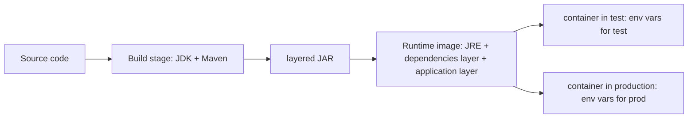
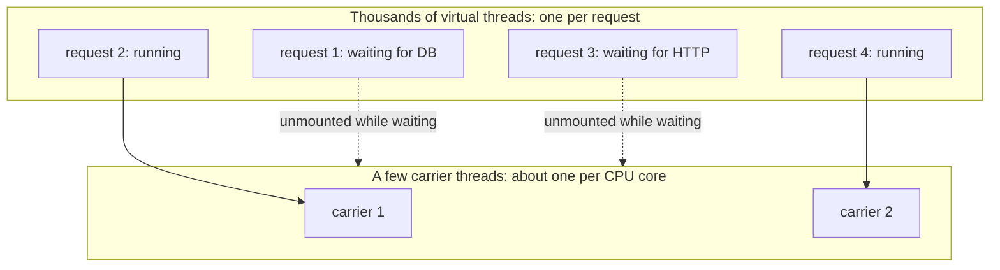

# Actuator, Docker images and virtual threads

> **Before this lesson:** you can build a runnable JAR and configure it per environment ([The Spring ecosystem and your first project](#/lesson/spring/spring-ecosystem-first-project), [Configuration properties, profiles and logging](#/lesson/spring/spring-config-profiles-logging)), and you know what a thread and a connection pool are ([Singleton scope, eager and lazy beans, thread safety](#/lesson/spring/spring-singleton-scope), [Configuring the DataSource and connection pools](#/lesson/spring/spring-datasource-pools)). The [Docker track](#/track/docker) explains containers in depth; the essentials are repeated here.

## In plain words

A car that only has to work in the garage needs an engine and wheels. A car that goes on the road needs more: a dashboard with warning lights, so the driver knows about trouble before the engine seizes; a standard shape that fits on any car transporter; and an engine that copes with rush-hour traffic.

An application that "works on my machine" is the garage car. Running it for real customers, that is **in production**, adds the same three needs, and this lesson covers one tool for each:

- **Spring Boot Actuator** is the dashboard: ready-made endpoints that report whether the application is healthy and what it is doing.
- A **Docker image** is the standard shape: the application packed together with its Java runtime, so that it runs identically on any server.
- **Virtual threads** are the traffic-capable engine: a Java feature that lets ordinary blocking code serve far more simultaneous requests.

None of these appears in a first tutorial, and all of them appear in job descriptions under words such as "production readiness", "observability" and "containerisation".

## Part 1: Actuator

### Switching it on

```xml
<dependency>
    <groupId>org.springframework.boot</groupId>
    <artifactId>spring-boot-starter-actuator</artifactId>
</dependency>
```

Actuator adds HTTP **endpoints** under `/actuator`. For safety only `health` is exposed over HTTP by default; you choose what else to open.

```properties
# src/main/resources/application.properties
management.endpoints.web.exposure.include=health,info,metrics,prometheus,loggers
management.endpoint.health.show-details=when-authorized
```

| Endpoint | Shows |
|---|---|
| `/actuator/health` | is the application, and what it depends on, working? |
| `/actuator/info` | build version, git commit, anything you add |
| `/actuator/metrics` | numbers: request counts and timings, memory, pool usage |
| `/actuator/prometheus` | the same metrics in the text format the Prometheus monitoring system collects |
| `/actuator/loggers` | view and change log levels at run time |
| `/actuator/env` | configuration properties and their sources |
| `/actuator/conditions` | the auto-configuration report |
| `/actuator/mappings` | every request mapping |
| `/actuator/threaddump`, `/actuator/heapdump` | diagnostic snapshots of threads and memory |

> [!WARNING]
> Actuator endpoints reveal internals and some can change behaviour. `env` lists configuration, `heapdump` contains everything in memory including secrets, `loggers` alters logging. Expose the minimum, never `*` on a public address, protect them with Spring Security, and consider serving them on a separate internal port with `management.server.port`.

### Health

```bash
curl -s http://localhost:8080/actuator/health
```

```text
{"status":"UP"}
```

With details shown:

```text
{
  "status": "UP",
  "components": {
    "db":        {"status": "UP", "details": {"database": "PostgreSQL", "validationQuery": "isValid()"}},
    "diskSpace": {"status": "UP", "details": {"free": 51234567890, "threshold": 10485760}},
    "ping":      {"status": "UP"}
  }
}
```

Each component comes from a **health indicator**: a small bean that checks one thing. Boot registers indicators automatically for what is on the classpath: the database, disk space, Redis, message brokers, mail servers. The overall status is an aggregate: the most severe status among the components, by the order `DOWN`, `OUT_OF_SERVICE`, `UP`, `UNKNOWN`. `DOWN` and `OUT_OF_SERVICE` make the endpoint answer with HTTP status **503**, anything else with 200, so a load balancer needs to look only at the status code.

```python-run
ORDER = ["DOWN", "OUT_OF_SERVICE", "UP", "UNKNOWN"]          # most severe first

def aggregate(node):
    if isinstance(node, str):                                 # a single indicator
        return node
    statuses = [s for s in (aggregate(child) for child in node.values()) if s in ORDER]
    return min(statuses, key=ORDER.index) if statuses else "UNKNOWN"

def health(components):
    status = aggregate(components)
    http = 503 if status in ("DOWN", "OUT_OF_SERVICE") else 200
    return http, status, {name: aggregate(child) for name, child in components.items()}

print(health({"db": "UP", "diskSpace": "UP", "ping": "UP"}))
print(health({"db": "UP", "diskSpace": "UP", "paymentGateway": "DOWN"}))
print(health({"db": {"primary": "UP", "replica": "OUT_OF_SERVICE"}, "ping": "UP"}))
print(health({}))
```

One failing component turns the whole application `DOWN`. That is a design decision to make with care: should a payment provider outage take the entire bookshop out of the load balancer, when browsing the catalogue still works? The practice problem [Aggregate Actuator health](#/problem/spring-health-aggregate) implements this rule.

A custom indicator:

```java
// src/main/java/com/bookshop/payment/PaymentGatewayHealthIndicator.java
@Component
public class PaymentGatewayHealthIndicator implements HealthIndicator {

    private final PaymentGateway gateway;

    public PaymentGatewayHealthIndicator(PaymentGateway gateway) { this.gateway = gateway; }

    @Override
    public Health health() {
        try {
            long millis = gateway.ping();
            return Health.up().withDetail("latencyMs", millis).build();
        } catch (RuntimeException e) {
            return Health.down(e).build();
        }
    }
}
```

The bean name minus `HealthIndicator` becomes the component name, `paymentGateway`.

### Liveness and readiness

Container platforms such as Kubernetes ask two different questions:

| Probe | Question | If the answer is no |
|---|---|---|
| **Liveness** | is the process broken beyond repair? | restart the container |
| **Readiness** | can it take traffic right now? | stop sending requests; do not restart |

Boot exposes them as **health groups**: `/actuator/health/liveness` and `/actuator/health/readiness` (automatic on Kubernetes, otherwise `management.endpoint.health.probes.enabled=true`).

Keep liveness free of external dependencies. If the database check were part of liveness, a database outage would make the platform restart every instance over and over, which helps nobody. A dependency the application cannot work without belongs in **readiness**:

```properties
management.endpoint.health.group.readiness.include=readinessState,db
```

> [!INTERVIEW]
> "Liveness versus readiness?" Liveness failing means "restart me": the application is stuck. Readiness failing means "do not route traffic to me yet": starting up, overloaded or a required dependency is unavailable. External dependencies belong in readiness, never in liveness, or an outage elsewhere causes restart loops.

### Metrics

Actuator records measurements through **Micrometer**, a metrics library that can publish to many monitoring systems. Out of the box you get HTTP request counts and timings by URL and status, JVM memory and garbage collection, thread counts, connection pool usage (`hikaricp.connections.active`, `.pending`) and more.

```bash
curl -s "http://localhost:8080/actuator/metrics/http.server.requests?tag=uri:/api/books"
```

Your own business metric:

```java
@Service
public class OrderService {

    private final Counter ordersPlaced;

    public OrderService(MeterRegistry registry) {
        this.ordersPlaced = Counter.builder("bookshop.orders.placed")
                .description("Number of orders placed")
                .register(registry);
    }

    public Order placeOrder(...) {
        ...
        ordersPlaced.increment();
        return order;
    }
}
```

Logs, metrics and traces are the three pillars of **observability**: the ability to understand from the outside what a running system is doing. Logs record individual events, metrics count and time them, and a trace follows one request across several services.

## Part 2: a Docker image

### Why containers

Deploying a JAR requires that the server has the right Java version, settings and libraries. A **container image** removes that assumption: it is a package holding the application *and* everything it needs, down to the Java runtime. A **container** is a running instance of an image, isolated from the rest of the machine. Docker is the best-known tool for building and running them.

### A Dockerfile

A **Dockerfile** is the recipe for an image. A first attempt:

```dockerfile
# Dockerfile (simple, not optimal)
FROM eclipse-temurin:21-jre
COPY target/bookshop-0.1.0.jar app.jar
ENTRYPOINT ["java", "-jar", "/app.jar"]
```

- `FROM` names the **base image**: here a Linux system with a Java 21 runtime.
- `COPY` adds the JAR.
- `ENTRYPOINT` is the command that runs when a container starts.

It works. Its weakness is about **layers**. An image is a stack of layers, one per instruction, and Docker reuses unchanged layers when rebuilding and when pushing or pulling. The fat JAR is one layer of perhaps 60 MB in which your own code is a few hundred kilobytes. Change one line of code and the whole 60 MB layer is rebuilt and uploaded again.

A better version builds inside Docker and splits the JAR into layers ordered by how often they change:

```dockerfile
# Dockerfile
# ---- stage 1: build ----
FROM eclipse-temurin:21-jdk AS build
WORKDIR /workspace
COPY mvnw pom.xml ./
COPY .mvn .mvn
RUN ./mvnw -q dependency:go-offline              # cached until pom.xml changes
COPY src src
RUN ./mvnw -q package -DskipTests
RUN java -Djarmode=tools -jar target/*.jar extract --layers --destination extracted

# ---- stage 2: run ----
FROM eclipse-temurin:21-jre
WORKDIR /app
RUN useradd --system --no-create-home spring     # do not run as root
USER spring
COPY --from=build /workspace/extracted/dependencies/ ./
COPY --from=build /workspace/extracted/spring-boot-loader/ ./
COPY --from=build /workspace/extracted/snapshot-dependencies/ ./
COPY --from=build /workspace/extracted/application/ ./
EXPOSE 8080
ENTRYPOINT ["java", "-jar", "bookshop-0.1.0.jar"]
```

- Two `FROM` lines make a **multi-stage build**. The first stage contains the full JDK and Maven and produces the JAR; the final image starts from a clean runtime image and copies in only the result. Compilers and sources never reach production.
- `-Djarmode=tools … extract --layers` is a Boot feature that unpacks the JAR into folders: third-party dependencies (which rarely change) and your application classes (which change constantly). Copied in that order, a code change rebuilds only the last small layer.
- `USER spring` runs the process as an unprivileged user, a basic security measure.

```bash
docker build -t bookshop:0.1.0 .
docker run --rm -p 8080:8080 \
       -e SPRING_PROFILES_ACTIVE=prod \
       -e DB_PASSWORD=change-me \
       bookshop:0.1.0
```

`-p 8080:8080` connects the host's port to the container's. `-e` sets environment variables, which is how configuration from the previous lesson reaches a container: the image is identical in every environment and only the environment variables differ.



### Without writing a Dockerfile

Boot's build plugin can produce a well-structured image directly, using Cloud Native Buildpacks:

```bash
./mvnw spring-boot:build-image -Dspring-boot.build-image.imageName=bookshop:0.1.0
```

It chooses a base image, layers the application sensibly, runs as a non-root user and can be rebuilt to pick up security patches of the base. Many teams use it; others prefer the control of their own Dockerfile.

### Running well in a container

- **Memory.** The JVM sizes its heap from the container's memory limit; `-XX:MaxRAMPercentage=75` is a common setting. Leave room for non-heap memory or the platform kills the container.
- **Graceful shutdown.** `server.shutdown=graceful` (the default from Boot 3.4) lets running requests finish when the platform stops the container.
- **Logs to standard output.** The platform collects them; do not write log files inside the container.
- **Health probes.** Point the platform at the liveness and readiness endpoints.
- **No secrets in the image.** Anyone who can pull the image can read every file in it.

## Part 3: virtual threads

### The limit of one thread per request

Spring MVC runs on the **thread-per-request** model: each incoming request is handled from start to finish by one thread taken from a pool, 200 threads in Tomcat by default. While the request waits for the database or a remote service, its thread is **blocked**: it does nothing and cannot serve anyone else.

Traditional Java threads, now called **platform threads**, are wrappers around operating-system threads. Each reserves about a megabyte of memory and is costly to create and to switch, so a server can afford hundreds or a few thousand of them. If every request spends most of its time waiting, which is typical for services that call databases and other services, the pool fills with idle, blocked threads and new requests queue.

### What a virtual thread is

A **virtual thread**, a standard feature since Java 21, is a thread managed by the JVM instead of the operating system. It is cheap: a few hundred bytes to start with, and millions can exist. Virtual threads run on a small set of platform threads called **carrier threads**. When a virtual thread blocks on I/O, the JVM **unmounts** it from its carrier, which is immediately free to run another virtual thread. When the I/O completes, the virtual thread is mounted again on any free carrier and continues.



Your code does not change. It is still plain blocking code, with normal stack traces and normal debugging, but a waiting request no longer occupies an operating-system thread. It offers much of the scalability of the reactive style from [WebClient, timeouts and resilient calls](#/lesson/spring/spring-webclient) without its programming model.

### Switching it on

```properties
spring.threads.virtual.enabled=true
```

That is all, with Java 21 or later and Spring Boot 3.2 or later. Tomcat then handles each request on a new virtual thread, and `@Async` methods and scheduled tasks use them as well.

### How much does it help?

The simulation serves a burst of requests, each of which waits 100 ms for I/O and needs 1 ms of CPU. With platform threads a waiting request holds a pool thread; with virtual threads waiting is free and only CPU work needs a carrier.

```python-run
import heapq

def platform_threads(requests, pool_size, io_ms, cpu_ms):
    """Each request holds one pool thread for its WHOLE duration, including the waiting."""
    free_at = [0] * pool_size
    heapq.heapify(free_at)
    finish = 0
    for _ in range(requests):                      # all arrive at t = 0
        start = heapq.heappop(free_at)
        end = start + io_ms + cpu_ms
        heapq.heappush(free_at, end)
        finish = max(finish, end)
    return finish

def virtual_threads(requests, carriers, io_ms, cpu_ms):
    """Waiting needs no thread. Only the CPU part competes for the carrier threads."""
    cpu_total = requests * cpu_ms
    return io_ms + cpu_total / carriers            # all waits overlap; CPU work is shared out

REQUESTS, IO, CPU = 2000, 100, 1
print(f"{REQUESTS} simultaneous requests, each {IO} ms waiting + {CPU} ms CPU")
print(f"  platform threads, pool of 200 : last response after {platform_threads(REQUESTS, 200, IO, CPU):7.0f} ms")
print(f"  platform threads, pool of 2000: last response after {platform_threads(REQUESTS, 2000, IO, CPU):7.0f} ms"
      f"   (about 2 GB of thread stacks)")
print(f"  virtual threads, 8 carriers   : last response after {virtual_threads(REQUESTS, 8, IO, CPU):7.0f} ms")

print("CPU-bound work (0 ms waiting, 50 ms CPU), 200 requests:")
print(f"  platform, pool of 200 on 8 cores: about {200 * 50 / 8:.0f} ms (cores are the limit)")
print(f"  virtual, 8 carriers             : about {virtual_threads(200, 8, 0, 50):.0f} ms (no gain)")
```

For the waiting-dominated workload, 200 platform threads need ten rounds of 101 ms, about a second. Virtual threads finish in roughly a third of that with eight carriers, and without reserving stack memory per request. The last two lines are equally important: when requests burn CPU, the number of cores is the limit and virtual threads change nothing.

### What to watch for

- **The bottleneck moves.** With thread limits gone, thousands of requests can reach the database at once and all wait on a ten-connection pool. Size pools deliberately and add limits (bulkheads, rate limits) where a downstream system needs protection.
- **Pinning.** In Java 21 to 23, a virtual thread that blocks inside a `synchronized` block cannot unmount and holds its carrier. Java 24 removed that restriction; on older versions prefer `ReentrantLock` around blocking calls and keep libraries up to date.
- **`ThreadLocal` at scale.** A value stored per thread is cheap with 200 threads and costly with a million. Do not cache heavy objects in thread-locals.
- **Do not pool virtual threads.** They are meant to be created per task and thrown away.
- **Not for CPU-bound work.** Image processing or number crunching gains nothing.

> [!INTERVIEW]
> "What are virtual threads and when do they help?" Lightweight threads scheduled by the JVM onto a few carrier (platform) threads; a blocking call unmounts the virtual thread so the carrier can do other work. They let thread-per-request code handle very many concurrent, I/O-bound requests cheaply. They do not make code faster and do not help CPU-bound work. Enable in Boot with `spring.threads.virtual.enabled=true` (Java 21+, Boot 3.2+). Watch for pinning on older JDKs and for downstream limits such as connection pools.

> [!TIP]
> Measure before and after. Virtual threads are a low-risk switch for I/O-heavy services, but the proof is a load test with your own traffic shape, and the Actuator metrics above are the instrument for reading the result.

## Pitfalls

- **Exposing all Actuator endpoints publicly.** Information leak and remote control for strangers.
- **External dependencies in the liveness probe.** Restart loops during someone else's outage.
- **A health indicator that is slow or flaky.** Probes time out and healthy instances are removed. Keep checks quick and cached where appropriate.
- **Fat JAR as a single image layer.** Slow builds and uploads; use layering.
- **Running the container as root, or shipping the JDK and sources.** Larger attack surface.
- **Secrets baked into the image or the Dockerfile.** They are readable by anyone with the image.
- **Tagging everything `latest`.** You cannot tell what is deployed or roll back. Tag with a version or commit id.
- **Expecting virtual threads to speed up CPU-bound code** or to remove the need for connection-pool limits.
- **High-cardinality metric tags.** A tag with unbounded values, such as a user id, creates millions of time series and overwhelms the monitoring system.

## Cheat sheet

| Item | Meaning |
|---|---|
| `spring-boot-starter-actuator` | adds production endpoints and metrics |
| `management.endpoints.web.exposure.include` | which endpoints are reachable over HTTP |
| `/actuator/health`, `/health/liveness`, `/health/readiness` | overall health and the two probes |
| `HealthIndicator` | bean contributing one health component |
| `management.endpoint.health.group.<name>.include` | compose a health group |
| `MeterRegistry`, `Counter`, `Timer`, `Gauge` | Micrometer metrics API |
| `/actuator/prometheus` | metrics for scraping |
| `Dockerfile`: `FROM`, `COPY`, `RUN`, `USER`, `ENTRYPOINT` | image recipe instructions |
| multi-stage build | build in one image, run in a smaller one |
| `java -Djarmode=tools -jar app.jar extract --layers` | split a Boot JAR into cacheable layers |
| `./mvnw spring-boot:build-image` | build an image with buildpacks, no Dockerfile |
| `server.shutdown=graceful` | finish running requests on shutdown |
| `spring.threads.virtual.enabled=true` | handle requests on virtual threads (Java 21+) |

## Summary

- Actuator provides health, metrics and diagnostic endpoints; expose few and secure them.
- Health is aggregated from indicators, worst status first; `DOWN` answers 503. Liveness means "restart me", readiness means "no traffic for now", and external dependencies belong only in readiness.
- A Docker image packages the application with its runtime. Use a multi-stage build, layered JAR, non-root user and environment variables for configuration, or let `build-image` do it.
- Virtual threads make blocked requests cheap, so thread-per-request code scales for I/O-bound work with one property; they do not help CPU-bound work and they shift pressure to downstream limits.

## Glossary

- **Actuator**: Spring Boot's module of production monitoring and management endpoints.
- **Base image**: the image a Dockerfile starts from.
- **Carrier thread**: a platform thread on which virtual threads are run.
- **Container**: an isolated running instance of an image.
- **Health indicator**: a component that reports the status of one dependency or aspect.
- **Image**: a packaged, immutable file system with an application and what it needs.
- **Layer**: one cached step of an image.
- **Liveness probe**: a check whose failure causes a restart.
- **Micrometer**: the metrics library used by Spring Boot.
- **Multi-stage build**: a Dockerfile with separate build and runtime stages.
- **Observability**: understanding a system's internal state from logs, metrics and traces.
- **Pinning**: a virtual thread being unable to unmount from its carrier while blocked.
- **Platform thread**: a traditional Java thread backed by an operating-system thread.
- **Readiness probe**: a check whose failure stops traffic to the instance.
- **Virtual thread**: a lightweight thread scheduled by the JVM.

```quiz
[
  {"q": "Which Actuator endpoint is exposed over HTTP by default?",
   "options": ["All of them", "health only", "env and beans", "None"],
   "answer": 1,
   "explain": "For safety only health is web-exposed by default; others must be included explicitly."},
  {"q": "The db indicator is UP, diskSpace is UP and a custom paymentGateway indicator is DOWN. What does /actuator/health return?",
   "options": ["200 with status UP", "503 with status DOWN", "200 with status DOWN", "500"],
   "answer": 1,
   "explain": "The aggregate takes the most severe status, and DOWN is mapped to HTTP 503."},
  {"q": "Why should a database check not be part of the liveness probe?",
   "options": ["Databases cannot be checked", "A database outage would make the platform restart every instance repeatedly, which does not fix anything", "Liveness probes cannot run SQL", "It would expose the password"],
   "answer": 1,
   "explain": "Liveness answers whether the process itself is broken. Dependencies belong in readiness, which only stops traffic."},
  {"q": "What is the benefit of copying a Boot application into the image as separate layers?",
   "options": ["The application runs faster", "Rarely changing dependencies are cached, so a code change rebuilds and uploads only a small layer", "It encrypts the JAR", "It removes the need for a JRE"],
   "answer": 1,
   "explain": "Docker reuses unchanged layers. Dependencies change seldom; application classes change often."},
  {"q": "How should a production database password reach a containerised application?",
   "options": ["Written in the Dockerfile", "In application.properties inside the image", "As an environment variable or mounted secret provided at run time", "In the image tag"],
   "answer": 2,
   "explain": "Images are readable by anyone who can pull them. Secrets are injected by the platform at start-up."},
  {"q": "What happens when a virtual thread performs a blocking database call?",
   "options": ["The carrier thread is blocked too", "The virtual thread is unmounted and its carrier runs other virtual threads until the call completes", "The request fails", "A new operating-system thread is created"],
   "answer": 1,
   "explain": "Unmounting on blocking I/O is what makes waiting cheap with virtual threads."},
  {"q": "For which workload do virtual threads bring little or no benefit?",
   "options": ["Many requests that mostly wait for other services", "Requests that spend their time in CPU-heavy computation", "Requests that wait for the database", "Long-polling connections"],
   "answer": 1,
   "explain": "CPU-bound work is limited by the number of cores, not by the number of threads."}
]
```

> **Source:** extension module beyond Spilcă, *Spring Start Here*. Documentation: https://docs.spring.io/spring-boot/reference/actuator/endpoints.html and https://docs.spring.io/spring-boot/reference/packaging/container-images/dockerfiles.html and https://docs.spring.io/spring-boot/reference/features/spring-application.html#features.spring-application.virtual-threads
