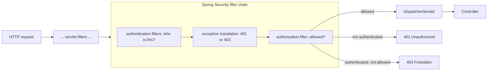
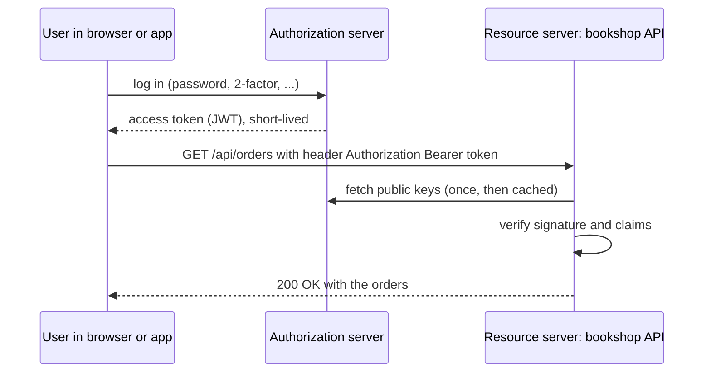

# Spring Security basics and JWT resource servers

> **Before this lesson:** you can build REST endpoints with proper status codes ([REST endpoints with @RestController and ResponseEntity](#/lesson/spring/spring-rest-controllers)), you know that filters run before the `DispatcherServlet` ([Spring MVC: the request flow through DispatcherServlet](#/lesson/spring/spring-mvc-request-flow)), and you understand sessions and why many back ends are stateless ([Request and session scope](#/lesson/spring/spring-request-session-scope)).

## In plain words

Getting into a music festival involves two separate checks. At the gate, staff look at your ticket and ID to establish **who you are**; in exchange you receive a wristband. Inside, every area has someone glancing at wristbands to decide **what you may do**: everyone can enter the main field, only a gold wristband opens the backstage door. The backstage guard does not phone the ticket office; the wristband itself carries the answer, and it is hard to forge.

Security in a web application has the same two halves. **Authentication** establishes who the caller is. **Authorization** decides whether that caller may perform this request. In a modern API the wristband is a **token**: a signed piece of data the client sends with every request. The most common format is the **JWT**.

**Spring Security** is the Spring project that implements both halves as a chain of filters in front of your controllers. This lesson covers its architecture, how to write authorization rules, and how to make the bookshop API accept JWTs as an *OAuth 2.0 resource server*. Security is the area where mistakes are most expensive, and where tutorials age fastest, so the configuration style shown is the current one for Spring Security 6.

## The moment you add the starter

```xml
<dependency>
    <groupId>org.springframework.boot</groupId>
    <artifactId>spring-boot-starter-security</artifactId>
</dependency>
```

With nothing else configured, auto-configuration makes the application **secure by default**:

- every endpoint requires authentication;
- a login form and HTTP Basic authentication are enabled;
- one user named `user` exists, with a random password printed in the start-up log;
- protection against CSRF, and several security response headers, are switched on.

```bash
curl -i http://localhost:8080/api/books
```

```text
HTTP/1.1 401
WWW-Authenticate: Basic realm="Realm"
```

Your controllers have not changed. The request was stopped before it reached them.

## Architecture: the filter chain



Spring Security registers one servlet filter that delegates to a **`SecurityFilterChain`**: an ordered list of small filters, each with one job. The ones that matter here:

1. **Authentication filters** look for credentials in the request (a session cookie, a Basic header, a bearer token). If present and valid, they create an `Authentication` object and store it in the **`SecurityContext`** for the duration of the request.
2. The **authorization filter** compares the request with your rules and the current `Authentication`.
3. A translation filter turns failures into responses: **401** when nobody is authenticated, **403** when somebody is but lacks permission.

The `Authentication` object holds the **principal** (who: a username, or the token), and a collection of **authorities** (what they may do: strings such as `ROLE_ADMIN` or `SCOPE_orders:read`). A **role** is an authority whose name starts with `ROLE_`.

## Writing the rules

You configure security by declaring a `SecurityFilterChain` bean. (The class `WebSecurityConfigurerAdapter` found in older tutorials was removed in Spring Security 6.)

```java
// src/main/java/com/bookshop/config/SecurityConfig.java
package com.bookshop.config;

import org.springframework.context.annotation.Bean;
import org.springframework.context.annotation.Configuration;
import org.springframework.http.HttpMethod;
import org.springframework.security.config.Customizer;
import org.springframework.security.config.annotation.web.builders.HttpSecurity;
import org.springframework.security.config.annotation.web.configuration.EnableWebSecurity;
import org.springframework.security.web.SecurityFilterChain;

@Configuration
@EnableWebSecurity
public class SecurityConfig {

    @Bean
    SecurityFilterChain api(HttpSecurity http) throws Exception {
        return http
                .authorizeHttpRequests(auth -> auth
                        .requestMatchers("/actuator/health/**").permitAll()
                        .requestMatchers("/actuator/**").hasRole("OPS")
                        .requestMatchers(HttpMethod.GET, "/api/books/**").permitAll()
                        .requestMatchers(HttpMethod.POST, "/api/books").hasAnyRole("EDITOR", "ADMIN")
                        .requestMatchers(HttpMethod.DELETE, "/api/books/*").hasRole("ADMIN")
                        .requestMatchers("/api/orders/**").authenticated()
                        .anyRequest().denyAll())
                .httpBasic(Customizer.withDefaults())
                .build();
    }
}
```

Read `authorizeHttpRequests` as a firewall table:

- Rules are checked **top to bottom; the first match decides**. Later rules are not consulted.
- `requestMatchers` takes an optional HTTP method and path patterns: `*` is one path segment, `**` is any number of segments.
- `permitAll()` lets everyone through; `authenticated()` requires any logged-in caller; `hasRole("ADMIN")` requires the authority `ROLE_ADMIN` (the prefix is added for you); `hasAuthority("x")` requires the exact string.
- `anyRequest()` is the catch-all and belongs last. Ending with `denyAll()` or `authenticated()` means a new endpoint is protected until someone decides otherwise.

Because order decides, the classic mistake is a broad rule above a narrow one:

```java
.requestMatchers("/api/**").permitAll()                 // matches first...
.requestMatchers("/api/admin/**").hasRole("ADMIN")      // ...so this line is never reached
```

The model below evaluates a rule list the way the authorization filter does.

```python-run
def segments(text):
    return [s for s in text.split("/") if s]

def matches(pattern, path):
    if not pattern:
        return not path
    if pattern[0] == "**":
        return any(matches(pattern[1:], path[k:]) for k in range(len(path) + 1))
    return bool(path) and pattern[0] in ("*", path[0]) and matches(pattern[1:], path[1:])

def allowed(access, user):
    if access == "permitAll":
        return True
    if access == "denyAll" or user is None:
        return False
    if access == "authenticated":
        return True
    kind, _, value = access.partition(":")
    wanted = ["ROLE_" + r for r in value.split(",")] if kind == "hasAnyRole" else [value]
    return any(authority in user for authority in wanted)

def authorize(rules, method, path, user):
    for index, (rule_method, pattern, access) in enumerate(rules):
        if rule_method in ("*", method) and matches(segments(pattern), segments(path)):
            if allowed(access, user):
                return 200, f"rule {index}: {access}"
            return (401 if user is None else 403), f"rule {index}: {access}"
    return (401 if user is None else 403), "no rule matched: denied"

RULES = [
    ("GET", "/api/books/**", "permitAll"),
    ("POST", "/api/books", "hasAnyRole:EDITOR,ADMIN"),
    ("DELETE", "/api/books/*", "hasAnyRole:ADMIN"),
    ("*", "/api/orders/**", "authenticated"),
    ("*", "/**", "denyAll"),
]
ANONYMOUS, CUSTOMER, EDITOR = None, ["ROLE_USER"], ["ROLE_EDITOR"]

for method, path, user, label in [
        ("GET", "/api/books/42", ANONYMOUS, "anonymous"),
        ("POST", "/api/books", ANONYMOUS, "anonymous"),
        ("POST", "/api/books", CUSTOMER, "customer"),
        ("POST", "/api/books", EDITOR, "editor"),
        ("DELETE", "/api/books/42", EDITOR, "editor"),
        ("GET", "/api/orders/7", CUSTOMER, "customer"),
        ("GET", "/internal/debug", EDITOR, "editor")]:
    print(f"{method:6} {path:16} as {label:9} -> {authorize(RULES, method, path, user)}")
```

Check each line against the table. An anonymous POST gets **401** ("log in first"); a customer's POST gets **403** ("you are known, and not allowed"). The practice problem [Security filter chain: who gets in?](#/problem/spring-security-filter-chain) asks you to implement this evaluator.

### Method security

URL rules protect by address. For rules tied to business operations, annotate the method; the check is an aspect, like `@Transactional`.

```java
@Configuration
@EnableMethodSecurity
class MethodSecurityConfig { }

@Service
public class OrderService {

    @PreAuthorize("hasRole('ADMIN') or #customerId == authentication.name")
    public List<Order> ordersOf(String customerId) { ... }
}
```

The expression says: admins may see anyone's orders, everybody else only their own. Use both layers: coarse rules on URLs, fine rules on methods. Being an aspect, it shares the proxy limits: no effect on self-invocation.

## Sessions versus tokens

After the first authentication, how does the server recognise the caller on the next request?

| | Session cookie | Bearer token (JWT) |
|---|---|---|
| Server keeps state | yes: a session per user | no |
| Sent by the browser | automatically, as a cookie | by client code, in the `Authorization` header |
| Scaling to many instances | needs sticky sessions or a shared store | any instance can validate the token |
| Revocation | delete the session | hard before expiry; keep lifetimes short |
| CSRF risk | yes, needs CSRF protection | no, when the token is sent in a header by code |
| Typical use | server-rendered web applications | APIs for single-page apps, mobile apps, other services |

## JWT in five minutes

A **JWT** (JSON Web Token, pronounced "jot") is a compact string of three parts separated by dots:

```text
eyJhbGciOiJSUzI1NiJ9.eyJpc3MiOiJodHRwczovL2F1dGguYm9va3Nob3AuZXhhbXBsZSIsInN1YiI6ImFuYSJ9.Qk3x...signature
└──── header ───────┘ └──────────────────────── payload ──────────────────────────────────┘ └ signature ┘
```

Each of the first two parts is a JSON object encoded with Base64URL, an encoding that turns bytes into URL-safe text. **It is an encoding, not encryption: anyone holding the token can read it.**

```text
header:   {"alg": "RS256", "kid": "key-2026-01"}

payload:  {
            "iss": "https://auth.bookshop.example",     issuer: who created the token
            "sub": "ana",                               subject: who it is about
            "aud": "bookshop-api",                      audience: who it is meant for
            "exp": 1767225600,                          expiry, seconds since 1970
            "iat": 1767222000,                          issued at
            "scope": "orders:read orders:write"         what the holder may do
          }
```

The entries of the payload are called **claims**. The third part is a **signature** computed over the first two with the issuer's private key. Anyone with the matching public key can verify that the token was produced by the issuer and has not been altered. Changing one character of the payload invalidates the signature.

That is the wristband: the API does not ask anyone whether Ana is logged in. It verifies the signature and reads the claims.

## OAuth 2.0 roles

**OAuth 2.0** is the standard framework describing how tokens are obtained and used; **OpenID Connect** (OIDC) is a layer on top that adds login and user identity.



| Role | Who | Responsibility |
|---|---|---|
| **Authorization server** | Keycloak, Auth0, Okta, Microsoft Entra ID, Spring Authorization Server | authenticates users, issues tokens |
| **Client** | the web or mobile application | obtains a token, sends it with requests |
| **Resource server** | your API | validates tokens, enforces authorization |

Your Spring Boot API is the resource server. It never sees passwords. That division of labour is the main point: authentication, password storage and multi-factor login are handled by a specialised system.

> [!WARNING]
> Do not write your own login endpoint that checks a password and hand-signs a JWT with a shared secret, as many older tutorials show. Use an authorization server. Home-made token issuing tends to lack key rotation, revocation, brute-force protection and secure password handling.

## Making the API a resource server

```xml
<dependency>
    <groupId>org.springframework.boot</groupId>
    <artifactId>spring-boot-starter-oauth2-resource-server</artifactId>
</dependency>
```

```yaml
# src/main/resources/application.yml
spring:
  security:
    oauth2:
      resourceserver:
        jwt:
          issuer-uri: https://auth.bookshop.example
          audiences: bookshop-api
```

`issuer-uri` does three things: at start-up Spring fetches the issuer's metadata to locate its public keys; every token's signature is verified with those keys; and every token's `iss` claim must equal this URI. `audiences` additionally requires the `aud` claim to contain your API's name.

```java
// src/main/java/com/bookshop/config/SecurityConfig.java
@Configuration
@EnableWebSecurity
public class SecurityConfig {

    @Bean
    SecurityFilterChain api(HttpSecurity http) throws Exception {
        return http
                .authorizeHttpRequests(auth -> auth
                        .requestMatchers("/actuator/health/**").permitAll()
                        .requestMatchers(HttpMethod.GET, "/api/books/**").permitAll()
                        .requestMatchers(HttpMethod.GET, "/api/orders/**").hasAuthority("SCOPE_orders:read")
                        .requestMatchers("/api/orders/**").hasAuthority("SCOPE_orders:write")
                        .anyRequest().authenticated())
                .oauth2ResourceServer(oauth -> oauth.jwt(Customizer.withDefaults()))    // accept bearer JWTs
                .sessionManagement(s -> s.sessionCreationPolicy(SessionCreationPolicy.STATELESS))
                .csrf(csrf -> csrf.disable())                                            // no cookies, no CSRF
                .build();
    }
}
```

- `oauth2ResourceServer(...jwt...)` installs the filter that reads `Authorization: Bearer <token>`, validates the token and builds the `Authentication`.
- Each entry of the `scope` claim becomes an authority prefixed with `SCOPE_`, which the rules reference.
- `STATELESS` tells Spring Security never to create an HTTP session.
- Disabling CSRF protection is appropriate **only** because this API authenticates by a header that browsers do not attach automatically. For cookie-based sessions it must stay on.

```bash
curl -i http://localhost:8080/api/orders
```

```text
HTTP/1.1 401
WWW-Authenticate: Bearer
```

```bash
curl -i -H "Authorization: Bearer $TOKEN" http://localhost:8080/api/orders
```

```text
HTTP/1.1 200
```

With a token that lacks the scope: `403` and the header `WWW-Authenticate: Bearer error="insufficient_scope"`.

Reading the caller in a controller:

```java
@GetMapping("/api/orders")
List<OrderView> myOrders(@AuthenticationPrincipal Jwt jwt) {
    return orders.findByCustomer(jwt.getSubject());         // the "sub" claim
}
```

## What "validating a token" means

A signature only proves who issued the token. Whether the token is for this API, now, with these permissions, is decided by the claims.

```python-run
def check_token(token, now, config):
    header, claims = token["header"], token["claims"]
    skew = config["clock_skew"]
    if header.get("alg") not in config["algorithms"]:
        return 401, "unsupported algorithm"                  # never accept "none"
    # (signature verification with the issuer's public key happens here)
    if "exp" not in claims:
        return 401, "missing exp"
    if now - skew > claims["exp"]:
        return 401, "expired"
    if "nbf" in claims and now + skew < claims["nbf"]:
        return 401, "not yet valid"
    if claims.get("iss") != config["issuer"]:
        return 401, "wrong issuer"
    audience = claims.get("aud", [])
    audience = [audience] if isinstance(audience, str) else audience
    if config["audience"] not in audience:
        return 401, "wrong audience"
    scopes = claims.get("scope", "").split()
    if config["required_scope"] not in scopes:
        return 403, "insufficient scope"                     # token is fine, permission is missing
    return 200, sorted("SCOPE_" + s for s in scopes)

CONFIG = {"issuer": "https://auth.bookshop.example", "audience": "bookshop-api", "clock_skew": 60,
          "algorithms": ["RS256"], "required_scope": "orders:read"}

def token(alg="RS256", **changes):
    claims = {"iss": "https://auth.bookshop.example", "aud": "bookshop-api", "sub": "ana",
              "exp": 2000, "scope": "orders:read profile"}
    claims.update(changes)
    return {"header": {"alg": alg}, "claims": claims}

for label, candidate, now in [
        ("good token", token(), 1500),
        ("expired 30 s ago (within skew)", token(), 2030),
        ("expired 5 min ago", token(), 2300),
        ("alg none", token(alg="none"), 1500),
        ("issued by someone else", token(iss="https://evil.example"), 1500),
        ("meant for another API", token(aud="payroll-api"), 1500),
        ("lacks the scope", token(scope="profile"), 1500)]:
    print(f"{label:32} -> {check_token(candidate, now, CONFIG)}")
```

Go through the rejections:

- **Algorithm.** Accept only the algorithms you configured. A token whose header says `none` claims to need no signature; libraries that honoured it produced famous vulnerabilities.
- **Expiry with clock skew.** Clocks of different machines disagree slightly, so a small tolerance (60 seconds by default in Spring Security) is applied.
- **Issuer and audience.** A perfectly signed token from the same company's authorization server, but issued for the payroll API, must not open the bookshop.
- **Scope.** A valid token without the needed permission is a **403**, not a 401.

The practice problem [Validate the claims of a JWT](#/problem/spring-jwt-validate) implements exactly this sequence.

> [!INTERVIEW]
> "How does a Spring Boot API validate a JWT?" As an OAuth 2.0 resource server: the bearer token filter extracts the token, a `JwtDecoder` verifies the signature with the issuer's public keys (fetched from the JWK set URL discovered via `issuer-uri` and cached), then validates `exp`/`nbf` with clock skew, `iss`, and configured `aud`. Scopes are mapped to `SCOPE_…` authorities and checked by `authorizeHttpRequests` or `@PreAuthorize`. Missing or invalid token → 401; valid token without permission → 403. No session is kept.

## Testing secured endpoints

With `spring-security-test` on the test classpath, a test does not need real tokens:

```java
@WebMvcTest(OrderApiController.class)
@Import(SecurityConfig.class)
class OrderApiSecurityTest {

    @Autowired MockMvc mvc;
    @MockitoBean OrderService orders;

    @Test
    void anonymousCallersGet401() throws Exception {
        mvc.perform(get("/api/orders")).andExpect(status().isUnauthorized());
    }

    @Test
    void tokenWithoutScopeGets403() throws Exception {
        mvc.perform(get("/api/orders").with(jwt().authorities(new SimpleGrantedAuthority("SCOPE_profile"))))
           .andExpect(status().isForbidden());
    }

    @Test
    void tokenWithScopeIsAccepted() throws Exception {
        mvc.perform(get("/api/orders").with(jwt().jwt(t -> t.subject("ana"))
                                                 .authorities(new SimpleGrantedAuthority("SCOPE_orders:read"))))
           .andExpect(status().isOk());
    }
}
```

Tests for the negative cases, 401 and 403, are the ones that protect you; a rule accidentally opened by a refactoring makes no positive test fail.

## Other protections worth knowing

- **Passwords.** If an application does store passwords, they are stored as slow, salted hashes produced by a `PasswordEncoder` such as BCrypt or Argon2, never in plain text and never with a fast hash such as SHA-256.
- **CORS** (cross-origin resource sharing). Browsers block JavaScript on one site from calling an API on another unless the API allows that origin. Configure it with `http.cors(…)` and a `CorsConfigurationSource` bean listing the allowed origins; avoid `*` for APIs that use credentials.
- **HTTPS.** Tokens and cookies are bearer credentials: whoever reads them can use them. They must only ever travel over encrypted connections.
- **Security headers.** Spring Security adds sensible defaults (for example to prevent the site being framed by another site).

> [!TIP]
> Start every rule list from "deny". Open what must be public explicitly, and finish with `anyRequest().authenticated()` or `denyAll()`. A forgotten endpoint then fails closed (inaccessible) instead of open (public), and somebody will notice the former.

## Practise in real Java

The judge has the JDK only, without Spring jars, so in these exercises you write in real Java 21 the mechanism that Spring provides. That is the level interview questions probe.

- [Java: a Spring Security filter chain with bearer tokens and URL rules](#/problem/spring-java-security-filter-chain): an ordered filter chain with a bearer-token filter and URL authorisation rules.

## Pitfalls

- **Rule order.** A broad matcher above a narrow one hides it.
- **No catch-all.** Without `anyRequest()`, unmatched requests are denied in current versions, but older configurations left them open; always be explicit.
- **`hasRole("ROLE_ADMIN")`.** The prefix is added automatically; write `hasRole("ADMIN")` or `hasAuthority("ROLE_ADMIN")`.
- **Disabling CSRF in a cookie-session application** because a tutorial for stateless APIs did.
- **Treating the JWT payload as secret.** It is readable by anyone. Put no sensitive data in it.
- **Skipping audience validation.** Tokens for other services are accepted.
- **Long-lived access tokens.** A stolen token works until it expires; keep lifetimes at minutes and use refresh tokens.
- **Tokens in URLs or logs.** They leak through histories, proxies and log files.
- **Security only in the front end.** Hiding a button is not authorization. Every rule must be enforced by the API.
- **`@PreAuthorize` on a self-invoked or private method.** The proxy never sees the call.
- **Copying pre-Spring-Security-6 code.** `WebSecurityConfigurerAdapter`, `antMatchers` and `authorizeRequests` are gone or deprecated; use `SecurityFilterChain`, `requestMatchers` and `authorizeHttpRequests`.

## Cheat sheet

| Annotation / method | Meaning |
|---|---|
| `spring-boot-starter-security` | secures everything by default |
| `SecurityFilterChain` bean | the security configuration |
| `authorizeHttpRequests(...)` | ordered URL rules; first match wins |
| `requestMatchers(method, patterns…)` | select requests; `*` one segment, `**` any |
| `permitAll()`, `authenticated()`, `denyAll()` | open, logged-in, closed |
| `hasRole("X")` / `hasAuthority("ROLE_X")` | role check |
| `hasAuthority("SCOPE_x")` | OAuth scope check |
| `@EnableMethodSecurity` + `@PreAuthorize("…")` | rules on methods |
| `spring-boot-starter-oauth2-resource-server` | bearer-token (JWT) support |
| `spring.security.oauth2.resourceserver.jwt.issuer-uri` | trusted issuer and key discovery |
| `…jwt.audiences` | required `aud` values |
| `oauth2ResourceServer(o -> o.jwt(withDefaults()))` | enable JWT authentication |
| `SessionCreationPolicy.STATELESS` | never create a session |
| `@AuthenticationPrincipal Jwt jwt` | the validated token in a controller |
| `401` / `403` | not authenticated / authenticated but not allowed |

## Summary

- Authentication establishes identity; authorization decides permission. Spring Security implements both in a filter chain ahead of your controllers and is secure by default.
- Rules in `authorizeHttpRequests` are evaluated in order and the first match decides; finish with a catch-all and prefer deny-by-default. Method security adds fine-grained checks.
- Stateless APIs use bearer tokens. A JWT is a signed, readable set of claims; the signature proves the issuer, the claims say for whom, until when and with which scopes.
- As an OAuth 2.0 resource server your API validates signature, expiry, issuer and audience, and maps scopes to authorities. Invalid token: 401. Missing permission: 403.
- Leave login and token issuing to an authorization server, keep tokens short-lived, send them only over HTTPS, and test the negative cases.

## Glossary

- **Access token**: a credential a client sends to an API to act on someone's behalf.
- **Authentication**: verifying who a caller is.
- **Authority**: a permission string attached to an authenticated caller.
- **Authorization**: deciding whether a caller may perform an action.
- **Authorization server**: the system that authenticates users and issues tokens.
- **Bearer token**: a token that grants access to whoever presents it.
- **Claim**: one entry of a JWT's payload.
- **CORS**: browser rules for calls from a page to a different origin.
- **CSRF**: an attack that tricks a logged-in user's browser into sending a request.
- **JWT**: JSON Web Token, a signed token of Base64URL-encoded JSON parts.
- **OAuth 2.0 / OpenID Connect**: standards for delegated authorization / login on top of it.
- **Principal**: the identity of the authenticated caller.
- **Resource server**: an API that accepts and validates access tokens.
- **Role**: an authority with the prefix `ROLE_`.
- **Scope**: a permission granted to a token.
- **`SecurityFilterChain`**: the ordered filters and rules Spring Security applies to requests.

```quiz
[
  {"q": "What is the difference between authentication and authorization?",
   "options": ["They are synonyms", "Authentication establishes who the caller is; authorization decides what that caller may do", "Authentication is for APIs, authorization for web pages", "Authorization always happens first"],
   "answer": 1,
   "explain": "Identity first, then permission. Spring Security answers 401 for a failure of the first and 403 for a failure of the second."},
  {"q": "The rules are, in order: requestMatchers(\"/api/**\").permitAll(), then requestMatchers(\"/api/admin/**\").hasRole(\"ADMIN\"). Who can call /api/admin/users?",
   "options": ["Only admins", "Everyone, because the first matching rule decides", "Nobody", "Only authenticated users"],
   "answer": 1,
   "explain": "Rules are evaluated top to bottom and the first match wins, so the broad permitAll hides the specific rule below it."},
  {"q": "An anonymous client calls an endpoint that requires hasRole(\"ADMIN\"). Which status is returned?",
   "options": ["403", "401", "404", "500"],
   "answer": 1,
   "explain": "Nobody is authenticated, so the client is asked to authenticate: 401. A logged-in non-admin would receive 403."},
  {"q": "Which statement about a JWT is true?",
   "options": ["Its payload is encrypted and unreadable", "Its payload is only encoded and can be read by anyone; the signature protects it against modification", "It must be stored in the server's session", "It never expires"],
   "answer": 1,
   "explain": "Base64URL is not encryption. The signature guarantees integrity and origin, not secrecy."},
  {"q": "Why must a resource server check the aud (audience) claim?",
   "options": ["To measure performance", "So that a validly signed token issued for a different API is not accepted", "Because the signature depends on it", "To decide the response format"],
   "answer": 1,
   "explain": "The same issuer signs tokens for many services. The audience says which service a token is meant for."},
  {"q": "A token is valid but lacks the scope an endpoint requires. What should the API answer?",
   "options": ["401 Unauthorized", "403 Forbidden", "400 Bad Request", "200 with an empty body"],
   "answer": 1,
   "explain": "The caller is authenticated; the permission is missing. Spring Security answers 403 with error insufficient_scope."},
  {"q": "When is it appropriate to disable CSRF protection?",
   "options": ["Always, it is outdated", "For a stateless API that authenticates with a bearer token in a header and uses no cookies", "For any application with a login form", "Never"],
   "answer": 1,
   "explain": "CSRF exploits credentials that browsers attach automatically (cookies). A header token set by client code is not attached automatically."}
]
```

> **Source:** extension module beyond Spilcă, *Spring Start Here*. Documentation: https://docs.spring.io/spring-security/reference/servlet/architecture.html and https://docs.spring.io/spring-security/reference/servlet/authorization/authorize-http-requests.html and https://docs.spring.io/spring-security/reference/servlet/oauth2/resource-server/jwt.html
