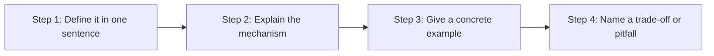
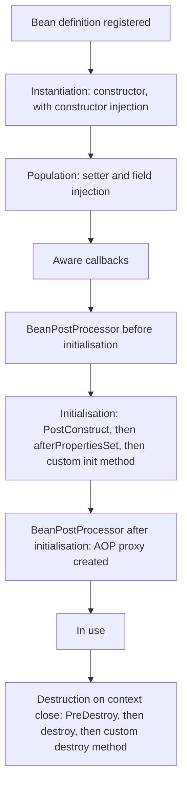

# Spring interview essentials: the container

> **Before this lesson:** you have worked through modules 1 to 7: beans and the context, wiring, abstractions, scopes, AOP and auto-configuration. This lesson adds no new mechanism. It turns what you know into answers you can give out loud, and links back to the lesson behind each one.

## In plain words

Knowing how to drive and passing the driving test are different skills. In the test you must show, in a few minutes and under observation, that you know the rules and can explain your decisions: mirror, signal, manoeuvre. Candidates who drive well but cannot say why they did something make examiners nervous.

A technical interview is the driving test for what you have learned. The interviewer has perhaps five minutes per topic and wants three things: a correct definition in one or two sentences, evidence that you understand the mechanism underneath, and a sign that you have met the practical consequences. This lesson gives you a structure for answering, then worked answers to the container questions asked most often, each with the follow-up an interviewer is likely to add and the trap that catches unprepared candidates.

Reading these answers is not enough. Say each one aloud without looking, in your own words. If you cannot, follow the link and return.

## How to shape an answer

Use the same four steps for almost every "what is…" or "how does…" question.



1. **Define.** One sentence a non-specialist could follow.
2. **Mechanism.** What Spring actually does. This separates understanding from memorising.
3. **Example.** Two lines of code or a situation from a project.
4. **Trade-off or pitfall.** Shows experience. Interviewers remember it.

Stop after step 4. A focused sixty-second answer followed by "would you like more detail on any part?" beats a five-minute lecture.

## 1. IoC versus DI

**Question:** "What is inversion of control, and how is it different from dependency injection?"

**Answer.** Inversion of control is the general principle that the framework, not my code, is in charge of the program's flow and of creating objects: I supply classes and the framework calls them. Dependency injection is one specific form of it: an object does not create or look up its collaborators; they are handed to it, normally through the constructor. In Spring, the IoC container is the `ApplicationContext`. It reads bean definitions, instantiates the beans, and injects each one's dependencies by type.

```java
// without DI: the class chooses and creates its collaborator
class OrderService {
    private final OrderRepository repository = new JdbcOrderRepository();
}

// with DI: the class states a need; the container satisfies it
@Service
class OrderService {
    private final OrderRepository repository;
    OrderService(OrderRepository repository) { this.repository = repository; }
}
```

The benefit is loose coupling: `OrderService` depends on an interface, so the implementation can be replaced in configuration or by a fake in a test.

**Follow-up:** "Is DI the only kind of IoC in Spring?" No. Template callbacks such as `JdbcTemplate` calling your `RowMapper`, event listeners, and the `DispatcherServlet` calling your controller are all inversion of control without being dependency injection.

**Trap:** saying they are the same thing. DI is a subset of IoC.

Lessons: [What a framework is and why Spring exists](#/lesson/spring/spring-why-frameworks), [Interfaces as contracts: decoupling your classes](#/lesson/spring/spring-interfaces-contracts).

## 2. What is a bean? @Component versus @Bean

**Question:** "What is a Spring bean, and what are the ways to define one?"

**Answer.** A bean is an object whose creation, wiring and lifecycle are managed by the Spring container. Only beans receive injection, proxies and lifecycle callbacks; an object created with `new` is invisible to Spring. There are three ways to register one: a stereotype annotation (`@Component`, `@Service`, `@Repository`, `@Controller`) on a class found by component scanning; an `@Bean` method in a `@Configuration` class; and programmatic registration with `registerBean`.

| | `@Component` family | `@Bean` |
|---|---|---|
| Placed on | the class | a method that returns the object |
| Who instantiates | Spring calls the constructor | your method body |
| Classes you do not own | not possible | yes |
| Several beans of one class | no | yes, one method each |
| Typical use | your services, repositories, controllers | library objects, custom construction |

**Follow-up:** "What does `@Configuration` add?" Spring subclasses the class so that calls between `@Bean` methods return the existing singleton instead of running the method again.

**Trap:** "`@Service` and `@Repository` do special things." `@Service` is purely descriptive. `@Repository` adds persistence exception translation. `@Controller` makes the class a candidate for request mappings.

Lessons: [The application context and @Bean](#/lesson/spring/spring-context-bean), [Stereotype annotations, component scanning and programmatic registration](#/lesson/spring/spring-stereotypes-scan).

## 3. Why constructor injection?

**Question:** "Which injection type do you prefer and why?"

**Answer.** Constructor injection, for four reasons. Dependencies can be `final`, so the object is immutable and safe to share between threads. The object is complete as soon as it exists; there is no window with `null` fields. A unit test can create it with `new` and pass mocks, without Spring or reflection. And the constructor makes the dependencies explicit: a long parameter list is a visible sign that the class does too much. Field injection hides all of that and makes the class usable only inside a container. Setter injection is reasonable for optional dependencies.

With a single constructor no `@Autowired` is needed. Constructor injection also exposes circular dependencies at start-up, where field injection can hide them.

**Follow-up:** "What if a dependency is optional?" Declare `Optional<T>` or `ObjectProvider<T>` as the constructor parameter, or use a setter with `@Autowired(required = false)`.

**Trap:** answering "field injection because it is shorter". Shorter to type is not an engineering argument.

Lesson: [Wiring beans with @Bean methods and @Autowired](#/lesson/spring/spring-wiring-autowired).

## 4. Several beans of the same type

**Question:** "Two beans implement the same interface. What happens at an injection point of that interface type?"

**Answer.** Start-up fails with `NoUniqueBeanDefinitionException`, because Spring will not guess. I can resolve it in several ways: mark one bean `@Primary` as the default; select one at the injection point with `@Qualifier("name")`; inject a `List<T>` or `Map<String, T>` to receive all of them; or make sure only one exists per environment with `@Profile` or a conditional annotation. The precedence is: qualifier first, then primary, then, as a last fallback, a bean whose name equals the parameter name.

**Follow-up:** "Both are `@Primary`?" Ambiguous again; start-up fails.

**Trap:** believing `@Primary` overrides `@Qualifier`. The specific instruction at the injection point wins.

Lesson: [Circular dependencies, @Primary and @Qualifier](#/lesson/spring/spring-circular-primary-qualifier).

## 5. Bean scopes

**Question:** "Which bean scopes exist, and are singleton beans thread-safe?"

**Answer.** Singleton, the default, is one instance per bean definition per application context. Prototype is a new instance each time the container is asked. In web applications there are request scope (one per HTTP request), session scope (one per HTTP session) and application scope (one per `ServletContext`).

Spring guarantees that a singleton is created once. It does not make it thread-safe. All request threads share the instance, so a singleton must be stateless or hold only immutable state; per-request data belongs in method parameters. Typical services and repositories with `final` injected fields are safe for that reason.

**Follow-up:** "A prototype is injected into a singleton. How many instances?" One. Injection happens once, when the singleton is built. For a fresh instance per use, inject `ObjectProvider<T>` and call `getObject()`, or use `@Lookup` or a scoped proxy.

**Follow-up:** "How can a request-scoped bean be injected into a singleton?" Through a scoped proxy, which `@RequestScope` enables by default: the proxy is a singleton that looks up the real instance for the current request on every call.

**Trap:** confusing Spring's singleton with the singleton design pattern. Spring's is per bean name and per context; the class itself stays an ordinary class.

The counting model summarises the scope rules in a few lines.

```python-run
def count_instances(definitions, lookups):
    count = {name: 0 for name in definitions}
    singletons = set()

    def obtain(name):
        scope, needs = definitions[name]
        if scope == "singleton":
            if name in singletons:
                return
            singletons.add(name)
        count[name] += 1
        for need in needs:
            obtain(need)                       # injection = asking the container

    for name, (scope, _) in definitions.items():
        if scope == "singleton":
            obtain(name)                       # eager creation at start-up
    for name in lookups:
        obtain(name)
    return count

DEFINITIONS = {
    "reportService": ("singleton", ["reportBuilder", "clock"]),
    "reportBuilder": ("prototype", ["clock"]),
    "clock": ("singleton", []),
}
print("service used 5 times:      ", count_instances(DEFINITIONS, ["reportService"] * 5))
print("builder looked up 5 times: ", count_instances(DEFINITIONS, ["reportBuilder"] * 5))
```

The first line shows the classic answer: five uses of the singleton, still one `reportBuilder`. The second shows a new prototype per container lookup, six in total with the one injected at start-up.

Lessons: [Singleton scope, eager and lazy beans, thread safety](#/lesson/spring/spring-singleton-scope), [Prototype scope and the bean lifecycle](#/lesson/spring/spring-prototype-lifecycle), [Request and session scope](#/lesson/spring/spring-request-session-scope).

## 6. The bean lifecycle

**Question:** "Walk me through the lifecycle of a bean."

**Answer.**



The container first registers bean definitions, then for each singleton: calls the constructor and injects constructor arguments; injects remaining fields and setters; runs post-processors; runs initialisation callbacks in the order `@PostConstruct`, `InitializingBean.afterPropertiesSet`, custom init method; and in the post-processing step after initialisation wraps the bean in a proxy if any aspect applies. When the context closes, singletons are destroyed in reverse creation order with `@PreDestroy`, `DisposableBean.destroy`, then the custom destroy method.

**Follow-up:** "Prototype beans?" They get initialisation callbacks but no destruction callbacks; the container does not track them after handing them out.

**Follow-up:** "What is a `BeanPostProcessor`?" An extension hook called for every bean before and after initialisation. It is how `@Autowired`, `@PostConstruct` and AOP proxying are implemented.

**Trap:** putting logic that needs injected fields into the constructor when using field injection; the fields are still `null` there. Use `@PostConstruct`, or constructor injection.

Lesson: [Prototype scope and the bean lifecycle](#/lesson/spring/spring-prototype-lifecycle).

## 7. BeanFactory versus ApplicationContext

**Question:** "What is the difference between `BeanFactory` and `ApplicationContext`?"

**Answer.** `BeanFactory` is the basic container interface: it holds bean definitions and creates beans on request. `ApplicationContext` extends it and adds what applications need: eager creation of singletons at start-up, automatic registration of post-processors (so annotations work), events, internationalised messages, resource loading and environment/profile support. In practice you always work with an `ApplicationContext`; `BeanFactory` matters mainly as the name in stack traces and exception messages.

**Trap:** claiming `BeanFactory` is deprecated. It is the foundation the context builds on.

## 8. Circular dependencies

**Question:** "What is a circular dependency and how does Spring handle it?"

**Answer.** Bean A needs B and B needs A, directly or through a chain. With constructor injection neither can be instantiated first, so the context fails at start-up with `BeanCurrentlyInCreationException`. With setter or field injection Spring could historically create both and wire them afterwards, but Spring Boot has forbidden circular references by default since version 2.6. The right fix is to remove the cycle: extract the shared responsibility into a third bean, or decouple with events. `@Lazy` on one injection point is a stop-gap: it injects a proxy that resolves the real bean on first use.

**Trap:** proposing `spring.main.allow-circular-references=true` as the solution. Mention it only as a legacy escape hatch.

Lesson: [Circular dependencies, @Primary and @Qualifier](#/lesson/spring/spring-circular-primary-qualifier).

## 9. How Spring AOP works

**Question:** "How does Spring AOP work, and what are its limits?"

**Answer.** Spring AOP is proxy-based. At start-up a post-processor checks each bean against the pointcuts of all aspects; a matching bean is replaced in the context by a proxy, either a JDK dynamic proxy implementing the bean's interfaces or a CGLIB subclass, which is the default in Spring Boot. Callers receive the proxy. It runs the advice chain (`@Around`, `@Before`, `@After`…) and delegates to the target.

The limits follow from the proxy: only Spring beans are advised; only method executions; only calls coming from outside the object, so a method calling another method of the same class through `this` bypasses the advice; `private` methods are never intercepted, and `final` methods and classes cannot be proxied by subclassing.

**Follow-up:** "Why does that matter in practice?" Because `@Transactional`, `@Cacheable`, `@Async`, `@PreAuthorize` and `@Retryable` are all implemented this way and share the self-invocation limit.

**Follow-up:** "Order of several aspects?" Undefined unless set with `@Order`; the lower value is the outer wrapper.

Lessons: [How Spring AOP works: proxies and your first aspect](#/lesson/spring/spring-aop-proxies), [Advice types, pointcut expressions and aspect order](#/lesson/spring/spring-aop-advice-pointcuts).

## 10. How auto-configuration works

**Question:** "How does Spring Boot auto-configuration work?"

**Answer.** `@SpringBootApplication` includes `@EnableAutoConfiguration`. At start-up Boot reads the list of auto-configuration classes from the file `META-INF/spring/org.springframework.boot.autoconfigure.AutoConfiguration.imports` in every JAR on the classpath. Each class is a normal `@Configuration` class guarded by conditions: `@ConditionalOnClass` (is the library present?), `@ConditionalOnMissingBean` (has the application defined its own?), `@ConditionalOnProperty` (is a property set?). They are evaluated after the application's own bean definitions, so user-defined beans win and Boot backs off. Starters complete the picture: they put the right libraries on the classpath, and the classpath is what triggers the conditions.

To see the decisions, start with `--debug` for the conditions evaluation report, or use the Actuator `conditions` endpoint.

```python-run
def evaluate(auto_configs, classpath, user_beans, properties):
    beans = list(user_beans)
    for name, bean, conditions in auto_configs:
        reason = next((f"{kind}({arg})" for kind, arg in conditions if not {
            "onClass": arg in classpath,
            "onMissingBean": arg not in beans,
            "onBean": arg in beans,
            "onProperty": properties.get(arg, "false") != "false",
        }[kind]), None)
        if reason:
            print(f"  {name:32} did not match: {reason}")
        else:
            beans.append(bean)
            print(f"  {name:32} matched -> {bean}")
    return beans

AUTO = [
    ("DataSourceAutoConfiguration", "dataSource", [("onClass", "DataSource"), ("onMissingBean", "dataSource")]),
    ("JdbcTemplateAutoConfiguration", "jdbcTemplate", [("onBean", "dataSource"), ("onMissingBean", "jdbcTemplate")]),
    ("JacksonAutoConfiguration", "objectMapper", [("onClass", "ObjectMapper"), ("onMissingBean", "objectMapper")]),
    ("CacheAutoConfiguration", "cacheManager", [("onProperty", "app.cache.enabled")]),
]
print("defaults:")
evaluate(AUTO, {"DataSource", "ObjectMapper"}, [], {})
print("user defines objectMapper, enables the cache, and has no JDBC on the classpath:")
evaluate(AUTO, {"ObjectMapper"}, ["objectMapper"], {"app.cache.enabled": "true"})
```

The second run shows all three behaviours an interviewer hopes to hear: an auto-configuration backing off for a user bean, one skipped because the library is absent, and one switched on by a property.

**Follow-up:** "How do you customise or disable one?" Properties first; then your own bean; then `@SpringBootApplication(exclude = …)`.

**Trap:** "It scans the classpath for all configuration classes." It reads explicit lists from the imports files and filters them by condition. Also outdated: saying the list lives in `spring.factories`; that was Boot 2.

Lesson: [Spring Boot: starters and auto-configuration](#/lesson/spring/spring-boot-autoconfig).

## 11. Spring versus Spring Boot

**Question:** "What does Spring Boot add to Spring?"

**Answer.** Spring Framework provides the container, AOP, MVC, data access and transactions. Spring Boot is an opinionated layer on top: starters for dependency management with tested versions, auto-configuration of sensible defaults, an embedded server and a runnable JAR, externalised configuration with profiles, and Actuator for production monitoring. Boot adds no new programming model; everything underneath is still Spring, and when a default does not fit, you override it with a property or your own bean.

Lesson: [The Spring ecosystem and your first project](#/lesson/spring/spring-ecosystem-first-project).

## 12. Common annotations explained

A frequent warm-up is "explain these annotations". One line each is expected.

| Annotation | One-line explanation |
|---|---|
| `@SpringBootApplication` | main class marker: `@SpringBootConfiguration` + `@ComponentScan` + `@EnableAutoConfiguration` |
| `@Configuration` | class declaring beans with `@Bean` methods; proxied so that inter-method calls return singletons |
| `@Bean` | method whose return value is registered as a bean |
| `@Component` | generic stereotype: class registered by component scanning |
| `@Service` | stereotype for business logic; no extra behaviour |
| `@Repository` | stereotype for data access; adds exception translation |
| `@Controller` | MVC controller; return values are view names |
| `@RestController` | `@Controller` + `@ResponseBody`: return values are written as the response body |
| `@Autowired` | injection point; optional on a single constructor |
| `@Qualifier` | selects one bean among several of the same type |
| `@Primary` | default bean among several of the same type |
| `@Value` | injects a property value or expression |
| `@ConfigurationProperties` | binds a group of properties to a typed object |
| `@Profile` | registers the bean only when the profile is active |
| `@Scope` | sets the scope: singleton, prototype, request, session |
| `@Lazy` | create on first use; on an injection point, inject a lazy proxy |
| `@PostConstruct` / `@PreDestroy` | initialisation / destruction callbacks |
| `@Aspect` | class containing advice; must also be a bean |
| `@Transactional` | run the method in a transaction through a proxy |
| `@RequestMapping`, `@GetMapping`, … | map HTTP requests to handler methods |
| `@PathVariable`, `@RequestParam`, `@RequestBody` | bind path segment, query/form parameter, request body |
| `@Valid` | trigger Bean Validation on the argument |
| `@ExceptionHandler`, `@RestControllerAdvice` | map exceptions to responses, globally |
| `@ConditionalOnMissingBean`, `@ConditionalOnProperty`, `@ConditionalOnClass` | conditions used by auto-configuration |
| `@SpringBootTest`, `@WebMvcTest`, `@DataJpaTest` | full-context test and layer slices |

> [!TIP]
> When asked about an annotation, add *who processes it*. "`@Transactional` is read by a post-processor that wraps the bean in a proxy" shows understanding in a way that "it makes the method transactional" does not.

## 13. Short questions, short answers

| Question | Answer |
|---|---|
| Eager or lazy by default? | Singletons are created eagerly at start-up so that configuration errors fail fast. `@Lazy` or `spring.main.lazy-initialization=true` defers creation. |
| What is component scanning? | The search through the main class's package and sub-packages for stereotype-annotated classes. |
| Can you inject a bean into a static field? | No; injection targets instances. |
| What happens with two constructors? | Spring needs `@Autowired` on one, or it uses the no-argument constructor if present. |
| How do you inject all implementations of an interface? | Declare `List<T>` or `Map<String, T>`. |
| What is the application context's fail-fast behaviour? | A bean that cannot be created stops start-up; errors are found at deployment, not at first use. |
| What is a `FactoryBean`? | A bean that produces another object; the container exposes the product. Used heavily inside the framework. |
| How do beans communicate without depending on each other? | Application events: `ApplicationEventPublisher` and `@EventListener`. |

> [!INTERVIEW]
> When you do not know an answer, say what you do know and how you would find out: "I have not used `FactoryBean` directly; I know Spring Data uses it to create repository proxies. I would check the reference documentation for the contract." Reasoning aloud from the mechanisms you understand is worth more than a guessed definition.

> [!WARNING]
> Version drift is a common way to lose credibility. For Spring Boot 3: Java 17 minimum, `jakarta.*` packages, `SecurityFilterChain` beans (no `WebSecurityConfigurerAdapter`), auto-configuration listed in `AutoConfiguration.imports` (not `spring.factories`), `RestClient` preferred over `RestTemplate` for new code, circular references forbidden by default.

## Pitfalls

- **Reciting definitions without the mechanism.** "DI is when Spring injects dependencies" says nothing. Say who creates what, when.
- **Answering a different, easier question.** Asked "how", do not answer "what".
- **Claiming absolutes.** "Field injection never works", "always use `REQUIRES_NEW`". Real answers have conditions.
- **Forgetting the proxy.** Half of the hard questions (transactions, caching, async, security annotations) reduce to "it is a proxy, so…".
- **Outdated facts** from Boot 1 or 2 tutorials.
- **No example.** One line of code or one project story anchors an answer.
- **Rambling.** Give the four-step answer, then offer depth.

## Cheat sheet

| Topic | Key sentence |
|---|---|
| IoC vs DI | IoC: the framework is in control. DI: collaborators are supplied, not created. |
| Bean | an object managed by the container |
| Constructor injection | final fields, complete objects, plain tests, visible dependencies |
| Ambiguity | qualifier > primary > parameter name; or inject a list |
| Scopes | singleton (default), prototype, request, session, application |
| Thread safety | created once, not synchronised: keep singletons stateless |
| Lifecycle | instantiate → inject → post-process → init callbacks → proxy → use → destroy |
| AOP | proxies; no self-invocation, no private or final methods |
| Auto-configuration | conditional configuration classes from imports files; user beans win |
| Boot vs Spring | starters, auto-configuration, embedded server, externalised configuration, Actuator |

## Summary

- Structure answers as definition, mechanism, example, trade-off.
- The container questions revolve around four ideas: who creates objects (IoC and DI), how many and how long (scopes and lifecycle), what stands in front of them (proxies), and who configures them (auto-configuration with conditions).
- Know the precise defaults: singleton scope, eager creation, constructor injection without `@Autowired`, CGLIB proxies in Boot, circular references forbidden.
- Know the standard traps: prototype in singleton, self-invocation, singleton thread safety, `@Primary` versus `@Qualifier`.
- Keep facts current for Spring Boot 3, and practise answers aloud.

## Glossary

- **`ApplicationContext`**: the full-featured Spring container.
- **Back off**: an auto-configuration not creating a bean because the application defined one.
- **`BeanFactory`**: the basic container interface underneath the application context.
- **`BeanPostProcessor`**: a hook that can modify or wrap each bean during creation.
- **Condition**: a start-up check that decides whether configuration applies.
- **Fail fast**: surfacing errors at start-up.
- **`FactoryBean`**: a bean whose purpose is to create another object.
- **Scoped proxy**: a proxy that resolves the correct scoped instance per call.
- **Self-invocation**: an internal call that bypasses the bean's proxy.

```quiz
[
  {"q": "Which statement about IoC and DI is correct?",
   "options": ["They are two names for the same thing", "DI is one form of IoC: the container supplies an object's collaborators", "IoC is a form of DI", "DI exists only in Spring Boot"],
   "answer": 1,
   "explain": "IoC is the broad principle of the framework being in control; DI applies it to object wiring."},
  {"q": "Which is NOT a reason to prefer constructor injection?",
   "options": ["Dependencies can be final", "The class can be instantiated in tests without Spring", "It hides the number of dependencies", "The object is never partially initialised"],
   "answer": 2,
   "explain": "Constructor injection makes dependencies explicit, which is an advantage. Hiding them is what field injection does."},
  {"q": "Two beans of type Notifier exist; one is @Primary. An injection point has @Qualifier naming the other. Which is injected?",
   "options": ["The primary one", "The qualified one", "Both", "Start-up fails"],
   "answer": 1,
   "explain": "A qualifier at the injection point takes precedence over the general default."},
  {"q": "A singleton bean keeps the current user's name in a non-final field set on each request. What is the problem?",
   "options": ["None", "Concurrent requests share the instance and overwrite each other's value", "Spring forbids fields in singletons", "The field is reset at each call"],
   "answer": 1,
   "explain": "Singletons are shared across threads. Mutable per-request state causes race conditions."},
  {"q": "In which lifecycle step is the AOP proxy for a bean normally created?",
   "options": ["Before the constructor", "During setter injection", "In BeanPostProcessor processing after initialisation", "At destruction"],
   "answer": 2,
   "explain": "The auto-proxy creator is a post-processor that wraps the fully initialised bean."},
  {"q": "Why does an auto-configured bean disappear when you define your own bean of the same type?",
   "options": ["Your bean overwrites it at run time", "The auto-configuration's bean method is guarded by @ConditionalOnMissingBean and is evaluated after user configuration", "Boot detects duplicates and deletes one at random", "It does not disappear"],
   "answer": 1,
   "explain": "Auto-configuration backs off when the application has supplied its own bean."},
  {"q": "Method a() of a bean calls this.b(), and b() carries an annotation implemented by Spring AOP. Does the advice run for b()?",
   "options": ["Yes, always", "No, the internal call bypasses the proxy", "Only if b() is private", "Only in singleton scope"],
   "answer": 1,
   "explain": "Advice is applied by the proxy, which only sees calls arriving from outside the object."},
  {"q": "Where does Spring Boot 3 look up the list of auto-configuration classes?",
   "options": ["application.properties", "META-INF/spring.factories only", "META-INF/spring/org.springframework.boot.autoconfigure.AutoConfiguration.imports", "The pom.xml"],
   "answer": 2,
   "explain": "Boot 3 reads the imports file from each JAR; the spring.factories location for auto-configurations was removed."}
]
```

> **Source:** Spilcă, *Spring Start Here*, ch. 1–7 (review); interview framing is this track's own. Documentation: https://docs.spring.io/spring-framework/reference/core/beans.html and https://docs.spring.io/spring-boot/reference/using/auto-configuration.html
