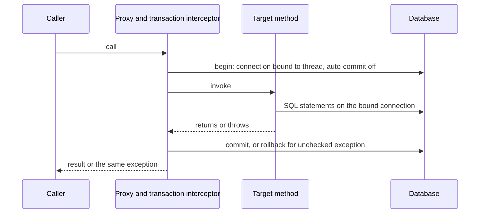
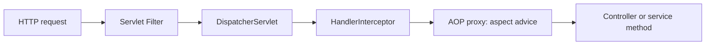

# Spring interview essentials: web, data and transactions

> **Before this lesson:** you have completed the web, data, transaction, testing and production modules, and read [Spring interview essentials: the container](#/lesson/spring/spring-interview-core), which explains the answer structure used here: definition, mechanism, example, trade-off.

## In plain words

A doctor's skill shows less in reciting textbook chapters than in diagnosis: a patient describes a symptom and the doctor reasons backwards to the cause. Experienced interviewers ask the same way. Not "define a transaction", but "we saved an order, an exception was thrown, and the stock was still reduced. Why?"

The second half of a Spring interview is full of such symptoms, because the web and data layers are where the framework's invisible machinery (proxies, the persistence context, the filter chain) produces visible surprises. This lesson gives worked answers to the questions that come up most, grouped by area, with emphasis on the reasoning from symptom to mechanism. Three ideas explain most of them: *the call went through a proxy or it did not*; *the persistence context was open or it was not*; *the request was stopped before or after it reached the controller*.

As before: say each answer aloud in your own words, then check it against the linked lesson.

## Part 1: transactions

### 1. How does @Transactional work?

**Answer.** `@Transactional` is implemented with Spring AOP. At start-up the bean is wrapped in a proxy. When a caller invokes the method through the proxy, a transaction interceptor asks the transaction manager to begin: it obtains a connection from the `DataSource`, switches auto-commit off and binds the connection to the current thread. Then the real method runs, and every repository call on that thread uses the bound connection. When the method returns normally the interceptor commits; when a `RuntimeException` or `Error` leaves the method it rolls back; then the connection is released and the exception continues to the caller.



### 2. When does @Transactional silently not work?

This is the most valuable transaction question to prepare. Give the list, grouped by cause.

| Cause | What happens | Fix |
|---|---|---|
| **Self-invocation**: a method of the same class calls it via `this` | the proxy is bypassed; no transaction starts | move the method to another bean, annotate the entry method, or use `TransactionTemplate` |
| **Checked exception** with default settings | the transaction **commits** | `rollbackFor = Exception.class`, or throw unchecked exceptions |
| **Exception caught and swallowed** inside the method | the proxy sees a normal return and commits | rethrow, or `setRollbackOnly()` |
| **`private`, `final` or `static` method** | cannot be intercepted | make it a non-final, proxyable method |
| **Object created with `new`** | not a bean, no proxy | let Spring create it |
| **Work on another thread** (`@Async`, manual threads, parallel streams) | transactions are thread-bound; the other thread has none | keep transactional work on one thread, or start a transaction there |
| **Called from `@PostConstruct` on the same bean** | the proxy is not in place yet | trigger after start-up, e.g. on `ApplicationReadyEvent` |
| **Wrong transaction manager or non-transactional storage** | nothing to roll back | check the configured manager and the database engine |

The simulation shows the first three causes side by side with the working case.

```python-run
class Database:
    def __init__(self): self.committed, self.pending, self.active = [], [], False
    def write(self, row): (self.pending if self.active else self.committed).append(row)

class Checked(Exception): pass
class Unchecked(Exception): pass

def through_proxy(db, method):
    """What the transactional proxy does around a call that arrives from outside."""
    db.active, db.pending = True, []
    try:
        method()
    except Unchecked:
        db.pending = []                                  # rollback
        raise
    finally:
        db.committed += db.pending                       # commit whatever is still pending
        db.active = False

def place_order(db, failure=None, swallow=False):
    db.write("stock reduced")
    try:
        if failure:
            raise failure
        db.write("order saved")
    except Exception:
        if not swallow:
            raise

def scenario(title, runner):
    db = Database()
    try:
        runner(db)
    except Exception:
        pass
    verdict = "OK" if db.committed in ([], ["stock reduced", "order saved"]) else "INCONSISTENT"
    print(f"{title:55} committed={db.committed}  {verdict}")

scenario("through proxy, unchecked exception", lambda db: through_proxy(db, lambda: place_order(db, Unchecked())))
scenario("through proxy, checked exception (default rules)", lambda db: through_proxy(db, lambda: place_order(db, Checked())))
scenario("through proxy, exception swallowed inside", lambda db: through_proxy(db, lambda: place_order(db, Unchecked(), swallow=True)))
scenario("self-invocation: proxy bypassed", lambda db: place_order(db, Unchecked()))
scenario("through proxy, success", lambda db: through_proxy(db, lambda: place_order(db)))
```

Three of the five lines end in `INCONSISTENT`: stock reduced and no order. None of the three produces any warning in a real application. Being able to list them from memory is a strong signal in an interview.

### 3. Propagation and isolation in two minutes

**Propagation** says how a transactional method relates to an existing transaction. `REQUIRED` (default) joins or creates. `REQUIRES_NEW` suspends the caller's transaction and runs in an independent one on a second connection, typical for audit records that must survive a rollback. `NESTED` uses a savepoint. `MANDATORY` and `NEVER` assert that a transaction does or does not exist; `SUPPORTS` and `NOT_SUPPORTED` join or suspend without requiring one.

The follow-up that separates candidates: *"A `REQUIRED` method calls another `REQUIRED` method, which throws; the outer method catches the exception. What happens?"* The inner proxy has already marked the shared transaction rollback-only. The outer method returns normally, the commit attempt fails, everything is rolled back and the caller receives `UnexpectedRollbackException`.

**Isolation** says what concurrent transactions see of each other. `READ_COMMITTED` prevents dirty reads; `REPEATABLE_READ` also prevents non-repeatable reads; `SERIALIZABLE` also prevents phantoms. Spring defaults to the database's default. For lost updates, mention the practical tools: an atomic `UPDATE … SET x = x - ?`, optimistic locking with `@Version`, or pessimistic locking with `SELECT … FOR UPDATE`.

Lessons: [@Transactional, rollback rules and the self-invocation pitfall](#/lesson/spring/spring-transactional), [Propagation and isolation](#/lesson/spring/spring-propagation-isolation).

### 4. Where do you put @Transactional, and what is readOnly for?

On service methods, because a use case is the unit that must succeed or fail together. Not on controllers (the transaction would span response rendering) and not only on repositories (each statement would be its own transaction). `readOnly = true` is a hint that lets the driver and the database optimise and, with JPA, lets Hibernate skip dirty checking; it does not enforce anything by itself. Keep transactions short: no remote HTTP calls inside, because the connection is held throughout and a rollback cannot undo the remote effect.

## Part 2: JPA and data access

### 5. What is the N+1 problem?

**Answer.** Loading N parent entities with one query and then triggering one additional query per parent when a lazily loaded association is accessed: N+1 round trips where one or two would do. It appears as slow list pages that get slower as data grows. I detect it by logging SQL or by counting statements in a test. I fix it per use case: `JOIN FETCH` in JPQL or `@EntityGraph` to load the association in the same query; batch fetching (`@BatchSize` or `hibernate.default_batch_fetch_size`) to load many collections per query; or a DTO projection that selects exactly the needed columns and avoids entities.

**Follow-up:** "Why not make the association `EAGER`?" Because for a list query Hibernate then issues the extra selects immediately for every row, on every use of the entity, including where the data is not needed. The N+1 is still there and can no longer be avoided.

**Follow-up:** "`JOIN FETCH` with pagination?" Fetching a collection with a join and paging at once makes Hibernate load everything and page in memory, with a warning. Page the parent ids first and fetch children for those ids, or rely on batch fetching.

### 6. LazyInitializationException

**Symptom:** "The endpoint fails with `LazyInitializationException: could not initialize proxy - no Session`."

**Answer.** A lazy association was accessed after the persistence context was closed, typically when a controller or the JSON serialiser touches `order.getCustomer()` after the service's transaction has ended. Fix it by loading what the response needs inside the transaction, with a fetch join or entity graph, and returning a DTO. Do not fix it by switching to `EAGER` or by leaning on `open-in-view`, which keeps the persistence context, and possibly a connection, open for the entire request and hides N+1 queries in the view layer.

### 7. Why did my entity get updated without calling save()?

Inside a transaction, loaded entities are *managed*. At flush time Hibernate compares each with the snapshot taken when it was loaded and writes the differences: dirty checking. Modifying a managed entity is therefore enough to produce an `UPDATE`. Outside a transaction, or on a detached entity, nothing is tracked.

### 8. Quick data questions

| Question | Answer |
|---|---|
| `JdbcTemplate` versus JPA? | `JdbcTemplate`: you write SQL and mapping, full control, no hidden behaviour. JPA: entities, dirty checking, lazy loading, less code for CRUD, more to understand. Many systems use both. |
| How does Spring Data create repositories? | It generates a proxy per repository interface, backed by a store-specific implementation; query methods are derived from method names or taken from `@Query`, validated at start-up. |
| `CrudRepository` versus `JpaRepository`? | `JpaRepository` adds list return types, paging and sorting, and JPA-specific methods such as `flush` and batch deletes. |
| What is a connection pool and why HikariCP? | A set of reusable open connections; opening one per request is too slow. HikariCP is Boot's default: small and fast. |
| "Connection is not available, request timed out"? | Pool exhaustion: slow queries, long transactions (often with remote calls inside), a leak, or too many concurrent requests for the pool size. Investigate before enlarging the pool. |
| How do you prevent SQL injection? | Bind values through placeholders; never concatenate input into SQL. Derived queries and JPQL parameters do this for you. |
| Optimistic versus pessimistic locking? | Optimistic: version column, detect conflicts at update, retry. Pessimistic: lock rows when reading, others wait. |

Lessons: [JPA basics: entity mapping, relationships and the N+1 problem](#/lesson/spring/spring-jpa-mapping), [Spring Data repositories: derived queries and @Query](#/lesson/spring/spring-data-repositories), [Configuring the DataSource and connection pools](#/lesson/spring/spring-datasource-pools).

## Part 3: the web layer

### 9. The request flow

**Answer.** The servlet container receives the HTTP request and passes it through the servlet **filters**, including Spring Security's chain, to the `DispatcherServlet`. The dispatcher asks the `HandlerMapping` which controller method matches the HTTP method and path; `HandlerInterceptor`s run their `preHandle`; a `HandlerAdapter` resolves the method's arguments (path variables, parameters, the request body via message converters, validation) and invokes the method. The return value is either a view name, resolved by a `ViewResolver` and rendered by a template engine, or, with `@RestController`, an object written to the response body by an `HttpMessageConverter` such as Jackson. Exceptions are routed to `@ExceptionHandler` methods. The response then travels back out through the interceptors and filters.

Status codes worth mentioning: 404 when no mapping matches, 405 when the path matches but not the method, 400 for binding or validation failures, 415 for an unsupported request body type, 406 when the `Accept` header cannot be satisfied.

### 10. Filter, interceptor or aspect?

A classic comparison question. All three wrap behaviour around your code, at different layers.



| | Servlet `Filter` | `HandlerInterceptor` | Aspect (Spring AOP) |
|---|---|---|---|
| Belongs to | the servlet container | Spring MVC | Spring core |
| Runs | before the `DispatcherServlet`, for every request including static files | around handler methods, after the handler is chosen | around methods of any Spring bean |
| Sees | raw request and response | request, response and the chosen handler; the model after execution | method, arguments, return value, exception |
| Knows about HTTP | yes | yes | no |
| Can stop processing | yes, by not calling `chain.doFilter` | yes, `preHandle` returns `false` | yes, around advice does not call `proceed()` |
| Typical use | security, CORS, compression, request logging, tracing ids | authentication checks tied to handlers, locale, timing of handlers | transactions, caching, retries, auditing, method security |
| Exceptions reach `@ExceptionHandler` | no | yes | yes, if thrown through a controller call |

**How to choose:** if the concern is about the HTTP request as such and must apply before Spring MVC, use a filter. If it needs to know which controller method will handle the request, use an interceptor. If it is about a business operation regardless of how it was invoked (HTTP, message listener, scheduled job), use an aspect.

```python-run
def build_pipeline(log):
    def controller(request):
        log.append("        controller method runs")
        if request.get("fail"):
            raise ValueError("business error")
        return "200 OK"

    def aspect(next_step):                       # knows the method, not HTTP
        def advice(request):
            log.append("      aspect: before method")
            try:
                return next_step(request)
            finally:
                log.append("      aspect: after method")
        return advice

    def interceptor(next_step):                  # knows the chosen handler
        def handle(request):
            log.append("    interceptor.preHandle (handler = BookController.list)")
            if request.get("blocked_by_interceptor"):
                return "403 from interceptor"
            result = next_step(request)
            log.append("    interceptor.postHandle")
            return result
        return handle

    def dispatcher(next_step):                   # where @ExceptionHandler lives
        def dispatch(request):
            try:
                return next_step(request)
            except ValueError as error:
                log.append(f"  @ExceptionHandler handles: {error}")
                return "422 from advice"
        return dispatch

    def filter_(next_step):                      # sees every request first
        def do_filter(request):
            log.append("filter: before chain.doFilter")
            if not request.get("token"):
                return "401 from filter"
            result = next_step(request)
            log.append("filter: after chain.doFilter")
            return result
        return do_filter

    return filter_(dispatcher(interceptor(aspect(controller))))

for title, request in [("normal request", {"token": "t"}),
                       ("no token", {}),
                       ("controller throws", {"token": "t", "fail": True})]:
    log = []
    result = build_pipeline(log)(request)
    print(f"{title} -> {result}")
    print("   " + "\n   ".join(log))
```

In the "no token" run only the filter appears: the request never reaches Spring MVC, which is how Spring Security answers 401 without your controller or exception handler being involved. In the failing run the aspect's "after" still executes, the interceptor's `postHandle` is skipped, and the exception handler produces the response.

### 11. Web questions, short form

| Question | Answer |
|---|---|
| `@Controller` versus `@RestController`? | `@RestController` adds `@ResponseBody`: return values are written to the body by message converters. A `@Controller` method's `String` is a view name. |
| `@RequestParam` versus `@PathVariable`? | Query/form parameter (optional filters) versus URL path segment (identifies the resource). Both are type-converted; failures give 400. |
| `@RequestBody` versus `@ModelAttribute`? | Body deserialised by a message converter (JSON) versus binding of form fields and query parameters to an object's properties. |
| How do you handle errors globally? | `@RestControllerAdvice` with `@ExceptionHandler` methods; the closest exception type wins; return `ProblemDetail` (RFC 9457). |
| How do you validate input? | Constraint annotations on the DTO plus `@Valid` on the parameter; failure raises `MethodArgumentNotValidException` → 400. |
| PUT versus POST versus PATCH? | POST creates or triggers (not idempotent); PUT replaces at a known URI (idempotent); PATCH changes part of a resource. |
| 401 versus 403? | Not authenticated versus authenticated without permission. |
| Is a controller thread-safe? | It is a singleton shared by all request threads, so it must hold no per-request state. |
| Session versus token authentication? | Server-side state identified by a cookie versus a signed, self-contained token sent on each request; tokens scale statelessly but are hard to revoke. |
| How does a resource server validate a JWT? | Verify the signature with the issuer's public keys, then `exp`, `iss`, `aud`; map scopes to authorities. |
| `RestTemplate`, `RestClient` or `WebClient`? | `RestClient` for new blocking code; `RestTemplate` is in maintenance; `WebClient` for reactive or streaming use. Always with timeouts. |

Lessons: [Spring MVC: the request flow through DispatcherServlet](#/lesson/spring/spring-mvc-request-flow), [Request bodies, validation and error handling with @RestControllerAdvice](#/lesson/spring/spring-rest-errors-validation), [Spring Security basics and JWT resource servers](#/lesson/spring/spring-security-jwt).

## Part 4: testing and production

| Question | Answer |
|---|---|
| Unit versus integration test? | One class with mocks, no Spring, milliseconds; versus real components together with a Spring context. Many of the first, enough of the second. |
| `@SpringBootTest` versus `@WebMvcTest` versus `@DataJpaTest`? | Full context; web slice with `MockMvc` (services must be mocked with `@MockitoBean`); persistence slice, transactional with rollback and an embedded database by default. |
| `@Mock` versus `@MockitoBean`? | Plain Mockito mock outside any context versus a mock registered in the Spring test context, replacing the real bean. |
| Why can a test suite get slow? | Many distinct context configurations defeat the context cache; each different set of mocked beans starts a new context. |
| Where does configuration come from, and which wins? | Packaged files < profile files < external files < environment variables < system properties < command-line arguments. |
| `@Value` versus `@ConfigurationProperties`? | Single values versus typed, validated groups. |
| What are profiles? | Named sets of properties and beans activated per environment with `spring.profiles.active`. |
| What does Actuator provide? | Health, metrics, info, loggers and other management endpoints; expose selectively and secure them. |
| Liveness versus readiness? | Restart me versus do not send traffic now; external dependencies belong only in readiness. |
| What are virtual threads? | JVM-scheduled lightweight threads that make blocking I/O cheap; enabled with `spring.threads.virtual.enabled=true` on Java 21+; no help for CPU-bound work. |

Lessons: [Integration tests with @SpringBootTest and test slices](#/lesson/spring/spring-integration-tests), [Configuration properties, profiles and logging](#/lesson/spring/spring-config-profiles-logging), [Actuator, Docker images and virtual threads](#/lesson/spring/spring-actuator-docker-vthreads).

## Part 5: scenario questions

Scenario questions test diagnosis. Answer in the order: restate the symptom, name the likely mechanisms, say how you would confirm, then fix.

### "An endpoint is slow and gets slower as data grows."

Likely the N+1 pattern or a missing index. Confirm by enabling SQL logging and counting statements for one request; look at the slowest statement's execution plan. Fix with a fetch join, entity graph, batch fetching or a projection, add pagination, and add the index if a filter column lacks one.

### "After a failed payment the order row still exists."

The transaction did not roll back, or there never was one. Check: is the method called through the proxy or self-invoked? Is the exception checked? Is it caught inside the method? Is the payment call on another thread? Confirm by logging transaction boundaries (`org.springframework.transaction.interceptor=TRACE`) and by a test that forces the failure and asserts that no row exists.

### "Under load the service returns 500s with 'Connection is not available'."

Pool exhaustion. Check Hikari's active and pending metrics, slow-query logs and transaction lengths. A frequent cause is a transactional method that makes a remote HTTP call while holding its connection; another is `open-in-view`. Move the remote call out of the transaction, add timeouts, enable leak detection, and only then consider the pool size against the database's connection limit.

### "The application starts locally and fails in production with NoSuchBeanDefinitionException."

A bean exists only under some condition: a profile (`@Profile("dev")`), a conditional property, or a class present on one classpath only. Compare active profiles and properties between the environments, and read the conditions report.

### "Our @Cacheable / @Async / @PreAuthorize annotation is ignored."

Same family as the transaction case: the feature is applied by a proxy. Look for self-invocation, a private or final method, an object created with `new`, or a missing enabling annotation (`@EnableCaching`, `@EnableAsync`, `@EnableMethodSecurity`).

> [!INTERVIEW]
> For any "why does X not work" question about an annotation-driven feature, start from the sentence: "This feature is applied by a proxy, so the first thing I check is whether the call goes through the proxy." It is the correct opening for transactions, caching, async execution, retries and method security alike.

> [!TIP]
> Keep one small real story per topic: an N+1 you found with SQL logging, a transaction that committed on a checked exception, a pool that ran dry. A concrete story of thirty seconds does more than a perfect definition, because it shows you have operated what you describe.

> [!WARNING]
> Do not bluff on security or data-integrity questions. Saying "I would disable CSRF" or "I would switch to EAGER" without the conditions marks a candidate as someone who makes problems disappear instead of solving them. State when a measure is appropriate and what it costs.

## Pitfalls

- **Saying "@Transactional rolls back on exceptions".** Only on unchecked ones by default, and only if the exception reaches the proxy.
- **Recommending `EAGER` or `open-in-view` as fixes.** They hide the problem.
- **Mixing up filter and interceptor.** Filters are servlet-level and run before Spring MVC; interceptors know the handler.
- **Confusing 401 with 403, 404 with 405, 406 with 415.**
- **Treating the pool size as the cure for pool exhaustion.**
- **Forgetting the persistence context** when explaining lazy loading and dirty checking.
- **Describing tests only by annotation names.** Say what each kind of test can and cannot detect.
- **Answering scenarios with a single guess.** List two or three candidate causes and how you would tell them apart.

## Cheat sheet

| Symptom | First suspects |
|---|---|
| Partial data after a failure | self-invocation; checked exception; swallowed exception; another thread |
| `UnexpectedRollbackException` | inner `REQUIRED` method failed and the outer caught the exception |
| `LazyInitializationException` | lazy association accessed outside the transaction |
| Hundreds of similar selects | N+1: add a fetch join, entity graph, batching or projection |
| Unexpected `UPDATE` statements | dirty checking on managed entities |
| `Connection is not available` | long transactions, remote calls in transactions, slow SQL, leaks |
| 401 without reaching the controller | Spring Security filter chain |
| 404 / 405 / 400 / 415 / 406 | no mapping / wrong method / binding or validation / request type / response type |
| Annotation "does nothing" | proxy bypassed, non-bean, private or final method, missing `@Enable…` |
| Bean missing in one environment | profile or conditional configuration |

## Summary

- `@Transactional` is a proxy that begins, commits and rolls back around a method. It fails silently on self-invocation, checked exceptions, swallowed exceptions, non-proxyable methods and other threads.
- With JPA, most surprises come from the persistence context: N+1 queries, `LazyInitializationException`, and updates without `save`.
- A request passes filters, the `DispatcherServlet`, interceptors and proxies before reaching your method; knowing which layer acts where explains status codes and tells you where to put a cross-cutting concern.
- Choose filter for HTTP-level concerns, interceptor for handler-aware concerns, aspect for method-level concerns.
- In scenario questions, reason from symptom to mechanism, name several candidate causes, and say how you would confirm before fixing.

## Glossary

- **Dirty checking**: automatic detection and persistence of changes to managed entities.
- **Filter**: a servlet-level component that processes requests and responses around the rest of the chain.
- **`HandlerInterceptor`**: a Spring MVC hook around handler execution.
- **Managed entity**: an entity tracked by the current persistence context.
- **Open Session in View**: keeping the persistence context open for the whole web request.
- **Pool exhaustion**: all pooled connections being in use.
- **Rollback-only**: a mark that forces a transaction to roll back at completion.
- **Scenario question**: an interview question describing a symptom to be diagnosed.
- **`UnexpectedRollbackException`**: thrown when a commit is attempted on a transaction marked rollback-only.

```quiz
[
  {"q": "A @Transactional method throws a checked exception with default settings. What does Spring do?",
   "options": ["Rolls back", "Commits", "Retries", "Ignores the method"],
   "answer": 1,
   "explain": "Default rollback rules cover only RuntimeException and Error. Checked exceptions lead to a commit unless rollbackFor says otherwise."},
  {"q": "Which situation does NOT cause @Transactional to be silently ineffective?",
   "options": ["The method is called via this from another method of the same class", "The method is private", "The method is public and called from a controller through an injected bean", "The exception is caught and swallowed inside the method"],
   "answer": 2,
   "explain": "A public method invoked through the injected proxy is the normal, working case."},
  {"q": "An outer REQUIRED method calls an inner REQUIRED method on another bean; the inner throws a RuntimeException that the outer catches. What happens when the outer returns?",
   "options": ["Everything commits", "Only the inner work is rolled back", "The transaction is rolled back and UnexpectedRollbackException is thrown", "A new transaction is started"],
   "answer": 2,
   "explain": "The inner proxy marked the shared transaction rollback-only; the commit attempt therefore fails."},
  {"q": "What is the recommended response to an N+1 problem on a list endpoint?",
   "options": ["Set the association to EAGER", "Enable open-in-view", "Use a fetch join, entity graph, batch fetching or a DTO projection for that query", "Increase the connection pool size"],
   "answer": 2,
   "explain": "These reduce the number of queries for the use case. EAGER keeps the extra selects and makes them unavoidable."},
  {"q": "A cross-cutting concern must run for every HTTP request before Spring MVC is involved, including requests for static files. Which mechanism fits?",
   "options": ["An aspect", "A HandlerInterceptor", "A servlet Filter", "A @ControllerAdvice"],
   "answer": 2,
   "explain": "Filters sit in front of the DispatcherServlet. Interceptors run only around handlers; aspects know nothing about HTTP."},
  {"q": "In the pipeline simulation, why does the request without a token never reach the exception handler?",
   "options": ["The handler is disabled", "The filter answers 401 before the dispatcher is called", "Interceptors swallow it", "Aspects block it"],
   "answer": 1,
   "explain": "The filter returns without calling the rest of the chain, exactly as Spring Security does for unauthenticated requests."},
  {"q": "A service logs 'Connection is not available, request timed out' under load. What is a likely root cause?",
   "options": ["Too few CPU cores", "Connections held too long, for example a transactional method making a slow remote call", "JSON serialisation errors", "A missing @Service annotation"],
   "answer": 1,
   "explain": "Pool exhaustion comes from connections not being returned quickly: long transactions, slow queries or leaks."},
  {"q": "A method annotated @Cacheable is called from another method of the same class and the cache is never used. Why?",
   "options": ["Caching requires prototype scope", "The call is a self-invocation and bypasses the caching proxy", "@Cacheable only works on controllers", "The cache is full"],
   "answer": 1,
   "explain": "Caching, like transactions, is applied by a proxy that only sees calls arriving from outside the object."}
]
```

> **Source:** Spilcă, *Spring Start Here*, ch. 7–15 (review); interview framing is this track's own. Documentation: https://docs.spring.io/spring-framework/reference/data-access/transaction/declarative.html and https://docs.spring.io/spring-framework/reference/web/webmvc/mvc-servlet.html
