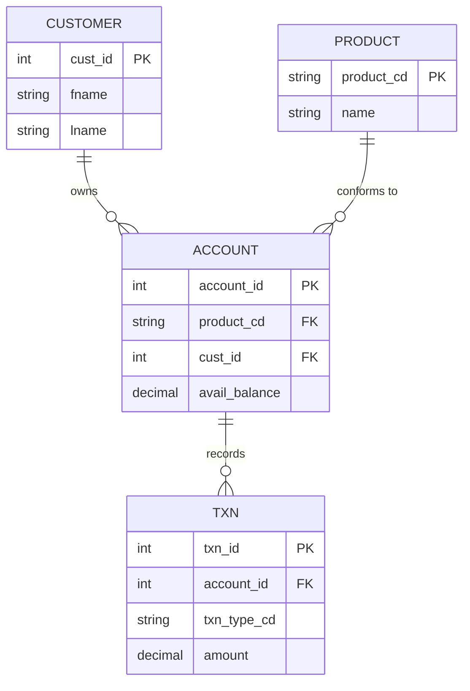
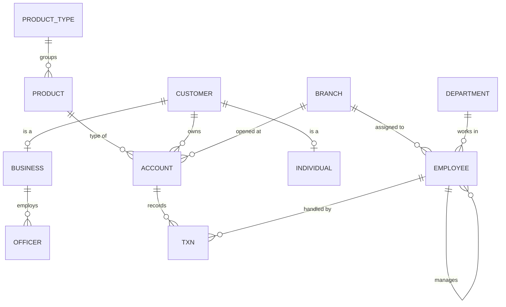
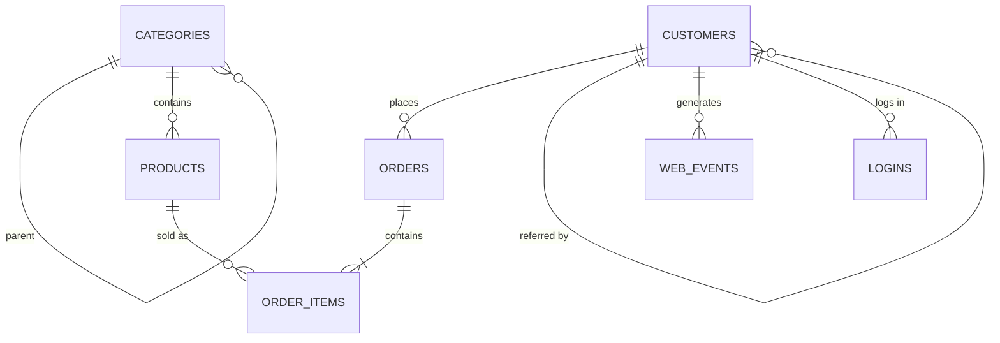
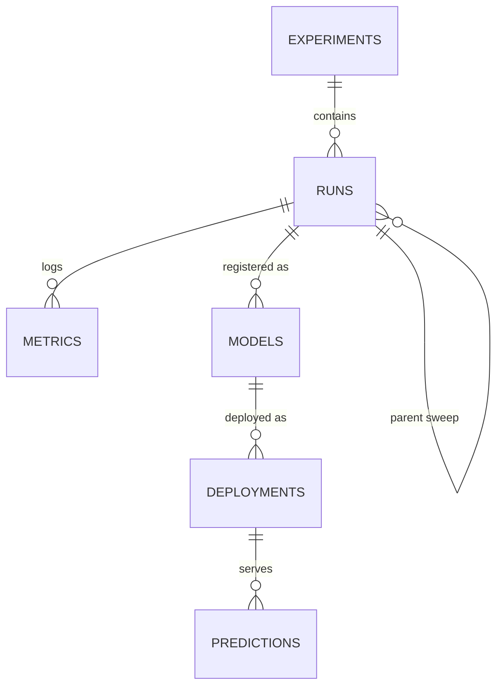

# Databases and the relational model

Before writing a single query it helps to know *why* relational databases look the way they do. Almost every design rule you will meet later in this track — primary keys, foreign keys, joins, normalization — is a direct consequence of one idea published in 1970. This lesson tells that story, defines the vocabulary you will use for the rest of the course, and introduces the three practice databases that every runnable example in this guide uses.

## What is a database?

A database is simply a collection of related information. A paper telephone directory is a database: names, addresses and numbers for everyone in a region. It is also a good example of what goes wrong with *manual* data storage:

- **Finding things is slow.** You can only search efficiently by the one order the book was printed in (last name, first name). Looking up *who lives at 12 Elm St.* means reading every page.
- **It goes stale immediately.** The day it is printed, people start moving and changing numbers, and the book cannot change.
- **It holds one view of the data.** Anyone wanting a different ordering needs a different book.

A *database system* is software that stores data electronically and fixes these problems: it can index data in many ways, answer questions in milliseconds, and always show the current state of the data to everyone who uses it.

Early computer database systems stored data on magnetic tape, and operators physically mounted tapes when a program asked for records. Modern systems keep terabytes on fast disks and SSDs and cache the hot part in memory, but the *logical* question has stayed the same: how should data be organised so that programs (and people) can find, combine and change it reliably?

## Before relational: hierarchies and networks

The first generation of database systems answered that question with **pointers**.

In a **hierarchical** database, data is arranged as trees. A bank might store one tree per customer: the customer at the root, their accounts as children, and each account's transactions as grandchildren. To find a transaction you locate the right customer tree and walk down. Every node has exactly one parent — a *single-parent hierarchy*. That works beautifully for questions that follow the tree ("show George's transactions") and badly for questions that cut across it ("show all money-market accounts").

A **network** database relaxes the one-parent rule. Records are linked by explicit sets of links, so an account record can be reached both from its customer and from its product. That makes cross-cutting questions possible, but the program still has to *navigate*: find the customer, follow the link to the list of accounts, walk the chain until the money-market account appears, follow its link to transactions.

Both models are still alive — mainframes still run them, and the hierarchical idea reappears in XML, JSON documents and directory services — but they share one weakness: **the access path is baked into the data**. If a question was not anticipated when the pointers were laid down, answering it means writing new navigation code.

## Codd's idea: data as tables

In 1970 Edgar F. Codd, a researcher at IBM, published *A Relational Model of Data for Large Shared Data Banks*. His proposal: represent all data as **sets of tables** (he called them *relations*) and link tables not with pointers but with **values**.

In a relational bank, the customer table has a `cust_id` column. The account table also has a `cust_id` column whose value says which customer owns the account. There is no pointer; the relationship is the *matching value*. To find a customer's accounts you ask for "accounts whose `cust_id` equals 1", and the database works out how.



This has two huge consequences.

1. **Questions are separated from storage.** Because relationships are just values, *any* question that can be phrased in terms of matching values can be answered without new navigation code. The database's query optimizer decides how to get the data.
2. **The rules for good design become precise.** Since the only links are values, you can reason mathematically about which data should be stored where, so that each fact lives in exactly one place.

### Keys

Every table needs a way to identify each row uniquely. That column (or set of columns) is the **primary key**. In the customer table it is `cust_id`: no two customers ever share one, and once assigned it never changes.

You *could* use first name + last name as the key — a key made of several columns is a **compound key** — but two customers can share a name, and people change their names. A key that comes from real-world data (a name, an email, a tax ID) is a **natural key**. A meaningless number invented by the system (`cust_id = 17`) is a **surrogate key**. The debate between them is long-running; the practical rule is that a primary key must be unique, must never be NULL, and should never need to change, and surrogate keys satisfy that trivially.

A column in one table that holds the primary-key value of a row in another table is a **foreign key**. `account.cust_id` is a foreign key to `customer.cust_id`; `account.product_cd` is a foreign key to `product.product_cd`. Foreign keys are the "redundant data" of the relational model — the one kind of duplication that is not only allowed but required.

### What redundancy is *not* allowed

It is fine for `account` to store the owner's `cust_id`. It is **not** fine for `account` to also store the owner's first and last name. If the customer changes her name, you would have to find and update every copy; miss one and the database contradicts itself. Names belong in exactly one place — the customer table — and everything else refers to them by key.

Likewise, one column should hold one piece of information. An `address` column containing "12 Elm St., Woburn, MA 01801" mixes four facts and makes "all customers in Woburn" a string-parsing exercise. Refining a design so that each independent fact lives in one place is called **normalization**; the last module of this track covers it formally (1NF, 2NF, 3NF, BCNF).

> [!TIP]
> When you are unsure where a column belongs, ask: *"If this value changes, how many rows must I update?"* The right answer is one.

## Vocabulary

| Term | Meaning |
|---|---|
| **Entity** | Something the users care about: a customer, an account, a model run. |
| **Table** (relation) | A set of rows describing one kind of entity. Stored permanently or produced temporarily. |
| **Row** (record, tuple) | One instance of the entity: one customer. |
| **Column** (attribute, field) | One property of the entity: a customer's city. |
| **Result set** | A temporary table produced by a query. |
| **Primary key** | Column(s) uniquely identifying each row. |
| **Foreign key** | Column(s) whose values identify a row in another table. |
| **Schema** | The set of table definitions, constraints and relationships. |

Note the word *set*. A relational table has **no inherent row order**: if you want rows in a particular order you must ask for it with `ORDER BY`. Many beginner bugs come from assuming that rows come back in insertion order. They often do in small SQLite databases — and then stop doing so the day an index or a parallel plan is added.

## Try it: your first look at real tables

Every grey box with a **Run** button in this guide executes real SQL in your browser against an in-memory SQLite database. Edit freely; the dataset is reloaded each time, so you cannot break anything.

Here is the bank's `customer` table. Notice the `cust_type_cd` column: `I` for individuals, `B` for businesses.

```sql-run dataset=bank
SELECT cust_id, fed_id, cust_type_cd, city, state
FROM customer
LIMIT 10;
```

And here are the accounts of customer 1, found *by value* — no pointers involved:

```sql-run dataset=bank
SELECT account_id, product_cd, open_date, status, avail_balance
FROM account
WHERE cust_id = 1;
```

To show the product's full name we combine two tables on the matching `product_cd` value — a **join**, the operation that replaces pointer-chasing:

```sql-run dataset=bank
SELECT a.account_id, p.name AS product, a.avail_balance
FROM account a
JOIN product p ON p.product_cd = a.product_cd
WHERE a.cust_id = 1;
```

You will study joins properly in a later module; for now just notice that the query says *what* to fetch, not *how* to walk to it.

## The three practice databases

This track uses three seeded databases. Get to know them now; every lesson and problem refers to them.

### `bank` — the book's community bank

Modelled on the example schema used throughout Alan Beaulieu's *Learning SQL*: four branches in Massachusetts and New Hampshire, 22 employees with a management hierarchy, 40 customers (30 individuals, 10 businesses), 84 accounts and about 480 transactions from 2024.



> [!NOTE]
> In the book the transaction table is called `transaction`. `TRANSACTION` is a keyword in SQL (you will write `BEGIN TRANSACTION` in the transactions module), so here the table is called `txn`. Quoting would also work (`"transaction"` in standard SQL, `` `transaction` `` in MySQL), but avoiding reserved words is the better habit.

### `shop` — a small online store

Customers in seven countries, a category tree (*Electronics > Computers > Laptops*), 40 products, about 250 orders with 460 line items during 2024, a clickstream table (`web_events`), daily `logins`, and a deliberately messy `customer_imports` table for cleanup exercises.



### `mlops` — an ML platform's metadata store

What an experiment tracker and model registry (in the style of MLflow) keep in their backing database: experiments, training runs with hyper-parameters, metrics in *long* format (one row per run × metric × step), registered model versions, deployments to staging/production/shadow, and online predictions with ground-truth labels that arrive late (some are still NULL).



Peek at it:

```sql-run dataset=mlops
SELECT run_id, run_name, model_type, learning_rate, status
FROM runs
WHERE experiment_id = 5;
```

## Why relational still wins (and when it doesn't)

Fifty years later the relational model still runs most of the world's transactional systems — banks, shops, airlines — and, through SQL, most analytics too. Its strengths are exactly Codd's: data independence, a mathematically grounded design discipline, and a declarative query language that lets optimizers improve without your code changing.

Other models have niches: document stores for nested, schema-flexible data; key-value stores for extreme throughput on simple lookups; graph databases for deep relationship traversal; columnar warehouses for scanning billions of rows. Notice, though, that most of them have since added SQL or SQL-like query languages — a sign of how much value the declarative approach carries.

## Pitfalls to avoid from day one

- **Assuming row order.** Without ORDER BY, order is undefined.
- **Storing several facts in one column** (full address, comma-separated tag lists). You will fight it in every query.
- **Copying descriptive data into related tables.** Store the key; join for the description.
- **Using changeable values as primary keys** (emails, names). Use a surrogate key and put a UNIQUE constraint on the natural one.

## Summary

- A database is a collection of related data; a database system stores, indexes and serves it.
- Hierarchical and network systems linked records with pointers, so every new question needed new navigation code.
- Codd's relational model (1970) stores data as tables linked by **matching values**: primary keys identify rows, foreign keys refer to them.
- Each fact should live in exactly one place; foreign keys are the only sanctioned duplication.
- Tables are sets — unordered — and queries describe *what* you want, not how to fetch it.
- This track's datasets: `bank` (from the book), `shop` (e-commerce) and `mlops` (experiment tracking and serving).

```quiz
[
  {"q": "What links rows in different tables in the relational model?", "options": ["Physical pointers between records", "Matching values in key columns", "The order rows were inserted", "A shared index file"], "answer": 1, "explain": "Codd's key move was to replace pointers with values: a foreign key holds the primary-key value of the related row."},
  {"q": "Why is cust_id a better primary key for customer than (fname, lname)?", "options": ["It is shorter", "Names may repeat and may change; a surrogate never needs to", "Text columns cannot be keys", "SQL requires integer keys"], "answer": 1, "explain": "A primary key must be unique and stable. Two people can share a name and people change names."},
  {"q": "Which piece of 'redundant' data is proper to store in the account table?", "options": ["The owner's last name", "The owner's cust_id", "The owner's city", "The product's full name"], "answer": 1, "explain": "Only foreign keys are duplicated; descriptive attributes live in their own table and are joined in."},
  {"q": "What does a query return if it has no ORDER BY?", "options": ["Rows in insertion order, guaranteed", "Rows sorted by primary key, guaranteed", "Rows in an unspecified order", "An error"], "answer": 2, "explain": "Tables are sets. Any order you see without ORDER BY is an implementation accident."},
  {"q": "A primary key made of two or more columns is called a...", "options": ["Surrogate key", "Foreign key", "Compound key", "Candidate index"], "answer": 2, "explain": "Compound (composite) keys combine columns, e.g. (customer_id, login_date) in shop.logins."},
  {"q": "Why is the book's 'transaction' table named 'txn' in this guide?", "options": ["SQLite limits table names to 3 letters", "TRANSACTION is an SQL keyword", "To save disk space", "It holds fewer columns"], "answer": 1, "explain": "Keywords as identifiers require quoting and invite bugs; renaming avoids the problem."}
]
```

> **Source:** Beaulieu, *Learning SQL*, ch. 1 "A Little Background" (introduction to databases, nonrelational systems, the relational model, terminology) and Appendix A (example database ER diagram).
