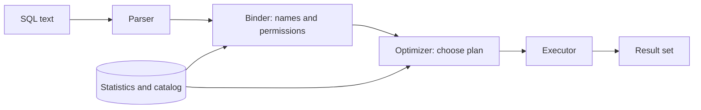

# What is SQL? Statement classes, dialects and how a query runs

SQL is the language every relational database speaks. It is more than fifty years old, it is on nearly every data-related job description, and it is unusual among programming languages: you describe the *result* you want and let the engine decide how to compute it. This lesson covers where SQL came from, the families of SQL statements, what "nonprocedural" really means, the major dialects (and how this guide handles them), and the mechanics of sending a query to a server.

## A short history

Along with the relational model, Codd proposed a query language called DSL/Alpha. An IBM team building a prototype simplified it into **SQUARE**, refined that into **SEQUEL**, and finally renamed it **SQL** (trademark issues ended "SEQUEL"). Pronounce it "S-Q-L" or "sequel"; both are common.

Oracle shipped the first commercial SQL database in 1979, IBM followed with DB2, and by the mid-1980s SQL had won. The American National Standards Institute published the first SQL standard in **1986**, followed by revisions that are still referred to by year:

| Standard | Notable additions |
|---|---|
| SQL-86 / SQL-89 | the core: SELECT, INSERT, UPDATE, DELETE, basic DDL |
| SQL-92 | explicit `JOIN ... ON` syntax, outer joins, CASE, CAST, `information_schema` |
| SQL:1999 | recursive queries (`WITH RECURSIVE`), triggers, booleans, ROLLUP |
| SQL:2003 | **window functions** (`OVER`), MERGE, sequences, XML |
| SQL:2006 / 2008 | more XML, `FETCH FIRST n ROWS`, TRUNCATE |
| SQL:2011 | temporal (system-versioned) tables |
| SQL:2016 / 2023 | JSON support, row pattern matching, property graph queries |

Two points matter for you. First, the features most valued in interviews today — joins, CASE, window functions, CTEs — are all *standard*, so what you learn here transfers. Second, no product implements the whole standard, and every product adds extensions. That is what "dialect" means.

> [!NOTE]
> The SQL name is sometimes expanded as "Structured Query Language", but the standard itself does not define it as an acronym.

## SQL is nonprocedural

In Python or Java you write *how*: loop over these rows, test this condition, append to that list. SQL is **declarative** (nonprocedural): you state *what* rows you want, and the database's **optimizer** chooses the access path — which index to use, in which order to join tables, whether to sort or hash.

```sql
SELECT i.fname, i.lname
FROM individual i
WHERE i.lname = 'Smith';
```

This says nothing about scanning, indexes or loops. If an index on `lname` exists the optimizer may use it; if the table grows tenfold it may switch strategy. Your query does not change. That separation is the practical payoff of Codd's model.

The flip side: SQL alone is not a complete application language. It has no user interface and (in its standard form) limited control flow, so it is usually embedded in a host language — Python's `sqlite3` or SQLAlchemy, Java's JDBC — or extended with procedural dialects such as Oracle's PL/SQL, SQL Server's Transact-SQL or PostgreSQL's PL/pgSQL. As a data engineer or ML engineer you will mostly write SQL strings from Python, from dbt models, or in a notebook.

## The statement classes

SQL statements fall into a few families. The book uses three; practitioners usually name four or five:

| Class | Purpose | Examples |
|---|---|---|
| **Schema statements** — DDL (data definition) | Define and change structures | `CREATE TABLE`, `ALTER TABLE`, `DROP`, `CREATE INDEX`, `CREATE VIEW` |
| **Data statements** — DML (data manipulation) | Read and change rows | `SELECT`, `INSERT`, `UPDATE`, `DELETE` |
| **Transaction statements** — TCL | Group changes atomically | `BEGIN`, `COMMIT`, `ROLLBACK`, `SAVEPOINT` |
| DCL (data control) | Permissions | `GRANT`, `REVOKE` |

Some texts put `SELECT` in its own class (DQL). Don't worry about the labels; worry about the idea that **schema statements create objects that are themselves stored in the database** — in a set of tables called the **data dictionary** or catalog. You can query the catalog with ordinary SQL, which is how tools draw ER diagrams. Try it:

```sql-run dataset=shop
SELECT type, name
FROM sqlite_master
WHERE type IN ('table', 'index')
ORDER BY type, name;
```

You will explore metadata properly in the *Views and metadata* module.

## The anatomy of a SQL statement

Statements are built from **clauses**, each starting with a keyword:

```sql
SELECT  c.first_name, c.last_name, COUNT(*) AS orders   -- what to return
FROM    customers c                                     -- where from
JOIN    orders o ON o.customer_id = c.customer_id       -- combined with
WHERE   o.status = 'delivered'                          -- which rows
GROUP BY c.customer_id, c.first_name, c.last_name       -- collapse into groups
HAVING  COUNT(*) >= 5                                   -- which groups
ORDER BY orders DESC;                                   -- in what order
```

Run it:

```sql-run dataset=shop
SELECT  c.first_name, c.last_name, COUNT(*) AS orders
FROM    customers c
JOIN    orders o ON o.customer_id = c.customer_id
WHERE   o.status = 'delivered'
GROUP BY c.customer_id, c.first_name, c.last_name
HAVING  COUNT(*) >= 5
ORDER BY orders DESC;
```

Lexical rules worth knowing now:

- **Keywords are case-insensitive.** `select`, `SELECT` and `SeLeCt` are the same. This guide upper-cases keywords for readability.
- **Statements end with `;`.** Many tools allow you to omit it for a single statement.
- **Comments:** `-- to end of line` and `/* block */`.
- **String literals use single quotes:** `'delivered'`. Embed a quote by doubling it: `'O''Brien'`.
- **Identifiers** (table and column names) can be quoted with double quotes in standard SQL (`"order"`), backticks in MySQL, square brackets in SQL Server. Quoting makes them case-sensitive and lets you use reserved words — avoid needing it.

> [!WARNING]
> In standard SQL, `"delivered"` (double quotes) is an *identifier*, not a string. SQLite, for compatibility, falls back to treating an unknown double-quoted identifier as a string, which hides typos: `WHERE status = "deliverd"` silently compares against a string. PostgreSQL would raise "column does not exist". Always use single quotes for strings.

## Dialects in this guide

The book teaches with **MySQL**. This guide runs everything in **SQLite** (compiled to WebAssembly as sql.js), because it runs entirely in your browser with no server. The judge also uses SQLite. Where dialects differ meaningfully, look for callouts like this:

> [!NOTE]
> **MySQL / PostgreSQL:** string concatenation is `CONCAT(a, b)` in MySQL (where `||` means logical OR by default) and `a || b` in PostgreSQL and SQLite.

What makes SQLite different from client-server databases?

- **It is a library, not a server.** The whole database is one file (or, here, memory). No users, no network, no `GRANT`.
- **Dynamic typing.** A column's declared type is an *affinity*, a preference, not a strict rule (next lesson). Version 3.37 added optional `STRICT` tables.
- **Limited ALTER TABLE**, no stored procedures, no `RIGHT/FULL JOIN` before version 3.39.
- **Rich standard SQL otherwise:** CTEs, recursive CTEs, window functions, UPSERT, partial and expression indexes, JSON functions.

Interview platforms use MySQL, PostgreSQL or SQL Server. The core you learn here — SELECT through window functions — is identical across them except for function names (dates especially), which the callouts cover.

## How a query actually runs

Whether you use the `mysql` command-line tool, a GUI, a Python driver or this web page, the life of a query is the same:

1. **Connect.** The client authenticates with the server and gets a session. (SQLite: open the file.)
2. **Parse.** The server checks syntax and produces a parse tree. Typos die here: `near "FORM": syntax error`.
3. **Bind / validate.** Names are resolved against the catalog: does table `customers` exist, is `email` a column, do you have permission?
4. **Optimize.** The optimizer enumerates candidate *execution plans* — access paths and join orders — estimates their cost from statistics, and picks the cheapest. You can see the chosen plan with `EXPLAIN` (MySQL, PostgreSQL) or `EXPLAIN QUERY PLAN` (SQLite).
5. **Execute.** The plan runs and produces a **result set** — a temporary table — streamed back to the client.



Peek at a plan now; the indexes module explains how to read it:

```sql-run dataset=bank
EXPLAIN QUERY PLAN
SELECT a.account_id, c.city
FROM account a JOIN customer c ON c.cust_id = a.cust_id
WHERE a.product_cd = 'CHK';
```

You will see something like `SCAN a` followed by `SEARCH c USING INTEGER PRIMARY KEY` — the engine scans accounts and looks up each customer by key. You wrote none of that.

## Result sets are tables too

A crucial property of SQL: **the output of a query is itself a table**. That means you can query a query:

```sql-run dataset=bank
SELECT product_cd, num_accounts
FROM (SELECT product_cd, COUNT(*) AS num_accounts
      FROM account
      GROUP BY product_cd) AS t
WHERE num_accounts > 5;
```

This closure property is what makes subqueries, views and CTEs possible, and it is why SQL composes so well. Keep it in mind; the subquery and CTE modules are built on it.

## A word on the SQL you will write in ML work

If you are heading for ML engineering or MLOps, you will meet SQL in feature pipelines (aggregating events into per-user features), in training-data extraction (point-in-time correct joins), in monitoring (prediction drift, label delay, latency percentiles), and in experiment trackers like MLflow whose backing store is a relational database. The `mlops` dataset mirrors that last case:

```sql-run dataset=mlops
SELECT e.name AS experiment, COUNT(*) AS runs,
       SUM(CASE WHEN r.status = 'FAILED' THEN 1 ELSE 0 END) AS failed
FROM experiments e
JOIN runs r ON r.experiment_id = e.experiment_id
GROUP BY e.name
ORDER BY runs DESC;
```

## Pitfalls

- **Double quotes for strings** — works in SQLite and MySQL (by default), fails or misbehaves elsewhere.
- **Relying on dialect-specific functions** without realising it (`DATE_FORMAT` is MySQL; `strftime` is SQLite; `to_char` is PostgreSQL/Oracle).
- **Thinking of SQL as a loop.** Think in sets: "the set of accounts whose balance exceeds X", not "for each account...".

## Worked example: one question, three dialects

To make "dialect" concrete, here is one business question — *how many orders were placed in each month of 2024, and what share were delivered?* — in the three dialects you are most likely to meet. Read them side by side and notice how little differs.

**SQLite** (runnable here):

```sql-run dataset=shop
SELECT strftime('%Y-%m', order_date) AS month,
       COUNT(*) AS orders,
       ROUND(100.0 * SUM(CASE WHEN status = 'delivered' THEN 1 ELSE 0 END) / COUNT(*), 1) AS delivered_pct
FROM orders
WHERE order_date >= '2024-01-01' AND order_date < '2025-01-01'
GROUP BY month
ORDER BY month;
```

**PostgreSQL:**

```sql
SELECT to_char(order_date, 'YYYY-MM') AS month,
       COUNT(*) AS orders,
       ROUND(100.0 * COUNT(*) FILTER (WHERE status = 'delivered') / COUNT(*), 1) AS delivered_pct
FROM orders
WHERE order_date >= DATE '2024-01-01' AND order_date < DATE '2025-01-01'
GROUP BY 1
ORDER BY 1;
```

**MySQL:**

```sql
SELECT DATE_FORMAT(order_date, '%Y-%m') AS month,
       COUNT(*) AS orders,
       ROUND(100.0 * SUM(status = 'delivered') / COUNT(*), 1) AS delivered_pct
FROM orders
WHERE order_date >= '2024-01-01' AND order_date < '2025-01-01'
GROUP BY month
ORDER BY month;
```

The clauses, the grouping logic, the filter and the arithmetic are identical. Only two things changed: the **date-formatting function** (`strftime` / `to_char` / `DATE_FORMAT`) and the idiom for a **conditional count** (`CASE`, `FILTER`, or a boolean summed as 0/1). That is typical. When you port a query, the checklist is short:

| Area | What to check |
|---|---|
| Date and time functions | formatting, truncation, intervals, "now" |
| String functions | concatenation (`\|\|` vs `CONCAT`), substring, position, regular expressions |
| Row limiting | `LIMIT`, `FETCH FIRST`, `TOP` |
| Booleans | real type (PostgreSQL) vs 0/1 integers (MySQL, SQLite) |
| Identifier quoting and case | `"x"`, `` `x` ``, `[x]`; case-folding rules |
| Integer division | `7 / 2` is 3 in SQLite, PostgreSQL, SQL Server; 3.5 in MySQL, Oracle |
| NULL ordering | first or last by default |
| Missing features | e.g. no `FULL JOIN` in MySQL, no `ROLLUP` in SQLite |

The portable core — the CASE version above — runs unchanged on all three, which is why this guide prefers standard constructs and flags the exceptions.

## How to practise in this guide

A few habits will make the rest of the track far more effective:

1. **Predict before you run.** Before pressing Run, guess how many rows will come back and roughly what they will contain. A wrong prediction is the fastest way to find a gap in your understanding.
2. **Change one thing.** Edit every example: remove a clause, flip a join, change a filter. See what breaks and read the error message — SQLite's messages (`no such column`, `near "FORM": syntax error`, `misuse of aggregate`) map directly onto the parse / bind stages described above.
3. **Explore the schema first.** `SELECT * FROM some_table LIMIT 5` and `SELECT COUNT(*) FROM some_table` on every table you are about to use. Knowing the grain of each table prevents most join mistakes.
4. **Solve problems without peeking,** then compare with the reference query and read the *pitfalls* note even when you got it right — several correct-looking alternatives are subtly wrong on edge cases.

```sql-run dataset=bank
-- A quick profile of a table you have never seen before
SELECT COUNT(*)                         AS row_count,
       COUNT(DISTINCT cust_id)          AS customers,
       COUNT(DISTINCT product_cd)       AS products,
       MIN(open_date)                   AS first_opened,
       MAX(open_date)                   AS last_opened,
       SUM(close_date IS NULL)          AS still_open
FROM account;
```

## Summary

- SQL descends from Codd's DSL/Alpha via IBM's SQUARE and SEQUEL; ANSI/ISO standards since 1986 keep adding features (window functions arrived in SQL:2003).
- It is **declarative**: you describe results, the optimizer chooses the plan.
- Statement classes: schema (DDL), data (DML incl. SELECT), transaction (TCL), and permissions (DCL).
- Schema objects are recorded in the queryable **data dictionary**.
- Every vendor speaks a dialect; this guide runs SQLite and flags MySQL/PostgreSQL differences.
- A query is parsed, bound, optimized and executed; its result is itself a table, which makes SQL composable.

```quiz
[
  {"q": "What does 'nonprocedural' mean for SQL?", "options": ["It has no functions", "You describe the desired result; the engine decides how to compute it", "It cannot be called from other languages", "Statements run in random order"], "answer": 1, "explain": "The optimizer chooses access paths and join orders; you specify the what, not the how."},
  {"q": "CREATE INDEX belongs to which statement class?", "options": ["Data (DML)", "Schema (DDL)", "Transaction (TCL)", "Control (DCL)"], "answer": 1, "explain": "It defines a database object, so it is a schema statement."},
  {"q": "Which SQL standard introduced window functions?", "options": ["SQL-86", "SQL-92", "SQL:2003", "SQL:2016"], "answer": 2, "explain": "OVER(...) analytic functions were standardised in SQL:2003."},
  {"q": "In standard SQL, what is \"status\" (in double quotes)?", "options": ["A string literal", "An identifier", "A comment", "A parameter"], "answer": 1, "explain": "Double quotes delimit identifiers; single quotes delimit strings."},
  {"q": "Which step decides whether to use an index?", "options": ["Parser", "Binder", "Optimizer", "Client driver"], "answer": 2, "explain": "The optimizer costs alternative plans using statistics and picks one."},
  {"q": "Why can you write SELECT ... FROM (SELECT ...) AS t?", "options": ["Because of a SQLite extension", "Because every query result is itself a table", "Because t is a stored view", "You cannot"], "answer": 1, "explain": "Closure: relational operations produce relations, so queries compose."}
]
```

> **Source:** Beaulieu, *Learning SQL*, ch. 1 ("What Is SQL?", "SQL Statement Classes", "SQL: A Nonprocedural Language", "SQL Examples") and ch. 3 "Query Mechanics".
