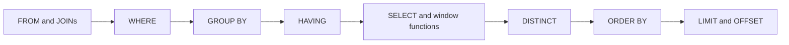

# ORDER BY, LIMIT and how clauses are evaluated

Results from a relational database come back in no particular order unless you ask for one. This lesson covers sorting with `ORDER BY` — ascending and descending, multiple keys, sorting by expressions, NULL placement — limiting results with `LIMIT`/`OFFSET` (and its many dialect spellings), a first look at `WHERE`, `GROUP BY` and `HAVING`, and the single most useful mental model for reading SQL: the **logical order of evaluation**.

## Why order is never guaranteed without ORDER BY

A table is a set. When the engine executes a query it reads rows in whatever order is cheapest — table order, index order, the order a hash join emits them, or interleaved from parallel workers. Today's order is an accident of today's plan.

```sql-run dataset=bank
SELECT account_id, cust_id, avail_balance FROM account LIMIT 6;
```

These happen to come out by `account_id` because SQLite scans the table in rowid order. Add an index or run on PostgreSQL with a parallel scan and the order can change. **If order matters, say ORDER BY.**

## Sorting

```sql-run dataset=bank
SELECT open_emp_id, product_cd, account_id
FROM account
ORDER BY open_emp_id;
```

Within one `open_emp_id` the product codes are in no particular order. Add a second key to sort ties:

```sql-run dataset=bank
SELECT open_emp_id, product_cd, account_id
FROM account
ORDER BY open_emp_id, product_cd;
```

Rows are sorted by the first key; only rows equal on the first key are ordered by the second, and so on.

### Ascending and descending

`ASC` (the default) sorts low to high; `DESC` reverses. Each key has its own direction:

```sql-run dataset=bank
SELECT account_id, product_cd, open_date, avail_balance
FROM account
ORDER BY product_cd ASC, avail_balance DESC;
```

Descending sorts are the backbone of "top N" questions: the five largest transactions, the newest ten orders, the best model run.

### Sorting via expressions

You can sort by something that is not a stored column — the book's example sorts customers by the last three digits of their federal ID:

```sql-run dataset=bank
SELECT cust_id, cust_type_cd, city, fed_id
FROM customer
ORDER BY substr(fed_id, -3);
```

Or put a business order on text values with CASE:

```sql-run dataset=shop
SELECT status, COUNT(*) AS orders
FROM orders
GROUP BY status
ORDER BY CASE status
           WHEN 'pending'   THEN 1
           WHEN 'shipped'   THEN 2
           WHEN 'delivered' THEN 3
           WHEN 'returned'  THEN 4
           ELSE 5
         END;
```

### Sorting by alias or by position

You may sort by a select-list alias, since ORDER BY is evaluated after SELECT:

```sql-run dataset=shop
SELECT name, price - cost AS margin
FROM products
ORDER BY margin DESC
LIMIT 5;
```

You can also sort by column *position* — `ORDER BY 2 DESC` means "the second column". The book mentions it, then advises restraint: if someone adds a column to the select list, positions shift and the sort silently changes. Handy at the interactive prompt; avoid it in saved code.

### Where do NULLs go?

NULL is not a value, so where should it sort? Engines disagree:

| Engine | ASC | DESC |
|---|---|---|
| SQLite, MySQL, SQL Server | NULLs **first** | NULLs last |
| PostgreSQL, Oracle | NULLs **last** | NULLs first |

The standard syntax `NULLS FIRST` / `NULLS LAST` makes it explicit and is supported by SQLite (3.30+), PostgreSQL and Oracle:

```sql-run dataset=mlops
SELECT run_id, status, ended_at
FROM runs
WHERE experiment_id = 3
ORDER BY ended_at DESC NULLS FIRST;
```

> [!NOTE]
> **MySQL** has no `NULLS FIRST/LAST`. Emulate it with an extra sort key: `ORDER BY ended_at IS NULL DESC, ended_at DESC` (the boolean `IS NULL` is 1 for NULL rows).

### Text sort order and collation

Text sorts according to the column's **collation**. SQLite's default `BINARY` collation compares bytes, so upper-case letters sort before lower-case (`'Z' < 'a'`). Use `ORDER BY name COLLATE NOCASE` for case-insensitive order. MySQL's default collations are already case-insensitive; PostgreSQL follows the database locale.

## Limiting rows

Real tables have millions of rows; you rarely want them all.

```sql-run dataset=bank
SELECT txn_id, txn_date, account_id, amount
FROM txn
ORDER BY amount DESC
LIMIT 5;
```

`LIMIT n OFFSET m` skips `m` rows first — the classic way to paginate:

```sql-run dataset=bank
SELECT txn_id, amount
FROM txn
ORDER BY amount DESC, txn_id
LIMIT 5 OFFSET 5;      -- page 2 of 5-row pages
```

> [!NOTE]
> **Same idea, different spellings.** SQLite, MySQL, PostgreSQL: `LIMIT n OFFSET m` (MySQL also `LIMIT m, n`). Standard SQL, PostgreSQL, Oracle 12c+, SQL Server 2012+: `OFFSET m ROWS FETCH FIRST n ROWS ONLY`. SQL Server: `SELECT TOP (n) ...`. Oracle legacy: `WHERE ROWNUM <= n`.

Two warnings:

1. **LIMIT without ORDER BY returns arbitrary rows.** "Give me any five" is fine for a peek, never for logic.
2. **Large OFFSETs are slow.** The engine must produce and discard `m` rows. For deep pagination use *keyset pagination*: remember the last key seen and ask `WHERE (amount, txn_id) < (:last_amount, :last_id) ORDER BY amount DESC, txn_id DESC LIMIT 5`.

Also note ties: if the 5th and 6th largest amounts were equal, `LIMIT 5` would pick one arbitrarily. Add a tie-breaker key (here `txn_id`) for deterministic output, or use `RANK()` (window functions module) if ties should all be included.

## A first look at WHERE, GROUP BY and HAVING

The remaining clauses each get a module, but here is how they fit:

- **WHERE** filters individual rows *before* grouping.
- **GROUP BY** collapses rows sharing values into one row per group.
- **HAVING** filters *groups*.

```sql-run dataset=bank
SELECT open_branch_id, COUNT(*) AS accounts, ROUND(SUM(avail_balance), 2) AS total
FROM account
WHERE status = 'ACTIVE'          -- row filter
GROUP BY open_branch_id          -- one row per branch
HAVING COUNT(*) >= 15            -- group filter
ORDER BY total DESC;
```

## The logical order of evaluation

SQL is written in the order SELECT – FROM – WHERE – GROUP BY – HAVING – ORDER BY, but it is *logically processed* in this order:



(The optimizer may physically execute things differently — pushing filters down, using an index to avoid sorting — but the *result* must be as if this order were followed.)

This order explains many errors and rules:

- **You cannot use a SELECT alias in WHERE** — the alias doesn't exist yet when WHERE runs. `SELECT price - cost AS margin FROM products WHERE margin > 50` fails in PostgreSQL and MySQL. (SQLite is lenient and allows it; don't rely on that.)
- **You can use a SELECT alias in ORDER BY** — ORDER BY runs after SELECT.
- **Aggregates can't appear in WHERE** — groups haven't been formed yet. That's what HAVING is for.
- **Window functions can't be filtered in WHERE** — they are computed in the SELECT step; filter them in an outer query.
- **LIMIT applies last**, after sorting, so `ORDER BY ... LIMIT 5` really gives the top five.

```sql-run dataset=shop
-- Works everywhere: repeat the expression, or wrap in a subquery
SELECT name, price - cost AS margin
FROM products
WHERE price - cost > 150
ORDER BY margin DESC;
```

> [!INTERVIEW]
> "In what order is a SQL query executed?" is a classic screening question. Answer with the logical order above, then add that the optimizer is free to reorder physical operations as long as the result is the same.

## Pitfalls

- Expecting a stable order without ORDER BY.
- `LIMIT` without ORDER BY in anything but exploration.
- Ignoring ties at the LIMIT boundary.
- Referring to SELECT aliases in WHERE (non-portable).
- Sorting by position in saved queries.
- Forgetting that NULL placement differs across engines.

## Summary

- `ORDER BY` sorts by one or more keys, each ASC or DESC; keys can be expressions, aliases or (sparingly) positions.
- NULL placement varies by engine; use `NULLS FIRST/LAST` where supported.
- `LIMIT/OFFSET` (or `FETCH FIRST`, `TOP`) restricts rows; always pair with ORDER BY and a tie-breaker; prefer keyset pagination for deep pages.
- Logical evaluation order: FROM → WHERE → GROUP BY → HAVING → SELECT → DISTINCT → ORDER BY → LIMIT.

```quiz
[
  {"q": "Which clause is logically evaluated first?", "options": ["SELECT", "WHERE", "FROM", "ORDER BY"], "answer": 2, "explain": "FROM (with joins) builds the working set; everything else operates on it."},
  {"q": "Why does WHERE margin > 50 fail in PostgreSQL when margin is a SELECT alias?", "options": ["Aliases must be quoted", "WHERE is evaluated before SELECT, so the alias doesn't exist yet", "margin is a reserved word", "Aliases only work with GROUP BY"], "answer": 1, "explain": "Logical order: WHERE precedes SELECT."},
  {"q": "In SQLite, where do NULLs appear in ORDER BY x ASC?", "options": ["First", "Last", "Randomly", "They are excluded"], "answer": 0, "explain": "SQLite and MySQL treat NULL as smallest; PostgreSQL puts them last for ASC."},
  {"q": "What is the risk of ORDER BY 2?", "options": ["It is not valid SQL", "Adding a column to the select list silently changes the sort", "It sorts descending", "It is slower"], "answer": 1, "explain": "Positional sorting is brittle; prefer names or aliases."},
  {"q": "Why can large OFFSET values be slow?", "options": ["OFFSET disables indexes", "The engine still has to produce and discard the skipped rows", "OFFSET forces DISTINCT", "They aren't"], "answer": 1, "explain": "Keyset pagination avoids scanning skipped rows."},
  {"q": "Which filters groups rather than rows?", "options": ["WHERE", "HAVING", "LIMIT", "ORDER BY"], "answer": 1, "explain": "HAVING runs after GROUP BY and may use aggregates."}
]
```

> **Source:** Beaulieu, *Learning SQL*, ch. 3 "Query Primer" (the where, group by/having and order by clauses; ascending vs descending; sorting via expressions and numeric placeholders).
