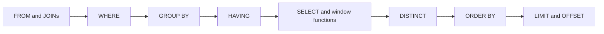

# ORDER BY, LIMIT and how clauses are evaluated

Results from a relational database come back in no particular order unless you ask for one. This lesson covers sorting with `ORDER BY` — ascending and descending, multiple keys, sorting by expressions, NULL placement — limiting results with `LIMIT`/`OFFSET` (and its many dialect spellings), a first look at `WHERE`, `GROUP BY` and `HAVING`, and the single most useful mental model for reading SQL: the **logical order of evaluation**.

## Before this lesson

You should be able to write a basic `SELECT ... FROM ...` query with chosen columns and aliases ([SELECT and FROM](#/lesson/sql/select-from)).

## In plain words

A database hands rows back in **no promised order**. If you want them sorted — newest first, largest first, alphabetical — you must say so with **`ORDER BY`**. And if you want only the first few, you say so with **`LIMIT`**. This lesson also explains the order in which a database works through the parts of a query, which is different from the order in which you type them and explains many puzzling error messages.

An everyday picture: a pile of exam papers handed in as students left the room. The pile has *an* order, but not a useful one. To find the top three you first sort the pile by mark, highest on top (`ORDER BY mark DESC`), and then take three from the top (`LIMIT 3`). Do it the other way round — take any three, then sort those — and you get the wrong students.

**Why it matters for a job.** "Top ten customers", "latest order", "five slowest requests" — a large share of everyday questions and interview exercises are a sort followed by a cut. The evaluation order covered at the end is one of the most common screening questions in SQL interviews.

### The smallest sorted query, line by line

```sql-run dataset=bank
SELECT name, city
FROM branch
ORDER BY city;
```

- The first two lines are the query you already know: two columns from the `branch` table.
- `ORDER BY city` — sort the result rows by the `city` column. Text is sorted alphabetically, numbers from small to large, dates from early to late. This "small to large" direction is called **ascending**.

Now one new idea: reverse the direction and keep only the first two rows.

```sql-run dataset=bank
SELECT name, city
FROM branch
ORDER BY city DESC
LIMIT 2;
```

- `DESC` (short for **descending**) reverses the sort: Z before A, large before small, late before early.
- `LIMIT 2` — after sorting, return only the first two rows.

Four branches exist; you see the two whose city names come last in the alphabet. The rest of the lesson builds on these two clauses: sorting by several columns, sorting by calculations, where empty values go, and how to page through long results.

## Why order is never guaranteed without ORDER BY

A table is a set. When the engine executes a query it reads rows in whatever order is cheapest — table order, index order, the order a hash join emits them, or interleaved from parallel workers. Today's order is an accident of today's plan.

```sql-run dataset=bank
SELECT account_id, cust_id, avail_balance FROM account LIMIT 6;
```

These happen to come out by `account_id` because SQLite scans the table in rowid order. Add an index or run on PostgreSQL with a parallel scan and the order can change. **If order matters, say ORDER BY.**

## Sorting

```sql-run dataset=bank
SELECT open_emp_id, product_cd, account_id
FROM account
ORDER BY open_emp_id;
```

Within one `open_emp_id` the product codes are in no particular order. Add a second key to sort ties:

```sql-run dataset=bank
SELECT open_emp_id, product_cd, account_id
FROM account
ORDER BY open_emp_id, product_cd;
```

Rows are sorted by the first key; only rows equal on the first key are ordered by the second, and so on.

### Ascending and descending

`ASC` (the default) sorts low to high; `DESC` reverses. Each key has its own direction:

```sql-run dataset=bank
SELECT account_id, product_cd, open_date, avail_balance
FROM account
ORDER BY product_cd ASC, avail_balance DESC;
```

Descending sorts are the backbone of "top N" questions: the five largest transactions, the newest ten orders, the best model run.

### Sorting via expressions

You can sort by something that is not a stored column — the book's example sorts customers by the last three digits of their federal ID:

```sql-run dataset=bank
SELECT cust_id, cust_type_cd, city, fed_id
FROM customer
ORDER BY substr(fed_id, -3);
```

Or put a business order on text values with CASE:

```sql-run dataset=shop
SELECT status, COUNT(*) AS orders
FROM orders
GROUP BY status
ORDER BY CASE status
           WHEN 'pending'   THEN 1
           WHEN 'shipped'   THEN 2
           WHEN 'delivered' THEN 3
           WHEN 'returned'  THEN 4
           ELSE 5
         END;
```

### Sorting by alias or by position

You may sort by a select-list alias, since ORDER BY is evaluated after SELECT:

```sql-run dataset=shop
SELECT name, price - cost AS margin
FROM products
ORDER BY margin DESC
LIMIT 5;
```

You can also sort by column *position* — `ORDER BY 2 DESC` means "the second column". The book mentions it, then advises restraint: if someone adds a column to the select list, positions shift and the sort silently changes. Handy at the interactive prompt; avoid it in saved code.

### Where do NULLs go?

NULL is not a value, so where should it sort? Engines disagree:

| Engine | ASC | DESC |
|---|---|---|
| SQLite, MySQL, SQL Server | NULLs **first** | NULLs last |
| PostgreSQL, Oracle | NULLs **last** | NULLs first |

The standard syntax `NULLS FIRST` / `NULLS LAST` makes it explicit and is supported by SQLite (3.30+), PostgreSQL and Oracle:

```sql-run dataset=mlops
SELECT run_id, status, ended_at
FROM runs
WHERE experiment_id = 3
ORDER BY ended_at DESC NULLS FIRST;
```

> [!NOTE]
> **MySQL** has no `NULLS FIRST/LAST`. Emulate it with an extra sort key: `ORDER BY ended_at IS NULL DESC, ended_at DESC` (the boolean `IS NULL` is 1 for NULL rows).

### Text sort order and collation

Text sorts according to the column's **collation**. SQLite's default `BINARY` collation compares bytes, so upper-case letters sort before lower-case (`'Z' < 'a'`). Use `ORDER BY name COLLATE NOCASE` for case-insensitive order. MySQL's default collations are already case-insensitive; PostgreSQL follows the database locale.

## Limiting rows

Real tables have millions of rows; you rarely want them all.

```sql-run dataset=bank
SELECT txn_id, txn_date, account_id, amount
FROM txn
ORDER BY amount DESC
LIMIT 5;
```

`LIMIT n OFFSET m` skips `m` rows first — the classic way to paginate:

```sql-run dataset=bank
SELECT txn_id, amount
FROM txn
ORDER BY amount DESC, txn_id
LIMIT 5 OFFSET 5;      -- page 2 of 5-row pages
```

> [!NOTE]
> **Same idea, different spellings.** SQLite, MySQL, PostgreSQL: `LIMIT n OFFSET m` (MySQL also `LIMIT m, n`). Standard SQL, PostgreSQL, Oracle 12c+, SQL Server 2012+: `OFFSET m ROWS FETCH FIRST n ROWS ONLY`. SQL Server: `SELECT TOP (n) ...`. Oracle legacy: `WHERE ROWNUM <= n`.

Two warnings:

1. **LIMIT without ORDER BY returns arbitrary rows.** "Give me any five" is fine for a peek, never for logic.
2. **Large OFFSETs are slow.** The engine must produce and discard `m` rows. For deep pagination use *keyset pagination*: remember the last key seen and ask `WHERE (amount, txn_id) < (:last_amount, :last_id) ORDER BY amount DESC, txn_id DESC LIMIT 5`.

Also note ties: if the 5th and 6th largest amounts were equal, `LIMIT 5` would pick one arbitrarily. Add a tie-breaker key (here `txn_id`) for deterministic output, or use `RANK()` (window functions module) if ties should all be included.

## A first look at WHERE, GROUP BY and HAVING

The remaining clauses each get a module, but here is how they fit:

- **WHERE** filters individual rows *before* grouping.
- **GROUP BY** collapses rows sharing values into one row per group.
- **HAVING** filters *groups*.

```sql-run dataset=bank
SELECT open_branch_id, COUNT(*) AS accounts, ROUND(SUM(avail_balance), 2) AS total
FROM account
WHERE status = 'ACTIVE'          -- row filter
GROUP BY open_branch_id          -- one row per branch
HAVING COUNT(*) >= 15            -- group filter
ORDER BY total DESC;
```

## The logical order of evaluation

SQL is written in the order SELECT – FROM – WHERE – GROUP BY – HAVING – ORDER BY, but it is *logically processed* in this order:



(The optimizer may physically execute things differently — pushing filters down, using an index to avoid sorting — but the *result* must be as if this order were followed.)

This order explains many errors and rules:

- **You cannot use a SELECT alias in WHERE** — the alias doesn't exist yet when WHERE runs. `SELECT price - cost AS margin FROM products WHERE margin > 50` fails in PostgreSQL and MySQL. (SQLite is lenient and allows it; don't rely on that.)
- **You can use a SELECT alias in ORDER BY** — ORDER BY runs after SELECT.
- **Aggregates can't appear in WHERE** — groups haven't been formed yet. That's what HAVING is for.
- **Window functions can't be filtered in WHERE** — they are computed in the SELECT step; filter them in an outer query.
- **LIMIT applies last**, after sorting, so `ORDER BY ... LIMIT 5` really gives the top five.

```sql-run dataset=shop
-- Works everywhere: repeat the expression, or wrap in a subquery
SELECT name, price - cost AS margin
FROM products
WHERE price - cost > 150
ORDER BY margin DESC;
```

> [!INTERVIEW]
> "In what order is a SQL query executed?" is a classic screening question. Answer with the logical order above, then add that the optimizer is free to reorder physical operations as long as the result is the same.

## Pitfalls

- Expecting a stable order without ORDER BY.
- `LIMIT` without ORDER BY in anything but exploration.
- Ignoring ties at the LIMIT boundary.
- Referring to SELECT aliases in WHERE (non-portable).
- Sorting by position in saved queries.
- Forgetting that NULL placement differs across engines.

## Worked example: ranking questions with ORDER BY and LIMIT

"Top N" and "bottom N" questions are the first place ORDER BY and LIMIT earn their keep, and they have more edge cases than they appear to. Take a concrete request: *the three highest-value transactions of March 2024, with the account's product.*

```sql-run dataset=bank
SELECT t.txn_id, t.txn_date, a.product_cd, t.txn_type_cd, t.amount
FROM txn t
JOIN account a ON a.account_id = t.account_id
WHERE t.txn_date >= '2024-03-01' AND t.txn_date < '2024-04-01'
ORDER BY t.amount DESC, t.txn_id
LIMIT 3;
```

Trace the logical order: FROM/JOIN builds transaction–account pairs; WHERE keeps March; SELECT computes the five columns; ORDER BY sorts by amount (largest first) and breaks ties by `txn_id`; LIMIT keeps three rows. Remove the WHERE clause and the same query answers the question for the whole year — the sort and limit always apply to whatever survived the earlier steps.

Now the variations interviewers ask for.

**The single largest value** can use an aggregate instead of a sort — but an aggregate cannot tell you *which row* it came from:

```sql-run dataset=bank
SELECT MAX(amount) AS largest FROM txn;
```

**The N-th row** uses OFFSET. The second-largest amount:

```sql-run dataset=bank
SELECT amount
FROM txn
ORDER BY amount DESC, txn_id
LIMIT 1 OFFSET 1;
```

**Top N of each group** cannot be done with LIMIT at all — LIMIT applies once, to the whole result. "The two largest transactions *per account*" needs a window function (`ROW_NUMBER() OVER (PARTITION BY account_id ORDER BY amount DESC)`), which the *Analytic functions* module covers. Recognising that boundary is itself a useful skill.

**Top N, presented in a different order.** Sort twice by wrapping the first query:

```sql-run dataset=shop
SELECT name, price
FROM (SELECT name, price FROM products ORDER BY price DESC LIMIT 5) AS top5
ORDER BY name;
```

The inner query picks the five most expensive products; the outer query presents them alphabetically.

## Sorting on several keys: a closer look

Multi-key sorts are read left to right, and each key can have its own direction. A common report layout — group rows visually by one column and rank within it:

```sql-run dataset=shop
SELECT country, city, COUNT(*) AS customers
FROM customers
WHERE city IS NOT NULL
GROUP BY country, city
ORDER BY country ASC, customers DESC, city ASC;
```

Countries appear alphabetically; inside each country the busiest city comes first; cities with equal counts are alphabetical. The third key exists purely to make the output **deterministic** — without it, tied cities could swap places between runs, and a test comparing outputs would fail intermittently.

> [!WARNING]
> Sorting is only as stable as its keys. If the ORDER BY columns do not uniquely determine the order, the database is free to return tied rows in any order — and with `LIMIT`, to return a *different set* of rows each time. Always end ORDER BY with a unique column when the exact rows matter.

### Sorting by something you do not display

ORDER BY may use columns and expressions that are not in the select list (as long as the query is not DISTINCT or grouped in a way that makes them undefined):

```sql-run dataset=bank
SELECT fname, lname, title
FROM employee
ORDER BY start_date
LIMIT 5;
```

The five longest-serving employees, with the hire date used for ordering but not shown. With `SELECT DISTINCT`, standard SQL requires the sort expressions to appear in the select list — otherwise "which of the merged rows' values should be used?" has no answer.

## Pagination done properly

Applications page through results constantly, so it is worth comparing the two approaches on the same data.

**Offset pagination** — simple, lets the user jump to page 37, but each page costs as much as reading all the previous ones, and rows shift between pages if data changes while the user is browsing:

```sql-run dataset=shop
SELECT order_id, order_date, status
FROM orders
ORDER BY order_date DESC, order_id DESC
LIMIT 5 OFFSET 10;
```

**Keyset (seek) pagination** — remember the sort key of the last row shown and ask for rows "after" it. Suppose the last row of the previous page was order 235 dated 2024-12-06:

```sql-run dataset=shop
SELECT order_id, order_date, status
FROM orders
WHERE (order_date, order_id) < ('2024-12-06', 235)
ORDER BY order_date DESC, order_id DESC
LIMIT 5;
```

The row-value comparison `(a, b) < (x, y)` means "a < x, or a = x and b < y" — exactly "comes after this row in a descending sort". With an index on `(order_date, order_id)` the database jumps straight to the right place, so page 10,000 is as fast as page 1. The trade-off: no jumping to an arbitrary page number. (Row-value comparisons work in SQLite, PostgreSQL and MySQL; on SQL Server expand them into the OR form.)

| | Offset | Keyset |
|---|---|---|
| Jump to page N | yes | no (next/previous only) |
| Cost of deep pages | grows with offset | constant |
| Stable under inserts | no — rows shift | yes |
| Needs | nothing | a unique, indexed sort key |

## The evaluation order, applied

The logical order is most useful as a debugging tool. Here are four error messages and the step that explains each.

| Query fragment | Error (PostgreSQL / MySQL) | Why |
|---|---|---|
| `SELECT price - cost AS margin … WHERE margin > 50` | column "margin" does not exist | WHERE runs before SELECT |
| `… WHERE COUNT(*) > 5` | aggregate functions are not allowed in WHERE | groups do not exist yet at WHERE |
| `SELECT country, city, COUNT(*) … GROUP BY country` | column "city" must appear in GROUP BY | after grouping, `city` has many values per group |
| `… WHERE ROW_NUMBER() OVER (…) = 1` | window functions are not allowed in WHERE | windows are computed in the SELECT step |

In each case the fix follows from the order: move the condition to the step where its inputs exist (HAVING for aggregates), or compute the value in an inner query and filter in an outer one.

```sql-run dataset=shop
SELECT name, margin
FROM (SELECT name, price - cost AS margin FROM products) AS m
WHERE margin > 150
ORDER BY margin DESC;
```

That inner-compute, outer-filter shape is portable to every engine and is the pattern you will reuse for window functions later.

## Summary

- `ORDER BY` sorts by one or more keys, each ASC or DESC; keys can be expressions, aliases or (sparingly) positions.
- NULL placement varies by engine; use `NULLS FIRST/LAST` where supported.
- `LIMIT/OFFSET` (or `FETCH FIRST`, `TOP`) restricts rows; always pair with ORDER BY and a tie-breaker; prefer keyset pagination for deep pages.
- Logical evaluation order: FROM → WHERE → GROUP BY → HAVING → SELECT → DISTINCT → ORDER BY → LIMIT.

## Glossary

| Term | Meaning in one sentence |
|---|---|
| **`ORDER BY`** | The clause that sorts the rows of a result. |
| **Ascending (`ASC`)** | Sorting from small to large, A to Z, early to late — the default. |
| **Descending (`DESC`)** | Sorting from large to small, Z to A, late to early. |
| **Sort key** | A column or calculation that rows are sorted by. |
| **Tie** | Two rows with equal values in the sort key. |
| **Tie-breaker** | An extra sort key added so that tied rows always come out in the same order. |
| **Deterministic** | Giving exactly the same result every time it is run. |
| **`LIMIT`** | The clause that keeps only the first *n* rows of the result. |
| **`OFFSET`** | The clause that skips a number of rows before starting to return them. |
| **Pagination** | Returning a long result one "page" of rows at a time. |
| **Keyset pagination** | Fetching the next page by asking for rows after the last one already seen, instead of skipping a count. |
| **Collation** | The rules for comparing and sorting text, including whether capital letters matter. |
| **`NULLS FIRST` / `NULLS LAST`** | Wording that says where empty values go in a sort. |
| **`WHERE`** | The clause that keeps only the rows meeting a condition. |
| **`GROUP BY`** | The clause that gathers rows with equal values into groups, one result row per group. |
| **`HAVING`** | The clause that keeps only the groups meeting a condition. |
| **Aggregate** | A calculation over many rows that produces one value, such as a count or a total. |
| **Logical order of evaluation** | The fixed sequence in which a query's clauses are applied: FROM, WHERE, GROUP BY, HAVING, SELECT, ORDER BY, LIMIT. |

```quiz
[
  {"q": "Which clause is logically evaluated first?", "options": ["SELECT", "WHERE", "FROM", "ORDER BY"], "answer": 2, "explain": "FROM (with joins) builds the working set; everything else operates on it."},
  {"q": "Why does WHERE margin > 50 fail in PostgreSQL when margin is a SELECT alias?", "options": ["Aliases must be quoted", "WHERE is evaluated before SELECT, so the alias doesn't exist yet", "margin is a reserved word", "Aliases only work with GROUP BY"], "answer": 1, "explain": "Logical order: WHERE precedes SELECT."},
  {"q": "In SQLite, where do NULLs appear in ORDER BY x ASC?", "options": ["First", "Last", "Randomly", "They are excluded"], "answer": 0, "explain": "SQLite and MySQL treat NULL as smallest; PostgreSQL puts them last for ASC."},
  {"q": "What is the risk of ORDER BY 2?", "options": ["It is not valid SQL", "Adding a column to the select list silently changes the sort", "It sorts descending", "It is slower"], "answer": 1, "explain": "Positional sorting is brittle; prefer names or aliases."},
  {"q": "Why can large OFFSET values be slow?", "options": ["OFFSET disables indexes", "The engine still has to produce and discard the skipped rows", "OFFSET forces DISTINCT", "They aren't"], "answer": 1, "explain": "Keyset pagination avoids scanning skipped rows."},
  {"q": "Which filters groups rather than rows?", "options": ["WHERE", "HAVING", "LIMIT", "ORDER BY"], "answer": 1, "explain": "HAVING runs after GROUP BY and may use aggregates."}
]
```

> **Source:** Beaulieu, *Learning SQL*, ch. 3 "Query Primer" (the where, group by/having and order by clauses; ascending vs descending; sorting via expressions and numeric placeholders).
