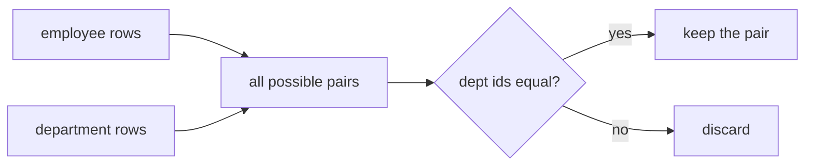

# Inner joins

> **Before this lesson:** you should be able to write a query with `SELECT`, `FROM` and `WHERE`, and give a table a short alias ([SELECT and FROM](#/lesson/sql/select-from), [Building conditions](#/lesson/sql/conditions)). You should also know what a primary key and a foreign key are ([Databases and the relational model](#/lesson/sql/relational-model)) and that a comparison with NULL is never true ([NULL: the four-letter word](#/lesson/sql/null-logic)). Every other term is explained when it first appears and collected in the glossary at the end.

## In plain words

A well-designed database does not keep everything in one giant table. It stores each kind of thing once, in its own table: employees in one, departments in another. An employee row does not contain the words "Loans department"; it contains a small number, `2`, that *points at* row 2 of the department table. That keeps the data tidy (rename the department once and every employee follows), but it means a single table rarely answers a real question on its own.

A **join** is the operation that puts the pieces back together. It takes rows from two tables and glues them side by side wherever a value in one matches a value in the other.

An everyday picture: a wedding guest list says "Priya, table 4" and a separate seating chart says "table 4, by the window". To tell Priya where to sit you run a finger down the guest list, read her table number, find the same number on the seating chart and read across. You have joined two lists on the table number. A database does exactly that, for every row at once.

The most common kind is the **inner join**, which keeps a guest only if their table number really exists on the chart. A guest with no table number, or with table 99 when there is no table 99, is left out of the answer.

**Why it matters for a job.** Almost every query written at work touches more than one table, so joins are the single most used skill after `SELECT ... WHERE`. In interviews, joins are where most wrong answers come from: rows that silently disappear, and rows that silently multiply. This lesson shows both effects on real data so you can predict them.

## Two tables that belong together

All queries on this page are live: press Run and the result appears underneath. Start by looking at the two tables separately. The first query asks for four columns of the bank's `employee` table and uses `LIMIT 5` to show only the first five rows.

```sql-run dataset=bank
SELECT emp_id, fname, lname, dept_id FROM employee LIMIT 5;
```

Each row is one employee. The last column, `dept_id`, is a number: 3 for Michael Smith, 1 for Susan Hawthorne, 2 for John Gooding. On its own that number tells a human nothing. Its meaning lives in the second table:

```sql-run dataset=bank
SELECT * FROM department;
```

Three rows: department 1 is Operations, 2 is Loans, 3 is Administration. So Susan Hawthorne (`dept_id` 1) works in Operations. You worked that out by reading a value in one table and finding the same value in the other, which is a join done by hand.

Two terms from earlier lessons describe this arrangement:

- `department.dept_id` is the **primary key** of `department`: the column whose value identifies exactly one row. No two departments share an id.
- `employee.dept_id` is a **foreign key**: a column whose values must be primary-key values of another table. It is the pointer from an employee to a department.

A join follows that pointer. Because the two tables have a column with the same name, the lesson writes `employee.dept_id` and `department.dept_id` (table name, a dot, column name) to say which one is meant. This is called **qualifying** a column.

## First attempt: naming two tables and nothing else

What happens if you put both tables in the `FROM` clause and do not say how they relate? Try it. The letters `e` and `d` are **aliases**, short nicknames for the tables, so that `e.fname` means "the `fname` column of `employee`".

```sql-run dataset=bank
SELECT e.fname, e.lname, d.name
FROM employee e JOIN department d;
```

The result has 66 rows, although the bank has only 22 employees. Read the first three: Michael Smith with Operations, Michael Smith with Loans, Michael Smith with Administration. The database paired **every** employee with **every** department: 22 × 3 = 66. Nothing told it which pairs make sense, so it produced all of them.

This all-pairs result is called the **Cartesian product** of the two tables (the name comes from mathematics), and a join that produces it is a **cross join**. It is almost never what you want. On small tables it gives nonsense; on large ones it is dangerous, because a million rows paired with a million rows is a million million rows. A later lesson, [Cross joins, natural joins and densifying data](#/lesson/sql/cross-natural), shows the few cases where an all-pairs result is useful.

> [!NOTE]
> SQLite (the database running in this page) and MySQL accept `JOIN` with no condition and quietly produce a cross join. PostgreSQL and the SQL standard reject it: they require a condition after `JOIN`, and make you write `CROSS JOIN` when you really want every pair. That strictness is a helpful safety net.

## The inner join: add a matching rule

To get the sensible pairs only, add a **join condition**: a test that says when a row from the left table and a row from the right table belong together. It goes after the keyword `ON`.

```sql-run dataset=bank
SELECT e.fname, e.lname, d.name AS department
FROM employee e
JOIN department d ON e.dept_id = d.dept_id;
```

Clause by clause:

- `FROM employee e` — start with the employee table, nicknamed `e`.
- `JOIN department d` — bring in the department table, nicknamed `d`.
- `ON e.dept_id = d.dept_id` — keep a pair of rows only when the employee's department number equals the department's own number.
- `SELECT e.fname, e.lname, d.name AS department` — from each surviving pair, show two columns that came from `employee` and one that came from `department`, renamed to `department` in the output.

Now there are 22 rows, one per employee, and each shows the right department: Michael Smith in Administration, Susan Hawthorne in Operations, John Gooding in Loans. Why exactly 22? Each employee has one `dept_id`, and that value matches exactly one department row, because `dept_id` is the primary key of `department`. One match per employee means one output row per employee.

A good way to picture it: imagine the 66-row all-pairs table from the previous section, and then cross out every row where the two department numbers differ. The 22 rows left over are the inner join. The database does not really build all 66 rows first (a later section shows what it does instead), but the *answer* is always the one this picture gives.



### What "inner" means: unmatched rows are left out

Suppose an employee had no department: the `dept_id` cell is NULL (empty). The condition `e.dept_id = d.dept_id` compares NULL with 1, with 2 and with 3; a comparison with NULL is never true, so no pair survives and that employee is **absent from the result**. The same happens to a department that has no employees: no pair contains it, so it never shows up.

That is the defining rule of an inner join: **a row appears only if it has a partner on the other side.** When you need to keep the partnerless rows too (for example, "list every customer, including those with no orders") you use an outer join, taught in [Outer joins](#/lesson/sql/outer-joins).

The bank data contains a real case. The `customer` table holds every customer; the `individual` table holds extra details (name, birth date) but only for customers who are people, not companies. The query below counts rows two ways. `COUNT(*)` is a function that returns the number of rows, and each count is wrapped in parentheses so that both numbers can sit in one result row.

```sql-run dataset=bank
SELECT (SELECT COUNT(*) FROM customer) AS all_customers,
       (SELECT COUNT(*) FROM customer c JOIN individual i ON i.cust_id = c.cust_id) AS joined_to_individual;
```

40 customers, but only 30 rows after the join. The other 10 are business customers. They have no row in `individual`, so the inner join left them out, without any warning. Whenever a joined result is smaller than you expected, this is the first thing to suspect.

### JOIN and INNER JOIN are the same thing

The full spelling is `INNER JOIN`. The word `INNER` is optional, and plain `JOIN` means exactly the same. Some teams write `INNER JOIN` everywhere to make the intent visible; most code uses the short form, and so does this guide.

### USING: a shortcut when the column names match

When the matching column has the same name in both tables, `USING (column)` can replace the `ON` condition:

```sql-run dataset=bank
SELECT e.fname, e.lname, d.name AS department
FROM employee e
JOIN department d USING (dept_id);
```

The same 22 rows come back. `USING (dept_id)` is short for `ON e.dept_id = d.dept_id`. It works only when the names are identical, and it hides which tables are being compared, so this guide mostly writes `ON` in full.

## Two ways to write a join: old and new

The `JOIN ... ON` form was added to the SQL standard in 1992 (the version known as **SQL-92**; you may also see it called ANSI join syntax, after the American standards body). Before that, people listed the tables with commas and put the matching rule in `WHERE`, next to the ordinary filters. You will meet this older style in existing code:

```sql-run dataset=bank
-- Older syntax: the join condition sits among the filters
SELECT e.fname, e.lname, d.name AS department
FROM employee e, department d
WHERE e.dept_id = d.dept_id
  AND e.title = 'Teller';
```

It returns the ten tellers with their department. Here is the same question in the newer form:

```sql-run dataset=bank
-- SQL-92 syntax: how the tables relate is stated next to the tables
SELECT e.fname, e.lname, d.name AS department
FROM employee e
JOIN department d ON e.dept_id = d.dept_id
WHERE e.title = 'Teller';
```

Identical rows. There are three reasons to prefer the newer form:

1. **Matching rules and filters are kept apart.** `ON` says how the tables connect; `WHERE` says which rows you want. A reader can see the shape of the query at a glance.
2. **A missing rule is hard to overlook.** Every `JOIN` is followed by its own `ON`. In the comma style, forgetting one line of `WHERE` does not cause an error: it silently produces the all-pairs Cartesian product.
3. **It works the same on every database.** The old ways of writing outer joins differed from vendor to vendor (`*=` on some systems, `(+)` on Oracle); the `JOIN` keywords are standard.

## Join conditions versus filter conditions

A **filter condition** is an ordinary test on a row, such as `cust_type_cd = 'B'` (business customers only). For an inner join the database treats a test the same whether you write it in `ON` or in `WHERE`. These two queries list the accounts of business customers and return the same 16 rows:

```sql-run dataset=bank
SELECT a.account_id, a.product_cd, c.fed_id
FROM account a
JOIN customer c ON a.cust_id = c.cust_id
WHERE c.cust_type_cd = 'B';
```

```sql-run dataset=bank
SELECT a.account_id, a.product_cd, c.fed_id
FROM account a
JOIN customer c ON a.cust_id = c.cust_id AND c.cust_type_cd = 'B';
```

Even so, keep to the convention: **how tables relate goes in `ON`; which rows you want goes in `WHERE`.** It reads better, and there is a practical reason too. With outer joins the placement *does* change the answer, so the habit you form now protects you later.

## How many rows will a join return?

Before running a join, predict how many rows it should produce. This one habit catches more join mistakes than any other. The answer depends on whether the matching column is unique on each side.

- **Many-to-one.** Many accounts point at one customer. Joining `account` to `customer` on the customer's primary key gives exactly one row per account (as long as every account has a customer). The row count stays the same as the "many" table.
- **One-to-many.** Seen from the other side, one customer has many accounts. The join still gives one row per account, so the customer's columns are **repeated** on each of that customer's rows.
- **Duplicates on both sides.** If the matching value is repeated in *both* tables, each row on the left pairs with several on the right and the result grows fast. This multiplication is called **fan-out**.

The shop dataset shows the effect. One order can contain several items, each stored as a row of `order_items`.

```sql-run dataset=shop
SELECT (SELECT COUNT(*) FROM orders)       AS orders,
       (SELECT COUNT(*) FROM order_items)  AS order_items,
       (SELECT COUNT(*) FROM orders o JOIN order_items oi ON oi.order_id = o.order_id) AS joined;
```

249 orders, 462 order items, and 462 joined rows. The join did not return one row per order; it returned one row per *item*, with the order's details copied onto each. The word for "what one row stands for" is the **grain** of a result. The grain here changed from "one order" to "one order item".

That matters as soon as you add things up. Each order has one `shipping_fee`. After the join, an order with three items carries its fee three times:

```sql-run dataset=shop
SELECT (SELECT ROUND(SUM(shipping_fee), 2) FROM orders) AS true_shipping,
       ROUND(SUM(o.shipping_fee), 2) AS inflated_shipping
FROM orders o JOIN order_items oi ON oi.order_id = o.order_id;
```

`SUM` adds up a column and `ROUND(..., 2)` rounds to two decimals. The true total is 1221.53; the total after the join is 2178.69, nearly double, and no error was raised. The second number is wrong because the fee of every multi-item order was counted once per item.

> [!WARNING]
> **Know the grain.** After every join, complete the sentence "each row of this result stands for one ___". Adding up a column from the "one" side after joining to the "many" side counts it several times.

## How the database carries out a join

You never tell the database *how* to match rows; you describe the result and it picks a method. Recognising the three standard methods helps when you later read a **query plan**, the database's description of the steps it will take.

| Method | Idea | Works well when |
|---|---|---|
| **Nested loop** | for each row of one table, look up its partners in the other, ideally through an index (a lookup structure, like the index of a book) | one side is small and the other can be looked up quickly |
| **Hash join** | build an in-memory lookup table from the smaller input, then check each row of the larger input against it | both inputs are large and the condition is an equality |
| **Merge join** | sort both inputs by the matching column and walk down them together | the inputs are already sorted |

SQLite uses nested loops only (it can build a temporary index when that helps). PostgreSQL and MySQL 8 choose among all three. In SQLite, putting `EXPLAIN QUERY PLAN` in front of a query shows the plan instead of the rows:

```sql-run dataset=bank
EXPLAIN QUERY PLAN
SELECT a.account_id, c.city
FROM account a
JOIN customer c ON c.cust_id = a.cust_id;
```

Read the `detail` column. `SCAN a` means "read every row of `account`". `SEARCH c USING INTEGER PRIMARY KEY` means "for each of those, jump straight to the one matching customer by its primary key". That is a nested loop with a fast lookup: 84 accounts, 84 quick lookups, never the 84 × 40 pairs of the mental picture.

## Does the order of the tables matter?

For inner joins, not to the result. Joining A to B to C gives the same rows whichever table you write first. SQL is a **declarative** language: you state what you want, and a component called the **optimizer** decides the cheapest order in which to read the tables, using statistics it keeps about their sizes. The order in your `FROM` clause is not an instruction. (Databases offer override switches for the rare cases where the optimizer chooses badly, such as `STRAIGHT_JOIN` in MySQL.)

## Worked example: a machine-learning question

The `mlops` dataset records machine-learning experiments. A *run* is one training attempt inside an experiment, and a *model* is a saved result of a run. The question: *which registered models are in the Production or Staging stage, what type of model is each, and which experiment did it come from?* The stage is in `models`, the model type in `runs`, and the experiment name in `experiments`, so the query hops twice. Each hop is the same idea you have already used: foreign key equals primary key.

```sql-run dataset=mlops
SELECT m.name || ':v' || m.version AS model,
       m.stage,
       r.model_type,
       e.name AS experiment
FROM models m
JOIN runs r        ON r.run_id = m.run_id
JOIN experiments e ON e.experiment_id = r.experiment_id
WHERE m.stage IN ('Production', 'Staging')
ORDER BY m.name, m.version;
```

`||` glues pieces of text together, so the first column reads like `churn-model:v9`. Seven rows come back. Each model row found its one run, and each run found its one experiment, so the row count is decided by the `WHERE` filter alone. The next lesson, [Three or more tables, self joins and non-equi joins](#/lesson/sql/multi-self-joins), studies longer chains like this.

## Worked example: building a join step by step

People who write SQL for a living rarely type a three-table query in one go. They grow it one table at a time and check the row count after each step. Follow the method on this question: *for each delivered order in December 2024, show the customer's name and country and how many items were ordered.*

**Step 1: start from the table whose grain matches the answer.** The answer has one row per order, so begin with `orders` and apply the filters.

```sql-run dataset=shop
SELECT COUNT(*) AS december_delivered_orders
FROM orders
WHERE status = 'delivered' AND order_date >= '2024-12-01' AND order_date < '2025-01-01';
```

Four orders. Remember that number: every later step must either keep it or change it for a reason you can state.

**Step 2: add a many-to-one join.** Each order belongs to exactly one customer, so the count must not move.

```sql-run dataset=shop
SELECT COUNT(*) AS rows_after_customer_join
FROM orders o
JOIN customers c ON c.customer_id = o.customer_id
WHERE o.status = 'delivered' AND o.order_date >= '2024-12-01' AND o.order_date < '2025-01-01';
```

Still four. Had the number dropped, some order would have a `customer_id` with no matching customer. Had it grown, `customer_id` would not be unique in `customers`.

**Step 3: add the one-to-many join, then fold the rows back.** Joining to `order_items` changes the grain to one row per item. To return to one row per order, the query uses `GROUP BY`, which collects rows that share the listed values into one group and lets `COUNT` and `SUM` work on each group. Grouping gets its own lesson, [Aggregate functions and GROUP BY](#/lesson/sql/group-by); here it is enough to see the shape.

```sql-run dataset=shop
SELECT o.order_id, o.order_date,
       c.first_name || ' ' || c.last_name AS customer, c.country,
       COUNT(*) AS lines, SUM(oi.quantity) AS items
FROM orders o
JOIN customers c    ON c.customer_id = o.customer_id
JOIN order_items oi ON oi.order_id = o.order_id
WHERE o.status = 'delivered' AND o.order_date >= '2024-12-01' AND o.order_date < '2025-01-01'
GROUP BY o.order_id, o.order_date, c.first_name, c.last_name, c.country
ORDER BY o.order_date, o.order_id;
```

Four rows again, one per order, each with the customer's name and the number of items. "Count, join, count again" is the most reliable defence against silent join mistakes, and saying it aloud in an interview shows the interviewer you know where joins go wrong.

## Diagnosing join problems

Three checks you will reuse for the rest of your career.

**Is the matching column really unique on the side I believe is "one"?** Group by the column and ask for values that occur more than once (`HAVING` filters groups; it is covered with grouping later).

```sql-run dataset=bank
SELECT product_cd, COUNT(*) AS n
FROM product
GROUP BY product_cd
HAVING COUNT(*) > 1;
```

An empty result is the good outcome here: no `product_cd` appears twice, so joining `account` to `product` cannot multiply rows. Run the same check on any column you are less sure of before joining on it.

**Which rows fail to find a partner?** This uses a `LEFT JOIN`, an outer join that keeps partnerless rows and fills the missing side with NULL. It is explained properly in a later lesson; the pattern is worth meeting now.

```sql-run dataset=bank
SELECT c.cust_id, c.cust_type_cd
FROM customer c
LEFT JOIN individual i ON i.cust_id = c.cust_id
WHERE i.cust_id IS NULL;
```

Ten rows, all of type `B`: the business customers that the inner join to `individual` left out earlier.

**How strongly does a join multiply rows?**

```sql-run dataset=bank
SELECT MIN(n) AS min_txns, ROUND(AVG(n), 1) AS avg_txns, MAX(n) AS max_txns
FROM (SELECT a.account_id, COUNT(t.txn_id) AS n
      FROM account a
      LEFT JOIN txn t ON t.account_id = a.account_id
      GROUP BY a.account_id);
```

An account has between 0 and 14 transactions, 5.8 on average. So any account-level number added up after a join to `txn` could be counted up to 14 times, and accounts with zero transactions would vanish from an inner join.

## Join syntax across databases

`JOIN ... ON` is written the same way everywhere. A few surrounding details differ.

| Topic | SQLite | MySQL | PostgreSQL |
|---|---|---|---|
| `JOIN` without `ON` | allowed (cross join) | allowed (cross join) | error |
| `USING (col)` | yes | yes | yes |
| Join methods | nested loop, with automatic indexes | nested loop, hash (8.0.18+) | nested loop, hash, merge |
| Forcing the table order | `CROSS JOIN` keeps the written order | `STRAIGHT_JOIN` | `join_collapse_limit` setting |

> [!INTERVIEW]
> A favourite warm-up: "Table A has 10 rows and table B has 20. How many rows can `A INNER JOIN B ON a.x = b.x` return?" Anywhere from **0** (no value of x appears in both) to **200** (every row holds the same x, so all pairs match). The answer depends entirely on how unique the matching column is, which is this whole lesson in one question.

## Pitfalls

- **A missing join condition** produces every pair of rows. In the comma style this is one forgotten line of `WHERE`.
- **Ambiguous column names.** Once a query has two tables, qualify every column (`e.dept_id`, not `dept_id`), or the database may not know which one you mean.
- **Rows that disappear.** An inner join leaves out rows without a partner: NULL foreign keys, or business customers with no `individual` row.
- **Double counting after fan-out.** Add things up at the right grain, or total the "many" table first and join afterwards.
- **Joining on a column that is not a key.** Duplicates on both sides multiply rows.

## Summary

- A join places rows from two tables side by side according to a matching rule, usually foreign key = primary key.
- With no rule you get the Cartesian product: every pair.
- An **inner join** keeps only pairs that satisfy the rule; rows with no partner are left out.
- Prefer `JOIN ... ON` to comma joins: relationships and filters are separated, a missing rule is hard to overlook, and the syntax is portable.
- Predict the row count and know the grain of the result before you add anything up.
- The written order of inner-joined tables does not change the result; the optimizer chooses the real order and method.

## Glossary

- **Join** — an operation that combines rows of two tables into wider rows.
- **Join condition** — the test, written after `ON`, that decides which pairs of rows belong together.
- **Inner join** — a join that keeps only rows with a partner on both sides.
- **Cartesian product / cross join** — every row of one table paired with every row of the other.
- **Primary key** — the column (or columns) whose value identifies exactly one row of a table.
- **Foreign key** — a column whose values refer to the primary key of another table.
- **Alias** — a short temporary name for a table or column inside one query.
- **Qualified column** — a column written with its table or alias in front, as in `e.dept_id`.
- **Filter condition** — a test in `WHERE` that picks rows, as opposed to connecting tables.
- **SQL-92 (ANSI) join syntax** — the standard `JOIN ... ON` way of writing joins.
- **Many-to-one / one-to-many** — a relationship in which several rows of one table point at a single row of another.
- **Fan-out** — the multiplication of rows when one row matches several rows on the other side.
- **Grain** — what a single row of a table or result stands for.
- **Query plan** — the database's step-by-step description of how it will run a query.
- **Optimizer** — the part of the database that chooses the plan.
- **Nested loop, hash join, merge join** — the three standard methods for carrying out a join.

```quiz
[
  {"q": "employee has 22 rows and department has 3. How many rows does FROM employee e JOIN department d (no ON) return in SQLite?", "options": ["22", "3", "25", "66"], "answer": 3, "explain": "With no join condition every employee is paired with every department: 22 x 3 = 66, the Cartesian product."},
  {"q": "What happens to an employee whose dept_id is NULL in an inner join to department?", "options": ["Appears with an empty department", "Is left out of the result", "Causes an error", "Matches every department"], "answer": 1, "explain": "NULL = anything is never true, so no pair qualifies and an inner join keeps only rows with a partner."},
  {"q": "Which is NOT an advantage of the JOIN ... ON syntax over comma joins?", "options": ["Join and filter conditions are separated", "It makes the database join tables in the written order", "It is portable across database products", "It is harder to forget a join condition"], "answer": 1, "explain": "The optimizer still chooses the join order; the syntax only describes the result."},
  {"q": "After joining orders to order_items, what does each row stand for?", "options": ["One order", "One customer", "One order item", "One product"], "answer": 2, "explain": "The grain becomes that of the 'many' side: one row per order item, with the order's columns repeated."},
  {"q": "Why is SUM(o.shipping_fee) wrong after joining orders to order_items?", "options": ["shipping_fee is NULL", "Each order's fee is repeated once per item", "SUM cannot be used with joins", "It is not wrong"], "answer": 1, "explain": "Fan-out copies the order's fee onto every item row, so multi-item orders are counted several times."},
  {"q": "JOIN written without any other keyword means...", "options": ["LEFT JOIN", "INNER JOIN", "CROSS JOIN", "NATURAL JOIN"], "answer": 1, "explain": "INNER is the default kind of join; the word is optional."},
  {"q": "customer has 40 rows; an inner join to individual on cust_id returns 30. What is the most likely reason?", "options": ["The join condition is wrong", "Ten customers have no matching row in individual", "COUNT(*) skips NULLs", "The database limits join results"], "answer": 1, "explain": "The ten business customers have no row in individual, and an inner join leaves out rows without a partner."}
]
```

> **Source:** Beaulieu, *Learning SQL*, ch. 5 "Querying Multiple Tables" (what a join is, the Cartesian product, inner joins, the ANSI join syntax, join conditions versus filter conditions), restated in original wording with this guide's own datasets.
