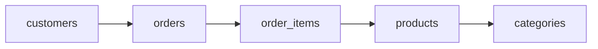

# Three or more tables, self joins and non-equi joins

> **Before this lesson:** you should be able to join two tables with `JOIN ... ON`, explain why an inner join leaves out rows without a partner, and say what the *grain* of a result is ([Inner joins](#/lesson/sql/inner-joins)). New terms are explained as they appear and listed in the glossary at the end.

## In plain words

The last lesson joined two tables. Real questions usually need more: "which customer bought which product in which category" already touches four or five. The good news is that there is no new mechanism to learn. A join of five tables is four two-table joins done one after another, each following one pointer from one table to the next.

An everyday picture: finding a friend's desk in a large office. The staff list gives you their team, the team list gives you the floor, the floor plan gives you the desk. Three lists, two hops, the same "read a value here, find it there" move each time.

This lesson also covers three variations that sound strange at first and turn out to be the same idea:

- **Joining to the result of another query** instead of to a stored table.
- **Joining a table to itself**, which is how you answer "who is each employee's manager?" when managers are employees too. It is like a family tree written as one list of people, where each person's row names their parent, who is another row in the same list.
- **Joining on something other than "equals"**, such as "this date falls inside that period".

**Why it matters for a job.** Multi-table joins are everyday work for anyone who touches a database. Self joins and range joins are favourite interview material ("employees who earn more than their manager", "which price was valid on that day") because they test whether you understand joins or only memorised one pattern.

## Joining three tables

Start with a question that needs three tables: *for each account owned by a business customer, which employee opened it?* The account is in `account`, the customer type in `customer`, and the employee's name in `employee`.

```sql-run dataset=bank
SELECT a.account_id, c.fed_id, e.fname, e.lname
FROM account a
JOIN customer c ON a.cust_id = c.cust_id
JOIN employee e ON a.open_emp_id = e.emp_id
WHERE c.cust_type_cd = 'B';
```

Read it one line at a time:

- `FROM account a` — begin with accounts.
- `JOIN customer c ON a.cust_id = c.cust_id` — attach to each account the customer who owns it.
- `JOIN employee e ON a.open_emp_id = e.emp_id` — then attach the employee whose id is stored in the account's `open_emp_id` column.
- `WHERE c.cust_type_cd = 'B'` — keep only rows whose customer is a business (`'B'`).

The result has 16 rows, one per business account: its id, the owner's tax id (`fed_id`) and the first and last name of the employee who opened it. The first two rows both name Frank Portman, who opened accounts 169 and 170.

A helpful picture is a snowball. `account` joined to `customer` makes a wider intermediate table; that table is then joined to `employee`, making it wider again. Each `ON` may mention any table that has already been named above it.

### Does the written order matter?

Put the tables in a different order and run it again:

```sql-run dataset=bank
SELECT a.account_id, c.fed_id, e.fname, e.lname
FROM employee e
JOIN account a  ON a.open_emp_id = e.emp_id
JOIN customer c ON a.cust_id = c.cust_id
WHERE c.cust_type_cd = 'B';
```

The same 16 rows. As the previous lesson said, the database's optimizer decides which table to read first (called the **driving table**) and in what order to visit the others. Your `FROM` clause describes the result; it is not a list of steps. The only rule for the written order is that an `ON` condition can mention only tables that already appeared.

### Walking a chain of foreign keys

Many questions are a walk along the pointers between tables. *Revenue from delivered orders, per customer country and product category* needs five tables in the shop dataset. Before writing anything, trace the path: a customer has orders, an order has items, an item names a product, a product belongs to a category.



One arrow, one `JOIN ... ON`:

```sql-run dataset=shop
SELECT c.country,
       cat.name AS category,
       ROUND(SUM(oi.quantity * oi.unit_price * (1 - oi.discount)), 2) AS revenue
FROM customers c
JOIN orders o       ON o.customer_id = c.customer_id
JOIN order_items oi ON oi.order_id = o.order_id
JOIN products p     ON p.product_id = oi.product_id
JOIN categories cat ON cat.category_id = p.category_id
WHERE o.status = 'delivered'
GROUP BY c.country, cat.name
ORDER BY revenue DESC
LIMIT 10;
```

The four joins produce one row per order item, carrying the customer's country and the category name. `GROUP BY c.country, cat.name` then collects those rows into one group per country and category, and `SUM(...)` adds up quantity × price (less any discount) inside each group. Grouping is taught in full in [Aggregate functions and GROUP BY](#/lesson/sql/group-by). The top row is laptops sold to customers in Germany.

Notice that five tables needed four `ON` conditions. In general *n* tables need at least *n − 1* conditions to be fully connected. Count them: a missing one gives the all-pairs Cartesian product.

## Joining to the result of a query

The thing after `JOIN` does not have to be a stored table. It can be a whole `SELECT` in parentheses, called a **subquery**. When a subquery is used in place of a table it is known as a **derived table**, and it must be given an alias so the rest of the query can refer to it.

Question: *which accounts were opened by long-serving tellers who work at the Woburn branch?*

```sql-run dataset=bank
SELECT a.account_id, a.cust_id, a.open_date, a.product_cd
FROM account a
JOIN (SELECT emp_id, assigned_branch_id
      FROM employee
      WHERE start_date < '2021-06-01'
        AND title IN ('Teller', 'Head Teller')) e
  ON a.open_emp_id = e.emp_id
JOIN (SELECT branch_id
      FROM branch
      WHERE name = 'Woburn Branch') b
  ON e.assigned_branch_id = b.branch_id;
```

Take it in pieces. The first parenthesised query, nicknamed `e`, is a small table of tellers who started before June 2021. The second, `b`, is a one-row table holding the Woburn branch. The outer query joins accounts to those two small tables and returns 25 accounts. There is no outer `WHERE`: all the filtering happened inside the derived tables.

Is this faster than writing three plain joins and one `WHERE`? Usually not; most optimizers turn both forms into the same plan. The benefit is to the reader. You build small pieces, check each one on its own (you can run a subquery by itself), and then connect them.

### The most important use: totals first, join second

The last lesson showed the fan-out problem: join `orders` to `order_items` and each order's `shipping_fee` is repeated on every item row. A derived table solves it. Add up the items **first**, so that the derived table has one row per order, and join afterwards. Totalling before joining is called **pre-aggregation**.

```sql-run dataset=shop
SELECT o.order_id, o.shipping_fee, t.items, t.subtotal,
       ROUND(t.subtotal + o.shipping_fee, 2) AS total
FROM orders o
JOIN (SELECT order_id,
             SUM(quantity) AS items,
             ROUND(SUM(quantity * unit_price * (1 - discount)), 2) AS subtotal
      FROM order_items
      GROUP BY order_id) t ON t.order_id = o.order_id
ORDER BY total DESC
LIMIT 8;
```

The derived table `t` holds one row per order with its item count and subtotal. Joining it to `orders` is one-to-one, so the shipping fee appears once and `total` is correct. The largest order is number 119: seven items, 9023.00 plus 4.99 shipping.

## Using the same table twice

Sometimes one table plays two parts in a question. An account was opened at a branch (`account.open_branch_id`). The employee who opened it is assigned to a branch too (`employee.assigned_branch_id`). To show both branch names, `branch` must be joined twice, and each copy needs its own alias:

```sql-run dataset=bank
SELECT a.account_id,
       e.emp_id,
       b_a.name AS open_branch,
       b_e.name AS emp_branch
FROM account a
JOIN branch b_a   ON a.open_branch_id = b_a.branch_id
JOIN employee e   ON a.open_emp_id = e.emp_id
JOIN branch b_e   ON e.assigned_branch_id = b_e.branch_id
WHERE a.product_cd = 'CHK'
LIMIT 10;
```

Treat `b_a` and `b_e` as two separate copies of the branch list: one is consulted for the account's branch, the other for the employee's. Without aliases the database could not tell which copy `branch.name` refers to and would report an error. Choose aliases that say the role (`b_a` for the account's branch, `b_e` for the employee's) instead of `b1` and `b2`.

## Self joins

A table can also be joined **to itself**. This comes up whenever a table has a **self-referencing foreign key**: a column that points at the primary key of the *same* table. In `employee`, the column `superior_emp_id` holds the `emp_id` of that person's manager, and the manager is another row of `employee`.

Look at the raw columns first:

```sql-run dataset=bank
SELECT emp_id, fname, lname, superior_emp_id
FROM employee
WHERE emp_id <= 4;
```

Michael Smith (id 1) has an empty `superior_emp_id`: he is the president and reports to no one. Susan Barker and Robert Tyler both show 1, meaning their manager is employee 1. To replace that number with a name, look it up in the same table:

```sql-run dataset=bank
SELECT e.fname || ' ' || e.lname AS employee,
       e.title,
       mgr.fname || ' ' || mgr.lname AS manager
FROM employee e
JOIN employee mgr ON e.superior_emp_id = mgr.emp_id
ORDER BY mgr.emp_id, e.emp_id;
```

The trick is to read the two aliases as two different tables. `e` is "the employee I am describing"; `mgr` is "the list in which I look up their manager". The condition says: the employee's `superior_emp_id` equals the manager's own `emp_id`.

The result has 21 rows although the bank has 22 employees. The missing one is the president. His `superior_emp_id` is NULL, no row can match NULL, and an inner join leaves out rows without a partner. An outer join would keep him ([Outer joins](#/lesson/sql/outer-joins)).

The same shape appears in the other datasets: `categories.parent_id`, `customers.referred_by`, `runs.parent_run_id`. Here each product category is listed with the category it sits under:

```sql-run dataset=shop
SELECT child.name AS category, parent.name AS parent_category
FROM categories child
JOIN categories parent ON child.parent_id = parent.category_id
ORDER BY parent.name, child.name;
```

One self join climbs exactly **one level**. Walking a hierarchy whose depth you do not know in advance (manager, manager's manager, and so on to the top) needs a recursive query, taught in [Recursive CTEs](#/lesson/sql/recursive-ctes).

A self join does not require a self-referencing key. Any time you compare rows of a table with *other rows of the same table* (two products in the same category, two sign-ups with the same email) you are self-joining.

## Joins that do not use "equals"

Every join so far had an equality as its condition. Such a join is an **equi-join**. A **non-equi-join** uses a range or an inequality (`<`, `>=`, `BETWEEN`) instead.

### Range joins

Question: *which insurance products were on offer on the day each employee started?* There is no foreign key between `employee` and `product` at all. The link is a date falling inside a period:

```sql-run dataset=bank
SELECT e.emp_id, e.fname, e.lname, e.start_date, p.name AS product_offered
FROM employee e
JOIN product p
  ON e.start_date >= p.date_offered
 AND (p.date_retired IS NULL OR e.start_date <= p.date_retired)
WHERE p.product_type_cd = 'INSURANCE';
```

The `ON` condition has two parts. The start date must be on or after the day the product was first offered, and it must be on or before the day the product was withdrawn. A product still on sale has NULL in `date_retired`, and a comparison with NULL is never true, so the condition needs the extra branch `p.date_retired IS NULL OR ...` to let those products through.

Range joins are everywhere in reporting: matching a sale to the price list in force that day, a payment to its accounting period, a prediction to the model version that was running when it was made. A close relative is the **point-in-time** question, "what was live at this instant?":

```sql-run dataset=mlops
SELECT d.deployment_id, m.name, m.version, d.deployed_at, d.retired_at
FROM deployments d
JOIN models m ON m.model_id = d.model_id
WHERE d.environment = 'production'
  AND d.deployed_at <= '2024-03-02 12:00:00'
  AND (d.retired_at IS NULL OR d.retired_at > '2024-03-02 12:00:00');
```

A **deployment** is a period during which a model version was serving users. Two production deployments were live at noon on 2 March 2024: each started before that moment and ended after it.

### Self non-equi-joins: making pairs

Suppose the four head tellers hold a chess tournament in which everyone plays everyone once. You need every pair. A self join with `e1.emp_id <> e2.emp_id` ("not the same person") gives each pairing twice, once as A against B and once as B against A. Using `<` keeps exactly one of the two:

```sql-run dataset=bank
SELECT e1.fname || ' ' || e1.lname AS player_1,
       'VS' AS vs,
       e2.fname || ' ' || e2.lname AS player_2
FROM employee e1
JOIN employee e2 ON e1.emp_id < e2.emp_id
WHERE e1.title = 'Head Teller' AND e2.title = 'Head Teller';
```

Four players give 4 × 3 ÷ 2 = 6 games, and six rows come back. Why does `<` work? For any two different people, one has the smaller id, so the pair qualifies in one direction only; and nobody's id is smaller than itself, so no one plays themselves. The `a.id < b.id` condition is the standard way to list unordered pairs.

> [!WARNING]
> Non-equi-joins can be slow. The fast join methods (hash join and merge join) need an equality to work with. A condition made only of ranges often forces the database to test every pair of rows. On large tables, add an equality where one exists (same customer, same day), or use window functions instead of a self join.

## Where conditions go, revisited

With several tables and subqueries it is tempting to scatter conditions anywhere. Keep the rule from the last lesson:

- **`ON`**: how this table connects to the ones already joined.
- **`WHERE`**: which rows of the finished combination you want.

For inner joins the placement does not change the result, but it changes how fast a reader can check the query, and for outer joins it does change the result.

## Worked example: one question, four tables

Long joins become manageable once you name the path. Question: *which tellers handled the most money in transactions on accounts they did not open themselves, and at which branch do they work?*

The path: `txn` holds the transactions; `txn.teller_emp_id` leads to `employee` (the teller); `employee.assigned_branch_id` leads to `branch`; and `txn.account_id` leads to `account`, which records who opened it.

```sql-run dataset=bank
SELECT e.emp_id,
       e.fname || ' ' || e.lname AS teller,
       b.name AS branch,
       COUNT(*) AS txns,
       ROUND(SUM(t.amount), 2) AS amount_handled
FROM txn t
JOIN employee e ON e.emp_id = t.teller_emp_id
JOIN branch b   ON b.branch_id = e.assigned_branch_id
JOIN account a  ON a.account_id = t.account_id
WHERE a.open_emp_id <> t.teller_emp_id
GROUP BY e.emp_id, e.fname, e.lname, b.name
ORDER BY amount_handled DESC
LIMIT 5;
```

Check the grain at each stage. `txn` has one row per transaction. Each of the three joins is many-to-one (a transaction has one teller, a teller one branch, a transaction one account), so the row count never grows. It shrinks once: the join on `teller_emp_id` leaves out cash-machine and online transactions, which have no teller. The `WHERE` clause then compares columns from two *different* tables, which is allowed: after the joins, every column of every joined table is available on each row. Thomas Ziegler of the Woburn branch heads the list.

If the **name** of the opening employee were wanted too, `employee` would appear a second time under another alias. That is the "same table twice" pattern again:

```sql-run dataset=bank
SELECT t.txn_id, t.amount,
       teller.lname AS handled_by,
       opener.lname AS account_opened_by
FROM txn t
JOIN account a       ON a.account_id = t.account_id
JOIN employee teller ON teller.emp_id = t.teller_emp_id
JOIN employee opener ON opener.emp_id = a.open_emp_id
WHERE teller.emp_id <> opener.emp_id
ORDER BY t.amount DESC
LIMIT 5;
```

Aliases named after roles (`teller`, `opener`) make the query read like the sentence that describes it.

## Self joins for comparing rows

Three shapes come up again and again.

**Rows that share a property.** Pairs of products in the same category whose prices are within 10 of each other:

```sql-run dataset=shop
SELECT a.name AS product_a, b.name AS product_b, a.price AS price_a, b.price AS price_b
FROM products a
JOIN products b
  ON a.category_id = b.category_id
 AND a.product_id < b.product_id
 AND ABS(a.price - b.price) <= 10
ORDER BY a.category_id, a.name;
```

The `ON` clause has three tests: an equality (same category), the `<` that removes self-pairs and mirror pairs, and a range on a calculated difference. `ABS` returns a number without its sign, so the test works whichever product is dearer.

**Finding duplicates.** Two rows are suspected duplicates when they agree on a value that should be unique but have different ids. The `customer_imports` table holds sign-ups loaded from files, and some people were loaded more than once:

```sql-run dataset=shop
SELECT a.import_id AS first_id, b.import_id AS duplicate_id, lower(trim(a.email)) AS email
FROM customer_imports a
JOIN customer_imports b
  ON lower(trim(a.email)) = lower(trim(b.email))
 AND a.import_id < b.import_id
ORDER BY email
LIMIT 8;
```

`trim` removes spaces at both ends and `lower` converts to lower case, so `" Ana@X.com"` and `"ana@x.com"` count as the same address.

**Previous or next row.** "Each order next to the same customer's previous order" can be written as a self join on "the latest earlier order", but it is slow and awkward. The window function `LAG()` does it in one line ([LAG, LEAD, running totals and frames](#/lesson/sql/lag-lead-frames)). Knowing the self-join form helps you recognise what `LAG` replaces.

## Point-in-time joins: a machine-learning example

Range joins are the basis of **point-in-time correctness** in machine learning: when building training data, each example may use only information that existed at that moment. The same logic credits each prediction to the model version that was serving when it was made:

```sql-run dataset=mlops
SELECT m.name || ':v' || m.version AS serving_model,
       COUNT(*) AS predictions,
       MIN(p.predicted_at) AS first_prediction,
       MAX(p.predicted_at) AS last_prediction
FROM predictions p
JOIN deployments d ON d.deployment_id = p.deployment_id
JOIN models m      ON m.model_id = d.model_id
WHERE p.predicted_at >= d.deployed_at
  AND (d.retired_at IS NULL OR p.predicted_at < d.retired_at)
  AND m.name = 'fraud-model'
GROUP BY m.name, m.version
ORDER BY first_prediction;
```

Look at the two ends of the period. The start uses `>=` (included) and the end uses `<` (excluded). A period written this way is called **half-open**, and it guarantees that a prediction made at the exact instant of a hand-over belongs to one deployment only. With `<=` at both ends such a row would be counted twice; with `<` at both ends it would be lost. A deployment that is still running has NULL in `retired_at` and needs its own `IS NULL` branch, for the same reason as before.

> [!INTERVIEW]
> Self-join classics to recognise: *employees who earn more than their manager* (join on the manager id, compare salaries), *pairs of rows with the same value* (`a.key = b.key AND a.id < b.id`), *consecutive rows* (`b.id = a.id + 1`). In each, say aloud which alias plays which role before you write the `ON` clause.

## Pitfalls

- **A forgotten `ON`** in a five-table join multiplies rows without any error in SQLite and MySQL. Count them: *n* tables need *n − 1* conditions.
- **No alias, or the same alias twice,** when a table appears more than once.
- **Mirror duplicates** when making pairs: use `<`, not `<>`.
- **Expecting one self join to walk a whole hierarchy.** Each self join climbs one level.
- **Mixing grains.** Joining per-order data to per-item data without totalling the items first double counts.
- **Forgetting open-ended periods.** A NULL end date needs an explicit `IS NULL` branch in a range join.

## Summary

- A multi-table join is a chain of two-table joins; the written order does not dictate the order the database uses.
- A derived table (a subquery in `FROM`) can be a join partner; total inside it first to avoid fan-out.
- A table may appear several times under different aliases to play different roles.
- A **self join** relates rows of a table to other rows of the same table, often through a self-referencing foreign key, and climbs one level per join.
- A **non-equi-join** uses ranges or inequalities: validity periods, point-in-time lookups, making pairs.

## Glossary

- **Driving table** — the table the database chooses to read first when carrying out a join.
- **Subquery** — a `SELECT` written inside another query, in parentheses.
- **Derived table** — a subquery used in `FROM` or `JOIN` in place of a stored table; it needs an alias.
- **Pre-aggregation** — totalling the "many" table down to one row per key before joining it.
- **Self-referencing foreign key** — a column that points at the primary key of its own table, such as an employee's manager id.
- **Self join** — a join of a table with itself, using two aliases.
- **Equi-join** — a join whose condition is an equality.
- **Non-equi-join** — a join whose condition is a range or an inequality.
- **Range join** — a non-equi-join that matches a value to the period or band it falls in.
- **Point-in-time lookup** — finding the row that was valid at a given moment.
- **Half-open period** — a period that includes its start and excludes its end, so neighbouring periods never overlap.
- **Deployment** — in the `mlops` dataset, a span of time during which one model version was serving predictions.

```quiz
[
  {"q": "How many ON conditions does a join of five tables need at minimum to avoid a Cartesian product?", "options": ["3", "4", "5", "10"], "answer": 1, "explain": "n tables need n-1 join conditions to connect them all, so five tables need four."},
  {"q": "Why does the employee-manager self join return 21 rows from 22 employees?", "options": ["A duplicate is removed", "The president's superior_emp_id is NULL, so he has no partner and the inner join leaves him out", "One employee left the bank", "LIMIT 21 is implied"], "answer": 1, "explain": "No manager row can match NULL, and an inner join keeps only rows with a partner."},
  {"q": "Which condition lists each unordered pair of employees exactly once?", "options": ["e1.emp_id = e2.emp_id", "e1.emp_id <> e2.emp_id", "e1.emp_id < e2.emp_id", "No condition"], "answer": 2, "explain": "< keeps one of (A,B) and (B,A) and excludes (A,A); <> would keep both directions."},
  {"q": "What is the main reason to join orders to a pre-aggregated subquery of order_items?", "options": ["SQLite requires it", "To keep one row per order and avoid double-counting order-level columns", "Subqueries are always faster", "To avoid aliases"], "answer": 1, "explain": "Totalling items first gives one row per order, so the join is one-to-one and shipping_fee is not repeated."},
  {"q": "Joining branch twice in one query requires...", "options": ["A view", "Two different table aliases", "A UNION", "A temporary table"], "answer": 1, "explain": "Each role needs its own alias so the database can tell the two copies apart."},
  {"q": "A join with the condition e.start_date BETWEEN p.date_offered AND p.date_retired is a...", "options": ["Equi-join", "Non-equi-join", "Natural join", "Cross join"], "answer": 1, "explain": "The condition is a range, not an equality."},
  {"q": "A validity period is tested with p.predicted_at >= d.deployed_at AND p.predicted_at < d.retired_at. Why is the end excluded?", "options": ["SQLite cannot compare dates with <=", "So that a row falling exactly on a hand-over belongs to one period only", "To make the query use an index", "Because retired_at may be NULL"], "answer": 1, "explain": "A half-open period includes its start and excludes its end, so neighbouring periods never both claim the same instant."}
]
```

> **Source:** Beaulieu, *Learning SQL*, ch. 5 "Querying Multiple Tables" (joining three or more tables, subqueries as tables, using the same table twice, self-joins, equi-joins versus non-equi-joins), restated in original wording with this guide's own datasets.
