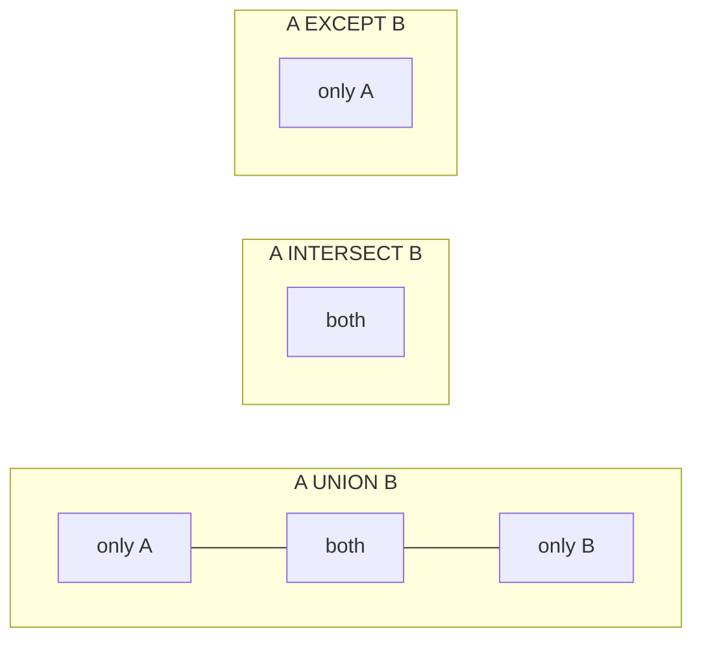

# Set theory and UNION

> **Before this lesson:** you should be able to write a `SELECT` with `WHERE` and `ORDER BY` ([SELECT and FROM](#/lesson/sql/select-from), [ORDER BY, LIMIT and how clauses are evaluated](#/lesson/sql/order-limit)) and join two tables ([Inner joins](#/lesson/sql/inner-joins)). No mathematics is assumed; the little set theory needed is explained here.

## In plain words

A join puts two tables **side by side**: the result gets more columns. Sometimes you want the opposite: to put one result **underneath** another, so the answer gets more rows. That is what `UNION` does. It stacks the rows of one query on top of the rows of another.

An everyday picture: two teachers each hand you a sign-up sheet for the same school trip. To get one list you staple the second sheet under the first. If a pupil signed both sheets, you have a choice. Keep both lines (every signature is there, including repeats) or cross out the repeats (each pupil appears once). SQL offers exactly those two choices: `UNION ALL` keeps everything, `UNION` removes repeated rows.

The idea comes from a branch of mathematics called **set theory**, which studies collections of things and three ways of combining them. SQL has a keyword for each: `UNION`, `INTERSECT` and `EXCEPT`. This lesson covers the first; the next lesson covers the other two.

**Why it matters for a job.** Data about one kind of thing is often spread over several tables: current orders and archived orders, individual and business customers, one table per month. `UNION ALL` is how you treat them as one. In interviews, "what is the difference between `UNION` and `UNION ALL`?" is one of the most frequently asked SQL questions.

## A two-minute set theory primer

A **set** is a collection of distinct things, such as the set of pupils on sheet A. Take two sets, A and B.

- **A union B**: everything that is in A, or in B, or in both. A thing in both is listed once.
- **A intersect B**: only the things that are in both.
- **A except B**: the things in A that are not in B. Unlike the other two, the order matters: B except A is usually a different answer.



The operations can be combined. "In A or B but not both" is (A union B) except (A intersect B). The next lesson builds that query.

## From sets of things to sets of rows

In SQL the "things" are rows, and the two collections are the results of two queries. The simplest possible example needs no table at all: each `SELECT` below produces one row out of fixed values.

```sql-run dataset=bank
SELECT 1 AS num, 'abc' AS str
UNION
SELECT 9 AS num, 'xyz' AS str;
```

Two rows come back: `1, abc` from the first query and `9, xyz` from the second. The whole thing, two `SELECT` statements with a set keyword between them, is called a **compound query**. Each `SELECT` is complete on its own; the keyword between them says how to combine their results.

For stacking to make sense, the two results must have the same shape. Two rules follow:

1. **Both queries must return the same number of columns.**
2. **Matching columns must hold compatible kinds of data.** The first column of the top query is stacked on the first column of the bottom query, the second on the second, and so on.

Columns are matched **by position, not by name**. If the top query returns first name then last name, and the bottom one returns last name then first name, the database raises no error and you get a column that mixes both.

## UNION ALL and UNION

`UNION ALL` appends the second result to the first and changes nothing. `UNION` appends and then **removes duplicate rows**, so each distinct row is listed once.

The bank stores people and companies in two separate tables, `individual` and `business`. To get one list of all customers, stack them:

```sql-run dataset=bank
SELECT 'IND' AS type_cd, cust_id, lname AS name
FROM individual
UNION ALL
SELECT 'BUS' AS type_cd, cust_id, name
FROM business
ORDER BY type_cd, cust_id;
```

Line by line:

- The first `SELECT` returns three columns for each individual: the fixed text `'IND'`, the customer id and the last name.
- `UNION ALL` says "now append the rows of the next query".
- The second `SELECT` returns three columns for each business: the fixed text `'BUS'`, the id and the company name.
- `ORDER BY` at the very end sorts the combined result.

40 rows: 30 individuals plus 10 businesses. The businesses come first because `'BUS'` sorts before `'IND'`. The fixed first column is a **source tag**: it records which table each row came from, a standard trick when stacking. `UNION ALL` is the right choice here because no customer is in both tables, so there is nothing to remove, and skipping the search for duplicates saves work.

To watch the difference between the two keywords, stack a table on itself. The department table has three rows.

```sql-run dataset=bank
SELECT COUNT(*) AS rows_with_union_all
FROM (SELECT name FROM department
      UNION ALL
      SELECT name FROM department);
```

```sql-run dataset=bank
SELECT COUNT(*) AS rows_with_union
FROM (SELECT name FROM department
      UNION
      SELECT name FROM department);
```

Six with `UNION ALL` (every name twice), three with `UNION` (each name once). In both queries the compound query sits in parentheses after `FROM`, so the outer `SELECT COUNT(*)` counts its rows.

Duplicates also arise naturally when two queries overlap. Here, tellers assigned to branch 2 are combined with employees who opened accounts at branch 2:

```sql-run dataset=bank
SELECT emp_id FROM employee
WHERE assigned_branch_id = 2 AND title LIKE '%Teller'
UNION ALL
SELECT DISTINCT open_emp_id FROM account
WHERE open_branch_id = 2
ORDER BY emp_id;
```

Seven rows, and ids such as 10 appear twice: once because that employee works at the branch, once because they opened an account there. Switch to `UNION`:

```sql-run dataset=bank
SELECT emp_id FROM employee
WHERE assigned_branch_id = 2 AND title LIKE '%Teller'
UNION
SELECT DISTINCT open_emp_id FROM account
WHERE open_branch_id = 2
ORDER BY emp_id;
```

Four rows, each employee once.

### Which one should you use?

| | `UNION ALL` | `UNION` |
|---|---|---|
| Duplicates | kept | removed, both between the two inputs and inside each one |
| Cost | appending only | appending, plus sorting or hashing to find duplicates |
| Use when | the inputs cannot overlap, or repeats are meaningful (you will add them up afterwards) | you need each distinct row once |

> [!TIP]
> Reach for `UNION ALL` first and switch to `UNION` only when you can say which duplicates you are removing. Writing `UNION` out of habit wastes time and, worse, can silently merge rows you meant to count separately: two payments of \$50 on the same day *are* two payments.

## Five practical uses

### 1. Combining similar data held in different tables

The individual and business example above. Other common cases: current orders stacked on archived orders, or one table per month presented as one.

### 2. Building a small table of fixed values

Handy for tests and for lookup lists that are too small to deserve a stored table:

```sql-run dataset=shop
SELECT 'bronze' AS tier, 0 AS min_spend
UNION ALL SELECT 'silver', 500
UNION ALL SELECT 'gold', 2000;
```

Three rows, built from nothing. SQL also has a `VALUES` form, `VALUES ('bronze', 0), ('silver', 500), ('gold', 2000)`, which SQLite and PostgreSQL accept as a query on its own.

### 3. Turning columns into rows

The `account` table has two balance columns, `avail_balance` and `pending_balance`. To list them as separate rows, select each in turn. Turning columns into rows is called **unpivoting**, and the result is said to be in *long* format.

```sql-run dataset=bank
SELECT account_id, 'available' AS balance_type, avail_balance AS amount
FROM account WHERE cust_id = 3
UNION ALL
SELECT account_id, 'pending', pending_balance
FROM account WHERE cust_id = 3
ORDER BY account_id, balance_type;
```

Each account of customer 3 now has two rows, one per kind of balance.

### 4. Adding a total row

```sql-run dataset=bank
SELECT product_cd, COUNT(*) AS accounts, ROUND(SUM(avail_balance), 2) AS balance
FROM account GROUP BY product_cd
UNION ALL
SELECT 'TOTAL', COUNT(*), ROUND(SUM(avail_balance), 2)
FROM account;
```

The top query gives one row per product (`GROUP BY` collects the accounts of each product into a group; see [Aggregate functions and GROUP BY](#/lesson/sql/group-by)). The bottom query gives one row for all accounts together. Some databases can add total rows on their own with `ROLLUP`; SQLite cannot, so `UNION ALL` is the tool ([HAVING, multi-column groups and rollups](#/lesson/sql/having-rollup)).

### 5. A timeline built from several kinds of event

In the `mlops` dataset, a model's history is spread over two tables: `models` records when each version was registered, and `deployments` records when a version was put into service and when it was withdrawn. One timeline needs three queries stacked:

```sql-run dataset=mlops
SELECT registered_at AS at, 'registered v' || version AS event
FROM models WHERE name = 'intent-model'
UNION ALL
SELECT d.deployed_at, 'deployed v' || m.version || ' to ' || d.environment
FROM deployments d JOIN models m ON m.model_id = d.model_id
WHERE m.name = 'intent-model'
UNION ALL
SELECT d.retired_at, 'retired v' || m.version || ' from ' || d.environment
FROM deployments d JOIN models m ON m.model_id = d.model_id
WHERE m.name = 'intent-model' AND d.retired_at IS NOT NULL
ORDER BY at;
```

Each of the three queries returns the same two columns, a time and a description (`||` joins pieces of text). One `ORDER BY` at the end sorts all 14 events by time.

## Column names and types in the result

The column names of a compound query come from the **first** `SELECT`. Aliases in later ones are ignored, which is why the examples above name the columns only once.

Types should be compatible. PostgreSQL rejects `SELECT 1 UNION SELECT 'a'` because a number and a text cannot share a column. SQLite does not fix a column to one type, so it stacks them without complaint and sorts numbers before text. To be safe on every database, convert on purpose with `CAST(value AS type)` when the columns differ.

## UNION, OR or JOIN?

- Two conditions on the **same table**: prefer `WHERE a OR b`. The table is read once.
- Rows from **different tables with the same shape**: `UNION` or `UNION ALL`.
- Columns from **different tables about the same thing**: `JOIN`.

A join makes the result *wider*; a union makes it *longer*.

## Worked example: a reconciliation report

A frequent use of `UNION ALL` is to place figures from different sources in one result so they can be compared. The bank stores a balance on each account and, separately, a ledger of transactions (`txn`), each marked as a credit (`'CDT'`, money in) or a debit (`'DBT'`, money out). The report below stacks four measurements, each with a label.

```sql-run dataset=bank
SELECT 'accounts: total available balance' AS measure, ROUND(SUM(avail_balance), 2) AS value
FROM account
UNION ALL
SELECT 'ledger: credits in 2024', ROUND(SUM(amount), 2)
FROM txn WHERE txn_type_cd = 'CDT'
UNION ALL
SELECT 'ledger: debits in 2024', ROUND(SUM(amount), 2)
FROM txn WHERE txn_type_cd = 'DBT'
UNION ALL
SELECT 'ledger: net movement in 2024',
       ROUND(SUM(CASE txn_type_cd WHEN 'CDT' THEN amount ELSE -amount END), 2)
FROM txn;
```

Each of the four queries is independent, with its own `FROM` and `WHERE`. All they share is the *shape* of the output: a label and a number. The last one uses `CASE`, SQL's "if ... then ... else" ([The CASE expression](#/lesson/sql/case-expressions)): it counts a credit as plus and a debit as minus. That is the way to think about every union: **agree on the output columns first, then write one `SELECT` per source.**

The same technique builds a long-format table for charts, where each row is (period, series, value):

```sql-run dataset=shop
SELECT strftime('%Y-%m', order_date) AS month, 'orders placed' AS series, COUNT(*) AS value
FROM orders GROUP BY month
UNION ALL
SELECT strftime('%Y-%m', signup_date), 'customers signed up', COUNT(*)
FROM customers GROUP BY 1
ORDER BY month, series
LIMIT 12;
```

`strftime('%Y-%m', ...)` cuts a date down to its year and month ([Dates, times and conversion](#/lesson/sql/dates-conversion)). Two unrelated tables become one tidy result a charting tool can read directly.

## Seeing exactly which duplicates UNION removes

`UNION` compares **whole rows**: two rows are duplicates only if every column matches. One experiment shows three different outcomes from the same two inputs:

```sql-run dataset=bank
SELECT 'UNION ALL of cities' AS what, COUNT(*) AS n
FROM (SELECT city FROM branch UNION ALL SELECT city FROM customer)
UNION ALL
SELECT 'UNION of cities', COUNT(*)
FROM (SELECT city FROM branch UNION SELECT city FROM customer)
UNION ALL
SELECT 'UNION of (source, city)', COUNT(*)
FROM (SELECT 'branch' AS src, city FROM branch UNION SELECT 'customer', city FROM customer);
```

- `UNION ALL`: 44, every row of both tables (4 branches plus 40 customers).
- `UNION` on `city` alone: 8, the number of different cities across both tables.
- `UNION` on source tag plus city: 12. The tag makes a branch row and a customer row different even when the city is the same, so a city found in both tables is listed twice. **Adding a source tag switches off the removal of duplicates between sources.** Sometimes that is what you want; sometimes it is a surprise.

A second point: `UNION` also removes duplicates *inside* one input. Stacking two months of sales lines with `UNION` would merge two separate sales of the same product at the same price on the same day into one. When rows stand for events, use `UNION ALL`, and include the event's id.

## Making the two halves line up

**1. Fill a missing column with NULL or a fixed value.** People have a birth date and companies have an incorporation date. A combined list must supply both columns from both queries:

```sql-run dataset=bank
SELECT cust_id, fname || ' ' || lname AS name, 'person' AS kind, birth_date, NULL AS incorp_date
FROM individual
WHERE cust_id <= 2
UNION ALL
SELECT cust_id, name, 'business', NULL, incorp_date
FROM business
WHERE cust_id <= 32
ORDER BY cust_id;
```

The person rows have an empty `incorp_date`; the business rows have an empty `birth_date`.

**2. Name the columns in the first query.** Later aliases are ignored, so `'business'` needs no `AS kind`, but the first `SELECT` must carry every name you want.

**3. Make the types match on purpose.** Here a numeric id is converted to text so that it can share a column with a text code:

```sql-run dataset=bank
SELECT 'account' AS entity, CAST(account_id AS TEXT) AS id FROM account WHERE cust_id = 1
UNION ALL
SELECT 'product', product_cd FROM product WHERE product_type_cd = 'INSURANCE';
```

## When a UNION is the wrong tool

Unions are easy to write, so they get overused. Two rewrites are worth knowing.

**Same table, different filters: read it once.** This compound query reads `txn` twice:

```sql
SELECT 'credits' AS kind, SUM(amount) FROM txn WHERE txn_type_cd = 'CDT'
UNION ALL
SELECT 'debits', SUM(amount) FROM txn WHERE txn_type_cd = 'DBT';
```

One grouped query reads it once and gives the same two rows:

```sql-run dataset=bank
SELECT CASE txn_type_cd WHEN 'CDT' THEN 'credits' ELSE 'debits' END AS kind,
       ROUND(SUM(amount), 2) AS total
FROM txn
GROUP BY txn_type_cd;
```

**Same table, two conditions: one `WHERE`.** `SELECT ... WHERE a UNION SELECT ... WHERE b` is usually the same as `SELECT DISTINCT ... WHERE a OR b`. There is one exception, for speed. An **index** is a lookup structure that lets the database find rows by a column's value without reading the whole table ([Indexes and query plans](#/lesson/sql/indexes)). When `a` and `b` would use *different* indexes, some databases handle the `OR` poorly, and a `UNION` of two indexed lookups can be much faster. Treat that as a tuning step taken after reading the query plan, not as a default style.

> [!NOTE]
> **Other databases.** `UNION` and `UNION ALL` behave the same in every major product. MySQL and PostgreSQL let each half be wrapped in parentheses with its own `ORDER BY ... LIMIT`; SQLite does not (put the half in a subquery instead). Oracle requires `FROM dual` in a `SELECT` that reads no table.

> [!INTERVIEW]
> "What is the difference between `UNION` and `UNION ALL`, and which is faster?" `UNION ALL` appends; `UNION` also removes duplicate rows, which needs a sort or a hash table, so `UNION ALL` is faster and is the default whenever duplicates are impossible or meaningful. A strong answer adds that both need the same number of columns with compatible types, matched by position.

## Pitfalls

- **Columns in a different order.** Matching is by position, so mis-ordered columns mix data without an error.
- **`UNION` out of habit** when `UNION ALL` is meant: slower, and it can merge rows that should stay separate.
- **Expecting names from the second query.** Only the first query's names survive.
- **`ORDER BY` in the wrong place.** It sorts the whole compound query and goes once, at the very end (next lesson).
- **A source tag that defeats de-duplication.** With a tag column, the same value from two sources is no longer a duplicate.

## Summary

- Set operators stack whole query results; both sides need the same number of columns with compatible types, matched by position.
- `UNION ALL` appends; `UNION` appends and then removes duplicate rows.
- Prefer `UNION ALL` unless you specifically need distinct rows.
- Typical uses: stacking similar tables, small fixed tables, unpivoting, total rows, timelines, reconciliation reports.
- Column names come from the first query; pad missing columns with NULL and convert types on purpose.

## Glossary

- **Set** — a collection of distinct things; in SQL, the rows returned by a query.
- **Set operator** — a keyword (`UNION`, `INTERSECT`, `EXCEPT`) that combines the results of two queries.
- **Compound query** — two or more `SELECT` statements joined by set operators.
- **Union** — everything in either collection.
- **Intersection** — only what is in both collections.
- **Difference (except)** — what is in the first collection and not in the second.
- **`UNION ALL`** — stacks two results and keeps every row, repeats included.
- **`UNION`** — stacks two results and removes duplicate rows.
- **Duplicate row** — a row equal to another in every column.
- **Source tag** — a fixed-value column that records which query a row came from.
- **Unpivot (long format)** — turning several columns into several rows of (label, value).
- **`CAST`** — a function that converts a value from one data type to another.
- **Reconciliation** — comparing figures for the same thing taken from different sources.

```quiz
[
  {"q": "What is the difference between UNION and UNION ALL?", "options": ["UNION ALL sorts the result", "UNION removes duplicate rows; UNION ALL keeps them", "UNION ALL requires matching column names", "There is none"], "answer": 1, "explain": "UNION removes duplicates from the combined result, which costs a sort or a hash; UNION ALL only appends."},
  {"q": "How are columns matched between the two queries of a UNION?", "options": ["By name", "By position", "By data type", "By alias"], "answer": 1, "explain": "The n-th column of each query is combined, whatever it is called."},
  {"q": "Table t has 5 rows, all identical. How many rows does SELECT * FROM t UNION SELECT * FROM t return?", "options": ["10", "5", "2", "1"], "answer": 3, "explain": "UNION removes duplicates inside each input as well as between them, leaving one row."},
  {"q": "Where do the result's column names come from?", "options": ["The last query", "The first query", "The query with the most rows", "They are generated"], "answer": 1, "explain": "Aliases in later queries are ignored."},
  {"q": "Which is the best choice to stack individual and business customers, which cannot overlap?", "options": ["UNION", "UNION ALL", "INTERSECT", "JOIN"], "answer": 1, "explain": "No duplicates are possible, so there is no reason to pay for removing them."},
  {"q": "A union makes a result ___ while a join makes it ___.", "options": ["wider; longer", "longer; wider", "sorted; unsorted", "distinct; duplicated"], "answer": 1, "explain": "Unions stack rows; joins add columns."},
  {"q": "You UNION (source, city) from two tables, where source is a fixed tag per table. A city present in both tables appears...", "options": ["Once", "Twice", "Never", "It causes an error"], "answer": 1, "explain": "UNION compares whole rows; the tag makes the two rows different, so both are kept."}
]
```

> **Source:** Beaulieu, *Learning SQL*, ch. 6 "Working with Sets" (set theory primer, set theory in practice, the union operator), restated in original wording with this guide's own datasets.
