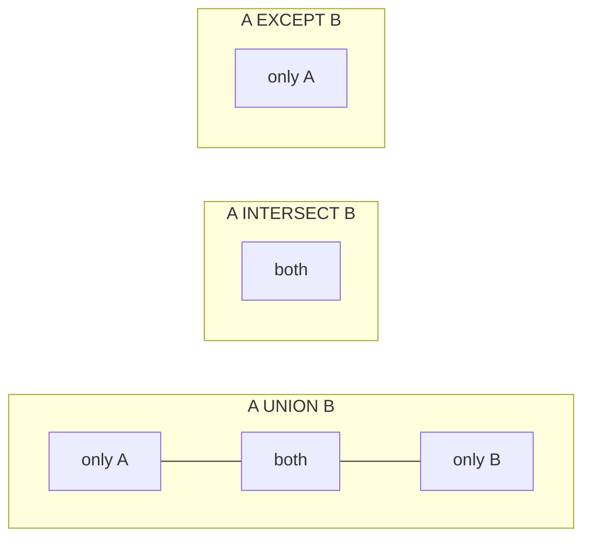

# Set theory and UNION

Joins combine tables *side by side*, adding columns. Set operators combine query results *top to bottom*, stacking rows. Because SQL is built on set theory, the three classical set operations — union, intersection and difference — are available directly as `UNION`, `INTERSECT` and `EXCEPT`. This lesson reviews the theory, explains what it means to apply it to tables, and covers `UNION` and `UNION ALL` in depth. The next lesson covers the other two operators and the rules they all share.

## Set theory primer

Take two sets, A and B.

- **A union B** (A ∪ B): everything in A or B or both. Shared elements appear once.
- **A intersect B** (A ∩ B): only the elements in both.
- **A except B** (A − B): the elements of A that are not in B. Unlike the other two, this is not symmetric: B − A is generally different.



You can build more complex regions by combining operations. "Everything in A or B but not both" (the symmetric difference) is `(A ∪ B) − (A ∩ B)`, or equivalently `(A − B) ∪ (B − A)`. The book uses exactly this exercise to show that the operators compose.

## Set theory in practice

Sets of integers are tidy. Query results are sets of *rows*, so two requirements arise before a set operation makes sense — the book calls them the guidelines for compound queries:

1. **Both data sets must have the same number of columns.**
2. **The data types of each column must be compatible** (or implicitly convertible). The n-th column of the first query is combined with the n-th column of the second.

Columns are matched **by position, not by name**. Stacking `(fname, lname)` on top of `(lname, fname)` runs happily and produces nonsense.

A set operator sits between two complete SELECT statements, forming a **compound query**:

```sql-run dataset=bank
SELECT 1 AS num, 'abc' AS str
UNION
SELECT 9 AS num, 'xyz' AS str;
```

Each SELECT yields one row; the union has two.

## UNION and UNION ALL

`UNION ALL` simply appends the second result to the first — duplicates and all. `UNION` appends and then **removes duplicate rows** from the combined result (which costs a sort or hash).

The bank keeps individuals and businesses in separate subtype tables. To get one list of all customer names, stack them:

```sql-run dataset=bank
SELECT 'IND' AS type_cd, cust_id, lname AS name
FROM individual
UNION ALL
SELECT 'BUS' AS type_cd, cust_id, name
FROM business
ORDER BY type_cd, cust_id;
```

40 rows: 30 individuals plus 10 businesses. The literal first column tags where each row came from — a standard trick when stacking sources. Here `UNION ALL` is right: the two tables hold different customers, so there can be no duplicates to remove, and skipping the de-duplication is free speed.

To see that `UNION ALL` really keeps duplicates, stack a table on itself:

```sql-run dataset=bank
SELECT COUNT(*) AS rows_with_union_all
FROM (SELECT name FROM department
      UNION ALL
      SELECT name FROM department);
```

```sql-run dataset=bank
SELECT COUNT(*) AS rows_with_union
FROM (SELECT name FROM department
      UNION
      SELECT name FROM department);
```

Six versus three.

Duplicates can also arise naturally from overlapping queries. The book's example: employees assigned to one branch, combined with employees who opened accounts at that branch:

```sql-run dataset=bank
SELECT emp_id FROM employee
WHERE assigned_branch_id = 2 AND title LIKE '%Teller'
UNION ALL
SELECT DISTINCT open_emp_id FROM account
WHERE open_branch_id = 2
ORDER BY emp_id;
```

The same employee ids appear twice — once from each branch of the query. Switch to `UNION` and each appears once:

```sql-run dataset=bank
SELECT emp_id FROM employee
WHERE assigned_branch_id = 2 AND title LIKE '%Teller'
UNION
SELECT DISTINCT open_emp_id FROM account
WHERE open_branch_id = 2
ORDER BY emp_id;
```

### Which one should you use?

| | `UNION ALL` | `UNION` |
|---|---|---|
| Duplicates | kept | removed (across *and within* inputs) |
| Cost | concatenation | concatenation + sort/hash |
| Use when | inputs are disjoint, or duplicates are meaningful (e.g. you will SUM afterwards) | you need the set of distinct rows |

> [!TIP]
> Default to `UNION ALL` and switch to `UNION` only when you can explain which duplicates you are removing. Using `UNION` by reflex wastes time and — worse — can silently merge rows you intended to count separately (two transactions of \$50 on the same day *are* two transactions).

Note that `UNION` removes duplicates *within* each input too, like a DISTINCT over the whole result.

## Practical uses of UNION

### 1. Combining similar data from different tables

The individual/business example above. Also common: `current_orders UNION ALL archived_orders`, or monthly partition tables stacked into one view (see *Views*).

### 2. Building a small table of constants

Useful for tests and lookups:

```sql-run dataset=shop
SELECT 'bronze' AS tier, 0 AS min_spend
UNION ALL SELECT 'silver', 500
UNION ALL SELECT 'gold', 2000;
```

Standard SQL also has the `VALUES` constructor — `VALUES ('bronze', 0), ('silver', 500), ('gold', 2000)` — which SQLite and PostgreSQL accept as a standalone query.

### 3. Unpivoting columns into rows

`account` has two balance columns. To treat them as rows (*long* format), select each in turn:

```sql-run dataset=bank
SELECT account_id, 'available' AS balance_type, avail_balance AS amount
FROM account WHERE cust_id = 3
UNION ALL
SELECT account_id, 'pending', pending_balance
FROM account WHERE cust_id = 3
ORDER BY account_id, balance_type;
```

### 4. Adding a total row

```sql-run dataset=bank
SELECT product_cd, COUNT(*) AS accounts, ROUND(SUM(avail_balance), 2) AS balance
FROM account GROUP BY product_cd
UNION ALL
SELECT 'TOTAL', COUNT(*), ROUND(SUM(avail_balance), 2)
FROM account;
```

MySQL's `WITH ROLLUP` and standard `GROUP BY ROLLUP` do this natively; SQLite has neither, so `UNION ALL` is the way (see the grouping module).

### 5. An activity feed across event types

In the `mlops` schema, a timeline of everything that happened to a model combines three sources:

```sql-run dataset=mlops
SELECT registered_at AS at, 'registered v' || version AS event
FROM models WHERE name = 'intent-model'
UNION ALL
SELECT d.deployed_at, 'deployed v' || m.version || ' to ' || d.environment
FROM deployments d JOIN models m ON m.model_id = d.model_id
WHERE m.name = 'intent-model'
UNION ALL
SELECT d.retired_at, 'retired v' || m.version || ' from ' || d.environment
FROM deployments d JOIN models m ON m.model_id = d.model_id
WHERE m.name = 'intent-model' AND d.retired_at IS NOT NULL
ORDER BY at;
```

Three SELECTs with matching column lists, one final ORDER BY.

## Column names and types in the result

The result's column names come from the **first** query; aliases in later queries are ignored. Types should be compatible: PostgreSQL will reject `SELECT 1 UNION SELECT 'a'` unless you cast; SQLite, being dynamically typed, will stack an integer on top of a text value without complaint (and sort them integers-first). Write explicit `CAST`s when stacking columns of different types.

## UNION versus OR versus JOIN

- Two filters on the **same table** — prefer `WHERE a OR b`; it scans once. (Occasionally the reverse rewrite, turning an OR across different indexed columns into a UNION of two index lookups, is a useful optimisation.)
- Rows from **different tables with the same shape** — UNION.
- Columns from **different tables about the same entity** — JOIN.

A join makes the result *wider*; a union makes it *longer*.

## Pitfalls

- **Column order mismatches** — matched by position; mis-ordered columns silently mix data.
- **Reflexive UNION** when UNION ALL is meant — slower, and can collapse legitimate duplicates.
- **Expecting names from the second query** — only the first query's names survive.
- **ORDER BY in the wrong place** — it applies to the whole compound query and goes at the end (next lesson).

## Summary

- Set operators combine whole result sets vertically; both sides need the same number of columns with compatible types, matched by position.
- `UNION ALL` concatenates; `UNION` concatenates then removes duplicates.
- Prefer `UNION ALL` unless you specifically need distinct rows.
- Typical uses: stacking similar tables, constant tables, unpivoting, total rows, event timelines.

```quiz
[
  {"q": "What is the difference between UNION and UNION ALL?", "options": ["UNION ALL sorts the result", "UNION removes duplicate rows; UNION ALL keeps them", "UNION ALL requires matching column names", "There is none"], "answer": 1, "explain": "UNION de-duplicates the combined result, at the cost of a sort or hash."},
  {"q": "How are columns matched between the two queries of a UNION?", "options": ["By name", "By position", "By data type", "By alias"], "answer": 1, "explain": "The n-th column of each query is combined, whatever it is called."},
  {"q": "Table t has 5 rows, all identical. How many rows does SELECT * FROM t UNION SELECT * FROM t return?", "options": ["10", "5", "2", "1"], "answer": 3, "explain": "UNION removes duplicates within and across inputs."},
  {"q": "Where do the result's column names come from?", "options": ["The last query", "The first query", "The query with the most rows", "They are generated"], "answer": 1, "explain": "Aliases in later queries are ignored."},
  {"q": "Which is the best choice to stack individual and business customers that cannot overlap?", "options": ["UNION", "UNION ALL", "INTERSECT", "JOIN"], "answer": 1, "explain": "No duplicates are possible, so skip the de-duplication cost."},
  {"q": "A union makes a result ___ while a join makes it ___.", "options": ["wider; longer", "longer; wider", "sorted; unsorted", "distinct; duplicated"], "answer": 1, "explain": "Unions stack rows; joins add columns."}
]
```

> **Source:** Beaulieu, *Learning SQL*, ch. 6 "Working with Sets" (set theory primer, set theory in practice, the union operator).
