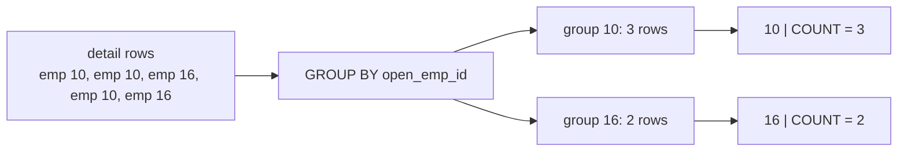

# Aggregate functions and GROUP BY

Databases store data at the finest grain anyone will ever need: one row per transaction, per order line, per prediction. People rarely want to read it at that grain. A branch manager wants total balances per branch; a product analyst wants orders per month; an ML engineer wants accuracy per model version. **Grouping** and **aggregate functions** turn many detail rows into few summary rows. This lesson covers the grouping concept, the aggregate functions, implicit versus explicit groups, counting distinct values, expressions inside aggregates, and how NULLs are handled.

## Grouping concepts

Suppose the operations manager asks how many accounts each teller has opened. You could list every account sorted by employee and count by eye:

```sql-run dataset=bank
SELECT open_emp_id FROM account ORDER BY open_emp_id LIMIT 15;
```

That works for 15 rows and is hopeless for 15 million. Instead, ask the server to form one **group** per distinct `open_emp_id` and return one row per group:

```sql-run dataset=bank
SELECT open_emp_id
FROM account
GROUP BY open_emp_id;
```

One row per employee — but no counts yet. Add an **aggregate function**, which computes one value from all the rows in a group:

```sql-run dataset=bank
SELECT open_emp_id, COUNT(*) AS how_many
FROM account
GROUP BY open_emp_id
ORDER BY how_many DESC;
```

`COUNT(*)` counts the rows in each group. That is the entire idea; the rest is detail.



To filter the *groups* — say, only tellers who opened more than eight accounts — you cannot use WHERE, because WHERE is evaluated before the groups exist. That is what `HAVING` is for (next lesson):

```sql-run dataset=bank
SELECT open_emp_id, COUNT(*) AS how_many
FROM account
GROUP BY open_emp_id
HAVING COUNT(*) > 8;
```

## Aggregate functions

Every engine implements these five:

| Function | Returns |
|---|---|
| `MAX(x)` | largest value in the group |
| `MIN(x)` | smallest value |
| `AVG(x)` | arithmetic mean |
| `SUM(x)` | total |
| `COUNT(*)` / `COUNT(x)` | number of rows / number of non-NULL values |

```sql-run dataset=bank
SELECT MAX(avail_balance) AS max_balance,
       MIN(avail_balance) AS min_balance,
       ROUND(AVG(avail_balance), 2) AS avg_balance,
       ROUND(SUM(avail_balance), 2) AS tot_balance,
       COUNT(*) AS num_accounts
FROM account
WHERE product_cd = 'CHK';
```

`MIN` and `MAX` work on any orderable type — numbers, dates, text. `MIN(order_date)` is a customer's first order; `MAX(lname)` is the alphabetically last name.

Most engines add more: `group_concat` / `string_agg` (previous lesson), statistical aggregates (`STDDEV`, `VARIANCE` in MySQL/PostgreSQL; not built into SQLite), `BOOL_AND`/`BOOL_OR` and ordered-set aggregates such as `percentile_cont` in PostgreSQL.

### Implicit versus explicit groups

The query above has no GROUP BY, yet it used aggregates. With no GROUP BY, all rows that survive WHERE form one **implicit group**, and the result is exactly one row.

Now extend it to *every* product. Adding `product_cd` to the select list without telling the server how to group fails in most databases:

```sql
SELECT product_cd, MAX(avail_balance) FROM account;   -- error in PostgreSQL, MySQL (ONLY_FULL_GROUP_BY)
```

The server cannot know which of the many `product_cd` values should accompany the single maximum. Make the groups **explicit**:

```sql-run dataset=bank
SELECT product_cd,
       MAX(avail_balance) AS max_balance,
       MIN(avail_balance) AS min_balance,
       ROUND(AVG(avail_balance), 2) AS avg_balance,
       ROUND(SUM(avail_balance), 2) AS tot_balance,
       COUNT(*) AS num_accts
FROM account
GROUP BY product_cd;
```

### The golden rule of GROUP BY

> Every expression in the SELECT list must either be **in the GROUP BY clause** or be **inside an aggregate function**.

After grouping, each output row represents a whole group. A column that is neither grouped nor aggregated has many values in the group, so "its value" is undefined.

> [!WARNING]
> **SQLite does not enforce this rule.** It accepts "bare" columns and returns the value from an arbitrary row of the group (with a documented special case: with a single `MIN()` or `MAX()`, bare columns come from the row holding that min/max). Old MySQL behaved similarly; modern MySQL (`ONLY_FULL_GROUP_BY`) and PostgreSQL reject the query. Run the block below and notice that `account_id` and `cust_id` are whatever SQLite happened to pick — a classic source of wrong answers that *look* plausible.

```sql-run dataset=bank
SELECT product_cd, account_id, cust_id, COUNT(*) AS n
FROM account
GROUP BY product_cd;
```

PostgreSQL relaxes the rule in one sound way: if you group by a table's primary key, you may select that table's other columns, since they are functionally dependent on the key.

### Counting distinct values

`COUNT(*)` counts rows. `COUNT(x)` counts rows where `x` is not NULL. `COUNT(DISTINCT x)` counts the number of different non-NULL values:

```sql-run dataset=bank
SELECT COUNT(*)                    AS accounts,
       COUNT(open_emp_id)          AS with_opener,
       COUNT(DISTINCT open_emp_id) AS distinct_openers,
       COUNT(DISTINCT cust_id)     AS distinct_customers
FROM account;
```

84 accounts were opened by far fewer distinct employees for 40 customers. `DISTINCT` works inside other aggregates too (`SUM(DISTINCT x)`), though that is rarely what you want.

Distinct counts are everywhere in analytics — daily active users is `COUNT(DISTINCT customer_id)` per day:

```sql-run dataset=shop
SELECT date(event_time) AS day,
       COUNT(*) AS events,
       COUNT(DISTINCT customer_id) AS active_customers
FROM web_events
GROUP BY day
ORDER BY day
LIMIT 7;
```

A caution: distinct counts are **not additive**. The number of distinct customers in a week is not the sum of the daily distinct counts, because the same customer can appear on several days. Never roll up a distinct count from a pre-aggregated table; recompute it from detail (or use approximate sketches such as HyperLogLog in warehouses).

### Using expressions

Aggregate arguments can be expressions, not just columns. The book finds the largest *pending deposit* across accounts:

```sql-run dataset=bank
SELECT MAX(pending_balance - avail_balance) AS max_uncleared,
       ROUND(AVG(pending_balance - avail_balance), 2) AS avg_diff
FROM account;
```

Revenue per order is an aggregate over an arithmetic expression:

```sql-run dataset=shop
SELECT order_id,
       SUM(quantity) AS items,
       ROUND(SUM(quantity * unit_price * (1 - discount)), 2) AS revenue
FROM order_items
GROUP BY order_id
ORDER BY revenue DESC
LIMIT 5;
```

And an expression can include `CASE`, which lets one query compute several conditional totals — *selective aggregation*, developed in the conditional-logic module:

```sql-run dataset=bank
SELECT COUNT(*) AS txns,
       ROUND(SUM(CASE WHEN txn_type_cd = 'CDT' THEN amount ELSE 0 END), 2) AS credits,
       ROUND(SUM(CASE WHEN txn_type_cd = 'DBT' THEN amount ELSE 0 END), 2) AS debits
FROM txn;
```

### How NULLs are handled

The book demonstrates with a tiny table; run it yourself:

```sql-run dataset=bank
CREATE TEMP TABLE number_tbl (val INTEGER);
INSERT INTO number_tbl VALUES (1), (3), (5), (NULL);

SELECT COUNT(*)  AS num_rows,
       COUNT(val) AS num_vals,
       SUM(val)   AS total,
       MAX(val)   AS max_val,
       AVG(val)   AS avg_val
FROM number_tbl;
```

- `COUNT(*)` = 4 — it counts rows.
- `COUNT(val)` = 3 — NULL is skipped.
- `SUM` = 9, `MAX` = 5, `AVG` = 3 — all ignore the NULL. Note that the average is 9 / 3, not 9 / 4.

Two more facts worth remembering:

- On an **empty** input (or a group with only NULLs), `SUM`, `AVG`, `MIN`, `MAX` return **NULL**, while `COUNT` returns **0**. Wrap with `COALESCE(SUM(x), 0)` when a report needs zero.
- `AVG(x)` ≠ `SUM(x) / COUNT(*)` when NULLs are present. Decide whether a missing value means "exclude" (use `AVG(x)`) or "zero" (use `AVG(COALESCE(x, 0))`).

```sql-run dataset=mlops
SELECT status,
       COUNT(*) AS runs,
       COUNT(gpu_hours) AS with_gpu_value,
       ROUND(AVG(gpu_hours), 2) AS avg_excluding_null,
       ROUND(AVG(COALESCE(gpu_hours, 0)), 2) AS avg_null_as_zero
FROM runs
GROUP BY status;
```

Running jobs have no `gpu_hours` yet; the two averages differ only for that group.

## Aggregates and joins: mind the grain

Aggregation happens after the FROM clause has built its joined rows, so a join that multiplies rows inflates sums and counts (lesson *Inner joins*). The remedy is to aggregate at the correct grain — often in a subquery — or to count distinct keys:

```sql-run dataset=shop
SELECT c.country,
       COUNT(*)                   AS order_lines,
       COUNT(DISTINCT o.order_id) AS orders,
       COUNT(DISTINCT c.customer_id) AS customers
FROM customers c
JOIN orders o       ON o.customer_id = c.customer_id
JOIN order_items oi ON oi.order_id = o.order_id
GROUP BY c.country
ORDER BY orders DESC;
```

Three different counts from the same joined rows — each correct for its own grain.

## How grouping is executed

The engine has two strategies: **sort** the rows by the grouping key and emit a group each time the key changes, or build a **hash table** keyed by the grouping columns. If an index already delivers rows in key order, the sort is free. In SQLite's plan you will see `USE TEMP B-TREE FOR GROUP BY` when it has to sort:

```sql-run dataset=bank
EXPLAIN QUERY PLAN
SELECT product_cd, COUNT(*) FROM account GROUP BY product_cd;
```

## Pitfalls

- **Bare columns** in a grouped query — legal in SQLite, meaningless results.
- **COUNT(*) vs COUNT(col)** — rows versus non-NULL values.
- **Summing distinct counts** across groups.
- **Aggregates over joined rows** at the wrong grain.
- **NULL from empty SUM** — use COALESCE where zero is expected.
- **AVG of integers:** in SQLite and PostgreSQL `AVG` returns a fractional result, but `SUM(x) / COUNT(*)` on integers is integer division.

## Summary

- `GROUP BY` forms one group per distinct key; aggregates compute one value per group.
- Without GROUP BY, aggregates treat the whole filtered table as one implicit group.
- Every selected expression must be grouped or aggregated (SQLite won't stop you — discipline must).
- `COUNT(*)` counts rows, `COUNT(x)` non-NULLs, `COUNT(DISTINCT x)` distinct non-NULL values.
- Aggregates ignore NULLs; on empty input SUM/AVG/MIN/MAX give NULL and COUNT gives 0.

```quiz
[
  {"q": "A table has val = 1, 3, 5, NULL. What is AVG(val)?", "options": ["2.25", "3", "NULL", "9"], "answer": 1, "explain": "AVG ignores NULLs: (1+3+5)/3 = 3."},
  {"q": "What does COUNT(col) count?", "options": ["All rows", "Rows where col is not NULL", "Distinct values of col", "NULL values of col"], "answer": 1, "explain": "COUNT(expression) skips NULLs; COUNT(*) counts rows."},
  {"q": "With no GROUP BY, SELECT MAX(avail_balance) FROM account returns...", "options": ["One row per account", "Exactly one row", "An error", "One row per product"], "answer": 1, "explain": "All rows form a single implicit group."},
  {"q": "In SQLite, SELECT product_cd, account_id, COUNT(*) FROM account GROUP BY product_cd returns for account_id...", "options": ["An error", "NULL", "A value from an arbitrary row of each group", "The smallest account_id"], "answer": 2, "explain": "SQLite permits bare columns and picks from an arbitrary row; other engines reject the query."},
  {"q": "What does SUM(x) return when no rows match the WHERE clause?", "options": ["0", "NULL", "An error", "An empty result"], "answer": 1, "explain": "SUM over an empty set is NULL; COUNT is 0. Use COALESCE for a zero."},
  {"q": "Why can't weekly distinct users be computed by summing daily distinct users?", "options": ["SUM cannot be applied to counts", "The same user can be active on several days and would be counted repeatedly", "Weeks have variable length", "It can"], "answer": 1, "explain": "Distinct counts are not additive."},
  {"q": "Which clause filters groups?", "options": ["WHERE", "HAVING", "ON", "DISTINCT"], "answer": 1, "explain": "HAVING is evaluated after grouping and may use aggregates."}
]
```

> **Source:** Beaulieu, *Learning SQL*, ch. 8 "Grouping and Aggregates" (grouping concepts, aggregate functions, implicit versus explicit groups, counting distinct values, using expressions, how nulls are handled).
