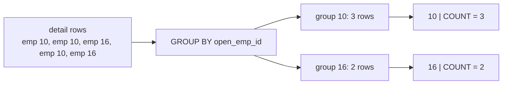

# Aggregate functions and GROUP BY

> **Before this lesson:** you should be able to filter rows with `WHERE`, sort with `ORDER BY` ([ORDER BY, LIMIT and how clauses are evaluated](#/lesson/sql/order-limit)), explain how NULL behaves ([NULL: the four-letter word](#/lesson/sql/null-logic)) and join two tables ([Inner joins](#/lesson/sql/inner-joins)). The idea of the *grain* of a result, what one row stands for, comes from the inner-joins lesson and is used again here.

## In plain words

A database stores facts at the finest level anyone might need: one row per bank transaction, one row per item in an order. People seldom want to read them at that level. A manager asks "how many accounts did each employee open?" or "what did we sell per month?". Those are **summaries**: many detail rows boiled down to a few.

SQL does this in two steps that work together:

- **`GROUP BY`** sorts the rows into piles, one pile for each different value of a column.
- An **aggregate function** looks at one whole pile and returns a single value for it: how many rows, their total, their average, the largest, the smallest.

An everyday picture: emptying a jar of coins. First you sort the coins into piles by kind (that is `GROUP BY`). Then for each pile you count the coins or add up their value (that is the aggregate function). The answer is one line per pile: "20-cent coins: 14".

If you have used a spreadsheet, a pivot table does the same job.

**Why it matters for a job.** Every report, dashboard and metric is a grouped query underneath. It is also the area where interview answers go quietly wrong: the query runs, a number comes out, and the number answers a slightly different question from the one asked. This lesson spends as much time on that danger as on the syntax.

## From a list to groups to counts

The operations manager asks how many accounts each employee has opened. The `account` table records the opening employee in `open_emp_id`. One way is to list that column in order and count by eye:

```sql-run dataset=bank
SELECT open_emp_id FROM account ORDER BY open_emp_id LIMIT 15;
```

You see 5, 5, 5, ... then 6, 6, ... That works for 15 rows and is hopeless for 15 million. Instead, ask the database to form one **group** for each different value:

```sql-run dataset=bank
SELECT open_emp_id
FROM account
GROUP BY open_emp_id;
```

`GROUP BY open_emp_id` collects all rows with the same `open_emp_id` into one group and returns **one row per group**. The 84 accounts shrink to 15 rows, one for each employee who has opened an account. There are no counts yet. Add an aggregate function:

```sql-run dataset=bank
SELECT open_emp_id, COUNT(*) AS how_many
FROM account
GROUP BY open_emp_id
ORDER BY how_many DESC;
```

`COUNT(*)` counts the rows in each group. The top row says employee 11 opened 11 accounts. That is the whole idea; the rest of the lesson is detail and safety.



Suppose only the employees with more than eight accounts are wanted. `WHERE` cannot do it: `WHERE` examines single rows *before* any groups exist, so it has no count to test. The clause that filters finished groups is `HAVING`, the subject of the next lesson. One example for now:

```sql-run dataset=bank
SELECT open_emp_id, COUNT(*) AS how_many
FROM account
GROUP BY open_emp_id
HAVING COUNT(*) > 8;
```

One row: employee 11.

## The five standard aggregate functions

| Function | Returns |
|---|---|
| `MAX(x)` | the largest value in the group |
| `MIN(x)` | the smallest value |
| `AVG(x)` | the average: the total divided by how many values there are |
| `SUM(x)` | the total |
| `COUNT(*)` / `COUNT(x)` | the number of rows / the number of rows where `x` is not NULL |

All five at once, for checking accounts (product code `'CHK'`):

```sql-run dataset=bank
SELECT MAX(avail_balance) AS max_balance,
       MIN(avail_balance) AS min_balance,
       ROUND(AVG(avail_balance), 2) AS avg_balance,
       ROUND(SUM(avail_balance), 2) AS tot_balance,
       COUNT(*) AS num_accounts
FROM account
WHERE product_cd = 'CHK';
```

There are 38 checking accounts; the largest balance is 23921.60, the smallest 0, the average 5645.34 and the total 214522.95.

`MIN` and `MAX` work on anything that can be put in order: numbers, dates, text. `MIN(order_date)` is a customer's first order; `MAX(lname)` is the last name alphabetically.

### One implicit group, or groups you name

The query above has no `GROUP BY` and still used aggregates. When there is no `GROUP BY`, all rows that pass `WHERE` form a single group, called the **implicit group**, and the result is exactly one row.

Now ask for the same figures for *every* product. Adding `product_cd` to the `SELECT` list without grouping is an error in most databases:

```sql
SELECT product_cd, MAX(avail_balance) FROM account;   -- error in PostgreSQL, and in MySQL's default mode
```

The database is being asked for one row (the single maximum) and has seven different product codes to put beside it. It cannot choose. State the groups explicitly:

```sql-run dataset=bank
SELECT product_cd,
       MAX(avail_balance) AS max_balance,
       MIN(avail_balance) AS min_balance,
       ROUND(AVG(avail_balance), 2) AS avg_balance,
       ROUND(SUM(avail_balance), 2) AS tot_balance,
       COUNT(*) AS num_accts
FROM account
GROUP BY product_cd;
```

Seven rows, one per product. The `CHK` row repeats the numbers from the earlier query, which is a good cross-check.

### The golden rule of GROUP BY

> Every item in the `SELECT` list must either appear in the `GROUP BY` clause or sit inside an aggregate function.

The reason: after grouping, each output row stands for a whole group. A column that is neither grouped nor aggregated has many different values inside the group, so there is no single value to show.

> [!WARNING]
> **SQLite does not enforce this rule.** It accepts such "bare" columns and fills them with the value from whichever row of the group it happens to pick. PostgreSQL and modern MySQL reject the query. Run the block below: `account_id` and `cust_id` look reasonable and mean nothing. This is a classic source of wrong answers that look right.

```sql-run dataset=bank
SELECT product_cd, account_id, cust_id, COUNT(*) AS n
FROM account
GROUP BY product_cd;
```

The `BUS` row shows account 172 of customer 33, but there are two `BUS` accounts; the other one is not mentioned.

### Counting distinct values

`COUNT` comes in three forms:

- `COUNT(*)` counts rows.
- `COUNT(x)` counts rows where `x` is not NULL.
- `COUNT(DISTINCT x)` counts how many *different* non-NULL values `x` has.

```sql-run dataset=bank
SELECT COUNT(*)                    AS accounts,
       COUNT(open_emp_id)          AS with_opener,
       COUNT(DISTINCT open_emp_id) AS distinct_openers,
       COUNT(DISTINCT cust_id)     AS distinct_customers
FROM account;
```

84 accounts, each with an opener recorded, opened by 15 different employees for 40 different customers.

Distinct counts are everywhere in reporting. "Daily active users" is the number of different users seen each day:

```sql-run dataset=shop
SELECT date(event_time) AS day,
       COUNT(*) AS events,
       COUNT(DISTINCT customer_id) AS active_customers
FROM web_events
GROUP BY day
ORDER BY day
LIMIT 7;
```

On 1 November there were 19 events, made by 3 different customers.

A caution: distinct counts **cannot be added up**. The number of different customers in a week is not the sum of the seven daily figures, because one customer active on three days would be counted three times. Always recount from the detail rows.

### Calculations inside an aggregate

The argument of an aggregate can be a calculation, not only a column. The gap between a pending balance and an available balance:

```sql-run dataset=bank
SELECT MAX(pending_balance - avail_balance) AS max_uncleared,
       ROUND(AVG(pending_balance - avail_balance), 2) AS avg_diff
FROM account;
```

The subtraction is done on each row first; then `MAX` and `AVG` work on the results.

Revenue per order: multiply quantity by price (less discount) on each item row, then add up per order.

```sql-run dataset=shop
SELECT order_id,
       SUM(quantity) AS items,
       ROUND(SUM(quantity * unit_price * (1 - discount)), 2) AS revenue
FROM order_items
GROUP BY order_id
ORDER BY revenue DESC
LIMIT 5;
```

The calculation can also contain `CASE`, SQL's "if ... then ... else". That lets one query produce several totals, each over a different subset of rows ([CASE patterns](#/lesson/sql/case-patterns)):

```sql-run dataset=bank
SELECT COUNT(*) AS txns,
       ROUND(SUM(CASE WHEN txn_type_cd = 'CDT' THEN amount ELSE 0 END), 2) AS credits,
       ROUND(SUM(CASE WHEN txn_type_cd = 'DBT' THEN amount ELSE 0 END), 2) AS debits
FROM txn;
```

For each row, the first `CASE` yields the amount if the transaction is a credit and 0 otherwise, so its `SUM` is the total of credits only.

### How NULLs are handled

A tiny experiment settles it. The block creates a temporary four-row table holding 1, 3, 5 and NULL, then applies each aggregate.

```sql-run dataset=bank
CREATE TEMP TABLE number_tbl (val INTEGER);
INSERT INTO number_tbl VALUES (1), (3), (5), (NULL);

SELECT COUNT(*)  AS num_rows,
       COUNT(val) AS num_vals,
       SUM(val)   AS total,
       MAX(val)   AS max_val,
       AVG(val)   AS avg_val
FROM number_tbl;
```

- `COUNT(*)` is 4: it counts rows.
- `COUNT(val)` is 3: the NULL is skipped.
- `SUM` is 9, `MAX` is 5 and `AVG` is 3: all of them ignore the NULL. The average is 9 ÷ 3, not 9 ÷ 4.

Two more facts to remember:

- On **no rows at all** (or a group holding only NULLs), `SUM`, `AVG`, `MIN` and `MAX` return **NULL**, while `COUNT` returns **0**. Write `COALESCE(SUM(x), 0)` when a report should show zero; `COALESCE` returns its first argument that is not NULL.
- `AVG(x)` differs from `SUM(x) / COUNT(*)` when NULLs are present. Decide what an empty value means. "Leave it out" is `AVG(x)`. "Treat it as zero" is `AVG(COALESCE(x, 0))`.

```sql-run dataset=mlops
SELECT status,
       COUNT(*) AS runs,
       COUNT(gpu_hours) AS with_gpu_value,
       ROUND(AVG(gpu_hours), 2) AS avg_excluding_null,
       ROUND(AVG(COALESCE(gpu_hours, 0)), 2) AS avg_null_as_zero
FROM runs
GROUP BY status;
```

Training runs that are still going have no `gpu_hours` yet. In a group where some values are missing, the two averages differ; where every value is present, they agree.

## Aggregates and joins: mind the grain

Aggregation happens after `FROM` and `JOIN` have built their combined rows. A join that multiplies rows therefore inflates sums and counts, as [Inner joins](#/lesson/sql/inner-joins) showed. Either aggregate at the right grain in a subquery first, or count distinct keys:

```sql-run dataset=shop
SELECT c.country,
       COUNT(*)                   AS order_lines,
       COUNT(DISTINCT o.order_id) AS orders,
       COUNT(DISTINCT c.customer_id) AS customers
FROM customers c
JOIN orders o       ON o.customer_id = c.customer_id
JOIN order_items oi ON oi.order_id = o.order_id
GROUP BY c.country
ORDER BY orders DESC;
```

For the USA: 162 item rows, belonging to 97 different orders, placed by 31 different customers. Three counts from the same joined rows, each right for its own grain. `COUNT(*)` alone would have reported 162 "orders".

## How the database carries out grouping

There are two methods. The database can **sort** the rows by the grouping column and close a group each time the value changes, or it can build a **hash table**: an in-memory lookup with one entry per group, updated as each row is read. If an index already delivers the rows in order, the sort costs nothing. SQLite's query plan shows `USE TEMP B-TREE FOR GROUP BY` when it has to build a temporary sorted structure:

```sql-run dataset=bank
EXPLAIN QUERY PLAN
SELECT product_cd, COUNT(*) FROM account GROUP BY product_cd;
```

## Worked example: "what is the average order value?"

Mistakes in aggregation are seldom syntax errors. They are *wrong-question* errors. Take this ordinary request and see how many defensible answers the data gives.

**Reading 1: the average of item rows.** Averaging the item table directly:

```sql-run dataset=shop
SELECT ROUND(AVG(quantity * unit_price * (1 - discount)), 2) AS avg_line_value
FROM order_items;
```

398.76. That is the average *item line*, not the average *order*. An order with four lines was counted four times.

**Reading 2: the average of order totals.** Add up to one row per order first, in a subquery, then average those totals:

```sql-run dataset=shop
SELECT ROUND(AVG(order_total), 2) AS avg_order_value, COUNT(*) AS orders
FROM (SELECT order_id, SUM(quantity * unit_price * (1 - discount)) AS order_total
      FROM order_items
      GROUP BY order_id);
```

739.86 over 249 orders, nearly twice the first figure.

**Reading 3: total revenue divided by the number of orders.** The same arithmetic as reading 2, in one step:

```sql-run dataset=shop
SELECT ROUND(SUM(quantity * unit_price * (1 - discount)) / COUNT(DISTINCT order_id), 2) AS revenue_per_order
FROM order_items;
```

**Reading 4: the average per customer.** A different grain again: total per customer, then the average of those totals. Each customer counts once however often they buy.

```sql-run dataset=shop
SELECT ROUND(AVG(customer_total), 2) AS avg_spend_per_customer, COUNT(*) AS customers
FROM (SELECT o.customer_id, SUM(oi.quantity * oi.unit_price * (1 - oi.discount)) AS customer_total
      FROM orders o JOIN order_items oi ON oi.order_id = o.order_id
      GROUP BY o.customer_id);
```

2489.54 over 74 customers.

Three different numbers, all of them "the average". The lesson: **an average is defined by its grain**, the thing you take one value per. Decide it before writing, and aggregate in two steps (a subquery to reach the grain, then the outer aggregate) whenever the table is finer than the grain you want.

### Weighted and unweighted averages

The same trap appears with rates. "The average discount" could treat every item line equally, or could weigh each line by the money involved:

```sql-run dataset=shop
SELECT ROUND(100.0 * AVG(discount), 2) AS avg_discount_pct_per_line,
       ROUND(100.0 * SUM(quantity * unit_price * discount) / SUM(quantity * unit_price), 2) AS revenue_weighted_discount_pct
FROM order_items;
```

6.43% is the average discount per line. 6.76% is the share of list-price revenue that was given away; it is higher because large lines are discounted more. An average in which bigger items count for more is a **weighted average**. When combining rates from several groups you nearly always want the weighted form: `SUM(numerator) / SUM(denominator)`, not `AVG(ratio)`.

## A tour of aggregates on one table

One row per machine-learning experiment, using every common aggregate:

```sql-run dataset=mlops
SELECT e.name AS experiment,
       COUNT(*)                                   AS runs,
       COUNT(r.ended_at)                          AS ended_runs,
       COUNT(DISTINCT r.model_type)               AS model_types,
       group_concat(DISTINCT r.model_type)        AS which_types,
       MIN(r.started_at)                          AS first_run,
       MAX(r.started_at)                          AS last_run,
       ROUND(SUM(r.gpu_hours), 1)                 AS gpu_hours,
       ROUND(AVG(r.gpu_hours), 2)                 AS avg_gpu_hours,
       ROUND(MAX(r.learning_rate) / MIN(r.learning_rate), 0) AS lr_range_ratio
FROM experiments e
JOIN runs r ON r.experiment_id = e.experiment_id
GROUP BY e.experiment_id, e.name
ORDER BY runs DESC;
```

Things to check in the output. `ended_runs` is smaller than `runs` wherever a run is still going, because `COUNT` of a column skips NULLs. `MIN` and `MAX` work on the timestamps because ISO-format text sorts in time order. `group_concat(DISTINCT ...)` lists each model type once. The last column divides one aggregate by another: the largest learning rate tried over the smallest, a quick measure of how wide a search was. The query groups by both `experiment_id` and `name` so that `name` may appear in the `SELECT` list under the golden rule.

## Aggregates that SQLite lacks

| Need | PostgreSQL / MySQL | SQLite |
|---|---|---|
| Variance, standard deviation | `VAR_SAMP(x)`, `STDDEV_SAMP(x)` | variance by formula (below); the square root is not available in this page |
| Median, percentiles | `percentile_cont(0.5) WITHIN GROUP (ORDER BY x)` (PostgreSQL) | window functions ([Top-N, deduplication, pivoting and medians](#/lesson/sql/patterns-1)) |
| Count rows meeting a condition | `COUNT(*) FILTER (WHERE c)` | the same `FILTER` syntax, or `SUM(CASE ...)` |
| True for all / true for any | `BOOL_AND(c)`, `BOOL_OR(c)` | `MIN(c)`, `MAX(c)` on 0/1 values |

**Variance** measures how spread out values are around their average. It can be computed from sums alone:

```sql-run dataset=mlops
SELECT deployment_id,
       COUNT(*) AS n,
       ROUND(AVG(latency_ms), 1) AS mean_latency,
       ROUND((SUM(latency_ms * latency_ms) - SUM(latency_ms) * SUM(latency_ms) * 1.0 / COUNT(*))
             / (COUNT(*) - 1), 1) AS variance_latency,
       MIN(latency_ms < 200) AS all_under_200ms,
       MAX(latency_ms > 300) AS any_over_300ms
FROM predictions
GROUP BY deployment_id
HAVING COUNT(*) >= 15
ORDER BY variance_latency DESC
LIMIT 6;
```

The last two columns use a trick. A comparison is 1 when true and 0 when false. `MIN` of those is 1 only if the comparison holds for *every* row; `MAX` is 1 if it holds for *any* row.

> [!INTERVIEW]
> When asked for any "average" or "rate", restate the grain before writing: "average *per order*, so I will first sum the lines per order, then average." It takes five seconds and prevents the most common wrong answer in SQL interviews.

## Pitfalls

- **Bare columns** in a grouped query: allowed by SQLite, meaningless in the result.
- **`COUNT(*)` versus `COUNT(col)`**: rows versus non-NULL values.
- **Adding up distinct counts** across days or groups.
- **Aggregating joined rows** at the wrong grain.
- **NULL from a `SUM` over no rows**: use `COALESCE` where zero is expected.
- **Averaging whole numbers by hand**: `AVG` returns a decimal, but `SUM(x) / COUNT(*)` on integers is integer division.
- **Averaging ratios** instead of dividing sums.

## Summary

- `GROUP BY` forms one group per different value; an aggregate function returns one value per group.
- Without `GROUP BY`, aggregates treat all filtered rows as one implicit group and return one row.
- Every selected item must be grouped or aggregated. SQLite will not stop you; discipline must.
- `COUNT(*)` counts rows, `COUNT(x)` non-NULL values, `COUNT(DISTINCT x)` different non-NULL values.
- Aggregates ignore NULLs; over no rows, `SUM`, `AVG`, `MIN` and `MAX` give NULL and `COUNT` gives 0.
- An average is defined by its grain; reach the grain in a subquery, then aggregate.

## Glossary

- **Aggregate function** — a function that turns the rows of a group into one value (`COUNT`, `SUM`, `AVG`, `MIN`, `MAX`).
- **Group** — a set of rows that share the same value in the grouping column or columns.
- **`GROUP BY`** — the clause that forms groups and returns one row per group.
- **Implicit group** — the single group made of all rows when a query uses aggregates without `GROUP BY`.
- **Bare column** — a column in a grouped query that is neither grouped nor aggregated.
- **`COUNT(DISTINCT x)`** — the number of different non-NULL values of `x`.
- **`HAVING`** — the clause that filters groups after they are formed.
- **Grain** — what one row of a table or result stands for.
- **`COALESCE`** — a function returning its first argument that is not NULL.
- **Weighted average** — an average in which larger items count for more, computed as a sum divided by a sum.
- **Hash table** — an in-memory lookup structure; here, one entry per group.
- **Variance** — a measure of how spread out values are around their average.

```quiz
[
  {"q": "A table has val = 1, 3, 5, NULL. What is AVG(val)?", "options": ["2.25", "3", "NULL", "9"], "answer": 1, "explain": "AVG ignores NULLs: (1 + 3 + 5) / 3 = 3."},
  {"q": "What does COUNT(col) count?", "options": ["All rows", "Rows where col is not NULL", "Different values of col", "NULL values of col"], "answer": 1, "explain": "COUNT of a column skips NULLs; COUNT(*) counts rows."},
  {"q": "With no GROUP BY, SELECT MAX(avail_balance) FROM account returns...", "options": ["One row per account", "Exactly one row", "An error", "One row per product"], "answer": 1, "explain": "All rows form a single implicit group, so there is one result row."},
  {"q": "In SQLite, SELECT product_cd, account_id, COUNT(*) FROM account GROUP BY product_cd returns for account_id...", "options": ["An error", "NULL", "A value from an arbitrary row of each group", "The smallest account_id"], "answer": 2, "explain": "SQLite permits bare columns and takes the value from whichever row it picks; other databases reject the query."},
  {"q": "What does SUM(x) return when no rows match the WHERE clause?", "options": ["0", "NULL", "An error", "An empty result"], "answer": 1, "explain": "SUM over no rows is NULL, while COUNT is 0. Use COALESCE to show a zero."},
  {"q": "Why can't weekly distinct users be computed by summing daily distinct users?", "options": ["SUM cannot be applied to counts", "A user active on several days would be counted once per day", "Weeks vary in length", "It can"], "answer": 1, "explain": "Distinct counts cannot be added; recount from the detail rows."},
  {"q": "Which clause filters groups?", "options": ["WHERE", "HAVING", "ON", "DISTINCT"], "answer": 1, "explain": "HAVING is applied after grouping and may use aggregates; WHERE filters single rows before grouping."},
  {"q": "order_items has several rows per order. AVG(quantity * unit_price) over that table gives...", "options": ["The average order value", "The average value of one item line", "The total revenue", "An error"], "answer": 1, "explain": "The table's grain is one item line, so that is what is averaged; sum per order first to get the average order value."}
]
```

> **Source:** Beaulieu, *Learning SQL*, ch. 8 "Grouping and Aggregates" (grouping concepts, aggregate functions, implicit versus explicit groups, counting distinct values, using expressions, how nulls are handled), restated in original wording with this guide's own datasets.
