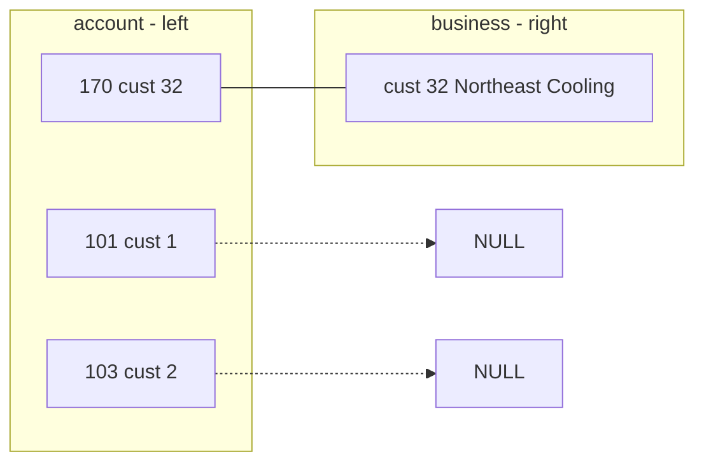

# Outer joins

> **Before this lesson:** you should be able to write an inner join and explain why it leaves out rows that have no partner ([Inner joins](#/lesson/sql/inner-joins)), know how NULL behaves in comparisons and what `COALESCE` does ([NULL: the four-letter word](#/lesson/sql/null-logic)), and count with `GROUP BY` ([Aggregate functions and GROUP BY](#/lesson/sql/group-by)). The self join comes from [Three or more tables, self joins and non-equi joins](#/lesson/sql/multi-self-joins).

## In plain words

An inner join shows a row only if it finds a partner in the other table. Very often that loses rows the question wanted. "List **all** customers with the number of orders each has placed" must include customers with no orders, shown with a zero. An inner join would drop them without a word.

An **outer join** keeps the rows that found no partner. Where the partner's columns should be, it puts NULL, the marker for "no value".

An everyday picture: a class register with a column for each pupil's project mark. Go down the register and copy each mark from the pile of marked projects. A pupil who handed nothing in still has a line on the register; their mark box stays blank. That is a **left outer join**: every line of the register (the left list) is kept, and the pile of projects (the right list) fills in what it can. An inner join would have printed a register with the missing pupils removed.

**Why it matters for a job.** Reports where *absence is information* are everywhere: customers who bought nothing, branches with no sales this month, products never ordered. Outer joins are also a favourite interview topic because of one trap, covered below: a single misplaced condition quietly turns an outer join back into an inner join.

## The problem with inner joins

In the bank data, `business` holds one row per company customer. Customers who are people have no row there. Join `account` to `business`:

```sql-run dataset=bank
SELECT a.account_id, a.cust_id, b.name
FROM account a
JOIN business b ON a.cust_id = b.cust_id
ORDER BY a.account_id;
```

Sixteen rows: the accounts owned by companies. The bank has 84 accounts. The other 68 belong to people, found no match in `business`, and were left out. If the report was meant to list *every* account and show a company name where there is one, the result is wrong, and nothing warned you.

## Left outer joins

A **left outer join** keeps every row of the table written to the *left* of the `JOIN` keyword. Where the right table has no match, its columns are NULL.

```sql-run dataset=bank
SELECT a.account_id, a.cust_id, b.name
FROM account a
LEFT OUTER JOIN business b ON a.cust_id = b.cust_id
ORDER BY a.account_id
LIMIT 12;
```

Only the join keyword changed. Now accounts 101 and 102, which belong to a person (customer 1), appear with `NULL` in the `name` column. Remove the `LIMIT` and all 84 accounts are there.

The word `OUTER` is optional; nearly everyone writes `LEFT JOIN`.

A helpful way to think about it: the left table **decides how many rows there are** (at least one per left row), and the right table **supplies values where a match exists**.



A left join to `individual` is the mirror image: names appear where the owner is a person and NULL where the owner is a company.

```sql-run dataset=bank
SELECT a.account_id, a.cust_id, i.fname, i.lname
FROM account a
LEFT JOIN individual i ON a.cust_id = i.cust_id
WHERE a.account_id BETWEEN 166 AND 174;
```

### Counting with a left join

The classic use: a count that must include zeros.

```sql-run dataset=shop
SELECT c.customer_id, c.first_name, COUNT(o.order_id) AS orders
FROM customers c
LEFT JOIN orders o ON o.customer_id = c.customer_id
GROUP BY c.customer_id, c.first_name
ORDER BY orders, c.customer_id
LIMIT 10;
```

The list begins with customers who have 0 orders, such as customer 13, Liam.

Look closely at what is counted: `COUNT(o.order_id)`, a column from the **right** table, not `COUNT(*)`. A customer with no orders still has one row in the joined result, the one padded with NULLs. `COUNT(*)` counts rows, so it would report 1. `COUNT(o.order_id)` skips NULLs, so it correctly reports 0.

## Left versus right

`RIGHT OUTER JOIN` is the same idea with the roles swapped: every row of the *right* table is kept.

```sql
SELECT c.cust_id, b.name
FROM customer c
RIGHT OUTER JOIN business b ON c.cust_id = b.cust_id;
```

The words `LEFT` and `RIGHT` say which table is kept in full; the *other* table is the one whose columns may be filled with NULL. Any right join can be rewritten as a left join by swapping the two tables, and most style guides ask you to. A query that reads top to bottom with left joins only ("start from these rows, attach those if they exist") is much easier to follow.

> [!NOTE]
> SQLite gained `RIGHT JOIN` and `FULL JOIN` in version 3.39 (2022). MySQL has `LEFT` and `RIGHT` but **no `FULL OUTER JOIN`**. PostgreSQL, SQL Server and Oracle support all three.

## Full outer joins

A `FULL OUTER JOIN` keeps unmatched rows from **both** sides. It suits **reconciliation**: comparing two lists to see what matches, what is only in the first and what is only in the second.

The shop has a table of real customers and a table of imported sign-ups. Which email addresses are in both, and which in one only?

```sql-run dataset=shop
-- Reconcile imported emails against real customers
WITH imp AS (SELECT DISTINCT lower(trim(email)) AS email FROM customer_imports),
     cust AS (SELECT lower(email) AS email FROM customers WHERE email IS NOT NULL)
SELECT CASE WHEN imp.email IS NULL THEN 'customer only'
            WHEN cust.email IS NULL THEN 'import only'
            ELSE 'both' END AS status,
       COUNT(*) AS n
FROM imp
FULL OUTER JOIN cust ON cust.email = imp.email
GROUP BY status;
```

The `WITH` clause names two cleaned-up lists, `imp` and `cust`. The full join lines them up by email. A row with NULL on the import side came from customers alone, and the other way round; `CASE` turns that into a label. 29 addresses are in both lists and 49 belong to customers who were never in an import.

Where `FULL JOIN` is missing (MySQL), build it from two pieces: a left join, plus the unmatched rows of the other side.

```sql
SELECT ... FROM a LEFT JOIN b ON ...
UNION ALL
SELECT ... FROM b LEFT JOIN a ON ... WHERE a.key IS NULL;
```

## ON versus WHERE: the outer-join trap

With inner joins it made no difference whether a condition sat in `ON` or in `WHERE`. With outer joins it makes a great deal of difference.

- A condition in **`ON`** decides which right-hand rows *count as a match*. A left row with no match is still kept, padded with NULLs.
- A condition in **`WHERE`** is applied *after* the join, to the padded rows too. A test on a right-table column compares NULL with something, which is never true, so the padded rows are thrown away. Your outer join has quietly become an inner join.

Task: count each customer's **delivered** orders, keeping customers who have none. The wrong version first; the outer query counts how many customers end up listed.

```sql-run dataset=shop
SELECT COUNT(*) AS customers_listed
FROM (SELECT c.customer_id, COUNT(o.order_id) AS delivered
      FROM customers c
      LEFT JOIN orders o ON o.customer_id = c.customer_id
      WHERE o.status = 'delivered'          -- removes the NULL-padded rows
      GROUP BY c.customer_id);
```

69 customers, out of 80. Eleven are missing: those with no orders at all (their padded row has `o.status` NULL) and those with orders but none delivered.

The right version makes the status test part of *matching*:

```sql-run dataset=shop
SELECT COUNT(*) AS customers_listed
FROM (SELECT c.customer_id, COUNT(o.order_id) AS delivered
      FROM customers c
      LEFT JOIN orders o ON o.customer_id = c.customer_id
                        AND o.status = 'delivered'
      GROUP BY c.customer_id);
```

All 80. The condition now says "attach an order only if it belongs to this customer *and* was delivered". A customer with no such order keeps a padded row and a count of 0.

> [!WARNING]
> **Rule of thumb for a `LEFT JOIN`:** conditions on the *right* table go in **`ON`**; conditions on the *left* table go in **`WHERE`**. (A left-table condition in `ON` does *not* remove left rows. It only stops them from matching, which is rarely what you mean.)

## The anti-join: LEFT JOIN ... IS NULL

Sometimes a test on a right-table column in `WHERE` is exactly what you want: to find the rows with **no** match.

```sql-run dataset=shop
SELECT c.customer_id, c.first_name, c.last_name
FROM customers c
LEFT JOIN orders o ON o.customer_id = c.customer_id
WHERE o.order_id IS NULL;
```

Six customers who have never ordered. The left join pads their row with NULLs, and `WHERE o.order_id IS NULL` keeps only those padded rows. This pattern is called an **anti-join**. Test a column that can never be NULL in a real match, normally the right table's primary key; otherwise a real match with an empty cell would be mistaken for "no match". The result is the same as `NOT EXISTS` from [Correlated subqueries, EXISTS and subqueries as data sources](#/lesson/sql/correlated-exists); use whichever reads better.

## Outer joins to two tables

One table can be outer-joined to two others. Every account with *either* the person's name or the company's name:

```sql-run dataset=bank
SELECT a.account_id, a.product_cd,
       i.fname || ' ' || i.lname AS person_name,
       b.name AS business_name
FROM account a
LEFT JOIN individual i ON a.cust_id = i.cust_id
LEFT JOIN business b   ON a.cust_id = b.cust_id
WHERE a.account_id BETWEEN 164 AND 172;
```

Each row has one name filled in and NULL in the other. `COALESCE`, which returns its first argument that is not NULL, folds the two into one column:

```sql-run dataset=bank
SELECT a.account_id,
       COALESCE(i.fname || ' ' || i.lname, b.name) AS customer_name,
       CASE WHEN b.cust_id IS NOT NULL THEN 'business' ELSE 'individual' END AS kind
FROM account a
LEFT JOIN individual i ON a.cust_id = i.cust_id
LEFT JOIN business b   ON a.cust_id = b.cust_id
ORDER BY a.account_id DESC
LIMIT 8;
```

For a company, `i.fname || ' ' || i.lname` is NULL (joining text to NULL gives NULL), so `COALESCE` moves on to `b.name`.

### Chains of joins: once outer, stay outer

When joins form a chain (customers to orders to order items), an inner join later in the chain can undo an earlier outer join.

```sql-run dataset=shop
-- Intention: all customers, with the items they bought (if any)
SELECT COUNT(DISTINCT c.customer_id) AS customers_kept
FROM customers c
LEFT JOIN orders o       ON o.customer_id = c.customer_id
JOIN order_items oi      ON oi.order_id = o.order_id;     -- inner join drops NULL-padded rows
```

74, not 80. For a customer without orders, the padded row has `o.order_id` NULL. The inner join then asks for order items whose `order_id` equals NULL; there are none, so the customer disappears again. Make the later join a left join as well:

```sql-run dataset=shop
SELECT COUNT(DISTINCT c.customer_id) AS customers_kept
FROM customers c
LEFT JOIN orders o       ON o.customer_id = c.customer_id
LEFT JOIN order_items oi ON oi.order_id = o.order_id;
```

80. An alternative that is often clearer: do the inner part in a subquery, and outer-join to the finished result.

```sql-run dataset=shop
SELECT c.customer_id, c.first_name, COALESCE(t.items, 0) AS items_bought
FROM customers c
LEFT JOIN (SELECT o.customer_id, SUM(oi.quantity) AS items
           FROM orders o
           JOIN order_items oi ON oi.order_id = o.order_id
           GROUP BY o.customer_id) t ON t.customer_id = c.customer_id
ORDER BY items_bought
LIMIT 8;
```

The subquery `t` holds one row per customer who bought something. Customers missing from it get NULL from the left join, and `COALESCE(t.items, 0)` shows that as 0.

## Self outer joins

The self join of employees to their managers lost the president, who has no manager. A left self join keeps him:

```sql-run dataset=bank
SELECT e.fname || ' ' || e.lname AS employee,
       COALESCE(mgr.fname || ' ' || mgr.lname, '(none)') AS manager
FROM employee e
LEFT JOIN employee mgr ON e.superior_emp_id = mgr.emp_id
ORDER BY e.emp_id
LIMIT 8;
```

Michael Smith now appears, with `(none)` as his manager.

Swap the roles, "every employee and how many people report to them", and the kept side is the manager:

```sql-run dataset=bank
SELECT mgr.fname || ' ' || mgr.lname AS employee,
       COUNT(e.emp_id) AS direct_reports
FROM employee mgr
LEFT JOIN employee e ON e.superior_emp_id = mgr.emp_id
GROUP BY mgr.emp_id
ORDER BY direct_reports DESC, mgr.emp_id
LIMIT 8;
```

Susan Hawthorne has five direct reports; most employees, further down the full list, have zero. Same two copies of the table, same condition; choosing which side is kept changes the question being answered.

## Worked example: a report that must not lose rows

*For every branch: the number of employees, the number of accounts opened there, and the number of transactions carried out there in December 2024, showing zeros.*

A first attempt joins everything to `branch`:

```sql-run dataset=bank
SELECT b.name,
       COUNT(DISTINCT e.emp_id)     AS employees,
       COUNT(DISTINCT a.account_id) AS accounts,
       COUNT(DISTINCT t.txn_id)     AS december_txns
FROM branch b
LEFT JOIN employee e ON e.assigned_branch_id = b.branch_id
LEFT JOIN account a  ON a.open_branch_id = b.branch_id
LEFT JOIN txn t      ON t.execution_branch_id = b.branch_id
                    AND t.txn_date >= '2024-12-01' AND t.txn_date < '2025-01-01'
GROUP BY b.branch_id, b.name;
```

The numbers are right, but only because of `COUNT(DISTINCT ...)`. Employees, accounts and transactions have nothing to do with each other, so joining all three to one branch pairs every employee with every account with every transaction. Headquarters alone produces 10 × 12 × 2 = 240 rows. On real data that intermediate result can run to billions of rows, and any `SUM` over it would be wrong. Note that the date test sits in **`ON`**, so that a branch with no December transactions still appears.

The sturdy version totals each table separately and left-joins the three small summaries:

```sql-run dataset=bank
SELECT b.name,
       COALESCE(e.n, 0) AS employees,
       COALESCE(a.n, 0) AS accounts,
       COALESCE(a.balance, 0) AS total_balance,
       COALESCE(t.n, 0) AS december_txns
FROM branch b
LEFT JOIN (SELECT assigned_branch_id AS branch_id, COUNT(*) AS n
           FROM employee GROUP BY assigned_branch_id) e ON e.branch_id = b.branch_id
LEFT JOIN (SELECT open_branch_id AS branch_id, COUNT(*) AS n, ROUND(SUM(avail_balance), 2) AS balance
           FROM account GROUP BY open_branch_id) a ON a.branch_id = b.branch_id
LEFT JOIN (SELECT execution_branch_id AS branch_id, COUNT(*) AS n
           FROM txn
           WHERE txn_date >= '2024-12-01' AND txn_date < '2025-01-01'
           GROUP BY execution_branch_id) t ON t.branch_id = b.branch_id
ORDER BY b.branch_id;
```

Each summary has at most one row per branch, so every join is one-to-one, a `SUM` is safe, and `COALESCE` turns "no summary row" into zero. Here the date test is inside the subquery's own `WHERE`, which is fine: it filters `txn` before the join. This **aggregate first, then left join** shape is the standard way to build a report with several measures.

## Outer joins in interviews

Recognise these phrases as signals for an outer join: "**all** customers, including those with no orders", "show zero when...", "**even if** there is no matching...", "which X have **no** Y". The usual follow-up questions:

- *Where does the filter go?* Right-table conditions in `ON`; left-table conditions in `WHERE`.
- *What do you count?* A right-table column, never `*`.
- *How do you find the unmatched rows?* `LEFT JOIN ... WHERE right.key IS NULL`.

```sql-run dataset=mlops
-- Experiments and how many of their runs became registered models (zeros included)
SELECT e.name, COUNT(DISTINCT r.run_id) AS runs, COUNT(m.model_id) AS registered_models
FROM experiments e
LEFT JOIN runs r   ON r.experiment_id = e.experiment_id
LEFT JOIN models m ON m.run_id = r.run_id
GROUP BY e.experiment_id, e.name
ORDER BY registered_models DESC;
```

Both joins are left joins (once outer, stay outer), and both counts use columns from the right-hand tables. `COUNT(DISTINCT r.run_id)` is needed because a run with two registered models appears on two rows.

> [!INTERVIEW]
> "Why did my `LEFT JOIN` return fewer rows than the left table?" The expected answer: a condition on the right table in `WHERE` removed the NULL-padded rows, or a later inner join did. Move the condition into `ON`, or make the later joins left joins too.

## Pitfalls

- **A right-table condition in `WHERE`** silently turns a `LEFT JOIN` into an inner join.
- **`COUNT(*)` after a left join** counts the NULL-padded row as 1.
- **An inner join after an outer join** in a chain drops the padded rows.
- **An anti-join that tests a column which may be NULL.** Test the right table's primary key.
- **Two unrelated "many" tables joined to one parent** multiply each other's rows. Total each one separately first.

## Summary

- A left outer join keeps every left row and fills missing right columns with NULL; a right join is its mirror; a full join keeps both sides.
- Put right-table conditions in `ON` to keep unmatched left rows; in `WHERE` they remove them.
- `LEFT JOIN ... WHERE right.pk IS NULL` is the anti-join, equivalent to `NOT EXISTS`.
- Count a right-table column, not `*`.
- Keep a chain outer all the way, or join to a subquery built beforehand.

## Glossary

- **Outer join** — a join that keeps rows even when they have no partner in the other table.
- **Left outer join (`LEFT JOIN`)** — keeps every row of the left table; unmatched right columns are NULL.
- **Right outer join** — keeps every row of the right table.
- **Full outer join** — keeps unmatched rows of both tables.
- **Preserved table** — the table whose rows an outer join keeps in full.
- **NULL-padded row** — a kept row whose columns from the other table are all NULL because no match was found.
- **Anti-join** — a query that returns the rows with no match in another table.
- **Reconciliation** — comparing two lists to find what matches and what is on one side only.
- **`COALESCE`** — a function that returns its first argument that is not NULL.
- **Aggregate first, then left join** — the report pattern of summarising each "many" table separately before joining the summaries to the parent.

```quiz
[
  {"q": "In A LEFT JOIN B, which rows are guaranteed to appear?", "options": ["All rows of B", "All rows of A", "Only matching rows", "All rows of both"], "answer": 1, "explain": "The left table is kept in full; unmatched rows get NULL in B's columns."},
  {"q": "customers LEFT JOIN orders ... WHERE o.status = 'delivered' behaves like...", "options": ["A left join", "An inner join", "A full join", "A cross join"], "answer": 1, "explain": "The WHERE test is never true for NULL-padded rows, so customers without a matching order are removed."},
  {"q": "To count orders per customer including zero, which is correct after a LEFT JOIN?", "options": ["COUNT(*)", "COUNT(o.order_id)", "COUNT(c.customer_id)", "SUM(1)"], "answer": 1, "explain": "COUNT of a right-table column skips the NULL-padded row and gives 0; the others count that row as 1."},
  {"q": "How do you find customers with no orders using a join?", "options": ["INNER JOIN ... WHERE o.order_id IS NULL", "LEFT JOIN ... WHERE o.order_id IS NULL", "LEFT JOIN ... ON o.order_id IS NULL", "RIGHT JOIN ... WHERE c.customer_id IS NULL"], "answer": 1, "explain": "Left join, then keep the rows where the right table's key is NULL: the anti-join."},
  {"q": "Which join does MySQL lack?", "options": ["LEFT JOIN", "RIGHT JOIN", "FULL OUTER JOIN", "CROSS JOIN"], "answer": 2, "explain": "Build it from a LEFT JOIN plus, with UNION ALL, the unmatched rows of the other side."},
  {"q": "Why does adding an INNER JOIN to order_items after customers LEFT JOIN orders drop customers without orders?", "options": ["Inner joins are run first", "The NULL order_id of the padded rows matches no order_items row", "order_items has no index", "It does not"], "answer": 1, "explain": "The inner join removes the padded rows; later joins must also be LEFT, or the inner part must go in a subquery."},
  {"q": "A RIGHT JOIN B is equivalent to...", "options": ["B LEFT JOIN A", "A LEFT JOIN B", "A FULL JOIN B", "A CROSS JOIN B"], "answer": 0, "explain": "Swapping the two tables turns a right join into a left join."},
  {"q": "In customers LEFT JOIN orders, where should a test on orders.status go if customers without such orders must still be listed?", "options": ["In WHERE", "In the ON clause", "In HAVING", "In ORDER BY"], "answer": 1, "explain": "In ON the test only limits which orders match; in WHERE it would remove the NULL-padded customers."}
]
```

> **Source:** Beaulieu, *Learning SQL*, ch. 10 "Joins Revisited" (outer joins, left versus right outer joins, three-way outer joins, self outer joins), restated in original wording with this guide's own datasets.
