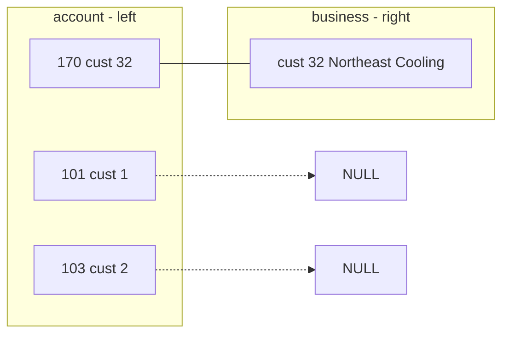

# Outer joins

An inner join returns only the rows that find a partner. Very often that is not what the question asks: "list **all** customers with their order counts" must include customers with zero orders; "show **every** account and its business name, if any" must include accounts owned by individuals. **Outer joins** keep the unmatched rows. This lesson covers left, right and full outer joins, three-way and self outer joins, the crucial ON-versus-WHERE distinction, and the anti-join idiom.

## The problem with inner joins

So far every join condition has involved a foreign key that always found its parent. Now consider joining `account` to `business`. Only business customers have a row in `business`:

```sql-run dataset=bank
SELECT a.account_id, a.cust_id, b.name
FROM account a
JOIN business b ON a.cust_id = b.cust_id
ORDER BY a.account_id;
```

Sixteen rows — only the business accounts. The 68 accounts owned by individuals found no match and were dropped. If the report is supposed to list *all* accounts and show a business name where there is one, the inner join gives the wrong answer without any warning.

## Left outer joins

A **left outer join** keeps every row from the table on the *left* of the JOIN keyword. Where the right table has no match, its columns are filled with NULL:

```sql-run dataset=bank
SELECT a.account_id, a.cust_id, b.name
FROM account a
LEFT OUTER JOIN business b ON a.cust_id = b.cust_id
ORDER BY a.account_id
LIMIT 12;
```

All 84 accounts are present; `name` is NULL for individuals. The keyword `OUTER` is optional — `LEFT JOIN` is what almost everybody writes.

The book's way to think about it: the left table **determines the number of rows** (at least one per left row), and the right table **supplies column values when a match exists**.



A left join to `individual` is the mirror image — names where the owner is a person:

```sql-run dataset=bank
SELECT a.account_id, a.cust_id, i.fname, i.lname
FROM account a
LEFT JOIN individual i ON a.cust_id = i.cust_id
WHERE a.account_id BETWEEN 166 AND 174;
```

### Counting with left joins

The classic use: an aggregate that must include zeros.

```sql-run dataset=shop
SELECT c.customer_id, c.first_name, COUNT(o.order_id) AS orders
FROM customers c
LEFT JOIN orders o ON o.customer_id = c.customer_id
GROUP BY c.customer_id, c.first_name
ORDER BY orders, c.customer_id
LIMIT 10;
```

Count a column from the **right** table (`COUNT(o.order_id)`), not `COUNT(*)`. A customer with no orders still has one row in the joined result — the NULL-padded one — so `COUNT(*)` would report 1.

## Left versus right outer joins

`RIGHT OUTER JOIN` is the same thing with the roles reversed: every row of the *right* table is kept.

```sql
SELECT c.cust_id, b.name
FROM customer c
RIGHT OUTER JOIN business b ON c.cust_id = b.cust_id;
```

The keywords `LEFT` and `RIGHT` only tell the server **which table is allowed to have gaps filled with NULLs** — the *other* one. Any right join can be rewritten as a left join by swapping the table order, and nearly every style guide says to do so: a query that reads top to bottom with only left joins ("start from these rows, optionally attach those") is much easier to follow.

> [!NOTE]
> SQLite added `RIGHT JOIN` and `FULL JOIN` only in version 3.39 (2022). MySQL has `LEFT` and `RIGHT` but **no `FULL OUTER JOIN`**; PostgreSQL, SQL Server and Oracle support all three.

## Full outer joins

A `FULL OUTER JOIN` keeps unmatched rows from **both** sides. It is the right tool for reconciliation: compare two lists and see what matches, what is only on the left and what is only on the right.

```sql-run dataset=shop
-- Reconcile imported emails against real customers
WITH imp AS (SELECT DISTINCT lower(trim(email)) AS email FROM customer_imports),
     cust AS (SELECT lower(email) AS email FROM customers WHERE email IS NOT NULL)
SELECT CASE WHEN imp.email IS NULL THEN 'customer only'
            WHEN cust.email IS NULL THEN 'import only'
            ELSE 'both' END AS status,
       COUNT(*) AS n
FROM imp
FULL OUTER JOIN cust ON cust.email = imp.email
GROUP BY status;
```

Where `FULL JOIN` is unavailable (MySQL, old SQLite), emulate it: a left join, plus the unmatched rows from the right side:

```sql
SELECT ... FROM a LEFT JOIN b ON ...
UNION ALL
SELECT ... FROM b LEFT JOIN a ON ... WHERE a.key IS NULL;
```

## ON versus WHERE: the outer-join trap

With inner joins it did not matter whether a condition sat in ON or WHERE. With outer joins it matters a great deal.

- A condition in **ON** decides which right-hand rows *match*. Left rows without a match are still kept (NULL-padded).
- A condition in **WHERE** is applied *after* the join, to the padded rows. A test on a right-table column is UNKNOWN for the padded rows — so they are filtered out, and your outer join quietly becomes an inner join.

Count each customer's **delivered** orders, keeping customers with none. Wrong:

```sql-run dataset=shop
SELECT COUNT(*) AS customers_listed
FROM (SELECT c.customer_id, COUNT(o.order_id) AS delivered
      FROM customers c
      LEFT JOIN orders o ON o.customer_id = c.customer_id
      WHERE o.status = 'delivered'          -- kills the NULL-padded rows
      GROUP BY c.customer_id);
```

Right — the status test is part of *matching*:

```sql-run dataset=shop
SELECT COUNT(*) AS customers_listed
FROM (SELECT c.customer_id, COUNT(o.order_id) AS delivered
      FROM customers c
      LEFT JOIN orders o ON o.customer_id = c.customer_id
                        AND o.status = 'delivered'
      GROUP BY c.customer_id);
```

All 80 customers now appear, some with a count of zero.

> [!WARNING]
> **Rule of thumb:** in a LEFT JOIN, conditions on the *right* table go in **ON**; conditions on the *left* table go in **WHERE**. (A left-table condition in ON does *not* filter left rows — it only stops them from matching, which is rarely what you intend.)

## The anti-join: LEFT JOIN … IS NULL

Sometimes filtering on a right-table column in WHERE is exactly what you want — to find the rows with **no** match:

```sql-run dataset=shop
SELECT c.customer_id, c.first_name, c.last_name
FROM customers c
LEFT JOIN orders o ON o.customer_id = c.customer_id
WHERE o.order_id IS NULL;
```

Customers who never ordered. Test a column that can never be NULL in a real match — the right table's primary key. This is equivalent to `NOT EXISTS`; use whichever reads better (optimizers treat them alike).

## Three-way outer joins

You can outer-join one table to two others. The book lists every account with *either* the individual's name or the business name:

```sql-run dataset=bank
SELECT a.account_id, a.product_cd,
       i.fname || ' ' || i.lname AS person_name,
       b.name AS business_name
FROM account a
LEFT JOIN individual i ON a.cust_id = i.cust_id
LEFT JOIN business b   ON a.cust_id = b.cust_id
WHERE a.account_id BETWEEN 164 AND 172;
```

Each row has one of the two names and NULL in the other. `COALESCE` folds them into one column:

```sql-run dataset=bank
SELECT a.account_id,
       COALESCE(i.fname || ' ' || i.lname, b.name) AS customer_name,
       CASE WHEN b.cust_id IS NOT NULL THEN 'business' ELSE 'individual' END AS kind
FROM account a
LEFT JOIN individual i ON a.cust_id = i.cust_id
LEFT JOIN business b   ON a.cust_id = b.cust_id
ORDER BY a.account_id DESC
LIMIT 8;
```

### Chains of joins: once outer, stay outer

When joins form a chain A → B → C, an inner join later in the chain can undo an earlier outer join:

```sql-run dataset=shop
-- Intention: all customers, with products they bought (if any)
SELECT COUNT(DISTINCT c.customer_id) AS customers_kept
FROM customers c
LEFT JOIN orders o       ON o.customer_id = c.customer_id
JOIN order_items oi      ON oi.order_id = o.order_id;     -- inner join drops NULL-padded rows
```

The padded rows have `o.order_id = NULL`, which matches no order item, so customers without orders vanish again. Make the later joins LEFT too:

```sql-run dataset=shop
SELECT COUNT(DISTINCT c.customer_id) AS customers_kept
FROM customers c
LEFT JOIN orders o       ON o.customer_id = c.customer_id
LEFT JOIN order_items oi ON oi.order_id = o.order_id;
```

Older MySQL versions imposed limits on mixing join types, and the book shows a workaround that is good practice anyway: do the inner part in a **subquery** and outer-join to the finished result. That makes the intended grouping explicit:

```sql-run dataset=shop
SELECT c.customer_id, c.first_name, COALESCE(t.items, 0) AS items_bought
FROM customers c
LEFT JOIN (SELECT o.customer_id, SUM(oi.quantity) AS items
           FROM orders o
           JOIN order_items oi ON oi.order_id = o.order_id
           GROUP BY o.customer_id) t ON t.customer_id = c.customer_id
ORDER BY items_bought
LIMIT 8;
```

## Self outer joins

The self join of employees to their managers lost the president, who has no superior. A left self join keeps him:

```sql-run dataset=bank
SELECT e.fname || ' ' || e.lname AS employee,
       COALESCE(mgr.fname || ' ' || mgr.lname, '(none)') AS manager
FROM employee e
LEFT JOIN employee mgr ON e.superior_emp_id = mgr.emp_id
ORDER BY e.emp_id
LIMIT 8;
```

Reverse the roles — "every employee and the people they supervise" — and almost everyone gets NULLs, because most employees supervise nobody:

```sql-run dataset=bank
SELECT mgr.fname || ' ' || mgr.lname AS employee,
       COUNT(e.emp_id) AS direct_reports
FROM employee mgr
LEFT JOIN employee e ON e.superior_emp_id = mgr.emp_id
GROUP BY mgr.emp_id
ORDER BY direct_reports DESC, mgr.emp_id
LIMIT 8;
```

Same two tables, same condition; choosing which side is preserved changes the question being answered.

## Pitfalls

- **Right-table filter in WHERE** silently converts LEFT JOIN to INNER JOIN.
- **`COUNT(*)` after a left join** counts the NULL-padded row.
- **Inner join after an outer join** in a chain drops the padded rows.
- **Anti-join on a nullable column** — test the right table's primary key.
- **Aggregating two unrelated child tables** off one parent with two left joins multiplies rows (orders × logins); aggregate each child separately first.

## Summary

- A left outer join keeps every left row and NULL-pads missing right columns; a right join is its mirror; a full join keeps both sides.
- Put right-table conditions in ON to preserve unmatched left rows; in WHERE they filter them out.
- `LEFT JOIN … WHERE right.pk IS NULL` is the anti-join (same as NOT EXISTS).
- Count right-table columns, not `*`. Keep chains outer, or join to a pre-built subquery.

```quiz
[
  {"q": "In A LEFT JOIN B, which rows are guaranteed to appear?", "options": ["All rows of B", "All rows of A", "Only matching rows", "All rows of both"], "answer": 1, "explain": "The left table is preserved; unmatched rows get NULLs for B's columns."},
  {"q": "customers LEFT JOIN orders ... WHERE o.status = 'delivered' behaves like...", "options": ["A left join", "An inner join", "A full join", "A cross join"], "answer": 1, "explain": "The WHERE test is UNKNOWN for NULL-padded rows, removing customers without matching orders."},
  {"q": "To count orders per customer including zero, which is correct after a LEFT JOIN?", "options": ["COUNT(*)", "COUNT(o.order_id)", "COUNT(c.customer_id)", "SUM(1)"], "answer": 1, "explain": "COUNT of a right-table column ignores the NULL-padded row, giving 0."},
  {"q": "How do you find customers with no orders using a join?", "options": ["INNER JOIN ... WHERE o.order_id IS NULL", "LEFT JOIN ... WHERE o.order_id IS NULL", "LEFT JOIN ... ON o.order_id IS NULL", "RIGHT JOIN ... WHERE c.customer_id IS NULL"], "answer": 1, "explain": "Left join then keep rows where the right table's key is NULL - the anti-join."},
  {"q": "Which join does MySQL lack?", "options": ["LEFT JOIN", "RIGHT JOIN", "FULL OUTER JOIN", "CROSS JOIN"], "answer": 2, "explain": "Emulate it with a LEFT JOIN UNION ALL the unmatched rows of the other side."},
  {"q": "Why does adding an INNER JOIN to order_items after customers LEFT JOIN orders drop customers without orders?", "options": ["Inner joins run first", "The NULL order_id of the padded rows matches no order_items row", "order_items has no index", "It doesn't"], "answer": 1, "explain": "The inner join filters out the padded rows; later joins must also be LEFT (or pre-join in a subquery)."},
  {"q": "A RIGHT JOIN B is equivalent to...", "options": ["B LEFT JOIN A", "A LEFT JOIN B", "A FULL JOIN B", "A CROSS JOIN B"], "answer": 0, "explain": "Swapping the tables turns a right join into a left join."}
]
```

> **Source:** Beaulieu, *Learning SQL*, ch. 10 "Joins Revisited" (outer joins, left versus right outer joins, three-way outer joins, self outer joins).
