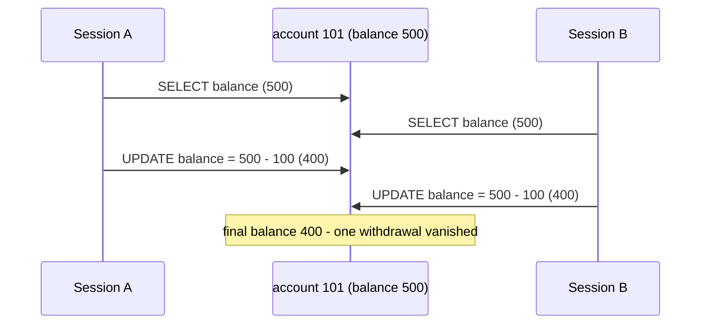
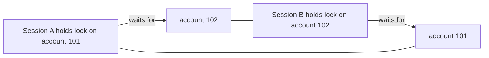

# Multiuser databases and locking

Every example so far has assumed you are alone in the database. Real databases serve hundreds or thousands of sessions at once: tellers posting transactions, a nightly job computing interest, analysts running reports, a model server logging predictions. As long as everyone only *reads*, nothing interesting happens. The moment some sessions *write* while others read or write the same data, the server must decide who sees what and who waits for whom. This lesson explains the problem and the two families of solutions — **locking** and **versioning** — along with lock granularity and deadlocks. The next lesson builds transactions on top.

## The problem: concurrent access

The book's motivating example: you run a report summing the available balance of every account at a branch. While your query is running, a teller posts a deposit to one of those accounts. What should your report show?

- the balance **before** the deposit,
- the balance **after** it,
- or should one of you be made to **wait**?

Worse scenarios exist. Suppose two sessions each withdraw \$100 from an account holding \$500 using read-then-write logic:



Two withdrawals, one debit: a **lost update**. Each session acted correctly on what it saw; the interleaving is what broke the result. Concurrency control exists to make such interleavings either impossible or harmless.

## Locking

**Locks** are the mechanism a database server uses to control simultaneous use of data resources. When part of the database is locked, other sessions wanting to modify (or, depending on the strategy, read) that data must wait until the lock is released. The book describes two strategies in use across servers:

### Strategy 1: readers and writers both lock

- Writers must obtain a **write lock** (exclusive) before modifying data.
- Readers must obtain a **read lock** (shared) before querying it.
- Many readers can hold read locks at once, but only **one** write lock is granted on a resource at a time, and **read requests are blocked until the write lock is released** (and vice versa).

The answer to the report question under this strategy: one of you waits. This guarantees consistency but can produce long waits when there are many concurrent readers and writers — a long report blocks tellers, or a burst of updates stalls the dashboard.

### Strategy 2: versioning

- Writers must still obtain **write locks** to modify data.
- Readers need **no locks at all**. Instead, the server ensures that a reader sees a **consistent view** of the data — the data as it appeared when the query (or transaction) began — even if other sessions modify it in the meantime.

This is called **versioning**, today usually **MVCC** (multi-version concurrency control). The server keeps older versions of changed rows (in "undo" or "rollback" segments, or as dead row versions) so that it can reconstruct the past for readers. Under this strategy, your report shows the balances as they were when it started, and neither you nor the teller waits. The catch appears with long-running queries during heavy modification: the server must retain a lot of old versions.

The slogan worth remembering: **under MVCC, readers don't block writers and writers don't block readers.** Writers still block other writers *on the same rows*.

| Engine | Default approach |
|---|---|
| Oracle | versioning (since the beginning) |
| PostgreSQL | versioning (MVCC) |
| MySQL **InnoDB** | versioning (MVCC) with row locks for writers |
| MySQL MyISAM (legacy) | table-level read/write locks |
| SQL Server | read/write locks by default; versioning optional ("snapshot isolation", "read committed snapshot") |
| SQLite | database-level locking; with **WAL mode**, readers see a snapshot and do not block the single writer |

## Lock granularities

Besides *whether* to lock, the server decides *how much* to lock. The book lists three levels:

- **Table locks** — keep multiple users from modifying data in the same table simultaneously.
- **Page locks** — keep multiple users from modifying data on the same page (a page is a block of storage, typically 2–16 KB, holding many rows).
- **Row locks** — keep multiple users from modifying the same row.

There is a trade-off. Coarse locks need very little bookkeeping — one lock covers a whole table — but cause waiting as soon as two users touch the same table. Fine-grained row locks let many users work in the same table as long as they touch different rows, at the cost of tracking many more locks.

Some servers start with row locks and **escalate** to page or table locks when a statement touches a large fraction of a table (SQL Server does this); Oracle never escalates; InnoDB and PostgreSQL use row-level locks for data changes and take lightweight table-level locks mostly to guard against concurrent schema changes.

So, to finish the report example for a versioning engine with row locks: the deposit takes a row lock on one account row; your report, needing no locks, reads the pre-deposit version; nobody waits.

### SQLite's model

SQLite is an embedded library operating on one file, and its locking is deliberately simple: **locks cover the whole database file**.

- Any number of connections can read at once.
- Only **one connection can write** at a time.
- In the default *rollback-journal* mode, a writer needs exclusive access to commit, so it must wait for readers to finish and blocks new ones briefly.
- In **WAL (write-ahead log) mode**, writers append to a separate log, readers keep reading a consistent snapshot, and readers and the writer do not block each other. There is still only one writer at a time.

That is plenty for an application's local store or a small website and a poor fit for many concurrent writers — which is the niche of client-server databases.

## Seeing locks at work

The sandbox in this guide is a single connection, so you cannot stage a real conflict here; but it is worth knowing what one looks like. With two terminals connected to PostgreSQL or MySQL/InnoDB:

```sql
-- Session A                              -- Session B
BEGIN;
UPDATE account SET avail_balance = avail_balance - 100
WHERE account_id = 101;
                                          BEGIN;
                                          SELECT avail_balance FROM account
                                          WHERE account_id = 101;   -- returns OLD value, no wait (MVCC)

                                          UPDATE account SET avail_balance = avail_balance - 50
                                          WHERE account_id = 101;   -- BLOCKS: row is write-locked by A
COMMIT;
                                          -- UPDATE now proceeds, applied to A's committed value
                                          COMMIT;
```

B's read was not blocked; B's write to the same row waited until A finished. With SQLite, the second writer gets `database is locked` (error code SQLITE_BUSY) unless a busy timeout tells it to retry for a while.

You *can* watch a single-statement update stay consistent, though. This is the safe way to do a withdrawal — let the database do the arithmetic atomically instead of read-then-write in application code:

```sql-run dataset=bank
UPDATE account
SET avail_balance = avail_balance - 100
WHERE account_id = 101 AND avail_balance >= 100;

SELECT account_id, avail_balance, changes() AS rows_changed FROM account WHERE account_id = 101;
```

Because the read and the write happen inside one statement under one lock, two sessions running this concurrently cannot lose an update: the second simply sees the first one's result. The `AND avail_balance >= 100` guard makes the "sufficient funds" check part of the same atomic step; `changes()` (rowcount) tells the application whether the withdrawal happened.

## Explicit locking

Sometimes you must read a row, make a decision in application code, and then write. To prevent another session changing the row in between, lock it when you read:

```sql
BEGIN;
SELECT avail_balance FROM account WHERE account_id = 101 FOR UPDATE;   -- row lock taken now
-- application checks the balance, decides...
UPDATE account SET avail_balance = avail_balance - 100 WHERE account_id = 101;
COMMIT;
```

`SELECT ... FOR UPDATE` (PostgreSQL, MySQL/InnoDB, Oracle) is **pessimistic locking**: assume conflicts will happen and block them up front. SQLite has no `FOR UPDATE`; its equivalent is to start the transaction with `BEGIN IMMEDIATE`, which takes the write lock straight away.

The alternative is **optimistic locking**: don't lock; detect conflicts when writing. Add a `version` column and make the update conditional on it:

```sql
UPDATE account
SET avail_balance = :new_balance, version = version + 1
WHERE account_id = 101 AND version = :version_i_read;
-- 0 rows updated  ->  somebody else changed it; re-read and retry
```

Optimistic locking suits web applications, where holding a database lock while a human fills in a form would be disastrous.

## Deadlocks

Locks introduce a new failure mode. Session A locks row 1 and then wants row 2; session B has locked row 2 and wants row 1. Each waits for the other forever — a **deadlock**.



Database servers detect such cycles and resolve them by choosing one transaction as the **victim**, rolling it back and returning an error (MySQL: `ERROR 1213 Deadlock found when trying to get lock; try restarting transaction`). The other transaction proceeds. The book's point: the application must be prepared to **retry** a transaction that fails this way — it is a normal event in a busy system, not a bug in the server.

Ways to make deadlocks rare:

- **Lock resources in a consistent order** everywhere (e.g. always the lower account id first in a transfer).
- **Keep transactions short**; never wait for user input inside one.
- **Touch as few rows as possible** and make sure updates use indexes (in InnoDB an unindexed UPDATE can lock far more rows than it changes).
- Prefer single atomic statements over read-then-write sequences.

## Choosing a storage engine (MySQL)

MySQL is unusual in letting each table use a different **storage engine**, and the book surveys them because they differ precisely on these topics:

| Engine | Locking | Transactions |
|---|---|---|
| MyISAM | table-level | no |
| MEMORY | table-level | no (in-memory tables) |
| InnoDB | row-level + MVCC | yes |

InnoDB has been the default since MySQL 5.5, and it is the only reasonable choice for data you care about: it supports transactions, row-level locking and foreign keys. If you ever inherit a MyISAM table, know that `COMMIT` and `ROLLBACK` silently do nothing there.

## What this means for analytics and ML workloads

- A long analytical query on an MVCC database does not block the application — but it does force the server to keep old row versions until it finishes (PostgreSQL "bloat", Oracle "snapshot too old"). Run heavy analytics on a **read replica** or a warehouse.
- Batch jobs that update millions of rows in one statement hold many row locks and a long transaction; process in **chunks** (e.g. 10,000 rows per commit).
- An online feature store or prediction log is write-heavy; append-only inserts conflict far less than updates to shared rows.

## Pitfalls

- **Read-then-write in application code** without locking — lost updates.
- **Assuming a reader blocks nothing** on a lock-based engine (or SQL Server defaults).
- **Long transactions** — hold locks and old versions.
- **Not handling deadlock/busy errors** with a retry.
- **Many writers on SQLite** — one writer at a time; enable WAL and set a busy timeout.

## Summary

- Concurrent writers and readers force the server to control access; uncontrolled interleavings cause lost updates and inconsistent reads.
- **Lock-based** engines make readers and writers wait for each other; **versioning (MVCC)** engines give readers a consistent snapshot without locks.
- Locks come at **table, page or row** granularity; finer locks mean more concurrency and more bookkeeping.
- Use atomic statements, `SELECT … FOR UPDATE` (pessimistic) or version checks (optimistic) to prevent lost updates.
- **Deadlocks** are detected and broken by rolling back a victim; applications must retry.

```quiz
[
  {"q": "Under versioning (MVCC), what must a reader obtain before querying?", "options": ["A read lock", "A write lock", "Nothing - it reads a consistent snapshot", "A table lock"], "answer": 2, "explain": "Readers see the data as of the start of their query or transaction and take no locks."},
  {"q": "Which lock granularity allows the most concurrency?", "options": ["Table", "Page", "Row", "Database"], "answer": 2, "explain": "Row locks only conflict when two sessions touch the same row, at the cost of more bookkeeping."},
  {"q": "Two sessions read a balance of 500 and each writes 400. This anomaly is a...", "options": ["Deadlock", "Lost update", "Phantom read", "Dirty read"], "answer": 1, "explain": "The second write overwrites the first without incorporating it."},
  {"q": "How does a server resolve a deadlock?", "options": ["Waits until one session times out forever", "Rolls back one transaction (the victim) with an error", "Grants both locks", "Restarts the server"], "answer": 1, "explain": "A victim is rolled back so the other can proceed; the application should retry."},
  {"q": "How many connections can write to a SQLite database at the same time?", "options": ["Unlimited", "One", "One per table", "One per row"], "answer": 1, "explain": "SQLite locks the whole database for writing; WAL mode lets readers continue but still allows a single writer."},
  {"q": "What does SELECT ... FOR UPDATE do?", "options": ["Updates the selected rows", "Locks the selected rows so others cannot modify them until the transaction ends", "Makes the query faster", "Creates a snapshot"], "answer": 1, "explain": "It is pessimistic locking: take the row locks at read time."},
  {"q": "Which statement prevents a lost update without explicit locking?", "options": ["SELECT then UPDATE with the computed value", "UPDATE account SET balance = balance - 100 WHERE id = 1", "Two SELECTs", "DELETE then INSERT"], "answer": 1, "explain": "The read and write occur atomically inside one statement."}
]
```

> **Source:** Beaulieu, *Learning SQL*, ch. 12 "Transactions" (multiuser databases, locking, lock granularities, deadlocks, storage engines). SQLite documentation, "File Locking And Concurrency" and "Write-Ahead Logging".
