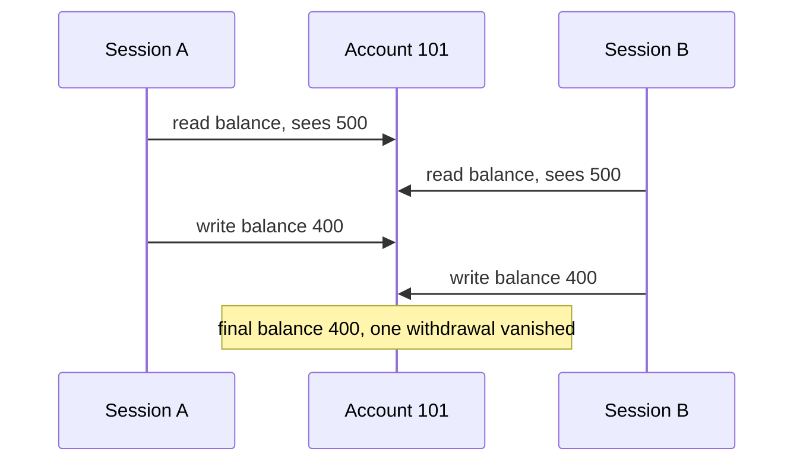
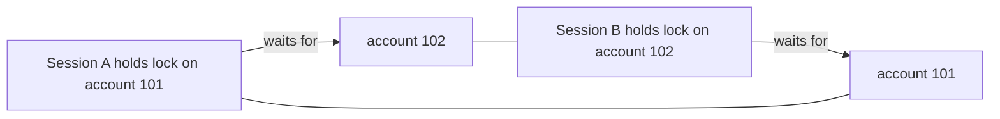

# Multiuser databases and locking

> **Before this lesson:** you should be able to read `SELECT` and `UPDATE` statements with a `WHERE` clause ([Inserting, updating, deleting - and when statements go bad](#/lesson/sql/dml-constraints)). No knowledge of how databases work internally is assumed; every term is explained as it appears.

## In plain words

Every example so far pretended you were alone in the database. A real database is used by many programs and people at the same moment: bank tellers recording deposits, a nightly job adding interest, analysts running reports. Each connection to the database is called a **session**, and several sessions working at the same time is called **concurrency**.

While everybody only *reads*, nothing can go wrong. Trouble starts when one session *changes* data that another session is reading or changing at the same instant. The database must then decide who sees what, and who has to wait.

An everyday picture: a shared paper sign-up sheet on an office door. Two people read "3 places left" at the same moment, both go off to tell their friends, and both come back and write a name in the last place. A shop fitting room shows the usual cure: a door with a latch. While it is latched, the next person waits. In a database the latch is called a **lock**.

There is a second cure, which avoids waiting for people who only want to look. Instead of making a reader wait for the writer to finish, hand the reader a photograph of the sheet as it was a moment ago. The reader works from the photograph; the writer carries on writing. This is called **versioning**.

**Why it matters for a job.** Bugs caused by concurrency are among the most expensive in software: they do not show up in testing with one user, and then money goes missing in production. Interviewers for backend and data roles regularly ask about lost updates, locks, deadlocks and how a database lets readers and writers work together. This lesson covers those ideas; the next builds transactions on top of them.

## The problem: several sessions at once

Suppose you run a report that adds up the available balance of every account at a branch. While your query is still running, a teller records a deposit into one of those accounts. What should your report show?

- the balance **before** the deposit,
- the balance **after** it,
- or should one of you be made to **wait**?

There is no single right answer; database products choose differently, as you will see. But some outcomes are plainly wrong. Suppose two sessions each withdraw 100 from an account holding 500, and each does it in two steps: read the balance, then write back the balance minus 100.



Two withdrawals of 100 were made and the balance fell by only 100. This is called a **lost update**: the second write wiped out the first. Notice that each session did the right thing given what it saw. What broke the result was the *interleaving*, the way their steps were shuffled together in time. The job of **concurrency control** is to make such interleavings either impossible or harmless.

## Locking

A **lock** is a claim that a session places on a piece of data. While the claim stands, any other session whose work would conflict with it is paused, and continues once the holder lets go. Database products fall into two camps according to *who* has to take locks.

### Strategy 1: readers and writers both lock

- A session that wants to change data first takes an **exclusive lock** (also called a write lock) on it.
- A session that only wants to read data first takes a **shared lock** (a read lock) on it.
- Shared locks get along with one another, so any number of readers can work together. An exclusive lock gets along with nothing: only one session can hold it, readers queue up behind it, and a writer in turn has to wait until existing readers have finished.

For the branch report this means that somebody waits: your query, or the teller's deposit. What you see is guaranteed to be consistent. The price is paid on a busy system: a slow report holds up the tellers, and a burst of deposits freezes the report.

### Strategy 2: versioning

- Changing data still needs an **exclusive lock**, exactly as before.
- Reading needs **no lock at all**. Each query is instead shown a frozen picture, called a **snapshot**: the rows exactly as they stood at the moment the query began, whatever other sessions change while it runs.

To make this possible, the database keeps the older versions of changed rows for a while, so that it can show readers the past. The technique is called **versioning**, and today usually **MVCC**, short for multi-version concurrency control. Under it, your report shows the balances as they were when it started, and neither you nor the teller waits. The cost appears with long-running queries during heavy changes: the database has to keep a great many old versions.

The slogan to remember: **under MVCC, readers do not block writers and writers do not block readers.** Writers still block other writers *on the same rows*.

| Database | Default approach |
|---|---|
| Oracle | versioning |
| PostgreSQL | versioning (MVCC) |
| MySQL with the **InnoDB** engine | versioning (MVCC), with row locks for writers |
| MySQL with the old MyISAM engine | read and write locks on whole tables |
| SQL Server | read and write locks by default; versioning can be switched on |
| SQLite | one lock for the whole database; in **WAL mode** readers see a snapshot and do not block the single writer |

## How much is locked: granularity

Besides *whether* to lock, the database decides *how much* to lock. The size of the thing a lock covers is called its **granularity**. Three sizes are common:

- **Table lock**: one lock for the entire table. Two sessions cannot change anything in it at the same time, even unrelated rows.
- **Page lock**: one lock per **page**. A page is the block in which a database stores a batch of rows on disk, usually a few kilobytes. Sessions collide only when their rows happen to share a page.
- **Row lock**: one lock per row. Sessions collide only when they want the very same row.

There is a trade-off. A coarse lock needs almost no record-keeping, since one lock covers a whole table, but it causes waiting as soon as two users touch that table. Fine row locks let many users work in the same table provided they touch different rows, at the cost of keeping track of many more locks.

Some databases begin with row locks and switch to page or table locks when one statement touches a large part of a table. This is called **lock escalation** (SQL Server does it). Oracle never escalates. InnoDB and PostgreSQL use row locks for data changes.

To finish the report example for a versioning database with row locks: the deposit takes a row lock on one account row; your report needs no lock and reads the version from before the deposit; nobody waits.

### SQLite's model

SQLite is not a separate server program. It is a library that reads and writes a single file, and its locking is deliberately plain: **a lock covers the whole database file**.

- Any number of connections can read at once.
- Only **one connection can write** at a time.
- In the default mode, a writer needs the file to itself at the moment it finishes, so it waits for readers and briefly holds up new ones.
- In **WAL mode** (write-ahead log), the writer adds its changes to a separate log file, readers continue reading a consistent snapshot, and readers and the writer do not block each other. There is still only one writer at a time.

That is plenty for an app's local storage or a small website, and a poor fit for many simultaneous writers, which is the territory of server databases such as PostgreSQL and MySQL.

## Seeing locks at work

The query boxes in this guide each use one connection, so a real conflict cannot be staged here. It is still worth knowing what one looks like. Picture two terminal windows connected to PostgreSQL or MySQL, with time running downward. `BEGIN` starts a **transaction**, a group of statements that is treated as one unit, and `COMMIT` makes its changes permanent and releases its locks. Both are explained fully in the next lesson.

```sql
-- PostgreSQL or MySQL/InnoDB, two sessions side by side
-- Session A                              -- Session B
BEGIN;
UPDATE account SET avail_balance = avail_balance - 100
WHERE account_id = 101;
                                          BEGIN;
                                          SELECT avail_balance FROM account
                                          WHERE account_id = 101;   -- returns the OLD value, no wait (MVCC)

                                          UPDATE account SET avail_balance = avail_balance - 50
                                          WHERE account_id = 101;   -- WAITS: the row is write-locked by A
COMMIT;
                                          -- the UPDATE now goes ahead, applied to A's committed value
                                          COMMIT;
```

Read it in time order. Session A changes row 101 and so holds an exclusive lock on it. Session B's `SELECT` is not held up: it reads the earlier version of the row. Session B's `UPDATE` of the same row has to wait until A commits. Then it runs, starting from the value A left behind, so both withdrawals count.

With SQLite, the second writer receives the error `database is locked` unless it has been told to keep retrying for a while (a setting called the busy timeout).

One thing you *can* watch here is the safe way to make a withdrawal: let the database do the arithmetic in one statement, instead of reading in your program and writing back.

```sql-run dataset=bank
UPDATE account
SET avail_balance = avail_balance - 100
WHERE account_id = 101 AND avail_balance >= 100;

SELECT account_id, avail_balance, changes() AS rows_changed FROM account WHERE account_id = 101;
```

Line by line:

- `SET avail_balance = avail_balance - 100` reads the current balance and writes the new one inside a single statement, under a single lock. Nothing can slip in between the read and the write.
- `AND avail_balance >= 100` makes the "enough money?" check part of the same step. If the balance is too low, no row matches and nothing changes.
- `changes()` reports how many rows the last statement changed. Here it is 1, and the balance has gone from 3820.42 to 3720.42. A program would read that number to learn whether the withdrawal happened.

An operation that happens completely or not at all, with no chance for anything to interleave, is called **atomic**. Because this statement is atomic, two sessions running it at the same moment cannot lose an update: the second one works on the first one's result.

## Asking for a lock yourself

Sometimes a program must read a row, make a decision in its own code, and then write. To stop another session from changing the row in between, lock it while reading:

```sql
-- PostgreSQL, MySQL/InnoDB, Oracle
BEGIN;
SELECT avail_balance FROM account WHERE account_id = 101 FOR UPDATE;   -- row lock taken now
-- the application checks the balance and decides...
UPDATE account SET avail_balance = avail_balance - 100 WHERE account_id = 101;
COMMIT;
```

`SELECT ... FOR UPDATE` reads the row and takes a write lock on it straight away. This is **pessimistic locking**: assume a conflict will happen and prevent it in advance. SQLite has no `FOR UPDATE`; its equivalent is to start the transaction with `BEGIN IMMEDIATE`, which takes the write lock at once.

The alternative is **optimistic locking**: take no lock, and detect a conflict at the moment of writing. Add a `version` column that goes up by one with every change, and make the update conditional on the version you read:

```sql
UPDATE account
SET avail_balance = :new_balance, version = version + 1
WHERE account_id = 101 AND version = :version_i_read;
-- 0 rows updated  ->  somebody else changed the row first; read it again and retry
```

The words starting with a colon stand for values supplied by the program. If another session changed the row in the meantime, its version number is no longer the one you read, the `WHERE` matches nothing, and your program knows it must start again. Optimistic locking suits web applications, where holding a database lock while a person fills in a form would be disastrous.

## Deadlocks

Locks bring a failure of their own. Session A locks row 1 and then wants row 2. Session B has locked row 2 and wants row 1. Each waits for the other, for ever. This is a **deadlock**.



Picture two people in a narrow corridor, each politely waiting for the other to step aside. A database server notices such a circle of waiting and breaks it: it picks one transaction as the **victim**, undoes its work and returns an error to it (in MySQL: `Deadlock found when trying to get lock; try restarting transaction`). The other transaction then continues. The consequence for programmers: an application must be ready to **retry** a transaction that fails in this way. On a busy system it is a normal event, not a fault in the database.

Ways to make deadlocks rare:

- **Lock things in the same order everywhere.** In a transfer between two accounts, always lock the lower account id first. Then two transfers can never each hold what the other needs.
- **Keep transactions short.** Never wait for a person to type something while holding locks.
- **Touch as few rows as possible**, and make sure updates can find their rows through an index. In InnoDB, an update that has to search the whole table can lock far more rows than it changes.
- **Prefer one atomic statement** to a read followed by a write.

## Storage engines in MySQL

MySQL is unusual in letting each table be managed by a different **storage engine**, the component that actually stores the rows and handles locks. The engines differ on exactly the topics of this lesson:

| Engine | Locking | Transactions |
|---|---|---|
| MyISAM | whole table | no |
| MEMORY | whole table | no (tables are kept in memory only) |
| InnoDB | rows, with MVCC | yes |

InnoDB has been the default since MySQL 5.5 and is the only sensible choice for data you care about. If you ever inherit a MyISAM table, be aware that `COMMIT` and `ROLLBACK` do nothing on it, and say nothing about it either.

## What this means for analytics and machine-learning work

- A long report on an MVCC database does not block the application, but it forces the database to keep old row versions until it ends. Run heavy analysis on a **read replica** (a copy of the database kept up to date for reading) or in a separate analytics database.
- A batch job that changes millions of rows in one statement holds many row locks for a long time. Work in **chunks**, for example 10,000 rows at a time, committing after each.
- A log of predictions or events is written to constantly. Adding new rows conflicts far less than updating shared rows, which is one reason such tables are designed to be append-only.

> [!INTERVIEW]
> "Two requests withdraw from the same account at the same time. How do you prevent a lost update?" Offer three answers, cheapest first: one atomic statement (`SET balance = balance - 100 WHERE ... AND balance >= 100`, then check the number of rows changed); pessimistic locking with `SELECT ... FOR UPDATE`; optimistic locking with a version column and a retry. Then say when you would choose each.

## Pitfalls

- **Read in the application, then write, with no lock**: lost updates.
- **Assuming a reader blocks nothing** on a database that locks for reading (SQL Server with default settings).
- **Long transactions** hold locks and keep old versions alive.
- **No retry** when the database reports a deadlock or a busy file.
- **Many writers on SQLite**: one writer at a time; switch on WAL mode and set a busy timeout.
- **Locking rows in a different order in different parts of a program**: the classic cause of deadlocks.

## Summary

- When sessions read and write at the same time, the database must control access; uncontrolled interleaving causes lost updates and inconsistent reads.
- **Lock-based** databases make readers and writers wait for each other; **versioning (MVCC)** databases give readers a consistent snapshot without locks.
- Locks come in **table, page and row** sizes; finer locks allow more simultaneous work and need more record-keeping.
- Prevent lost updates with an atomic statement, with `SELECT ... FOR UPDATE` (pessimistic) or with a version check (optimistic).
- A **deadlock** is detected and broken by undoing one victim transaction; applications must retry.

## Glossary

- **Session** — one connection between a program and the database.
- **Concurrency** — several sessions working in the database at the same time.
- **Lost update** — a change that is silently overwritten by another session's change.
- **Interleaving** — the order in which the steps of different sessions are mixed together in time.
- **Lock** — a claim on data that makes conflicting sessions wait.
- **Shared (read) lock** — a lock that many readers may hold together.
- **Exclusive (write) lock** — a lock only one session may hold; nothing else may use the data meanwhile.
- **Snapshot** — a consistent picture of the data as it stood at one moment.
- **Versioning / MVCC** — keeping old versions of rows so readers see a snapshot without taking locks.
- **Granularity** — how much data one lock covers: a table, a page or a row.
- **Page** — the block in which a database stores a batch of rows on disk.
- **Lock escalation** — replacing many small locks with one larger lock.
- **Atomic** — happening completely or not at all, with nothing able to occur in the middle.
- **Pessimistic locking** — locking data when it is read, to prevent conflicts in advance.
- **Optimistic locking** — taking no lock and checking for a conflict when writing, usually with a version column.
- **Deadlock** — two or more sessions each waiting for a lock that another of them holds.
- **Victim** — the transaction the database undoes in order to break a deadlock.
- **WAL (write-ahead log)** — a file to which changes are added before the main database file is updated.
- **Storage engine** — in MySQL, the component that stores a table's rows and handles its locking.
- **Read replica** — a copy of a database kept up to date and used for reading only.

```quiz
[
  {"q": "Under versioning (MVCC), what must a reader obtain before querying?", "options": ["A read lock", "A write lock", "Nothing; it reads a consistent snapshot", "A table lock"], "answer": 2, "explain": "A reader sees the data as it stood when its query or transaction began and takes no lock."},
  {"q": "Which lock granularity allows the most sessions to work at once?", "options": ["Table", "Page", "Row", "Database"], "answer": 2, "explain": "Row locks conflict only when two sessions want the same row, at the cost of more record-keeping."},
  {"q": "Two sessions read a balance of 500 and each writes 400. This problem is called a...", "options": ["Deadlock", "Lost update", "Phantom read", "Dirty read"], "answer": 1, "explain": "The second write overwrites the first without taking it into account."},
  {"q": "How does a database server resolve a deadlock?", "options": ["It waits indefinitely", "It undoes one transaction (the victim) and returns an error to it", "It grants both locks", "It restarts the server"], "answer": 1, "explain": "The victim is rolled back so the other transaction can continue; the application should retry."},
  {"q": "How many connections can write to an SQLite database at the same time?", "options": ["Unlimited", "One", "One per table", "One per row"], "answer": 1, "explain": "SQLite locks the whole database for writing; WAL mode lets readers continue but still allows a single writer."},
  {"q": "What does SELECT ... FOR UPDATE do?", "options": ["Updates the selected rows", "Locks the selected rows so that others cannot change them until the transaction ends", "Makes the query faster", "Creates a snapshot"], "answer": 1, "explain": "It is pessimistic locking: the row locks are taken at the moment of reading."},
  {"q": "Which statement prevents a lost update without asking for a lock explicitly?", "options": ["SELECT, then UPDATE with a value computed in the application", "UPDATE account SET balance = balance - 100 WHERE id = 1", "Two SELECTs", "DELETE then INSERT"], "answer": 1, "explain": "The read and the write happen atomically inside one statement."},
  {"q": "With optimistic locking, an UPDATE ... WHERE id = 101 AND version = 7 changes 0 rows. What does that mean?", "options": ["The row does not exist", "Another session changed the row since you read it; read again and retry", "The table is locked", "The update succeeded"], "answer": 1, "explain": "Every change raises the version, so a mismatch shows that someone else wrote first."}
]
```

> **Source:** Beaulieu, *Learning SQL*, ch. 12 "Transactions" (multiuser databases, locking, lock granularities, deadlocks, storage engines), restated in original wording. SQLite documentation, "File Locking And Concurrency" and "Write-Ahead Logging".
