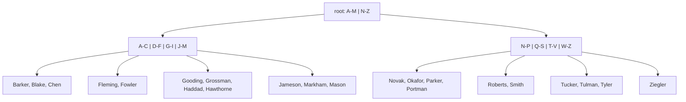

# Indexes and query plans

> **Before this lesson:** you should be able to write queries with `WHERE`, `ORDER BY` and joins ([Building conditions](#/lesson/sql/conditions), [Inner joins](#/lesson/sql/inner-joins)), group with `GROUP BY` ([Aggregate functions and GROUP BY](#/lesson/sql/group-by)), and know what a primary key and a foreign key are ([Data types and CREATE TABLE](#/lesson/sql/data-types-tables)). Nothing about how a database stores data is assumed.

## In plain words

When a row is added to a table, the database puts it wherever there is room. The rows are not kept in any useful order. So when you ask for the employees whose last name is Tyler, the database has only one way to be sure it has found them all: look at **every** row. Reading a whole table like that is called a **table scan**. With 22 employees nobody notices. With 22 million, every such query takes seconds, and a busy system grinds to a halt.

An **index** is the cure. It is a separate structure, built from one or more columns of a table and **kept in sorted order**, that tells the database where the matching rows are.

The everyday picture is the index at the back of a textbook: an alphabetical list of terms, each with page numbers. To find "outer join" you do not read the book from the first page. You look the term up in the sorted list, which is quick because it is sorted, and go straight to the page. A database index works the same way: a sorted list of values, each with a pointer to the row it came from.

A textbook index also has costs, and so does a database index. It takes extra pages, and every time the book is revised the index must be revised too. This lesson is about using indexes well: how to create them, how they work inside, how to check whether the database is using one, and when an index does more harm than good.

**Why it matters for a job.** "This query is slow, what would you do?" is asked in nearly every backend, data-engineering and analytics-engineering interview. The expected answer starts with reading the query plan and thinking about indexes. In daily work, a missing index is the most common reason a query that was fast on test data is slow in production.

## Creating an index

```sql
CREATE INDEX dept_name_idx ON department (name);
```

Read it as: create an index, call it `dept_name_idx`, on the table `department`, built from the column `name`. The syntax is nearly the same on every database. `DROP INDEX dept_name_idx` removes it. The table's data is not changed by either statement; an index is an extra, and queries return the same rows with or without it.

SQLite can list the indexes a table has. (MySQL: `SHOW INDEX FROM customer`; PostgreSQL: `\d customer`.)

```sql-run dataset=bank
SELECT name, "unique", origin FROM pragma_index_list('customer');
```

The `customer` table already has an index that nobody asked for by name. SQLite built it to enforce the rule that `fed_id` must be unique: the `origin` column says `u`, for "unique constraint". Primary keys are indexed automatically as well. (In SQLite, a primary key declared `INTEGER PRIMARY KEY` is the order in which the table itself is stored, so it needs no separate index.)

### Unique indexes

A unique index does two jobs: it speeds up lookups **and** it refuses duplicates. The block below fails on purpose; run it to see the message.

```sql-run dataset=bank
CREATE UNIQUE INDEX dept_name_uq ON department (name);
INSERT INTO department (name) VALUES ('Operations');
```

`UNIQUE constraint failed`: a department called Operations already exists, so the insert is rejected. There is no need to create a unique index on a primary key; the database already checks those.

### Indexes on several columns

An index can be built from several columns, in a stated order. Such an index is called a **composite index**.

```sql
CREATE INDEX emp_names_idx ON employee (lname, fname);
```

This index is sorted by last name and, among people with the same last name, by first name. That is how a telephone directory is sorted. A directory is good for finding "Tyler, Robert" and for finding everyone called "Tyler". It is no help at all for finding everyone whose first name is "Susan": they are scattered over every page.

This is the **leftmost-prefix rule**, the single most important fact about composite indexes: an index can be searched by its first column, or its first two, and so on, but not by a later column alone. Choose the column order according to how the index will be searched. Put columns tested with `=` first, then the column used for a range or for sorting.

## What an index looks like inside

### B-tree indexes

The indexes above are **B-tree** indexes (the B stands for "balanced"), the default kind in every major database. A B-tree is a sorted list with signposts on top of it.

- At the bottom are the **leaf nodes**: blocks holding the indexed values in sorted order, each value with the location of its row.
- Above them are **branch nodes**: signposts that say "values from A to M are that way".
- At the top is a single **root** node, where every search begins.



To find last names starting with "T", the database reads the root, follows the N–Z signpost, then the T–V signpost, and arrives at the right leaf. Three blocks read, instead of the whole table.

As rows are added and removed, the database splits and merges blocks so that the tree stays **balanced**: every leaf is the same number of steps from the root, so no search is unluckily long. Each block holds hundreds of values, which keeps the tree very shallow. A table of a billion rows needs only four or five levels. In the notation used for costs, a lookup is $O(\log n)$: the number of steps grows with the *logarithm* of the number of rows, which means it barely grows at all.

Because the leaves are sorted and linked to their neighbours, a B-tree supports:

- **equality** lookups: `lname = 'Tyler'`;
- **range** searches: `start_date >= '2020-01-01' AND start_date < '2021-01-01'`, or `lname LIKE 'T%'`;
- **ordered** reading: `ORDER BY lname` without a separate sorting step;
- `MIN` and `MAX` in one step, by going to one end of the leaves.

### Bitmap indexes

The number of different values a column holds is called its **cardinality**. B-trees are excellent for columns of high cardinality: names, ids, timestamps. They are of little use for a column with a handful of values, such as `status`, because each value points at a large share of the table.

For those, Oracle offers **bitmap indexes**: for each different value, a long string of bits, one per row, set to 1 where the row has that value. The bit strings for several conditions can be combined very quickly, which suits reporting queries that filter on many low-cardinality columns. They are a poor fit for systems with many small updates.

### Text indexes and others

To search for words inside long text, databases provide **full-text indexes** (MySQL `FULLTEXT`, PostgreSQL GIN, SQLite FTS5). Other special kinds exist: **hash indexes** (equality only), indexes for geographic shapes, and, in machine-learning systems, **vector indexes** for finding the stored items most similar to a given one.

## Is the index being used? Reading the plan

You never tell the database to use an index. A component called the **optimizer** decides how to carry out each query. Its decision is the **query plan**, and you can ask to see it: `EXPLAIN` in MySQL and PostgreSQL, `EXPLAIN QUERY PLAN` in SQLite. Put it in front of a query and you get the plan back instead of the rows.

First, a query on a column with no index:

```sql-run dataset=bank
EXPLAIN QUERY PLAN
SELECT txn_id, amount FROM txn WHERE account_id = 157;
```

Look at the `detail` column: `SCAN txn`. The whole table, 484 rows, will be read to find the 14 that belong to account 157. Now create an index and ask again. (Each Run starts from a fresh copy of the data, so the index has to be created in the same block.)

```sql-run dataset=bank
CREATE INDEX txn_account_idx ON txn (account_id);

EXPLAIN QUERY PLAN
SELECT txn_id, amount FROM txn WHERE account_id = 157;
```

`SEARCH txn USING INDEX txn_account_idx (account_id=?)`. The word changed from `SCAN` to `SEARCH`: the database now walks down the B-tree to the entries for account 157 and fetches only those rows. The query text is identical; only the plan differs.

The vocabulary of SQLite plans:

| Plan text | Meaning |
|---|---|
| `SCAN t` | read every row of the table |
| `SEARCH t USING INDEX i (col=?)` | look up in the B-tree, then fetch the rows from the table |
| `SEARCH t USING COVERING INDEX i (...)` | answered from the index alone |
| `SEARCH t USING INTEGER PRIMARY KEY (rowid=?)` | direct lookup by primary key |
| `SCAN t USING INDEX i` | read the whole index in order, to avoid sorting |
| `USE TEMP B-TREE FOR ORDER BY / GROUP BY / DISTINCT` | a separate sorting step was needed |

### Covering indexes

Normally an index lookup has two steps: find the entry in the index, then go to the table for the rest of the row. If every column the query needs is already in the index, the second step is skipped. The index is then said to **cover** the query.

```sql-run dataset=bank
CREATE INDEX acc_bal_idx ON account (cust_id, avail_balance);

EXPLAIN QUERY PLAN
SELECT cust_id, SUM(avail_balance) AS tot_bal
FROM account
WHERE cust_id IN (1, 5, 9, 11)
GROUP BY cust_id;
```

The query uses only `cust_id` and `avail_balance`, and the index contains both. The plan says `USING COVERING INDEX`, the fastest kind of access. (PostgreSQL calls it an *index-only scan*; MySQL shows "Using index".) This is one reason `SELECT *` is costly: asking for every column makes covering impossible.

### The leftmost-prefix rule in action

```sql-run dataset=bank
CREATE INDEX emp_names_idx ON employee (lname, fname);

EXPLAIN QUERY PLAN SELECT emp_id FROM employee WHERE lname = 'Tyler';
```

```sql-run dataset=bank
CREATE INDEX emp_names_idx ON employee (lname, fname);

EXPLAIN QUERY PLAN SELECT emp_id FROM employee WHERE fname = 'Susan';
```

The first plan is a `SEARCH`: last name is the leading column, so the database can jump to "Tyler". The second is a `SCAN ... USING COVERING INDEX`: the database cannot jump to "Susan", because first names are not in order across the index. It reads the *entire* index instead (which SQLite prefers to reading the table only because the index is smaller).

### Conditions an index can serve

An index on a column helps only when the condition compares the **bare column** with a value. Wrap the column in a function or a calculation and it is hidden from the index. Both queries below count the transactions of March 2024.

```sql-run dataset=bank
CREATE INDEX txn_date_idx ON txn (txn_date);

EXPLAIN QUERY PLAN SELECT COUNT(*) FROM txn WHERE strftime('%Y-%m', txn_date) = '2024-03';
```

```sql-run dataset=bank
CREATE INDEX txn_date_idx ON txn (txn_date);

EXPLAIN QUERY PLAN SELECT COUNT(*) FROM txn WHERE txn_date >= '2024-03-01' AND txn_date < '2024-04-01';
```

The first is a `SCAN`: the index is sorted by `txn_date`, not by `strftime('%Y-%m', txn_date)`, so every entry must be read and converted. The second is a `SEARCH` with `txn_date>? AND txn_date<?`: the database jumps to 1 March and stops at 1 April.

A condition that an index can serve is called **sargable** (from "search argument"). Common ways to lose that property:

- a function around the column: `lower(email) = ...`, `date(ts) = ...`, `substr(...)`;
- arithmetic on the column: `amount * 1.1 > 100` (write `amount > 100 / 1.1` instead);
- a pattern that starts with a wildcard: `LIKE '%son'`;
- comparing a text column with a number, which forces a hidden conversion;
- `<>` and `NOT IN`, which usually match most of the table anyway.

When you really must search on a calculated value, index the calculation: `CREATE INDEX cust_email_lower ON customers (lower(email))` works in SQLite, PostgreSQL and MySQL 8.

### Indexes for joins, sorting and grouping

Indexes are not only for `WHERE`.

- **Joins.** A nested-loop join looks up matching rows in one table for each row of the other ([Inner joins](#/lesson/sql/inner-joins)). Without an index on the join column, each lookup is a scan. **Index your foreign keys**; most databases do not do it for you (MySQL's InnoDB does).
- **`ORDER BY` and `GROUP BY`.** An index that delivers rows already in the needed order removes the sorting step.

```sql-run dataset=shop
CREATE INDEX orders_cust_date ON orders (customer_id, order_date);

EXPLAIN QUERY PLAN
SELECT order_id, order_date FROM orders
WHERE customer_id = 42
ORDER BY order_date DESC
LIMIT 3;
```

One `SEARCH` line and no `USE TEMP B-TREE FOR ORDER BY`. The index finds customer 42 by equality on its first column, and within that customer the entries are already in date order. The database reads three entries from the end and stops. "Equality column first, sort column second" is the ideal composite index for "latest N per customer" queries.

## The downside of indexes

If indexes are so useful, why not index every column? Because **every index is another structure that must be kept up to date**. Each `INSERT` adds an entry to every index on the table. Each `DELETE` removes one. Each `UPDATE` of an indexed column does both. More indexes mean slower writes, more disk space and more competition for memory.

There is also a point at which an index is not worth using even for reading. Suppose a condition matches most of the table, such as `status = 'ACTIVE'` when 83% of accounts are active. Hopping between index and table for each of those rows is slower than reading the table straight through. The share of rows a condition keeps is called its **selectivity**; an index pays off for conditions that keep a small share. The optimizer estimates this from **statistics** it stores about each table. They are refreshed with `ANALYZE` (SQLite, PostgreSQL) or `ANALYZE TABLE` (MySQL). Out-of-date statistics lead to poor plans.

A sensible starting strategy:

1. Make sure **every primary key is indexed** (normally automatic).
2. Index every column used in a **foreign key**. You join on them constantly, and the database must look up child rows whenever a parent row is deleted.
3. Index columns **often used to find rows**. Date columns and short text columns are frequent candidates.

Then measure. Look at the slow queries, read their plans, add or adjust indexes, and drop the ones nothing uses. When loading a very large batch of data, it is common to drop indexes first and rebuild them afterwards.

> [!TIP]
> Two special indexes worth knowing. A **partial index** (`CREATE INDEX ... WHERE status = 'pending'`) covers only the rows you actually query, so it is tiny and fast. An index with extra included columns (`INCLUDE` in PostgreSQL and SQL Server) is a way to make a covering index without changing the sort order.

> [!INTERVIEW]
> "A query filtering on `customer_id` and sorting by `order_date` is slow. What do you do?" A complete answer: look at the plan with `EXPLAIN`; if it shows a full scan and a sort, create a composite index on `(customer_id, order_date)`, equality column first; check the plan again; and mention the price, which is slower writes. Add that a function around the column in `WHERE` would stop the index from being used.

## Pitfalls

- **Foreign keys without an index**: slow joins and slow deletes of parent rows.
- **The wrong column order** in a composite index.
- **A function around an indexed column** in `WHERE`.
- **Too many indexes** on a table that is written to heavily.
- **Redundant indexes**: an index on `(a)` adds nothing if one on `(a, b)` exists.
- **Out-of-date statistics**, leading to poor plans.
- **Guessing the plan.** Always check with `EXPLAIN`.

## Summary

- An index is a sorted structure that maps values to rows; a B-tree gives fast equality lookups, range searches and ordered reading.
- A composite index obeys the leftmost-prefix rule: equality columns first, then the range or sort column.
- In `EXPLAIN QUERY PLAN`, `SCAN` means the whole table is read, `SEARCH ... USING INDEX` means a lookup, and `COVERING INDEX` means the table is not touched.
- Keep conditions sargable: compare the bare column; index the calculation if you must search on one.
- Indexes speed up reading and slow down writing. Index primary keys, foreign keys and frequently filtered columns, then measure.

## Glossary

- **Table scan (full scan)** — reading every row of a table to answer a query.
- **Index** — a sorted structure built from one or more columns that lets the database find rows without scanning.
- **Unique index** — an index that also forbids duplicate values.
- **Composite (multicolumn) index** — an index built from several columns in a stated order.
- **Leftmost-prefix rule** — a composite index can be searched only by its leading column or columns.
- **B-tree** — the balanced tree structure used by ordinary indexes.
- **Root / branch / leaf node** — the top block of a B-tree / the signpost blocks / the bottom blocks holding the sorted values and row locations.
- **Cardinality** — the number of different values in a column.
- **Bitmap index** — an index holding one string of bits per value, suited to columns with few different values.
- **Full-text index** — an index for finding words inside long text.
- **Optimizer** — the part of the database that decides how to carry out a query.
- **Query plan** — the optimizer's chosen list of steps for a query.
- **`EXPLAIN` / `EXPLAIN QUERY PLAN`** — the command that shows a query's plan instead of running it.
- **Covering index** — an index that contains every column a query needs, so the table is not read.
- **Sargable** — describes a condition that an index can be used to answer.
- **Selectivity** — the share of rows a condition keeps; the smaller, the more an index helps.
- **Statistics** — information the database stores about the data in each table, used by the optimizer.
- **Partial index** — an index that covers only the rows meeting a stated condition.

```quiz
[
  {"q": "What does SCAN txn in an SQLite query plan mean?", "options": ["A lookup in an index", "Every row of the table is read", "The table is locked", "The query result is cached"], "answer": 1, "explain": "SCAN is a full table scan; SEARCH indicates a B-tree lookup."},
  {"q": "An index on (lname, fname) can efficiently serve which query?", "options": ["WHERE fname = 'Susan'", "WHERE lname = 'Barker'", "WHERE title = 'Teller'", "WHERE fname LIKE '%an'"], "answer": 1, "explain": "The leftmost-prefix rule: the leading column of the index must be the one being searched."},
  {"q": "What is a covering index?", "options": ["An index on every column", "An index containing all the columns a query needs, so the table is not read", "A unique index", "An index on the primary key"], "answer": 1, "explain": "The query is answered from the index alone, skipping the trip to the table."},
  {"q": "Which condition can use an index on txn_date?", "options": ["strftime('%Y', txn_date) = '2024'", "date(txn_date) = '2024-03-07'", "txn_date >= '2024-03-07' AND txn_date < '2024-03-08'", "substr(txn_date, 1, 7) = '2024-03'"], "answer": 2, "explain": "Only the range on the bare column is sargable; the others hide the column inside a function."},
  {"q": "Why not index every column?", "options": ["A table may have at most five indexes", "Each index must be updated on every write and takes space", "Indexes make SELECT slower", "Indexes switch off constraints"], "answer": 1, "explain": "Every index is another structure to maintain on INSERT, UPDATE and DELETE."},
  {"q": "For which column is a B-tree index least useful?", "options": ["A unique email column", "A timestamp column", "A status column with 3 values where 80% of rows are 'ACTIVE' and you query for 'ACTIVE'", "A foreign key column"], "answer": 2, "explain": "A condition that keeps most of the table has poor selectivity; reading the table straight through is cheaper."},
  {"q": "Which index best serves WHERE customer_id = ? ORDER BY order_date DESC LIMIT 3?", "options": ["(order_date)", "(customer_id)", "(customer_id, order_date)", "(order_date, customer_id)"], "answer": 2, "explain": "Equality column first, then the sort column: the rows come out of the index already in order."},
  {"q": "A table grows from a million rows to a billion. Roughly how does the cost of a B-tree lookup change?", "options": ["It becomes a thousand times slower", "It needs only one or two more levels of the tree", "It is unchanged because of caching", "Lookups stop working"], "answer": 1, "explain": "Each block holds hundreds of values, so the depth grows with the logarithm of the row count: a billion rows need about four or five levels."}
]
```

> **Source:** Beaulieu, *Learning SQL*, ch. 13 "Indexes and Constraints" (index creation, unique and multicolumn indexes, types of indexes: B-tree, bitmap, text; how indexes are used; the downside of indexes), restated in original wording. SQLite documentation, "EXPLAIN QUERY PLAN" and "The SQLite Query Optimizer Overview".
