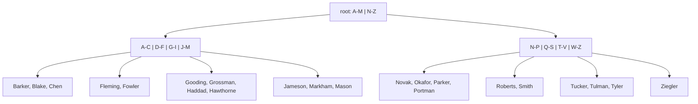

# Indexes and query plans

When you insert a row, the server does not put it anywhere in particular; it goes in the next free spot. So when you ask for employees whose last name starts with T, the server has to inspect **every** row — a **table scan**. For 22 employees nobody cares. For 22 million, every query takes seconds and the server melts under load. An **index** is the fix: a separate, sorted structure that lets the server find rows without reading the whole table. This lesson covers creating indexes, how B-tree indexes work, how to read `EXPLAIN QUERY PLAN`, when indexes help and when they hurt.

## What an index is

The book's analogy is the index at the back of a technical book: an alphabetical list of terms, each with page numbers. You don't read the book to find "outer join"; you look it up and go straight to the page. A database index is the same idea — a special table that, unlike a normal table, **is kept in a specific order**, and that holds only the indexed column(s) plus a pointer to the full row.

## Index creation

```sql
CREATE INDEX dept_name_idx ON department (name);
```

The syntax is nearly identical everywhere (MySQL also allows `ALTER TABLE department ADD INDEX dept_name_idx (name)`). Remove an index with `DROP INDEX dept_name_idx` (MySQL: `ALTER TABLE … DROP INDEX …`).

In SQLite you can list a table's indexes with a pragma (MySQL: `SHOW INDEX FROM account`; PostgreSQL: `\d account`):

```sql-run dataset=bank
SELECT name, "unique", origin FROM pragma_index_list('customer');
```

The `customer` table already has one index you did not create: SQLite built it automatically to enforce the `UNIQUE` constraint on `fed_id` (origin `u`). Primary keys get one too (in SQLite an `INTEGER PRIMARY KEY` *is* the table's own B-tree key, the rowid, so no separate index is needed).

### Unique indexes

A unique index does double duty: it speeds up lookups **and** rejects duplicates.

```sql-run dataset=bank
CREATE UNIQUE INDEX dept_name_uq ON department (name);
INSERT INTO department (name) VALUES ('Operations');
```

The insert fails — an *Operations* department already exists. You should not build unique indexes on your primary key columns; the server already checks those.

### Multicolumn indexes

An index may cover several columns, in a stated order:

```sql
CREATE INDEX emp_names_idx ON employee (lname, fname);
```

This index is sorted by last name, and within the same last name by first name — like a phone book. That makes it useful for queries that specify **last name and first name**, or **just last name**, but *not* for queries that specify only the first name. A phone book is no help for finding everyone called "Susan". This is the **leftmost-prefix rule**, and it is the single most important fact about composite indexes: choose the column order by how the index will be searched. Put columns tested with **equality first**, then the **range/sort** column.

## Types of indexes

### B-tree indexes

All the indexes above are **balanced-tree (B-tree)** indexes, the default in every major database. A B-tree is organised as a tree of **branch nodes** leading to a single level of **leaf nodes**. Branch nodes are for navigation — "keys from A to M are down this way" — and leaf nodes hold the actual key values with the locations of the rows.



To find employees whose last name starts with "T", the server reads the root, follows the N–Z branch, then the T–V pointer, and lands on the right leaf: three node reads instead of a full scan. As rows are inserted, updated and deleted, the server splits and merges nodes to keep the tree **balanced**, so that every leaf is the same distance from the root. Because each node holds hundreds of keys, the tree is very shallow: a table of a billion rows needs only about four or five levels. Lookup cost is $O(\log n)$ with a huge logarithm base.

Since leaves are sorted and linked, a B-tree supports:

- **equality** lookups (`lname = 'Tyler'`),
- **range** scans (`start_date >= '2020-01-01' AND start_date < '2021-01-01'`, `lname LIKE 'T%'`),
- **ordered** retrieval (`ORDER BY lname` without sorting),
- `MIN`/`MAX` in one step.

### Bitmap indexes

B-trees are excellent for columns with many distinct values (**high cardinality**): names, ids, timestamps. They are poor for columns with a handful of values — `product_cd`, `status` — because each value points to a large share of the table. For those, Oracle offers **bitmap indexes**: one bitmap per distinct value, with a bit per row. The bitmaps for several conditions can be AND-ed and OR-ed quickly, which suits data-warehouse queries filtering on many low-cardinality columns. They are a bad fit for transactional systems, because updates lock large parts of a bitmap.

### Text indexes and others

To search for words inside documents, databases provide **full-text** indexes (MySQL `FULLTEXT`, PostgreSQL GIN on `tsvector`, SQLite's FTS5 virtual tables, Oracle Text). Other specialised kinds: **hash** indexes (equality only), **GiST/R-tree** for geometric and range data, **BRIN** for huge naturally ordered tables — and, in ML systems, **vector indexes** (HNSW, IVF) for nearest-neighbour search over embeddings (pgvector, sqlite-vec).

## How indexes are used: reading the plan

Ask the optimizer what it intends with `EXPLAIN` (MySQL, PostgreSQL) or `EXPLAIN QUERY PLAN` (SQLite). First, without an index:

```sql-run dataset=bank
EXPLAIN QUERY PLAN
SELECT txn_id, amount FROM txn WHERE account_id = 157;
```

`SCAN txn` — a full table scan: all ~480 rows read to find 14. Now create an index and look again:

```sql-run dataset=bank
CREATE INDEX txn_account_idx ON txn (account_id);

EXPLAIN QUERY PLAN
SELECT txn_id, amount FROM txn WHERE account_id = 157;
```

`SEARCH txn USING INDEX txn_account_idx (account_id=?)` — the server descends the B-tree to the entries for account 157 and fetches just those rows.

The vocabulary of SQLite plans:

| Plan text | Meaning |
|---|---|
| `SCAN t` | read every row of the table |
| `SEARCH t USING INDEX i (col=?)` | B-tree lookup, then fetch rows from the table |
| `SEARCH t USING COVERING INDEX i (…)` | answered from the index alone |
| `SEARCH t USING INTEGER PRIMARY KEY (rowid=?)` | direct lookup by primary key |
| `SCAN t USING INDEX i` | walk the whole index in order (to avoid a sort) |
| `USE TEMP B-TREE FOR ORDER BY / GROUP BY / DISTINCT` | an explicit sort was needed |

### Covering indexes

If every column the query needs is in the index, the server never touches the table. The book's example: the query asks only for `cust_id` and `SUM(avail_balance)`, and an index on `(cust_id, avail_balance)` contains both.

```sql-run dataset=bank
CREATE INDEX acc_bal_idx ON account (cust_id, avail_balance);

EXPLAIN QUERY PLAN
SELECT cust_id, SUM(avail_balance) AS tot_bal
FROM account
WHERE cust_id IN (1, 5, 9, 11)
GROUP BY cust_id;
```

`USING COVERING INDEX` — the fastest kind of access. (PostgreSQL calls this an *index-only scan*; in MySQL's EXPLAIN it shows as "Using index".) It is also why `SELECT *` is costly: it prevents covering.

### The leftmost-prefix rule in action

```sql-run dataset=bank
CREATE INDEX emp_names_idx ON employee (lname, fname);

EXPLAIN QUERY PLAN SELECT emp_id FROM employee WHERE lname = 'Tyler';
```

```sql-run dataset=bank
CREATE INDEX emp_names_idx ON employee (lname, fname);

EXPLAIN QUERY PLAN SELECT emp_id FROM employee WHERE fname = 'Susan';
```

The first is a `SEARCH`; the second cannot seek into the index because `fname` is not its leading column (SQLite may still *scan* the index, since it is smaller than the table, but it reads all of it).

### Sargable predicates

An index on a column helps only if the condition compares the **bare column** with a value. Wrapping the column in a function or arithmetic hides it:

```sql-run dataset=bank
CREATE INDEX txn_date_idx ON txn (txn_date);

EXPLAIN QUERY PLAN SELECT COUNT(*) FROM txn WHERE strftime('%Y-%m', txn_date) = '2024-03';
```

```sql-run dataset=bank
CREATE INDEX txn_date_idx ON txn (txn_date);

EXPLAIN QUERY PLAN SELECT COUNT(*) FROM txn WHERE txn_date >= '2024-03-01' AND txn_date < '2024-04-01';
```

Same rows, but the first scans everything and the second searches a range. Conditions the optimizer can use an index for are called **sargable** (Search ARGument-able). Common index killers:

- functions on the column: `lower(email) = …`, `date(ts) = …`, `substr(…)`
- arithmetic on the column: `amount * 1.1 > 100` (write `amount > 100 / 1.1`)
- leading wildcards: `LIKE '%son'`
- implicit type conversion: comparing a text column with a number
- `OR` across different columns (sometimes), `<>` and `NOT IN` (usually)

When you truly need to search on an expression, index the expression itself: `CREATE INDEX cust_email_lower ON customers (lower(email))` (SQLite, PostgreSQL, MySQL 8).

### Indexes for joins, sorting and grouping

Indexes are not only for WHERE:

- **Joins:** a nested-loop join looks up the inner table once per outer row; without an index on the join column that is a scan each time. **Index your foreign keys** — most databases do not do it automatically (MySQL InnoDB does).
- **ORDER BY / GROUP BY:** an index that delivers rows in the needed order removes the sort.

```sql-run dataset=shop
CREATE INDEX orders_cust_date ON orders (customer_id, order_date);

EXPLAIN QUERY PLAN
SELECT order_id, order_date FROM orders
WHERE customer_id = 42
ORDER BY order_date DESC
LIMIT 3;
```

Equality on `customer_id`, then rows already ordered by `order_date`: no `TEMP B-TREE`, and the LIMIT stops after three entries. This (equality columns, then sort column) is the ideal composite index for "latest N per entity" queries.

## The downside of indexes

If indexes are so great, why not index every column? The book's answer: **every index is a table** that must be maintained. Each INSERT adds an entry to every index on the table; each DELETE removes one; each UPDATE of an indexed column does both. More indexes means slower writes, more disk and more memory competition.

There is also a point where an index is not worth using even for reads. If a condition matches a large fraction of the table (say `status = 'ACTIVE'`, 83% of accounts), jumping between index and table for each row is slower than one sequential scan. Optimizers know this from **statistics** about data distribution (`ANALYZE` in SQLite and PostgreSQL, `ANALYZE TABLE` in MySQL) — keep them fresh. The measure is **selectivity**: the fraction of rows a predicate keeps. Indexes pay off for selective predicates.

The book's default strategy is a good starting point:

1. Make sure **all primary key columns are indexed** (usually automatic). For multicolumn keys, consider additional indexes on a subset or a different column order.
2. Build indexes on all columns referenced in **foreign key** constraints (the server looks up children when a parent is deleted, and you join on them constantly).
3. Index columns **frequently used to retrieve data**. Most date columns are good candidates, along with short string columns.

Then measure: look at slow queries, read their plans, add or adjust indexes, and drop indexes nobody uses. In data warehouses a common tactic is to drop indexes before a big bulk load and rebuild them afterwards.

> [!TIP]
> Special-purpose indexes worth knowing: **partial indexes** (`CREATE INDEX … WHERE status = 'pending'`) index only the rows you query — tiny and fast; **covering/INCLUDE indexes** add non-key columns to avoid table lookups.

## Pitfalls

- **Unindexed foreign keys** — slow joins and slow parent deletes.
- **Wrong column order** in a composite index.
- **Functions on indexed columns** in WHERE.
- **Over-indexing** write-heavy tables.
- **Redundant indexes**: `(a)` is redundant if `(a, b)` exists.
- **Stale statistics** leading to bad plans.
- **Assuming** the plan — always check with EXPLAIN.

## Summary

- An index is a sorted structure mapping key values to rows; B-trees give $O(\log n)$ equality and range lookups and ordered scans.
- Composite indexes obey the leftmost-prefix rule; equality columns first, then range/sort columns.
- `EXPLAIN QUERY PLAN`: `SCAN` = full scan, `SEARCH … USING INDEX` = seek, `COVERING INDEX` = no table access.
- Keep predicates sargable; index expressions when necessary.
- Indexes speed reads and slow writes; index primary keys, foreign keys and frequent filter columns, then measure.

```quiz
[
  {"q": "What does SCAN txn in an SQLite query plan mean?", "options": ["An index seek", "Every row of the table is read", "The table is locked", "The query is cached"], "answer": 1, "explain": "SCAN is a full table scan; SEARCH indicates a B-tree lookup."},
  {"q": "An index on (lname, fname) can efficiently serve which query?", "options": ["WHERE fname = 'Susan'", "WHERE lname = 'Barker'", "WHERE title = 'Teller'", "WHERE fname LIKE '%an'"], "answer": 1, "explain": "The leftmost-prefix rule: the leading column must be constrained."},
  {"q": "What is a covering index?", "options": ["An index on every column", "An index containing all columns a query needs, so the table is not read", "A unique index", "An index on the primary key"], "answer": 1, "explain": "The query is answered from the index alone."},
  {"q": "Which predicate can use an index on txn_date?", "options": ["strftime('%Y', txn_date) = '2024'", "date(txn_date) = '2024-03-07'", "txn_date >= '2024-03-07' AND txn_date < '2024-03-08'", "substr(txn_date, 1, 7) = '2024-03'"], "answer": 2, "explain": "Only the range on the bare column is sargable."},
  {"q": "Why not index every column?", "options": ["Indexes are limited to 5 per table", "Each index must be updated on every write and consumes space", "Indexes make SELECT slower", "Indexes disable constraints"], "answer": 1, "explain": "Every index is another structure to maintain on INSERT, UPDATE and DELETE."},
  {"q": "For which column is a B-tree index least useful?", "options": ["A unique email column", "A timestamp column", "A status column with 3 values where 80% of rows are 'ACTIVE' and you query for 'ACTIVE'", "A foreign key column"], "answer": 2, "explain": "A predicate matching most of the table is not selective; a scan is cheaper."},
  {"q": "Which index best serves WHERE customer_id = ? ORDER BY order_date DESC LIMIT 3?", "options": ["(order_date)", "(customer_id)", "(customer_id, order_date)", "(order_date, customer_id)"], "answer": 2, "explain": "Equality column first, then the sort column: rows come out already ordered."}
]
```

> **Source:** Beaulieu, *Learning SQL*, ch. 13 "Indexes and Constraints" (index creation, unique and multicolumn indexes, types of indexes: B-tree, bitmap, text; how indexes are used; the downside of indexes). SQLite documentation, "EXPLAIN QUERY PLAN" and "The SQLite Query Optimizer Overview".
