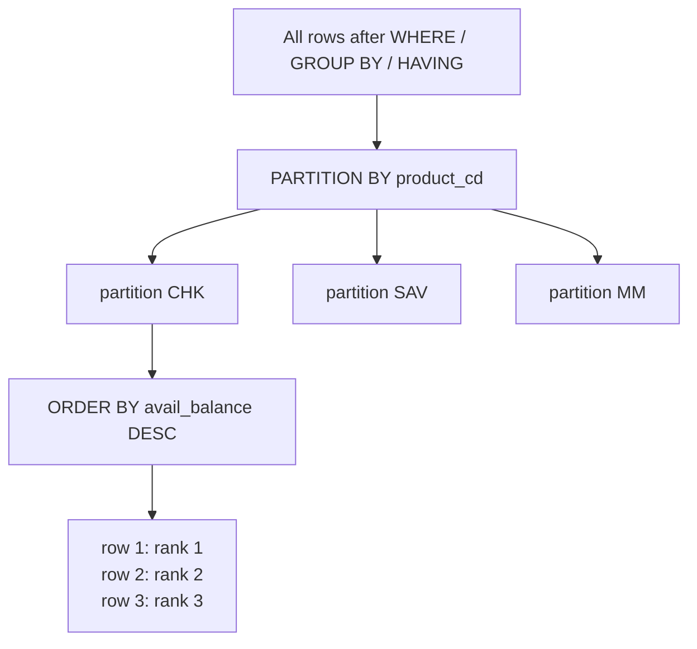

# Window basics and ranking

`GROUP BY` answers questions *about groups* by collapsing each group to one row. But many questions need both the detail row **and** something computed across related rows: each order with its rank within the month, each run with its experiment's best score next to it, each transaction with a running balance. Before SQL:2003 these required self joins or correlated subqueries that were slow and hard to read. **Window functions** (the book's later editions call them *analytic functions*) solve them directly: they compute a value for every row from a set of rows related to it — its **window** — **without collapsing rows**.

Window functions are the single most heavily tested topic in data interviews. This lesson covers the `OVER` clause, `PARTITION BY`, `ORDER BY` inside windows, and the ranking functions `ROW_NUMBER`, `RANK`, `DENSE_RANK`, `NTILE` and `PERCENT_RANK`. The next covers `LAG`/`LEAD`, running totals and frames.

> [!NOTE]
> **Availability:** SQLite 3.25+ (2018), PostgreSQL 8.4+, MySQL **8.0+** (not 5.7), SQL Server, Oracle. The second edition of *Learning SQL*, written for MySQL 5, predates them; the third edition devotes chapter 16 to analytic functions.

## From GROUP BY to OVER

Count accounts per product with GROUP BY — one row per product:

```sql-run dataset=bank
SELECT product_cd, COUNT(*) AS n
FROM account
GROUP BY product_cd;
```

Now the same aggregate as a **window function**. Add `OVER (...)` and remove GROUP BY:

```sql-run dataset=bank
SELECT account_id, product_cd, avail_balance,
       COUNT(*) OVER (PARTITION BY product_cd) AS accounts_in_product,
       ROUND(AVG(avail_balance) OVER (PARTITION BY product_cd), 2) AS avg_in_product,
       ROUND(AVG(avail_balance) OVER (), 2) AS avg_overall
FROM account
ORDER BY product_cd, account_id
LIMIT 12;
```

Every account row is still there, and each carries the count and average of *its* product group, plus the overall average. That is the essential difference:

| | GROUP BY | Window function |
|---|---|---|
| Rows returned | one per group | every input row |
| Detail columns | lost (must be grouped or aggregated) | kept |
| Compare a row with its group | needs a join back | direct |

Because the detail survives, comparisons become trivial — how far is each account from its product average?

```sql-run dataset=bank
SELECT account_id, product_cd, avail_balance,
       ROUND(avail_balance - AVG(avail_balance) OVER (PARTITION BY product_cd), 2) AS diff_from_product_avg,
       ROUND(100.0 * avail_balance / SUM(avail_balance) OVER (PARTITION BY product_cd), 1) AS pct_of_product
FROM account
WHERE product_cd IN ('SAV', 'MM')
ORDER BY product_cd, avail_balance DESC
LIMIT 10;
```

## Anatomy of the OVER clause

```
function(args) OVER (
    [PARTITION BY expr, ...]      -- split rows into independent groups
    [ORDER BY expr [ASC|DESC], ...]   -- order rows within each partition
    [frame clause]                -- which rows around the current row (next lesson)
)
```

- **`OVER ()`** — empty: the window is the entire result set.
- **`PARTITION BY`** — like GROUP BY, but rows are not merged. The function restarts for each partition.
- **`ORDER BY`** inside OVER — orders rows *within the partition* for functions where order matters (ranking, LAG, running totals). It is independent of the query's final ORDER BY.



### Where windows fit in the order of evaluation

Window functions are computed in the SELECT phase — **after** FROM, WHERE, GROUP BY and HAVING, **before** DISTINCT, ORDER BY and LIMIT. Two consequences that explain most window-function errors:

1. **You cannot use a window function in WHERE, GROUP BY or HAVING.** To filter on its result, compute it in a subquery or CTE and filter outside. (Snowflake, BigQuery, DuckDB and Teradata offer a `QUALIFY` clause for this; SQLite, PostgreSQL and MySQL do not.)
2. **Windows see the rows that survived WHERE and GROUP BY.** So you can apply a window function *over aggregated rows* — e.g. rank the monthly totals.

## Ranking functions

Ranking functions number rows within a partition according to the window's ORDER BY. The three main ones differ only in how they treat **ties**:

| Function | Ties | Sequence for scores 90, 85, 85, 80 |
|---|---|---|
| `ROW_NUMBER()` | arbitrary distinct numbers | 1, 2, 3, 4 |
| `RANK()` | same rank, then a **gap** | 1, 2, 2, 4 |
| `DENSE_RANK()` | same rank, **no gap** | 1, 2, 2, 3 |

See all three side by side, on data with a tie:

```sql-run dataset=bank
SELECT open_emp_id, COUNT(*) AS accounts_opened,
       ROW_NUMBER() OVER (ORDER BY COUNT(*) DESC) AS row_num,
       RANK()       OVER (ORDER BY COUNT(*) DESC) AS rnk,
       DENSE_RANK() OVER (ORDER BY COUNT(*) DESC) AS dense_rnk
FROM account
GROUP BY open_emp_id
ORDER BY accounts_opened DESC
LIMIT 10;
```

Notice two things. First, the window's ORDER BY uses `COUNT(*)` — an aggregate — because the window runs after GROUP BY. Second, wherever two employees opened the same number of accounts, `RANK` and `DENSE_RANK` agree on the tie while `ROW_NUMBER` picks an order arbitrarily.

How to choose:

- **`ROW_NUMBER`** — you need *exactly one* row per position: deduplication, "the latest row per key", pagination. Always add a tie-breaker to the ORDER BY so the choice is deterministic.
- **`RANK`** — competition-style ranking ("joint 2nd, next is 4th"); "top 3" returns everyone tied within the top three positions.
- **`DENSE_RANK`** — "the top 3 *distinct values*", e.g. the three highest salaries however many people earn them. This is the usual choice for "Nth highest" questions.

### Ranking within partitions

Add `PARTITION BY` and the ranking restarts per group:

```sql-run dataset=shop
SELECT c.name AS category, p.name AS product, p.price,
       RANK() OVER (PARTITION BY p.category_id ORDER BY p.price DESC) AS price_rank
FROM products p
JOIN categories c ON c.category_id = p.category_id
ORDER BY category, price_rank
LIMIT 14;
```

### Top-N per group

Filtering on the rank gives the most common interview pattern of all. Because the rank cannot be used in WHERE directly, wrap it:

```sql-run dataset=shop
WITH ranked AS (
  SELECT c.name AS category, p.name AS product, p.price,
         ROW_NUMBER() OVER (PARTITION BY p.category_id ORDER BY p.price DESC, p.product_id) AS rn
  FROM products p
  JOIN categories c ON c.category_id = p.category_id
)
SELECT category, product, price
FROM ranked
WHERE rn <= 2
ORDER BY category, price DESC;
```

"The two most expensive products in each category." Swap `ROW_NUMBER` for `DENSE_RANK` if tied prices should all be shown. The same shape with `rn = 1` answers "latest order per customer", "best run per experiment", "most recent deployment per model":

```sql-run dataset=mlops
WITH d AS (
  SELECT m.name, m.version, dp.environment, dp.deployed_at,
         ROW_NUMBER() OVER (PARTITION BY m.name ORDER BY dp.deployed_at DESC) AS rn
  FROM deployments dp
  JOIN models m ON m.model_id = dp.model_id
  WHERE dp.environment = 'production'
)
SELECT name, version, deployed_at
FROM d
WHERE rn = 1
ORDER BY name;
```

### Nth highest value

"Second-highest balance per product" — `DENSE_RANK() = 2`:

```sql-run dataset=bank
WITH r AS (
  SELECT product_cd, account_id, avail_balance,
         DENSE_RANK() OVER (PARTITION BY product_cd ORDER BY avail_balance DESC) AS dr
  FROM account
  WHERE status = 'ACTIVE'
)
SELECT product_cd, account_id, avail_balance
FROM r
WHERE dr = 2;
```

If a product has only one distinct balance there is no rank 2, so it does not appear — usually the desired behaviour (LeetCode's version asks you to return NULL instead; wrap in a scalar subquery or left join to get that).

## NTILE, PERCENT_RANK and CUME_DIST

`NTILE(n)` deals the ordered rows into `n` buckets of (nearly) equal size — quartiles, deciles, percentiles:

```sql-run dataset=shop
WITH spend AS (
  SELECT o.customer_id,
         ROUND(SUM(oi.quantity * oi.unit_price * (1 - oi.discount)), 2) AS total_spend
  FROM orders o JOIN order_items oi ON oi.order_id = o.order_id
  WHERE o.status = 'delivered'
  GROUP BY o.customer_id
)
SELECT quartile, COUNT(*) AS customers,
       MIN(total_spend) AS min_spend, MAX(total_spend) AS max_spend
FROM (SELECT customer_id, total_spend,
             NTILE(4) OVER (ORDER BY total_spend DESC) AS quartile
      FROM spend)
GROUP BY quartile;
```

Quartile 1 holds the top quarter of spenders. Note that NTILE splits by *row count*, so tied values can land in different buckets.

- `PERCENT_RANK()` = (rank − 1) / (rows − 1): 0 for the first row, 1 for the last.
- `CUME_DIST()` = fraction of rows with a value ≤ the current row's: "this latency is at the 95th percentile".

```sql-run dataset=mlops
SELECT prediction_id, latency_ms,
       ROUND(PERCENT_RANK() OVER (ORDER BY latency_ms), 3) AS pct_rank,
       ROUND(CUME_DIST()    OVER (ORDER BY latency_ms), 3) AS cume_dist
FROM predictions
WHERE deployment_id = (SELECT MAX(deployment_id) FROM predictions)
ORDER BY latency_ms DESC
LIMIT 6;
```

A percentile lookup follows directly — the smallest latency whose cumulative distribution reaches 0.95 is the p95:

```sql-run dataset=mlops
WITH d AS (
  SELECT latency_ms, CUME_DIST() OVER (ORDER BY latency_ms) AS cd
  FROM predictions
)
SELECT MIN(latency_ms) AS p95_latency_ms FROM d WHERE cd >= 0.95;
```

(PostgreSQL has `percentile_cont(0.95) WITHIN GROUP (ORDER BY latency_ms)`; SQLite and MySQL do not.)

## Named windows

When several functions share a window, define it once with the `WINDOW` clause:

```sql-run dataset=bank
SELECT account_id, product_cd, avail_balance,
       RANK()       OVER w AS rnk,
       DENSE_RANK() OVER w AS dense_rnk,
       ROUND(PERCENT_RANK() OVER w, 2) AS pct
FROM account
WHERE product_cd = 'MM'
WINDOW w AS (PARTITION BY product_cd ORDER BY avail_balance DESC)
ORDER BY rnk;
```

Clearer, and it guarantees the definitions really are identical. (Supported by SQLite, PostgreSQL and MySQL 8; not by Oracle before 21c or SQL Server before 2022.)

## How windows are executed

For each distinct window definition the engine **sorts** the rows by (partition columns, order columns) and then makes one pass. Cost: O(n log n) per distinct window; functions sharing a window share the sort. An index that already provides that order can remove the sort. This is dramatically better than the O(n²) correlated-subquery alternatives:

```sql-run dataset=bank
EXPLAIN QUERY PLAN
SELECT account_id, RANK() OVER (PARTITION BY product_cd ORDER BY avail_balance DESC)
FROM account;
```

## Pitfalls

- **Window function in WHERE** — not allowed; wrap in a CTE/subquery.
- **`ROW_NUMBER` without a deterministic ORDER BY** — ties are broken arbitrarily and may change between runs. Add a unique tie-breaker.
- **`RANK` when you meant `DENSE_RANK`** (or vice versa) for "Nth highest".
- **Forgetting PARTITION BY** — you get one global ranking.
- **Confusing the window's ORDER BY with the query's ORDER BY** — the first defines the computation, the second the output order.
- **MySQL 5.7 and SQLite < 3.25** — no window functions.

## Summary

- A window function computes a value per row over a set of related rows defined by `OVER (PARTITION BY … ORDER BY …)`, keeping every row.
- Any aggregate can be used as a window function; `OVER ()` means the whole result.
- Windows are evaluated after GROUP BY/HAVING and cannot appear in WHERE — filter in an outer query.
- `ROW_NUMBER` (unique), `RANK` (ties with gaps), `DENSE_RANK` (ties without gaps); `NTILE`, `PERCENT_RANK`, `CUME_DIST` for buckets and percentiles.
- **Top-N per group** = rank in a CTE, filter outside.

```quiz
[
  {"q": "For scores 90, 85, 85, 80 ordered descending, what does RANK() produce?", "options": ["1, 2, 3, 4", "1, 2, 2, 3", "1, 2, 2, 4", "1, 1, 2, 3"], "answer": 2, "explain": "Ties share a rank and the next rank skips: 1, 2, 2, 4. DENSE_RANK would give 1, 2, 2, 3."},
  {"q": "What is the key difference between GROUP BY and a window function?", "options": ["Windows are faster", "Windows keep every input row; GROUP BY returns one row per group", "GROUP BY cannot use SUM", "Windows cannot partition"], "answer": 1, "explain": "Window functions add computed columns without collapsing rows."},
  {"q": "Why can't you write WHERE ROW_NUMBER() OVER (...) = 1?", "options": ["ROW_NUMBER needs arguments", "Window functions are evaluated after WHERE", "It requires GROUP BY", "It is allowed"], "answer": 1, "explain": "Windows are computed in the SELECT phase; filter them in an outer query or CTE."},
  {"q": "Which function should you use to keep exactly one row per customer (the latest order)?", "options": ["RANK", "DENSE_RANK", "ROW_NUMBER", "NTILE"], "answer": 2, "explain": "ROW_NUMBER gives distinct numbers even on ties, so rn = 1 is exactly one row."},
  {"q": "What does PARTITION BY do in OVER?", "options": ["Sorts the final output", "Restarts the computation for each group of rows", "Removes duplicates", "Filters rows"], "answer": 1, "explain": "Each partition is an independent window."},
  {"q": "To find the three highest distinct salaries per department, use...", "options": ["ROW_NUMBER() <= 3", "RANK() <= 3", "DENSE_RANK() <= 3", "NTILE(3)"], "answer": 2, "explain": "DENSE_RANK numbers distinct values consecutively, so <= 3 covers the top three values and everyone who has them."},
  {"q": "What does AVG(x) OVER () compute?", "options": ["An error", "The average over the entire result set, repeated on every row", "The running average", "The average per row"], "answer": 1, "explain": "An empty OVER makes the whole result one window."}
]
```

> **Source:** Beaulieu, *Learning SQL*, 3rd ed., ch. 16 "Analytic Functions" (data windows, localized sorting, ranking functions); the 2nd edition's ch. 8 grouping concepts as background. SQLite documentation, "Window Functions".
