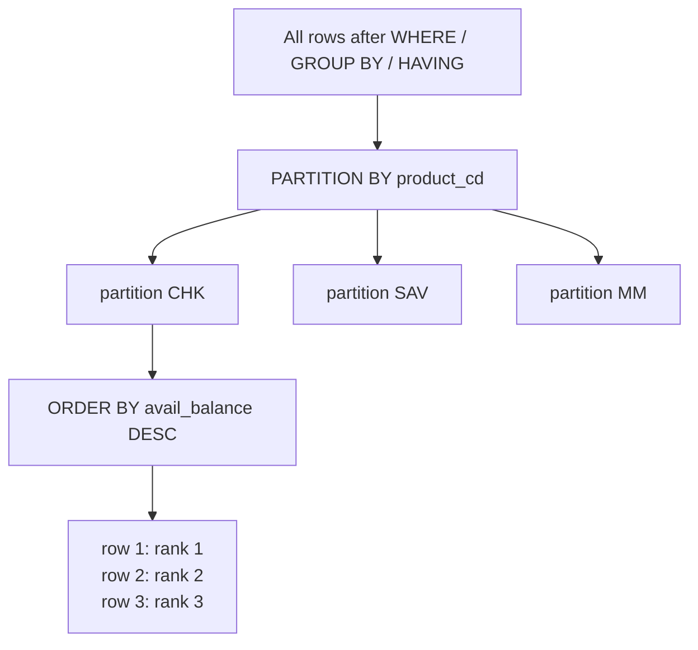

# Window basics and ranking

> **Before this lesson:** you should be able to write grouped queries with aggregates ([Aggregate functions and GROUP BY](#/lesson/sql/group-by)), know the order in which the clauses of a query are evaluated ([ORDER BY, LIMIT and how clauses are evaluated](#/lesson/sql/order-limit)), and read a query that names an intermediate result with `WITH` or uses a subquery in `FROM` ([Correlated subqueries, EXISTS and subqueries as data sources](#/lesson/sql/correlated-exists)).

## In plain words

`GROUP BY` answers questions *about groups*, and it does so by squeezing each group into one row. Ask for the average balance per product and you get one row per product; the individual accounts are gone.

Many questions need both at once: every detail row, **and** something calculated from the rows related to it. Show each account next to the average of its product. Show each runner with their finishing position. Show each sale with the running total so far. A **window function** does exactly this. For every row it looks at a set of related rows, called that row's **window**, calculates something from them, and writes the answer onto the row. No rows are merged and none are lost.

An everyday picture: a school report. Each pupil's line shows their own mark, and beside it the class average and their position in the class. The class average is the same on every line of that class; the position differs from pupil to pupil. Nobody's line disappeared in order to compute them. The "class" is the window.

This lesson covers the `OVER` clause, which turns a function into a window function, and the functions that number and rank rows. The next lesson covers looking at neighbouring rows and running totals.

**Why it matters for a job.** Window functions are the most heavily tested topic in interviews for data roles. "Top three per category", "the second-highest salary", "the latest order of each customer": all are a ranking function plus a filter. In daily work they replace slow and hard-to-read self joins.

> [!NOTE]
> **Availability:** SQLite 3.25 and later, PostgreSQL, MySQL **8.0 and later** (not 5.7), SQL Server, Oracle. Some books call them *analytic functions*.

## From GROUP BY to OVER

Count the accounts of each product with `GROUP BY`. One row per product:

```sql-run dataset=bank
SELECT product_cd, COUNT(*) AS n
FROM account
GROUP BY product_cd;
```

Seven rows: 2 `BUS` accounts, 8 `CD`, 38 `CHK`, and so on. Now the same count as a **window function**: add `OVER (...)` after the function and remove `GROUP BY`.

```sql-run dataset=bank
SELECT account_id, product_cd, avail_balance,
       COUNT(*) OVER (PARTITION BY product_cd) AS accounts_in_product,
       ROUND(AVG(avail_balance) OVER (PARTITION BY product_cd), 2) AS avg_in_product,
       ROUND(AVG(avail_balance) OVER (), 2) AS avg_overall
FROM account
ORDER BY product_cd, account_id
LIMIT 12;
```

Read the three new columns:

- `COUNT(*) OVER (PARTITION BY product_cd)` — count the rows that have the same `product_cd` as this row. `PARTITION BY` splits the rows into groups, called **partitions**, the way `GROUP BY` does, but the rows are kept.
- `AVG(avail_balance) OVER (PARTITION BY product_cd)` — the average balance of this row's product.
- `AVG(avail_balance) OVER ()` — empty parentheses mean "over all rows": the overall average.

The first two rows are the two `BUS` accounts, 172 and 177. Both show `accounts_in_product` 2 and `avg_in_product` 31168.24, and both show the overall average 5696.64. Every account is still there, and each carries facts about its group.

| | `GROUP BY` | Window function |
|---|---|---|
| Rows returned | one per group | every input row |
| Detail columns | lost (must be grouped or aggregated) | kept |
| Comparing a row with its group | needs a join back to the detail | direct |

Because the detail survives, comparisons are easy. How far is each account from its product's average, and what share of the product's total does it hold?

```sql-run dataset=bank
SELECT account_id, product_cd, avail_balance,
       ROUND(avail_balance - AVG(avail_balance) OVER (PARTITION BY product_cd), 2) AS diff_from_product_avg,
       ROUND(100.0 * avail_balance / SUM(avail_balance) OVER (PARTITION BY product_cd), 1) AS pct_of_product
FROM account
WHERE product_cd IN ('SAV', 'MM')
ORDER BY product_cd, avail_balance DESC
LIMIT 10;
```

Account 126 holds 8782.83, which is 5446.04 above the money-market average and 20.2% of all money-market balances. A window function can be used inside a calculation like any other value.

## The parts of the OVER clause

```
function(arguments) OVER (
    [PARTITION BY expression, ...]          -- split the rows into independent groups
    [ORDER BY expression [ASC|DESC], ...]   -- put the rows of each group in order
    [frame clause]                          -- which rows around the current one (next lesson)
)
```

- **`OVER ()`**, empty: the window is the whole result.
- **`PARTITION BY`**: like `GROUP BY`, except that rows are not merged. The function starts afresh in each partition.
- **`ORDER BY` inside `OVER`**: puts the rows *of each partition* in order, for functions where order matters, such as ranking. It has nothing to do with the `ORDER BY` at the end of the query, which only arranges the output.



### Where windows fit in the order of evaluation

Window functions are calculated while the `SELECT` list is worked out: **after** `FROM`, `WHERE`, `GROUP BY` and `HAVING`, and **before** `DISTINCT`, `ORDER BY` and `LIMIT`. Two consequences explain most errors people make with them.

1. **A window function cannot be used in `WHERE`, `GROUP BY` or `HAVING`.** Those clauses run before it exists. To filter on its result, calculate it in a subquery or a `WITH` clause and filter in the query around it. (Snowflake, BigQuery and DuckDB have a `QUALIFY` clause for this; SQLite, PostgreSQL and MySQL do not.)
2. **A window sees the rows that survived `WHERE` and `GROUP BY`.** So a window function can be applied *to grouped rows*, for example to rank monthly totals.

## Ranking functions

A ranking function numbers the rows of a partition according to the window's `ORDER BY`. The three main ones differ only in how they treat **ties**, rows with equal values:

| Function | Ties | Result for scores 90, 85, 85, 80 |
|---|---|---|
| `ROW_NUMBER()` | each row gets its own number, in an arbitrary order among the tied rows | 1, 2, 3, 4 |
| `RANK()` | tied rows share a rank, and a **gap** follows | 1, 2, 2, 4 |
| `DENSE_RANK()` | tied rows share a rank, with **no gap** | 1, 2, 2, 3 |

`RANK` is how sports results are announced: "joint second; the next finisher is fourth". All three side by side, on data that contains a tie:

```sql-run dataset=bank
SELECT open_emp_id, COUNT(*) AS accounts_opened,
       ROW_NUMBER() OVER (ORDER BY COUNT(*) DESC) AS row_num,
       RANK()       OVER (ORDER BY COUNT(*) DESC) AS rnk,
       DENSE_RANK() OVER (ORDER BY COUNT(*) DESC) AS dense_rnk
FROM account
GROUP BY open_emp_id
ORDER BY accounts_opened DESC
LIMIT 10;
```

This query groups first (one row per employee, with the number of accounts opened) and then ranks those grouped rows. That is why the window's `ORDER BY` may use `COUNT(*)`: by the time the window is evaluated, the counts exist.

Employee 11 opened 11 accounts and is number 1 in all three columns. Employees 19 and 10 both opened 8. `ROW_NUMBER` gives them 2 and 3, in an order nothing guarantees. `RANK` and `DENSE_RANK` give both of them 2. For the next employee, `RANK` continues with 4 and `DENSE_RANK` with 3.

How to choose:

- **`ROW_NUMBER`** when you need *exactly one* row per position: removing duplicates, "the latest row per customer", splitting results into pages. Always add a tie-breaker (a unique column) to the `ORDER BY`, so the choice is the same every time.
- **`RANK`** for competition-style ranking. "Top 3" then returns everyone tied within the first three positions.
- **`DENSE_RANK`** for "the top 3 *different values*", such as the three highest salaries however many people earn them. It is the usual choice for "the Nth highest" questions.

### Ranking within partitions

Add `PARTITION BY` and the numbering starts again in each group:

```sql-run dataset=shop
SELECT c.name AS category, p.name AS product, p.price,
       RANK() OVER (PARTITION BY p.category_id ORDER BY p.price DESC) AS price_rank
FROM products p
JOIN categories c ON c.category_id = p.category_id
ORDER BY category, price_rank
LIMIT 14;
```

Within Accessories the monitor at 279.00 is rank 1, the keyboard at 89.00 rank 2, the hub at 39.50 rank 3. When the next category begins, the rank goes back to 1.

### Top-N per group

Filtering on the rank gives the most common interview pattern of all. The rank cannot be used in `WHERE` directly, so it is calculated in a `WITH` clause (a named intermediate result) and filtered in the main query:

```sql-run dataset=shop
WITH ranked AS (
  SELECT c.name AS category, p.name AS product, p.price,
         ROW_NUMBER() OVER (PARTITION BY p.category_id ORDER BY p.price DESC, p.product_id) AS rn
  FROM products p
  JOIN categories c ON c.category_id = p.category_id
)
SELECT category, product, price
FROM ranked
WHERE rn <= 2
ORDER BY category, price DESC;
```

"The two most expensive products in each category." The first part numbers the products of each category from the most expensive down; `p.product_id` at the end of the window's `ORDER BY` is the tie-breaker. The second part keeps numbers 1 and 2. Use `DENSE_RANK` instead if all products tied on price should be shown.

The same shape with `rn = 1` answers "the latest order per customer", "the best run per experiment", and here "the most recent production deployment of each model":

```sql-run dataset=mlops
WITH d AS (
  SELECT m.name, m.version, dp.environment, dp.deployed_at,
         ROW_NUMBER() OVER (PARTITION BY m.name ORDER BY dp.deployed_at DESC) AS rn
  FROM deployments dp
  JOIN models m ON m.model_id = dp.model_id
  WHERE dp.environment = 'production'
)
SELECT name, version, deployed_at
FROM d
WHERE rn = 1
ORDER BY name;
```

Six models, one row each: for `churn-model` the most recently deployed version is 9.

### The Nth highest value

"The second-highest balance of each product" is `DENSE_RANK() = 2`:

```sql-run dataset=bank
WITH r AS (
  SELECT product_cd, account_id, avail_balance,
         DENSE_RANK() OVER (PARTITION BY product_cd ORDER BY avail_balance DESC) AS dr
  FROM account
  WHERE status = 'ACTIVE'
)
SELECT product_cd, account_id, avail_balance
FROM r
WHERE dr = 2;
```

For `CD`, two accounts (122 and 138) share the second-highest balance of 1500, and both are returned: that is `DENSE_RANK` treating ties. A product with only one distinct balance has no rank 2 and does not appear at all, which is usually what is wanted.

## NTILE, PERCENT_RANK and CUME_DIST

`NTILE(n)` deals the ordered rows into `n` buckets of equal size, or as nearly equal as possible. With 4 the buckets are called quartiles, with 10 deciles.

```sql-run dataset=shop
WITH spend AS (
  SELECT o.customer_id,
         ROUND(SUM(oi.quantity * oi.unit_price * (1 - oi.discount)), 2) AS total_spend
  FROM orders o JOIN order_items oi ON oi.order_id = o.order_id
  WHERE o.status = 'delivered'
  GROUP BY o.customer_id
)
SELECT quartile, COUNT(*) AS customers,
       MIN(total_spend) AS min_spend, MAX(total_spend) AS max_spend
FROM (SELECT customer_id, total_spend,
             NTILE(4) OVER (ORDER BY total_spend DESC) AS quartile
      FROM spend)
GROUP BY quartile;
```

Three layers: total spend per customer; a quartile number for each customer, with the biggest spenders in quartile 1; and a summary per quartile. Quartile 1 has 18 customers who spent between 2195.13 and 10665.34. `NTILE` splits by *number of rows*, so two customers with equal spend can land in different buckets.

Two related functions express a position as a fraction:

- `PERCENT_RANK()` is (rank − 1) ÷ (rows − 1): 0 for the first row and 1 for the last.
- `CUME_DIST()`, the cumulative distribution, is the fraction of rows whose value is less than or equal to this row's.

```sql-run dataset=mlops
SELECT prediction_id, latency_ms,
       ROUND(PERCENT_RANK() OVER (ORDER BY latency_ms), 3) AS pct_rank,
       ROUND(CUME_DIST()    OVER (ORDER BY latency_ms), 3) AS cume_dist
FROM predictions
WHERE deployment_id = (SELECT MAX(deployment_id) FROM predictions)
ORDER BY latency_ms DESC
LIMIT 6;
```

`latency_ms` is the time a prediction took. The slowest one, at 75 milliseconds, has both values equal to 1.0: every row is at or below it.

A **percentile** follows directly. The 95th percentile, written p95, is the value below which 95% of the measurements fall. It is the smallest value whose cumulative distribution reaches 0.95:

```sql-run dataset=mlops
WITH d AS (
  SELECT latency_ms, CUME_DIST() OVER (ORDER BY latency_ms) AS cd
  FROM predictions
)
SELECT MIN(latency_ms) AS p95_latency_ms FROM d WHERE cd >= 0.95;
```

165 milliseconds: 95% of all predictions were at least that fast. (PostgreSQL has a direct function, `percentile_cont(0.95) WITHIN GROUP (ORDER BY latency_ms)`; SQLite and MySQL do not.)

## Named windows

When several functions use the same window, define it once with the `WINDOW` clause and refer to it by name:

```sql-run dataset=bank
SELECT account_id, product_cd, avail_balance,
       RANK()       OVER w AS rnk,
       DENSE_RANK() OVER w AS dense_rnk,
       ROUND(PERCENT_RANK() OVER w, 2) AS pct
FROM account
WHERE product_cd = 'MM'
WINDOW w AS (PARTITION BY product_cd ORDER BY avail_balance DESC)
ORDER BY rnk;
```

It is shorter, and it guarantees that the three definitions really are the same. (SQLite, PostgreSQL and MySQL 8 support it; older Oracle and SQL Server versions do not.)

## How the database carries out a window

For each different window definition, the database **sorts** the rows by the partition columns and then the order columns, and makes one pass over the sorted rows. Functions that share a window share the sort. An index that already supplies that order can remove the sort. This is far cheaper than the alternative with a correlated subquery, which re-reads rows for every row.

```sql-run dataset=bank
EXPLAIN QUERY PLAN
SELECT account_id, RANK() OVER (PARTITION BY product_cd ORDER BY avail_balance DESC)
FROM account;
```

The plan shows one scan of `account` and `USE TEMP B-TREE FOR ORDER BY`, which is the sort.

## Worked example: three ranking functions in one request

*For each team, show its two best training runs by accuracy; show where each run stands among all runs; and flag runs in the top 10% overall. List the teams in order of their best score.*

```sql-run dataset=mlops
WITH scored AS (
  SELECT e.team, r.run_id, r.model_type, m.value AS accuracy
  FROM runs r
  JOIN experiments e ON e.experiment_id = r.experiment_id
  JOIN metrics m     ON m.run_id = r.run_id AND m.metric_name = 'accuracy'
  WHERE r.status = 'FINISHED'
),
ranked AS (
  SELECT team, run_id, model_type, accuracy,
         ROW_NUMBER() OVER (PARTITION BY team ORDER BY accuracy DESC, run_id) AS rn_in_team,
         DENSE_RANK() OVER (ORDER BY accuracy DESC)                           AS overall_rank,
         NTILE(10)    OVER (ORDER BY accuracy DESC)                           AS decile,
         MAX(accuracy) OVER (PARTITION BY team)                               AS team_best
  FROM scored
)
SELECT team, run_id, model_type, accuracy, overall_rank,
       CASE WHEN decile = 1 THEN 'top 10%' ELSE '' END AS flag
FROM ranked
WHERE rn_in_team <= 2
ORDER BY team_best DESC, team, rn_in_team;
```

The first step, `scored`, builds one row per finished run with its team and accuracy. The second, `ranked`, adds four windows over those rows, each answering one part of the request:

- `ROW_NUMBER` partitioned by team numbers each team's runs from best to worst, so the filter `rn_in_team <= 2` keeps exactly two per team.
- `DENSE_RANK` with no partition gives the position among all runs.
- `NTILE(10)` assigns tenths; bucket 1 is the top 10%.
- `MAX(accuracy) OVER (PARTITION BY team)` copies each team's best score onto all of its rows, so the final `ORDER BY` can sort the *teams* by it.

Everything is calculated first and filtered afterwards. That rhythm, calculate then filter in an outer step, is the shape of every window query. The top row is run 17 of the growth team, with an accuracy of 0.9521 and overall rank 1.

> [!INTERVIEW]
> The three ranking functions are asked about directly ("what is the difference between `RANK` and `DENSE_RANK`?") and indirectly through "top N per group" and "Nth highest" problems. Whichever you choose, say how ties behave, and add a tie-breaker to the `ORDER BY` if exactly N rows are required.

## Pitfalls

- **A window function in `WHERE`** is not allowed. Calculate it in a `WITH` clause or subquery and filter outside.
- **`ROW_NUMBER` with an `ORDER BY` that allows ties.** Tied rows are numbered arbitrarily and the result can change between runs. Add a unique tie-breaker.
- **`RANK` where `DENSE_RANK` was meant**, or the reverse, in "Nth highest" questions.
- **A forgotten `PARTITION BY`** gives one ranking over everything.
- **Confusing the window's `ORDER BY` with the query's.** The first defines the calculation; the second arranges the output.
- **MySQL 5.7 and SQLite before 3.25** have no window functions.

## Summary

- A window function calculates a value for each row from a set of related rows defined by `OVER (PARTITION BY ... ORDER BY ...)`, and keeps every row.
- Any aggregate can be used as a window function; `OVER ()` means the whole result.
- Windows are evaluated after `GROUP BY` and `HAVING` and cannot appear in `WHERE`; filter in an outer query.
- `ROW_NUMBER` gives unique numbers, `RANK` gives ties with gaps, `DENSE_RANK` gives ties without gaps; `NTILE`, `PERCENT_RANK` and `CUME_DIST` give buckets and percentiles.
- **Top-N per group**: rank in a `WITH` clause, filter outside.

## Glossary

- **Window function** — a function that calculates a value for each row from a set of related rows, without merging rows.
- **Window** — the set of rows a window function looks at for a given row.
- **`OVER`** — the clause that turns a function into a window function and describes its window.
- **Partition** — a group of rows that share the values named in `PARTITION BY`; each is processed independently.
- **Ranking function** — a window function that numbers rows in order: `ROW_NUMBER`, `RANK`, `DENSE_RANK`.
- **Tie** — two or more rows with equal values in the ordering columns.
- **Tie-breaker** — an extra, unique column in `ORDER BY` that makes the order certain.
- **Top-N per group** — the pattern of keeping the first N rows of each partition.
- **`NTILE(n)`** — deals ordered rows into n buckets of nearly equal size.
- **Quartile / decile** — one of four / ten equal-sized buckets of ordered rows.
- **`PERCENT_RANK` / `CUME_DIST`** — a row's position expressed as a fraction between 0 and 1.
- **Percentile** — the value below which a given percentage of measurements fall (p95: 95%).
- **Named window** — a window defined once in the `WINDOW` clause and used by several functions.
- **`QUALIFY`** — a clause in some databases that filters directly on a window function's result.

```quiz
[
  {"q": "For scores 90, 85, 85, 80 ordered from highest to lowest, what does RANK() produce?", "options": ["1, 2, 3, 4", "1, 2, 2, 3", "1, 2, 2, 4", "1, 1, 2, 3"], "answer": 2, "explain": "Tied rows share a rank and the next rank skips: 1, 2, 2, 4. DENSE_RANK would give 1, 2, 2, 3."},
  {"q": "What is the key difference between GROUP BY and a window function?", "options": ["Windows are faster", "A window function keeps every input row; GROUP BY returns one row per group", "GROUP BY cannot use SUM", "Windows cannot split rows into groups"], "answer": 1, "explain": "Window functions add calculated columns without merging rows."},
  {"q": "Why can't you write WHERE ROW_NUMBER() OVER (...) = 1?", "options": ["ROW_NUMBER needs arguments", "Window functions are evaluated after WHERE", "It requires GROUP BY", "It is allowed"], "answer": 1, "explain": "Windows are calculated with the SELECT list; filter on them in an outer query or a WITH clause."},
  {"q": "Which function should you use to keep exactly one row per customer (the latest order)?", "options": ["RANK", "DENSE_RANK", "ROW_NUMBER", "NTILE"], "answer": 2, "explain": "ROW_NUMBER gives different numbers even to tied rows, so rn = 1 is exactly one row."},
  {"q": "What does PARTITION BY do inside OVER?", "options": ["Sorts the final output", "Restarts the calculation for each group of rows", "Removes duplicates", "Filters rows"], "answer": 1, "explain": "Each partition is an independent window."},
  {"q": "To find the three highest distinct salaries per department, use...", "options": ["ROW_NUMBER() <= 3", "RANK() <= 3", "DENSE_RANK() <= 3", "NTILE(3)"], "answer": 2, "explain": "DENSE_RANK numbers different values consecutively, so <= 3 covers the top three values and everyone who has them."},
  {"q": "What does AVG(x) OVER () compute?", "options": ["An error", "The average over the entire result, repeated on every row", "A running average", "The average of each single row"], "answer": 1, "explain": "An empty OVER makes the whole result one window."},
  {"q": "A query has GROUP BY open_emp_id and RANK() OVER (ORDER BY COUNT(*) DESC). What is being ranked?", "options": ["The individual accounts", "The grouped rows, one per employee", "Nothing; it is an error", "The tables"], "answer": 1, "explain": "Windows are evaluated after GROUP BY, so they see one row per group and may order by an aggregate."}
]
```

> **Source:** Beaulieu, *Learning SQL*, 3rd ed., ch. 16 "Analytic Functions" (data windows, localized sorting, ranking functions), restated in original wording with this guide's own datasets. SQLite documentation, "Window Functions".
