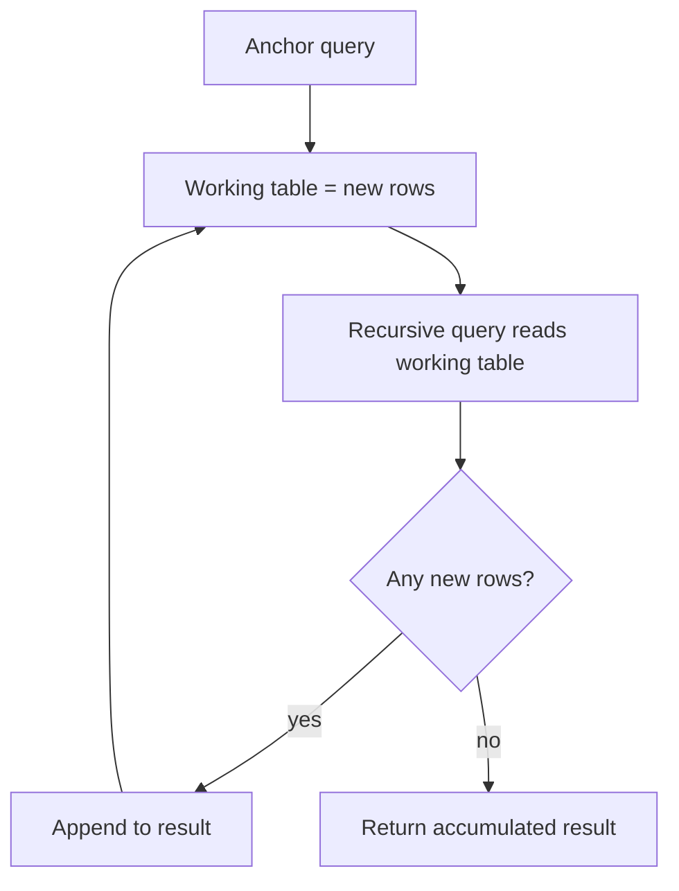

# Recursive CTEs

> **Before this lesson:** you should be able to write a CTE with `WITH` ([Common table expressions](#/lesson/sql/ctes)), stack results with `UNION ALL` ([Set theory and UNION](#/lesson/sql/union)), and join a table to itself to find each employee's manager ([Three or more tables, self joins and non-equi joins](#/lesson/sql/multi-self-joins)).

## In plain words

Ordinary SQL can follow a link a *fixed* number of steps: one join for each step. A self join finds each employee's manager. A second self join finds the manager's manager. But some data has no fixed depth. A company might have three levels of management or thirty. A folder can contain folders that contain folders. To go "as many levels as there are", you need a way to repeat a step until there is nothing left to find.

SQL provides this with the **recursive CTE**: a CTE whose definition mentions its own name. "Recursive" describes something defined in terms of itself.

An everyday picture: tracing your ancestors. You start with yourself. From that list of one person you find the parents. From the list of parents you find *their* parents. You repeat the same step, each time starting from the people found in the previous round, and you stop when a round finds nobody new. You did not need to know in advance how many generations there would be.

Data shaped like a family tree, where each item has one parent, is called a **hierarchy** or **tree**. Recursive CTEs are the standard tool for it. They also do a second job that has nothing to do with trees: producing a run of numbers or dates out of nothing.

**Why it matters for a job.** Organisation charts, product categories, folders, parts made of smaller parts, comment threads and referral chains are all hierarchies, and all real. In interviews, "list everyone who reports to this manager, directly or indirectly" and "generate every date in a range" are the two usual recursive-CTE questions.

> [!NOTE]
> Syntax: `WITH RECURSIVE` in SQLite, PostgreSQL and MySQL 8 and later. SQL Server and Oracle write plain `WITH`, without the word `RECURSIVE`. Oracle also has an older syntax, `CONNECT BY`.

## How a recursive CTE is built

```
WITH RECURSIVE name(columns) AS (
    anchor_query            -- runs once: the starting rows
    UNION ALL
    recursive_query         -- mentions "name": makes the next rows from the previous ones
)
SELECT ... FROM name;
```

There are two parts joined by `UNION ALL`. The first, called the **anchor member**, is an ordinary query that supplies the starting rows. The second, the **recursive member**, mentions the CTE's own name and produces new rows from existing ones.

How the database evaluates it:

1. Run the **anchor**. Its rows go into the result, and also into a scratch area called the *working table*.
2. Run the **recursive member**. Inside it, the CTE's name stands for the **working table only**: the rows produced by the previous round, not everything found so far.
3. Add the new rows to the result. They become the new working table.
4. Repeat steps 2 and 3 until the recursive member returns **no rows**.

Despite the name, this is really a loop: each round pushes the edge of the result one step further.



The smallest example counts to ten:

```sql-run dataset=bank
WITH RECURSIVE counter(n) AS (
  SELECT 1                              -- anchor
  UNION ALL
  SELECT n + 1 FROM counter WHERE n < 10  -- recursive member with a stop condition
)
SELECT n FROM counter;
```

Trace it by hand:

- The anchor produces one row: `1`.
- Round 1: the recursive member reads the working table, which holds 1. Since 1 < 10, it produces 2.
- Round 2: the working table holds 2; it produces 3. And so on, until round 9 produces 10.
- Round 10: the working table holds 10. The condition `n < 10` is false, so no row is produced, and the loop ends.

The result is the ten rows 1 to 10. **The stop condition is essential.** Without `WHERE n < 10` the query would go on producing numbers for ever, or until the database's limit is reached.

## Walking a hierarchy from the top down

The bank's `employee` table stores each person's manager in `superior_emp_id`. Start with the president, who has no manager, and repeatedly find the people who report to those found in the previous round:

```sql-run dataset=bank
WITH RECURSIVE org AS (
  SELECT emp_id, fname || ' ' || lname AS name, title, superior_emp_id, 1 AS level
  FROM employee
  WHERE superior_emp_id IS NULL                       -- anchor: the top of the tree

  UNION ALL

  SELECT e.emp_id, e.fname || ' ' || e.lname, e.title, e.superior_emp_id, org.level + 1
  FROM employee e
  JOIN org ON e.superior_emp_id = org.emp_id          -- people who report to the previous round
)
SELECT level, emp_id, name, title
FROM org
ORDER BY level, emp_id;
```

- The anchor selects the employee whose `superior_emp_id` is NULL and gives him `level` 1. The top of a tree is called its **root**.
- The recursive member joins `employee` to `org`. Remember that `org` here means "the people found in the previous round". An employee `e` qualifies when their manager is one of those people, and gets a level one higher.

All 22 employees come back. Michael Smith, the president, is at level 1. Susan Barker and Robert Tyler, who report to him, are at level 2. Susan Hawthorne, who reports to Robert Tyler, is at level 3.

The `level` column, carried along and increased in each round, is the standard way to compute **depth**. The recursive member is the self join from the joins lesson; the CTE repeats it until the bottom of the tree is reached.

### Paths and an indented chart

Carry a piece of text along as well, and each row knows its whole chain of command. Sorting by that text prints the tree with each manager followed by their own people:

```sql-run dataset=bank
WITH RECURSIVE org AS (
  SELECT emp_id, lname, title, 1 AS level, lname AS path
  FROM employee
  WHERE superior_emp_id IS NULL
  UNION ALL
  SELECT e.emp_id, e.lname, e.title, org.level + 1, org.path || ' > ' || e.lname
  FROM employee e
  JOIN org ON e.superior_emp_id = org.emp_id
)
SELECT substr('            ', 1, (level - 1) * 3) || lname AS org_chart, title, path
FROM org
ORDER BY path;
```

In each round the path grows by one name: `Smith`, then `Smith > Barker`, then `Smith > Barker > Okafor`. The `org_chart` column puts three spaces in front of the name for each level below the top, which draws the tree as an indented list.

### Walking from the bottom up

To find one person's chain of managers, anchor at that person and join in the other direction, from each row to its manager:

```sql-run dataset=bank
WITH RECURSIVE chain AS (
  SELECT emp_id, fname || ' ' || lname AS name, title, superior_emp_id, 0 AS steps_up
  FROM employee
  WHERE emp_id = 15                                   -- Frank Portman, a teller
  UNION ALL
  SELECT e.emp_id, e.fname || ' ' || e.lname, e.title, e.superior_emp_id, chain.steps_up + 1
  FROM employee e
  JOIN chain ON e.emp_id = chain.superior_emp_id      -- the manager of the previous row
)
SELECT steps_up, name, title FROM chain ORDER BY steps_up;
```

Five rows: Frank Portman, then his head teller John Blake, then Susan Hawthorne, then Robert Tyler, then the president. The loop ends by itself at the president: his `superior_emp_id` is NULL, which matches no employee, so the next round finds nothing.

The same pattern gives the "breadcrumb" of a product category, the trail of categories above it:

```sql-run dataset=shop
WITH RECURSIVE up AS (
  SELECT category_id, name, parent_id, 0 AS depth FROM categories WHERE name = 'Laptops'
  UNION ALL
  SELECT c.category_id, c.name, c.parent_id, up.depth + 1
  FROM categories c JOIN up ON c.category_id = up.parent_id
)
SELECT group_concat(name, ' > ') AS breadcrumb
FROM (SELECT name FROM up ORDER BY depth DESC);
```

`Electronics > Computers > Laptops`. The recursion climbs from Laptops to the top; `group_concat` then glues the names together, from the top down.

## Totals over a whole branch

A frequent need: a total for an item **including everything beneath it**. The number of people under each manager at any depth. The revenue of a category including all its subcategories.

The technique is to list every pair of (ancestor, descendant): each item paired with everything below it, at any depth. This list is called the **transitive closure** of the hierarchy. An **ancestor** is anything above an item in the tree; a **descendant** is anything below. Start by pairing every item with itself, then extend downward:

```sql-run dataset=bank
WITH RECURSIVE closure(ancestor, descendant, depth) AS (
  SELECT emp_id, emp_id, 0 FROM employee              -- every employee paired with themselves
  UNION ALL
  SELECT c.ancestor, e.emp_id, c.depth + 1
  FROM closure c
  JOIN employee e ON e.superior_emp_id = c.descendant
)
SELECT m.emp_id, m.fname || ' ' || m.lname AS manager, m.title,
       COUNT(*) - 1 AS total_reports,                 -- minus themselves
       SUM(CASE WHEN c.depth = 1 THEN 1 ELSE 0 END) AS direct_reports
FROM closure c
JOIN employee m ON m.emp_id = c.ancestor
GROUP BY m.emp_id
HAVING COUNT(*) > 1
ORDER BY total_reports DESC;
```

In the recursive member, if (A, D) is a known pair and employee `e` reports to D, then (A, `e`) is a pair too, one level deeper. Once all pairs exist, counting them per ancestor gives the size of each manager's whole organisation. The president has 21 people under him, 2 of them directly. Susan Hawthorne has 17, of whom 5 report to her directly.

With the closure in hand, any total over a branch is an ordinary join and `GROUP BY`. Revenue added up at every level of the category tree:

```sql-run dataset=shop
WITH RECURSIVE closure(ancestor, descendant) AS (
  SELECT category_id, category_id FROM categories
  UNION ALL
  SELECT c.ancestor, k.category_id
  FROM closure c JOIN categories k ON k.parent_id = c.descendant
)
SELECT a.name AS category,
       COUNT(DISTINCT p.product_id) AS products_in_subtree,
       ROUND(SUM(oi.quantity * oi.unit_price * (1 - oi.discount)), 2) AS revenue
FROM closure c
JOIN categories a   ON a.category_id = c.ancestor
JOIN products p     ON p.category_id = c.descendant
JOIN order_items oi ON oi.product_id = p.product_id
JOIN orders o       ON o.order_id = oi.order_id AND o.status = 'delivered'
GROUP BY a.category_id, a.name
ORDER BY revenue DESC
LIMIT 8;
```

Electronics shows 101455.34, which contains the 84447.89 of Computers, which in turn contains the 76412.20 of Laptops. Each level's total includes the totals of everything beneath it.

## Generating a series

With no table at all, a recursive CTE can produce the framework of rows that [Cross joins, natural joins and densifying data](#/lesson/sql/cross-natural) built from lists of digits. A calendar of fourteen days:

```sql-run dataset=shop
WITH RECURSIVE days(day) AS (
  SELECT '2024-12-01'
  UNION ALL
  SELECT date(day, '+1 day') FROM days WHERE day < '2024-12-14'
)
SELECT d.day, COUNT(o.order_id) AS orders
FROM days d
LEFT JOIN orders o ON o.order_date = d.day
GROUP BY d.day
ORDER BY d.day;
```

The anchor is 1 December; each round adds one day; the loop stops after 14 December. The left join then attaches the orders, so every day appears, with a 0 where there were none (2 and 3 December, for example). Series of months, hours or plain numbers work the same way. PostgreSQL's `generate_series` function is a shortcut for this.

A series can also carry a calculation in which each row is worked out from the row before. Compound interest on 1,000 at 4% a year for ten years:

```sql-run dataset=bank
WITH RECURSIVE growth(year, balance) AS (
  SELECT 0, 1000.0
  UNION ALL
  SELECT year + 1, ROUND(balance * 1.04, 2) FROM growth WHERE year < 10
)
SELECT year, balance FROM growth;
```

1000.00, then 1040.00, then 1081.60, then 1124.86: each balance is the previous one times 1.04.

## Graphs and cycles

A tree has no loops: following the links upward always ends at the root. A **graph** is the more general shape in which anything may link to anything, as with flight routes or people following one another, and it can contain a **cycle**: a chain of links that leads back to where it started. Bad data can put a cycle into a supposed hierarchy too: A manages B and B manages A. With `UNION ALL`, a cycle means the loop **never ends**, because the same rows keep being found again.

Three defences:

1. **A depth limit.** Carry a counter and stop at some value: `WHERE depth < 20`. Plain, and always available.
2. **Path tracking.** Carry the ids already visited in a piece of text, and refuse to visit one again:

```sql-run dataset=shop
WITH RECURSIVE chain(customer_id, depth, path) AS (
  SELECT customer_id, 0, ',' || customer_id || ','
  FROM customers
  WHERE referred_by IS NULL AND customer_id IN (SELECT referred_by FROM customers)
  UNION ALL
  SELECT c.customer_id, ch.depth + 1, ch.path || c.customer_id || ','
  FROM customers c
  JOIN chain ch ON c.referred_by = ch.customer_id
  WHERE ch.path NOT LIKE '%,' || c.customer_id || ',%'     -- not already on this path
    AND ch.depth < 20
)
SELECT depth, COUNT(*) AS customers, MAX(path) AS example_path
FROM chain
GROUP BY depth;
```

The shop's customers can refer one another (`referred_by`). The anchor is the customers who were referred by nobody and have referred someone. Each round adds the people they referred. The path is text such as `,20,21,28,`, with commas around every id so that the test for `,2,` cannot be fooled by `,20,`. The longest chain here is three referrals deep.

3. **`UNION` instead of `UNION ALL`.** `UNION` throws away rows that have already been produced, so visiting an item a second time adds nothing new and the loop ends. This works only if the rows carry no changing column, such as a depth or a path, that would make every revisit look like a new row.

Databases also have limits of their own. SQL Server stops at 100 rounds by default (`OPTION (MAXRECURSION n)` changes it). MySQL stops at 1000 (`cte_max_recursion_depth`). PostgreSQL 14 and later has a `CYCLE` clause that does the path tracking for you. SQLite has no limit, so always write a stop condition there.

## Restrictions on the recursive member

To keep the meaning well defined, databases impose rules. In general, the recursive member:

- may mention the CTE **only once**, and not inside a subquery;
- may not use aggregate functions, `GROUP BY`, `DISTINCT` or window functions over the recursive reference (MySQL, PostgreSQL, SQL Server; SQLite is more relaxed);
- must return the same number of columns as the anchor, with compatible types. PostgreSQL is strict about types, so cast the anchor's columns if needed.

Do the aggregating *after* the recursion, in the main query, as the closure examples did.

## Other ways to store a hierarchy

A recursive CTE reads the most natural way of storing a tree, called the **adjacency list**: each row stores the id of its parent. When a tree is read far more often than it is changed, other ways of storing it avoid recursion at query time:

| Model | Idea | Trade-off |
|---|---|---|
| Adjacency list | a `parent_id` column | easy to change; reading needs recursion |
| Materialized path | store a path such as `'1/2/3'` on each row | a branch is `LIKE '1/2/%'`; moving a branch rewrites many paths |
| Closure table | store every (ancestor, descendant) pair | fastest to read; many rows, upkeep on every change |
| Nested sets | store a left and a right number per row | fast branch reads; expensive inserts |

The closure CTE above is exactly what you would run to build, or rebuild, a closure table.

> [!INTERVIEW]
> "Return everyone who reports to manager X, at any depth." Say the three parts aloud as you write them: the anchor is X's direct reports; the recursive member joins `employee` to the CTE on `superior_emp_id = cte.emp_id`; it stops when a round finds no one. Then volunteer the risk: a cycle in the data would loop for ever under `UNION ALL`, so add a depth limit. That last sentence is what interviewers hope to hear.

## Pitfalls

- **A missing or wrong stop condition**: a query that never finishes.
- **Cycles in the data** with `UNION ALL`.
- **Joining in the wrong direction**: from child to parent when parent to child was meant.
- **Aggregating inside the recursive member.** Do it outside.
- **Mismatched column types** between anchor and recursive member (PostgreSQL).
- **Reading the CTE's name as "all rows so far"** inside the recursive member. It means the rows of the previous round.

## Summary

- A recursive CTE is an anchor, `UNION ALL`, and a recursive member that mentions the CTE; it loops until a round produces no new rows.
- From the top down: anchor at the root and join children to the previous round; carry `level` and `path` columns.
- From the bottom up: anchor at one item and join to parents.
- Totals over a branch: build the (ancestor, descendant) closure, then join and group.
- Series of numbers and dates can be generated without any table.
- Protect against cycles with a depth limit, path tracking or `UNION`.

## Glossary

- **Recursive** — defined in terms of itself.
- **Recursive CTE** — a CTE whose definition mentions its own name and is evaluated in repeated rounds.
- **Anchor member** — the first part of a recursive CTE, run once to supply the starting rows.
- **Recursive member** — the second part, run repeatedly on the rows of the previous round.
- **Working table** — the rows produced by the most recent round, which the next round reads.
- **Stop condition** — the test that eventually makes the recursive member return no rows.
- **Hierarchy (tree)** — data in which each item has at most one parent.
- **Root** — the top item of a tree, which has no parent.
- **Depth (level)** — how many steps an item is from the root.
- **Ancestor / descendant** — an item above / below another in the tree, at any distance.
- **Transitive closure** — the list of all (ancestor, descendant) pairs of a hierarchy.
- **Graph** — data in which any item may link to any other.
- **Cycle** — a chain of links that returns to its starting point.
- **Adjacency list** — storing a tree by giving each row the id of its parent.
- **Closure table** — a stored table of all (ancestor, descendant) pairs.

```quiz
[
  {"q": "What does the anchor member of a recursive CTE do?", "options": ["Runs in every round", "Runs once to produce the starting rows", "Stops the recursion", "Sorts the output"], "answer": 1, "explain": "The anchor fills the working table once; the recursive member then runs repeatedly."},
  {"q": "When does a recursive CTE stop?", "options": ["Always after 100 rounds", "When the recursive member returns no rows", "When the anchor returns no rows", "When LIMIT is reached, on every database"], "answer": 1, "explain": "The loop ends when a round produces nothing new (database limits aside)."},
  {"q": "Inside the recursive member, the CTE's name refers to...", "options": ["All rows accumulated so far", "Only the rows produced by the previous round", "The anchor rows only", "The final result"], "answer": 1, "explain": "Each round works from the new rows of the round before, the working table."},
  {"q": "To list an employee's chain of managers up to the president you...", "options": ["Anchor at the president and join children", "Anchor at the employee and join each row to its manager", "Use a cross join", "Use NTILE"], "answer": 1, "explain": "Going bottom-up, the anchor is the starting item and each round follows the link to the parent."},
  {"q": "What happens with UNION ALL when the data contains a cycle?", "options": ["Duplicates are removed", "The recursion never ends", "An error is always raised at once", "Nothing unusual"], "answer": 1, "explain": "The same rows keep being produced; use a depth limit, path tracking or UNION."},
  {"q": "How do you compute a total for each item including everything beneath it?", "options": ["A single self join", "Build all (ancestor, descendant) pairs recursively, then join and GROUP BY the ancestor", "ORDER BY parent_id", "It is impossible in SQL"], "answer": 1, "explain": "The transitive closure turns a total over a branch into an ordinary grouped join."},
  {"q": "Which keyword does SQL Server use for recursive CTEs?", "options": ["WITH RECURSIVE", "WITH (the word RECURSIVE is not written)", "CONNECT BY", "LOOP"], "answer": 1, "explain": "SQL Server and Oracle use plain WITH; SQLite, PostgreSQL and MySQL require RECURSIVE."},
  {"q": "WITH RECURSIVE c(n) AS (SELECT 1 UNION ALL SELECT n + 1 FROM c WHERE n < 5) SELECT COUNT(*) FROM c returns...", "options": ["4", "5", "6", "It never ends"], "answer": 1, "explain": "The rows are 1, 2, 3, 4, 5: when the working table holds 5, the condition n < 5 fails and the loop stops."}
]
```

> **Source:** Beaulieu, *Learning SQL*, self-referencing foreign keys and self joins (ch. 5 and 10) as background. Recursive queries: SQLite documentation, "The WITH Clause: Recursive Common Table Expressions", and the PostgreSQL manual, "WITH Queries". Restated in original wording with this guide's own datasets.
