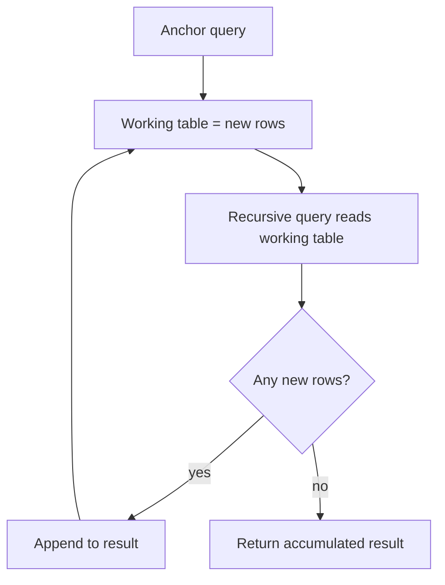

# Recursive CTEs

Ordinary SQL can follow a relationship a *fixed* number of steps: one join per step. But some data has no fixed depth. An org chart may be three levels deep or thirty; a category tree, a bill of materials, a referral chain, a dependency graph — all are **hierarchies or graphs of unknown depth**. A self join climbs one level; to climb "as many levels as there are" you need iteration. SQL provides it through the **recursive common table expression**: a CTE that refers to itself. Recursive CTEs also generate sequences — numbers, dates — without any table at all. This lesson explains the mechanics, walks through hierarchy traversal, paths and depth, aggregation over subtrees, series generation, and cycle protection.

> [!NOTE]
> Syntax: `WITH RECURSIVE` in SQLite, PostgreSQL and MySQL 8+. SQL Server and Oracle (11gR2+) write plain `WITH` — the keyword RECURSIVE is not used. Oracle also has the older `CONNECT BY` syntax.

## Anatomy

```
WITH RECURSIVE name(columns) AS (
    anchor_query            -- runs once: the starting rows
    UNION ALL
    recursive_query         -- refers to "name": produces the next rows from the previous ones
)
SELECT ... FROM name;
```

How it is evaluated:

1. Run the **anchor** member. Its rows go into the result and into a *working table*.
2. Run the **recursive** member, with the CTE name standing for the **working table only** (the rows produced by the previous step, not everything so far).
3. Add the new rows to the result; they become the new working table.
4. Repeat steps 2–3 until the recursive member returns **no rows**.

Despite the name, it is really *iteration*: each pass extends the frontier by one step.



The simplest example counts to ten:

```sql-run dataset=bank
WITH RECURSIVE counter(n) AS (
  SELECT 1                              -- anchor
  UNION ALL
  SELECT n + 1 FROM counter WHERE n < 10  -- recursive member with a stop condition
)
SELECT n FROM counter;
```

Pass 1 yields 1; pass 2 reads {1} and yields 2; … pass 10 reads {9} and yields 10; pass 11 reads {10}, the WHERE fails, no rows, stop. **The stop condition is essential** — without `WHERE n < 10` the query would run forever (or until the engine's limit).

## Walking a hierarchy top-down

The bank's `employee` table stores each person's manager in `superior_emp_id`. Start from the president (no superior) and repeatedly find the direct reports of the people found in the previous pass:

```sql-run dataset=bank
WITH RECURSIVE org AS (
  SELECT emp_id, fname || ' ' || lname AS name, title, superior_emp_id, 1 AS level
  FROM employee
  WHERE superior_emp_id IS NULL                       -- anchor: the root

  UNION ALL

  SELECT e.emp_id, e.fname || ' ' || e.lname, e.title, e.superior_emp_id, org.level + 1
  FROM employee e
  JOIN org ON e.superior_emp_id = org.emp_id          -- children of the previous level
)
SELECT level, emp_id, name, title
FROM org
ORDER BY level, emp_id;
```

The `level` column is carried along and incremented on each pass — the standard way to compute **depth**. The recursive member is just the self join from the joins module; the CTE repeats it until the bottom of the tree.

### Building paths and indented output

Carry a string as well, and each row knows its full chain of command. Sorting by that path prints the tree in depth-first order:

```sql-run dataset=bank
WITH RECURSIVE org AS (
  SELECT emp_id, lname, title, 1 AS level, lname AS path
  FROM employee
  WHERE superior_emp_id IS NULL
  UNION ALL
  SELECT e.emp_id, e.lname, e.title, org.level + 1, org.path || ' > ' || e.lname
  FROM employee e
  JOIN org ON e.superior_emp_id = org.emp_id
)
SELECT substr('            ', 1, (level - 1) * 3) || lname AS org_chart, title, path
FROM org
ORDER BY path;
```

### Walking bottom-up

To find one node's ancestors, anchor at the node and join the other way — from child to parent:

```sql-run dataset=bank
WITH RECURSIVE chain AS (
  SELECT emp_id, fname || ' ' || lname AS name, title, superior_emp_id, 0 AS steps_up
  FROM employee
  WHERE emp_id = 15                                   -- Frank Portman, a teller
  UNION ALL
  SELECT e.emp_id, e.fname || ' ' || e.lname, e.title, e.superior_emp_id, chain.steps_up + 1
  FROM employee e
  JOIN chain ON e.emp_id = chain.superior_emp_id      -- the boss of the previous row
)
SELECT steps_up, name, title FROM chain ORDER BY steps_up;
```

Same pattern for the category tree — the *breadcrumb* of a category:

```sql-run dataset=shop
WITH RECURSIVE up AS (
  SELECT category_id, name, parent_id, 0 AS depth FROM categories WHERE name = 'Laptops'
  UNION ALL
  SELECT c.category_id, c.name, c.parent_id, up.depth + 1
  FROM categories c JOIN up ON c.category_id = up.parent_id
)
SELECT group_concat(name, ' > ') AS breadcrumb
FROM (SELECT name FROM up ORDER BY depth DESC);
```

## Aggregating over subtrees

A frequent requirement: totals for a node **including all its descendants** — headcount under each manager, revenue of a category including its subcategories.

The technique is to compute the **transitive closure**: every (ancestor, descendant) pair. Anchor each node as its own ancestor, then extend downward:

```sql-run dataset=bank
WITH RECURSIVE closure(ancestor, descendant, depth) AS (
  SELECT emp_id, emp_id, 0 FROM employee              -- every employee "contains" themselves
  UNION ALL
  SELECT c.ancestor, e.emp_id, c.depth + 1
  FROM closure c
  JOIN employee e ON e.superior_emp_id = c.descendant
)
SELECT m.emp_id, m.fname || ' ' || m.lname AS manager, m.title,
       COUNT(*) - 1 AS total_reports,                 -- minus themselves
       SUM(CASE WHEN c.depth = 1 THEN 1 ELSE 0 END) AS direct_reports
FROM closure c
JOIN employee m ON m.emp_id = c.ancestor
GROUP BY m.emp_id
HAVING COUNT(*) > 1
ORDER BY total_reports DESC;
```

Once you have the closure, any subtree aggregate is an ordinary join and GROUP BY. Revenue rolled up to every level of the category tree:

```sql-run dataset=shop
WITH RECURSIVE closure(ancestor, descendant) AS (
  SELECT category_id, category_id FROM categories
  UNION ALL
  SELECT c.ancestor, k.category_id
  FROM closure c JOIN categories k ON k.parent_id = c.descendant
)
SELECT a.name AS category,
       COUNT(DISTINCT p.product_id) AS products_in_subtree,
       ROUND(SUM(oi.quantity * oi.unit_price * (1 - oi.discount)), 2) AS revenue
FROM closure c
JOIN categories a   ON a.category_id = c.ancestor
JOIN products p     ON p.category_id = c.descendant
JOIN order_items oi ON oi.product_id = p.product_id
JOIN orders o       ON o.order_id = oi.order_id AND o.status = 'delivered'
GROUP BY a.category_id, a.name
ORDER BY revenue DESC
LIMIT 8;
```

*Electronics* includes *Computers*, which includes *Laptops* and *Accessories* — each level's total contains its children's.

## Generating series

With no table at all, a recursive CTE can produce the scaffold rows that the cross-join lesson built from digit tables. A calendar:

```sql-run dataset=shop
WITH RECURSIVE days(day) AS (
  SELECT '2024-12-01'
  UNION ALL
  SELECT date(day, '+1 day') FROM days WHERE day < '2024-12-14'
)
SELECT d.day, COUNT(o.order_id) AS orders
FROM days d
LEFT JOIN orders o ON o.order_date = d.day
GROUP BY d.day
ORDER BY d.day;
```

Every day appears, zeros included. Month series, hour buckets and number ranges work the same way. (PostgreSQL's `generate_series` is a shortcut for this.)

A series can also drive a computation — compound interest over ten years on \$1,000 at 4%:

```sql-run dataset=bank
WITH RECURSIVE growth(year, balance) AS (
  SELECT 0, 1000.0
  UNION ALL
  SELECT year + 1, ROUND(balance * 1.04, 2) FROM growth WHERE year < 10
)
SELECT year, balance FROM growth;
```

Each row is computed from the previous one — something plain SQL cannot otherwise express without a window-function trick.

## Graphs and cycles

A tree has no cycles: following parent links always ends at the root. General graphs (flight routes, social follows, task dependencies) can loop, and so can a "hierarchy" with bad data — A manages B, B manages A. With `UNION ALL`, a cycle means **infinite recursion**.

Three defences:

1. **Depth limit** — carry a counter and stop: `WHERE depth < 20`. Simple, always available.
2. **Path tracking** — carry the visited ids in a string and refuse to revisit:

```sql-run dataset=shop
WITH RECURSIVE chain(customer_id, depth, path) AS (
  SELECT customer_id, 0, ',' || customer_id || ','
  FROM customers
  WHERE referred_by IS NULL AND customer_id IN (SELECT referred_by FROM customers)
  UNION ALL
  SELECT c.customer_id, ch.depth + 1, ch.path || c.customer_id || ','
  FROM customers c
  JOIN chain ch ON c.referred_by = ch.customer_id
  WHERE ch.path NOT LIKE '%,' || c.customer_id || ',%'     -- not already on this path
    AND ch.depth < 20
)
SELECT depth, COUNT(*) AS customers, MAX(path) AS example_path
FROM chain
GROUP BY depth;
```

3. **`UNION` instead of `UNION ALL`** — `UNION` discards rows already produced, so revisiting a node generates nothing new and the recursion terminates. This works only if the recursive rows don't carry a changing column (like depth or path) that makes every revisit look new.

PostgreSQL 14+ has a declarative `CYCLE … SET … USING …` clause, and SQL Server caps recursion at 100 levels by default (`OPTION (MAXRECURSION n)`); MySQL limits by `cte_max_recursion_depth` (1000). SQLite has no built-in cap, so always write a stop condition — adding `LIMIT` to the final query also halts generation in SQLite, but do not rely on that elsewhere.

## Restrictions on the recursive member

Engines impose rules to keep the semantics well-defined. In general, the recursive member:

- may reference the CTE **only once**, and not inside a subquery (in most engines);
- may not use aggregate functions, `GROUP BY`, `DISTINCT` or window functions over the recursive reference (MySQL, PostgreSQL, SQL Server; SQLite allows some since 3.34);
- must produce the same number of columns, with compatible types, as the anchor. (PostgreSQL is strict about types: cast the anchor's columns, e.g. `lname::text` or `CAST(1 AS INT)`.)

Aggregate *after* the recursion, in the outer query, as the closure examples did.

## Alternatives for hierarchical data

Recursive CTEs query the natural **adjacency list** representation (each row stores its parent). When reads vastly outnumber writes, other representations avoid recursion at query time:

| Model | Idea | Trade-off |
|---|---|---|
| Adjacency list | `parent_id` column | simple writes; recursive reads |
| Materialized path | store `'1/2/3'` on each row | subtree = `LIKE '1/2/%'`; moving a subtree rewrites paths |
| Closure table | store every (ancestor, descendant) pair | fastest reads; more rows, maintenance on change |
| Nested sets | left/right numbers | fast subtree reads; expensive inserts |

The closure CTE above is exactly what you would use to (re)build a closure table.

## Pitfalls

- **Missing or wrong stop condition** → runaway query.
- **Cycles in the data** with `UNION ALL`.
- **Joining in the wrong direction** (child→parent when you meant parent→child).
- **Aggregating inside the recursive member** — do it outside.
- **Type mismatch** between anchor and recursive columns (PostgreSQL).
- **Thinking the CTE name means "all rows so far"** inside the recursive member — it means the previous iteration's rows.

## Summary

- A recursive CTE = anchor `UNION ALL` recursive member that references the CTE; it iterates until no new rows appear.
- Top-down: anchor at roots, join children to the previous level; carry `level` and `path` columns.
- Bottom-up: anchor at a node, join parents.
- Subtree aggregates: build the (ancestor, descendant) closure, then join and group.
- Generate number and date series for scaffolds.
- Guard against cycles with depth limits, path checks or `UNION`.

```quiz
[
  {"q": "What does the anchor member of a recursive CTE do?", "options": ["Runs on every iteration", "Runs once to produce the starting rows", "Stops the recursion", "Sorts the output"], "answer": 1, "explain": "The anchor seeds the working table; the recursive member then runs repeatedly."},
  {"q": "When does a recursive CTE stop?", "options": ["After 100 iterations always", "When the recursive member returns no rows", "When the anchor returns no rows", "When LIMIT is reached, in every engine"], "answer": 1, "explain": "Iteration ends when a pass produces nothing new (engine limits aside)."},
  {"q": "Inside the recursive member, the CTE's name refers to...", "options": ["All rows accumulated so far", "Only the rows produced by the previous iteration", "The anchor rows only", "The final result"], "answer": 1, "explain": "Each pass works from the previous pass's new rows (the working table)."},
  {"q": "To list an employee's chain of managers up to the president you...", "options": ["Anchor at the president and join children", "Anchor at the employee and join each row to its superior", "Use a cross join", "Use NTILE"], "answer": 1, "explain": "Bottom-up traversal anchors at the node and follows parent links."},
  {"q": "What happens with UNION ALL when the data contains a cycle?", "options": ["Duplicates are removed", "The recursion never terminates", "An error is always raised immediately", "Nothing unusual"], "answer": 1, "explain": "Rows keep being regenerated; use a depth limit, path check or UNION."},
  {"q": "How do you compute totals for each node including all descendants?", "options": ["A single self join", "Build all (ancestor, descendant) pairs recursively, then join and GROUP BY ancestor", "ORDER BY parent_id", "It is impossible in SQL"], "answer": 1, "explain": "The transitive closure turns subtree aggregation into an ordinary grouped join."},
  {"q": "Which keyword does SQL Server use for recursive CTEs?", "options": ["WITH RECURSIVE", "WITH (RECURSIVE is not written)", "CONNECT BY", "LOOP"], "answer": 1, "explain": "SQL Server and Oracle use plain WITH; SQLite, PostgreSQL and MySQL require RECURSIVE."}
]
```

> **Source:** Beaulieu, *Learning SQL* — self-referencing foreign keys and self joins (ch. 5, 10) as background; recursive queries are covered in SQLite documentation, "The WITH Clause: Recursive Common Table Expressions", and the PostgreSQL manual, "WITH Queries".
