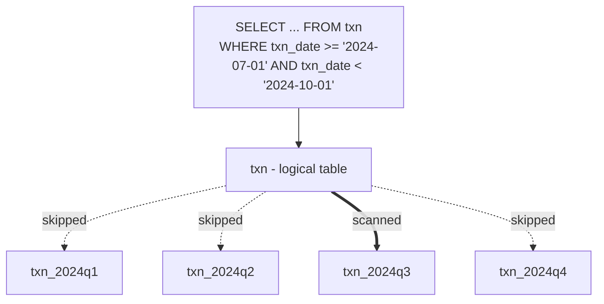

# Partitioning

> **Before this lesson:** you should know what an index and a table scan are and why a function around a column stops an index from being used ([Indexes and query plans](#/lesson/sql/indexes)), how a view with `UNION ALL` can present several tables as one ([Views](#/lesson/sql/views)), and what a primary key and a unique constraint are ([Constraints and cascading](#/lesson/sql/constraints)).

## In plain words

Everything so far assumed tables that fit comfortably on one computer and that an index can keep fast. Then the tables grow. The bank's `txn` table has a few hundred rows here; at a real bank it would hold billions after ten years. At that size, new problems appear that no clever query can solve: reading the whole table takes hours, the indexes no longer fit in memory, and deleting old data keeps the table busy for a day.

The first tool for very large tables is **partitioning**: storing one table as many smaller pieces, according to a rule. To the people and programs that query it, it is still one table.

An everyday picture: a filing cabinet for invoices. One huge drawer with every invoice ever issued would be miserable to search. So the office uses one drawer per year. To find an invoice from March 2024 you open the 2024 drawer and ignore the others. When invoices older than seven years may be thrown away, you empty one whole drawer instead of picking papers out one by one. And the office still thinks of it as "the invoice cabinet", a single thing.

Those two benefits, skipping the drawers you do not need and removing a whole drawer at once, are exactly what database partitioning gives.

**Why it matters for a job.** Partitioning is a standard topic in data-engineering and system-design interviews: "this table has ten billion rows and the queries are slow; what do you do?". In analytics databases that charge by the amount of data read, partitioning directly reduces the bill.

## What goes wrong with very large tables

Three kinds of pain:

1. **Query time.** A query that has to look at most of a table gets slower in step with the table's size. An index helps when a query wants a few rows. But an index over ten billion rows is itself hundreds of gigabytes; keeping it up to date slows every insert.
2. **Maintenance time.** Removing data older than seven years with `DELETE FROM txn WHERE txn_date < ...` deletes hundreds of millions of rows one at a time, writing an enormous log and holding locks. Rebuilding an index or adding a column takes hours.
3. **Storage cost.** Old data is seldom read, yet it sits on the same fast, expensive disks as today's data.

Partitioning eases all three by using one fact about most large tables: **queries and maintenance usually concern a small, predictable slice of the data**, most often the newest.

## The idea

A **partitioned table** is one table, as far as queries are concerned, whose rows are physically stored in several pieces called **partitions**. Every partition has the same columns. A rule based on one or more columns, the **partition key**, decides which partition each row belongs to.

Programs notice nothing: they read from and insert into `txn` as before. The database sends each new row to the right partition and, more importantly, can **skip partitions that cannot contain the rows a query asks for**.



Splitting a table by rows in this way is **horizontal partitioning**. There is also **vertical partitioning**, which splits by *columns*: rarely used or bulky columns (a long text, an image) are moved to a second table that shares the primary key. That is a design decision you make yourself, not a feature the database provides.

## Partitioning methods

The examples in this section are for PostgreSQL and MySQL. SQLite has no partitioning, so they are shown as static code; a hand-made imitation in SQLite follows.

### Range partitioning

Each partition holds a continuous **range** of key values. It is by far the most common method, nearly always on a date.

```sql
-- PostgreSQL
CREATE TABLE txn (
  txn_id      BIGINT,
  txn_date    TIMESTAMP NOT NULL,
  account_id  INT NOT NULL,
  txn_type_cd VARCHAR(10),
  amount      NUMERIC(10,2)
) PARTITION BY RANGE (txn_date);

CREATE TABLE txn_2024q1 PARTITION OF txn FOR VALUES FROM ('2024-01-01') TO ('2024-04-01');
CREATE TABLE txn_2024q2 PARTITION OF txn FOR VALUES FROM ('2024-04-01') TO ('2024-07-01');
CREATE TABLE txn_2024q3 PARTITION OF txn FOR VALUES FROM ('2024-07-01') TO ('2024-10-01');
CREATE TABLE txn_2024q4 PARTITION OF txn FOR VALUES FROM ('2024-10-01') TO ('2025-01-01');
```

The first statement creates the table and says it will be partitioned by ranges of `txn_date`. Each of the next four creates one partition and states the range it holds: one per quarter of 2024.

```sql
-- MySQL
CREATE TABLE txn ( ... )
PARTITION BY RANGE (YEAR(txn_date) * 100 + QUARTER(txn_date)) (
  PARTITION q2024_1 VALUES LESS THAN (202402),
  PARTITION q2024_2 VALUES LESS THAN (202403),
  PARTITION q2024_3 VALUES LESS THAN (202404),
  PARTITION q2024_4 VALUES LESS THAN (202501),
  PARTITION pmax    VALUES LESS THAN MAXVALUE
);
```

The ranges include their start and exclude their end, so every value belongs to exactly one partition. Partitions for future periods must be created in advance, by hand or by a tool. A row whose key fits no partition is rejected, unless a catch-all partition exists (`DEFAULT` in PostgreSQL, `MAXVALUE` above).

### List partitioning

Each partition holds an explicit **list** of key values. Use it for a column with few different values that queries filter on: region, country, customer organisation, status.

```sql
-- PostgreSQL
CREATE TABLE customers (...) PARTITION BY LIST (country);
CREATE TABLE customers_na   PARTITION OF customers FOR VALUES IN ('USA', 'Canada');
CREATE TABLE customers_eu   PARTITION OF customers FOR VALUES IN ('UK', 'Germany');
CREATE TABLE customers_rest PARTITION OF customers DEFAULT;
```

List partitioning also helps with laws about where data may be kept: the European partition can be stored on machines located in Europe.

### Hash partitioning

Sometimes there is no natural range or list, and the aim is to **spread rows evenly**. A **hash function** is a calculation that turns any value into a number that looks random but is always the same for the same input. The database applies one to the key, divides the result by the number of partitions, and uses the remainder to pick the partition.

```sql
-- PostgreSQL
CREATE TABLE predictions (...) PARTITION BY HASH (deployment_id);
CREATE TABLE predictions_p0 PARTITION OF predictions FOR VALUES WITH (MODULUS 4, REMAINDER 0);
-- ... p1, p2, p3
```

Hash partitioning gives partitions of similar size and helps lookups of one exact key value. It does **nothing for range queries**, because neighbouring key values land in different partitions, and there is no "oldest" partition to drop. Changing the number of partitions means moving rows around.

### Composite partitioning

Two methods can be combined: partition by one key and divide each partition again, into **subpartitions**, by another. Typically range by date, then hash or list within each period. It is useful when queries filter on both, at the price of many more pieces to look after.

### Imitating partitions in SQLite

SQLite is meant for sizes at which partitioning is not needed. The idea can still be shown by hand: separate tables, and a view that stacks them with `UNION ALL`.

```sql-run dataset=bank
CREATE TABLE txn_2024h1 AS SELECT * FROM txn WHERE txn_date <  '2024-07-01';
CREATE TABLE txn_2024h2 AS SELECT * FROM txn WHERE txn_date >= '2024-07-01';

CREATE VIEW txn_all AS
SELECT * FROM txn_2024h1
UNION ALL
SELECT * FROM txn_2024h2;

SELECT 'h1' AS part, COUNT(*) AS n FROM txn_2024h1
UNION ALL SELECT 'h2', COUNT(*) FROM txn_2024h2
UNION ALL SELECT 'view', COUNT(*) FROM txn_all;
```

The first two statements copy the transactions of each half-year into a table of their own. The view presents the two as one. The final query counts each piece: 236 rows in the first half, 248 in the second, and 484 through the view, the same as the original table. Before databases had partitioning built in, this was how it was done. The drawback is that inserts must be sent to the right table by the program, which is the bookkeeping a partitioned table does for you.

## Partition pruning

The speed benefit comes from **partition pruning**: when a query's `WHERE` clause restricts the partition key, the optimizer works out which partitions could hold matching rows and **never opens the others**. ("Pruning" is the gardener's word for cutting away branches.)

```sql
SELECT SUM(amount)
FROM txn
WHERE txn_date >= '2024-07-01' AND txn_date < '2024-10-01';
```

With quarterly partitions, only `txn_2024q3` is read. That is a quarter of the data if the table holds one year, and one fortieth if it holds ten years, with or without an index.

Pruning has the same requirement as index use: the condition must be on the **bare partition key**.

| Condition | Pruned? |
|---|---|
| `txn_date >= '2024-07-01' AND txn_date < '2024-10-01'` | yes |
| `txn_date = '2024-08-15'` | yes |
| `EXTRACT(YEAR FROM txn_date) = 2024` | usually **no**: the function hides the key |
| `account_id = 157` (not the partition key) | **no**: every partition is searched |

The last row is the price of partitioning. A query that does *not* filter on the partition key must look in **every** partition, each with its own index, and can be *slower* than on an unpartitioned table. Partitioning helps queries that fit the key and taxes those that do not.

Before partitioning a table, look at what the partitions would be. This query shows the size of each would-be quarterly partition:

```sql-run dataset=bank
SELECT strftime('%Y', txn_date) || 'Q' || ((CAST(strftime('%m', txn_date) AS INTEGER) + 2) / 3) AS partition_key,
       COUNT(*) AS row_count,
       ROUND(100.0 * COUNT(*) / SUM(COUNT(*)) OVER (), 1) AS pct_of_rows,
       MIN(txn_date) AS first_txn, MAX(txn_date) AS last_txn
FROM txn
GROUP BY partition_key
ORDER BY partition_key;
```

The first column builds a label such as `2024Q1` from the year and the quarter number (months 1 to 3 give 1, and so on). `SUM(COUNT(*)) OVER ()` is a window function over the grouped rows: the total of all the counts, used to turn each count into a percentage. The four quarters hold 21.9%, 26.9%, 24.8% and 26.4% of the rows. Roughly equal partitions like these are the goal.

Compare a list scheme by branch:

```sql-run dataset=bank
SELECT COALESCE(CAST(execution_branch_id AS TEXT), 'none (ATM/online)') AS branch_partition,
       COUNT(*) AS row_count,
       ROUND(100.0 * COUNT(*) / SUM(COUNT(*)) OVER (), 1) AS pct_of_rows
FROM txn
GROUP BY execution_branch_id
ORDER BY row_count DESC;
```

Here the largest "partition", at 30%, would be the transactions with no branch at all, while the smallest branch holds only about 9%. An uneven spread is called **skew**. A badly skewed key gives one giant partition and several tiny ones, which defeats the purpose.

## Maintenance benefits

For many teams the practical advantages matter more than the faster queries.

- **Removing old data in an instant.** Dropping a partition does not touch its rows one by one. The database only updates its own records of which pieces exist. `ALTER TABLE txn DROP PARTITION q2017_1` (MySQL) or `DROP TABLE txn_2017q1` (PostgreSQL) removes a quarter of a billion rows in milliseconds. A rule such as "keep seven years" becomes easy to enforce.
- **Archiving and cheaper storage.** Old partitions can be moved to slow, cheap disks, compressed or made read-only, while recent ones stay on fast disks.
- **Loading in bulk.** Load and index a new period in a separate table, check it, then attach it as a partition (`ATTACH PARTITION`). The new data appears all at once.
- **Smaller units of upkeep.** Refreshing statistics, rebuilding indexes and taking backups work partition by partition, and only the active partition changes.
- **Local indexes.** Each partition has its own smaller index. The active partition's index fits in memory even when an index over the whole table would not.

## Keys on partitioned tables

Partitioning interacts with keys in ways that surprise people:

- A **unique or primary key must include the partition key** (MySQL, PostgreSQL). The database can cheaply guarantee uniqueness only within one partition. So the primary key of `txn` becomes `(txn_id, txn_date)`. (Oracle offers indexes that span all partitions, at a cost whenever a partition is dropped.)
- **Foreign keys** to and from partitioned tables are restricted. MySQL does not allow them on partitioned InnoDB tables.
- Changing a row's partition key moves it to another partition, which is a delete followed by an insert.

## Choosing a partition key

Ask, in this order:

1. **What do most queries filter on?** If nearly every query has a date range, partition by date.
2. **How will data be removed?** If by age, range-partition by date, so that removal is the dropping of a partition.
3. **Is the spread even?** Avoid skew.
4. **How many partitions?** Enough that each is manageable, not so many that planning queries becomes slow. Hundreds are fine; tens of thousands usually are not. Daily partitions kept for ten years are 3,650; monthly ones are 120.

And first ask whether you need it at all. A well-indexed table of a few hundred million rows is routine for PostgreSQL or MySQL. Partitioning adds real complexity. Adopt it when maintenance or scan times hurt, not because the table sounds big.

## Partitioning in analytics databases and data lakes

The idea matters even more in systems built for analysis:

- **BigQuery** and **Snowflake** charge according to the data a query reads. Partitioning and pruning cut the cost directly.
- A **data lake** is a large collection of data files kept in cheap storage and queried with tools such as Spark or Athena. There, partitions are folders: `s3://bucket/predictions/dt=2024-03-07/part-000.parquet`. A filter on `dt` skips whole folders. The classic mistake is to partition too finely (by user, by minute) and end up with millions of tiny files.
- In data pipelines, date-partitioned tables make **incremental processing** natural: each daily job reads and writes exactly one partition, and a failed day can be run again by overwriting that one partition.

> [!INTERVIEW]
> "A ten-billion-row events table is slow. What do you do?" A solid answer: ask what the queries filter on (almost always time); range-partition by date so that pruning skips old partitions; keep the filter on the bare column; drop old partitions for retention; and name the cost, which is that queries without the partition key read every partition and that unique keys must include the partition key.

## Pitfalls

- **Queries that omit the partition key** read every partition.
- **A function around the key** in `WHERE` prevents pruning.
- **A skewed key** creates one huge, busy partition.
- **Too many partitions**: slow planning and tiny files.
- **Forgetting to create future partitions**: inserts fail at midnight on the first day of the new period.
- **Expecting a column to be unique across the table** when it is not part of the partition key.

## Summary

- Partitioning stores one table as many pieces chosen by a **partition key**; programs still see a single table.
- Methods: **range** (dates), **list** (categories), **hash** (an even spread), **composite**.
- **Partition pruning** skips partitions that cannot match a filter on the bare key; queries without such a filter touch every partition.
- Maintenance gains: dropping, attaching and archiving whole partitions at once, smaller local indexes, upkeep partition by partition.
- Unique keys must include the partition key. Choose the key from the query patterns, the retention rule and the spread of the data, and partition only when size demands it.

## Glossary

- **Partitioning** — storing one table as several physical pieces while it still behaves as one table.
- **Partition** — one of those pieces.
- **Partition key** — the column or columns whose value decides which partition a row goes to.
- **Horizontal partitioning** — splitting a table by rows.
- **Vertical partitioning** — splitting a table by columns into tables that share a key.
- **Range partitioning** — each partition holds a continuous range of key values.
- **List partitioning** — each partition holds a stated list of key values.
- **Hash function** — a calculation that turns a value into a seemingly random but repeatable number.
- **Hash partitioning** — choosing the partition from a hash of the key, to spread rows evenly.
- **Composite partitioning / subpartition** — partitioning by one key and dividing each partition again by another.
- **Partition pruning** — the optimizer skipping partitions that cannot contain matching rows.
- **Skew** — an uneven spread of rows among partitions.
- **Retention** — the rule for how long data is kept before it is removed.
- **Local index** — an index that covers a single partition.
- **Data lake** — a large store of data files queried by separate tools, usually organised in folders.
- **Incremental processing** — handling only the newest slice of data in each run of a pipeline.

```quiz
[
  {"q": "What is partition pruning?", "options": ["Deleting old partitions", "The optimizer skipping partitions that cannot contain rows matching the query's filter", "Merging small partitions", "Compressing partitions"], "answer": 1, "explain": "A filter on the partition key lets the database avoid opening partitions that cannot match."},
  {"q": "Which partitioning method is the natural choice for a table queried by date range and cleared out by age?", "options": ["Hash", "List", "Range", "Vertical"], "answer": 2, "explain": "Range partitions on the date fit both the queries and the retention rule."},
  {"q": "A table is range-partitioned by txn_date. Which query must examine every partition?", "options": ["WHERE txn_date >= '2024-07-01'", "WHERE txn_date = '2024-08-15'", "WHERE account_id = 157", "WHERE txn_date < '2024-02-01'"], "answer": 2, "explain": "account_id is not the partition key, so no partition can be ruled out."},
  {"q": "Why is dropping a partition better than DELETE for removing old data?", "options": ["DELETE is not allowed on large tables", "It is a near-instant change to the database's own records instead of removing rows one by one", "It keeps the data", "It rebuilds indexes"], "answer": 1, "explain": "There is no row-by-row logging and no long-held lock."},
  {"q": "What is a drawback of hash partitioning?", "options": ["Uneven partitions", "It cannot be used with whole numbers", "Range queries on the key cannot be pruned", "It requires a date column"], "answer": 2, "explain": "Neighbouring key values hash to different partitions, so a range spans all of them."},
  {"q": "In MySQL and PostgreSQL, a primary key on a partitioned table must...", "options": ["Be a whole number", "Include the partition key column or columns", "Be dropped", "Be a hash of all columns"], "answer": 1, "explain": "Uniqueness is enforced within each partition, so the key must determine the partition."},
  {"q": "What is vertical partitioning?", "options": ["Splitting a table by rows", "Splitting a table by columns into separate tables", "Sorting a table", "Copying a table to another server"], "answer": 1, "explain": "Rarely used or bulky columns move to another table that shares the key."},
  {"q": "A table is range-partitioned by txn_date. Why does WHERE EXTRACT(YEAR FROM txn_date) = 2024 usually read every partition?", "options": ["EXTRACT is not allowed on partitioned tables", "The function hides the bare partition key, so the optimizer cannot match the condition to partition ranges", "2024 has too many rows", "It does not; it is pruned"], "answer": 1, "explain": "Pruning, like index use, needs a condition on the bare key; write a range on txn_date instead."}
]
```

> **Source:** Beaulieu, *Learning SQL*, 3rd ed., ch. 17 "Working with Large Databases" (partitioning concepts, table and index partitioning, partitioning methods, pruning, benefits), restated in original wording with this guide's own datasets. PostgreSQL manual, "Table Partitioning"; MySQL manual, "Partitioning".
