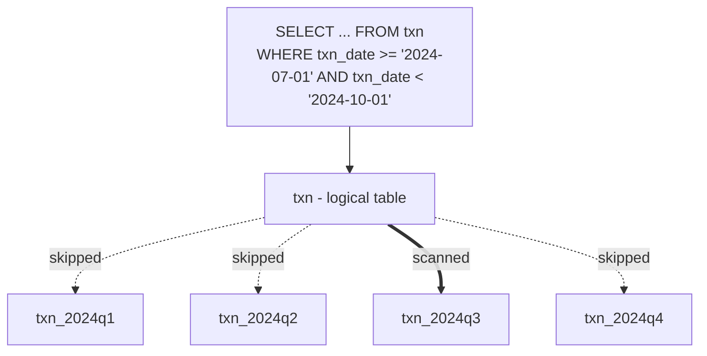

# Partitioning

Everything so far has assumed tables that fit comfortably on one server and that an index can tame. Then the tables grow. The bank's `txn` table, at a few hundred rows here, would hold billions of rows after a decade at a real bank; the `predictions` table of a busy model server gains millions of rows a day. At that scale new problems appear that no amount of query cleverness solves: full scans take hours, indexes are too large for memory, deleting old data locks the table, backups never finish. The first tool for managing very large tables is **partitioning**: splitting one logical table into many physical pieces. This lesson covers the concepts, the partitioning methods (range, list, hash, composite), partition pruning, maintenance benefits, and how to choose a partition key. The next lesson moves beyond one server.

## What goes wrong with very large tables

Three kinds of pain, each with a different cure:

1. **Query time.** A query that must examine most of a table grows linearly with it. An index helps selective lookups, but a B-tree over ten billion rows is itself hundreds of gigabytes — index maintenance slows every insert, and range scans touch pages scattered all over the disk.
2. **Maintenance time.** Purging data older than seven years with `DELETE FROM txn WHERE txn_date < …` removes hundreds of millions of rows one at a time, generating enormous logs and holding locks. Rebuilding an index or adding a column takes hours.
3. **Storage and cost.** Old data is rarely read but sits on the same expensive fast storage as today's data.

Partitioning addresses all three by exploiting a fact about most large tables: **queries and maintenance operations are usually confined to a small, predictable slice of the data** — typically the most recent.

## The partitioning concept

A **partitioned table** is a single logical table whose rows are stored in several physical pieces called **partitions**. Every partition has the same columns and (usually) the same indexes, but each is its own storage object. A rule based on one or more columns — the **partition key** — decides which partition each row belongs to.

To applications, nothing changes: they select from and insert into `txn` as before. The database routes each row to the right partition and, crucially, can **skip partitions that cannot contain the rows a query asks for**.

This is **horizontal partitioning** — splitting by rows. (**Vertical partitioning** splits by *columns*: moving rarely used or bulky columns, such as a large text or image column, into a separate table that shares the primary key. That is a schema-design technique rather than a database feature, and columnar storage — next lesson — takes it to its logical conclusion.)



## Partitioning methods

### Range partitioning

Each partition holds a contiguous **range** of key values. By far the most common scheme, and nearly always on a date or timestamp.

```sql
-- PostgreSQL
CREATE TABLE txn (
  txn_id      BIGINT,
  txn_date    TIMESTAMP NOT NULL,
  account_id  INT NOT NULL,
  txn_type_cd VARCHAR(10),
  amount      NUMERIC(10,2)
) PARTITION BY RANGE (txn_date);

CREATE TABLE txn_2024q1 PARTITION OF txn FOR VALUES FROM ('2024-01-01') TO ('2024-04-01');
CREATE TABLE txn_2024q2 PARTITION OF txn FOR VALUES FROM ('2024-04-01') TO ('2024-07-01');
CREATE TABLE txn_2024q3 PARTITION OF txn FOR VALUES FROM ('2024-07-01') TO ('2024-10-01');
CREATE TABLE txn_2024q4 PARTITION OF txn FOR VALUES FROM ('2024-10-01') TO ('2025-01-01');
```

```sql
-- MySQL
CREATE TABLE txn ( ... )
PARTITION BY RANGE (YEAR(txn_date) * 100 + QUARTER(txn_date)) (
  PARTITION q2024_1 VALUES LESS THAN (202402),
  PARTITION q2024_2 VALUES LESS THAN (202403),
  PARTITION q2024_3 VALUES LESS THAN (202404),
  PARTITION q2024_4 VALUES LESS THAN (202501),
  PARTITION pmax    VALUES LESS THAN MAXVALUE
);
```

Ranges are half-open (`FROM` inclusive, `TO` exclusive) so that every value maps to exactly one partition. New partitions must be created ahead of time (or automatically, with tools like `pg_partman` or Oracle's *interval partitioning*); a row whose key fits no partition is rejected unless a default/`MAXVALUE` partition catches it.

### List partitioning

Each partition holds an explicit **list** of key values. Use it for a low-cardinality category that queries filter on: region, country, tenant, status.

```sql
-- PostgreSQL
CREATE TABLE customers (...) PARTITION BY LIST (country);
CREATE TABLE customers_na   PARTITION OF customers FOR VALUES IN ('USA', 'Canada');
CREATE TABLE customers_eu   PARTITION OF customers FOR VALUES IN ('UK', 'Germany');
CREATE TABLE customers_rest PARTITION OF customers DEFAULT;
```

List partitioning also supports data-residency requirements: the EU partition can live on storage physically located in the EU.

### Hash partitioning

When there is no natural range or list — or the goal is simply to **spread rows evenly** — the database applies a hash function to the key and uses the result modulo N to pick one of N partitions.

```sql
-- PostgreSQL
CREATE TABLE predictions (...) PARTITION BY HASH (deployment_id);
CREATE TABLE predictions_p0 PARTITION OF predictions FOR VALUES WITH (MODULUS 4, REMAINDER 0);
-- ... p1, p2, p3
```

Hash partitioning gives balanced partitions and helps equality lookups on the key, but it does **nothing for range queries** (neighbouring key values land in different partitions), and you cannot drop "old" data by dropping a partition. Changing the number of partitions means redistributing rows.

### Composite partitioning

Two methods can be combined: **partition** by one key and **subpartition** by another — typically range by date, then hash or list within each period. Useful when both dimensions appear in queries (time range *and* tenant), at the price of many more physical pieces to manage.

### Simulating partitions in SQLite

SQLite has no native partitioning — it targets data sizes where it is not needed. But the idea is easy to see by hand: separate tables plus a `UNION ALL` view, which is precisely the "joining partitioned data" use of views from the book.

```sql-run dataset=bank
CREATE TABLE txn_2024h1 AS SELECT * FROM txn WHERE txn_date <  '2024-07-01';
CREATE TABLE txn_2024h2 AS SELECT * FROM txn WHERE txn_date >= '2024-07-01';

CREATE VIEW txn_all AS
SELECT * FROM txn_2024h1
UNION ALL
SELECT * FROM txn_2024h2;

SELECT 'h1' AS part, COUNT(*) AS n FROM txn_2024h1
UNION ALL SELECT 'h2', COUNT(*) FROM txn_2024h2
UNION ALL SELECT 'view', COUNT(*) FROM txn_all;
```

Before native partitioning existed (and still, in some warehouse designs), this is how it was done — except that the application or the view had to know which table to read, which is the bookkeeping a partitioned table automates.

## Partition pruning

The performance benefit comes from **partition pruning** (also called partition elimination): when a query's WHERE clause constrains the partition key, the optimizer determines which partitions could contain matching rows and **never opens the others**.

```sql
SELECT SUM(amount)
FROM txn
WHERE txn_date >= '2024-07-01' AND txn_date < '2024-10-01';
```

With quarterly range partitions, only `txn_2024q3` is read — a quarter of the data in a one-year table, a fortieth in a ten-year table — regardless of indexes. `EXPLAIN` shows which partitions are scanned.

Pruning has the same requirement as index use: the predicate must be on the **bare partition key**.

| Predicate | Pruned? |
|---|---|
| `txn_date >= '2024-07-01' AND txn_date < '2024-10-01'` | yes |
| `txn_date = '2024-08-15'` | yes |
| `EXTRACT(YEAR FROM txn_date) = 2024` | usually **no** — function hides the key |
| `account_id = 157` (not the partition key) | **no** — every partition is searched |

That last row is the price of partitioning: a query that does *not* filter on the partition key must probe **every** partition (each with its own index), and can be *slower* than on an unpartitioned table. Partitioning helps the queries that align with the key and taxes those that do not.

Before partitioning a table, it pays to profile what the partitions would look like. The query from the problem set does this for quarters:

```sql-run dataset=bank
SELECT strftime('%Y', txn_date) || 'Q' || ((CAST(strftime('%m', txn_date) AS INTEGER) + 2) / 3) AS partition_key,
       COUNT(*) AS row_count,
       ROUND(100.0 * COUNT(*) / SUM(COUNT(*)) OVER (), 1) AS pct_of_rows,
       MIN(txn_date) AS first_txn, MAX(txn_date) AS last_txn
FROM txn
GROUP BY partition_key
ORDER BY partition_key;
```

Roughly even partitions are the goal. Compare a list scheme by branch, where one "partition" is everything without a branch:

```sql-run dataset=bank
SELECT COALESCE(CAST(execution_branch_id AS TEXT), 'none (ATM/online)') AS branch_partition,
       COUNT(*) AS row_count,
       ROUND(100.0 * COUNT(*) / SUM(COUNT(*)) OVER (), 1) AS pct_of_rows
FROM txn
GROUP BY execution_branch_id
ORDER BY row_count DESC;
```

Uneven distribution like this is **skew**; a heavily skewed key gives one giant partition and several tiny ones, which defeats the purpose.

## Maintenance benefits

For many teams the operational advantages outweigh the query speed-up.

- **Instant data retirement.** Dropping a partition is a metadata operation: `ALTER TABLE txn DROP PARTITION q2017_1` (MySQL) or `DROP TABLE txn_2017q1` (PostgreSQL) removes a quarter of a billion rows in milliseconds, with no row-by-row delete, no bloat, no long locks. Retention policies ("keep 7 years") become trivial.
- **Archiving and tiered storage.** Old partitions can be detached, moved to cheap storage, compressed or made read-only, while recent partitions stay on fast disks.
- **Bulk loading by exchange.** Load and index a new period in a standalone table, verify it, then attach it as a partition (`ATTACH PARTITION`, `EXCHANGE PARTITION`) — an atomic, near-instant publish.
- **Smaller maintenance units.** Vacuuming, statistics, index rebuilds and backups operate per partition; only the active partition changes, so only it needs frequent attention.
- **Local indexes.** Each partition has its own, smaller B-tree; the active partition's index fits in memory even if the whole table's would not.

## Constraints and indexes on partitioned tables

Partitioning interacts with keys in ways that surprise people:

- A **unique or primary key constraint must include the partition key** (MySQL, PostgreSQL). The engine can only enforce uniqueness within a partition cheaply; a "global" unique index across partitions would undo the benefits. So `txn`'s primary key becomes `(txn_id, txn_date)`. (Oracle supports global indexes, with maintenance costs when partitions are dropped.)
- **Foreign keys** to and from partitioned tables have restrictions (MySQL does not support them at all for partitioned InnoDB tables; PostgreSQL added support gradually in versions 11–12).
- Updating a row's partition key moves it between partitions — a delete plus an insert.

## Choosing a partition key

Ask, in order:

1. **What do most queries filter on?** If nearly every query has a time range, partition by time. If every query is for one tenant, consider tenant.
2. **How will data be retired?** If by age, range-partition by date so that expiry is a partition drop.
3. **Is the distribution even?** Avoid skew; avoid keys with unbounded growth of one value.
4. **How many partitions?** Enough that each is manageable (often 10–100 GB), not so many that planning slows down and file handles run out. Hundreds are fine; tens of thousands usually are not. Daily partitions kept for ten years is 3,650 — consider monthly.

And first ask whether you need it at all. A well-indexed table of a few hundred million rows is routine for PostgreSQL or MySQL. Partitioning adds real complexity; adopt it when maintenance or scan times actually hurt, not because the table "sounds big".

## Partitioning in data warehouses and lakes

The idea is even more central in analytics systems:

- **BigQuery** and **Snowflake** bill by data scanned; partitioning (BigQuery: `PARTITION BY DATE(ts)`; Snowflake: automatic micro-partitions with clustering keys) and pruning directly cut cost.
- **Data lakes** (Hive, Spark, Athena, Delta/Iceberg) partition by directory: `s3://bucket/predictions/dt=2024-03-07/part-000.parquet`. A filter on `dt` prunes whole directories. The classic mistake is over-partitioning (by user id, by minute) and producing millions of tiny files.
- For ML pipelines, date-partitioned tables make **incremental processing** natural: each daily job reads and writes exactly one partition, and a failed day can be re-run idempotently by overwriting that partition.

## Pitfalls

- **Queries that omit the partition key** scan every partition.
- **Functions on the key** in WHERE prevent pruning.
- **Skewed keys** create one hot, huge partition.
- **Too many partitions** — planning overhead, tiny files.
- **Forgetting to create future partitions** — inserts fail at midnight on the first of the month.
- **Expecting global uniqueness** on a column that is not part of the partition key.

## Summary

- Partitioning stores one logical table as many physical pieces chosen by a **partition key**; applications see a single table.
- Methods: **range** (dates), **list** (categories), **hash** (even spread), **composite**.
- **Partition pruning** skips partitions that cannot match a filter on the bare key; queries without such a filter touch all partitions.
- Maintenance wins: drop/attach/archive partitions instantly, smaller local indexes, per-partition upkeep.
- Unique keys must include the partition key. Choose the key from query patterns, retention needs and data distribution — and only partition when size demands it.

```quiz
[
  {"q": "What is partition pruning?", "options": ["Deleting old partitions", "The optimizer skipping partitions that cannot contain rows matching the query's filter", "Merging small partitions", "Compressing partitions"], "answer": 1, "explain": "A filter on the partition key lets the planner avoid opening irrelevant partitions."},
  {"q": "Which partitioning method is the natural choice for a table queried by date range and purged by age?", "options": ["Hash", "List", "Range", "Vertical"], "answer": 2, "explain": "Range partitions on the date align with both the queries and the retention policy."},
  {"q": "A table is range-partitioned by txn_date. Which query must examine every partition?", "options": ["WHERE txn_date >= '2024-07-01'", "WHERE txn_date = '2024-08-15'", "WHERE account_id = 157", "WHERE txn_date < '2024-02-01'"], "answer": 2, "explain": "account_id is not the partition key, so no partition can be ruled out."},
  {"q": "Why is dropping a partition better than DELETE for retiring old data?", "options": ["DELETE is not allowed on large tables", "It is a near-instant metadata operation instead of removing rows one by one", "It keeps the data", "It rebuilds indexes"], "answer": 1, "explain": "No per-row logging, locking or bloat."},
  {"q": "What is a drawback of hash partitioning?", "options": ["Uneven partitions", "It cannot be used with integers", "Range queries on the key get no pruning", "It requires a date column"], "answer": 2, "explain": "Adjacent key values hash to different partitions, so ranges span all of them."},
  {"q": "In MySQL and PostgreSQL, a primary key on a partitioned table must...", "options": ["Be an integer", "Include the partition key column(s)", "Be dropped", "Be a hash of all columns"], "answer": 1, "explain": "Uniqueness is enforced per partition, so the key must determine the partition."},
  {"q": "What is vertical partitioning?", "options": ["Splitting a table by rows", "Splitting a table by columns into separate tables", "Sorting a table", "Replicating a table"], "answer": 1, "explain": "Rarely used or large columns move to another table sharing the key."}
]
```

> **Source:** Beaulieu, *Learning SQL*, 3rd ed., ch. 17 "Working with Large Databases" (partitioning concepts, table and index partitioning, partitioning methods, pruning, benefits); 2nd ed. ch. 14 "Joining Partitioned Data". PostgreSQL manual, "Table Partitioning"; MySQL manual, "Partitioning".
