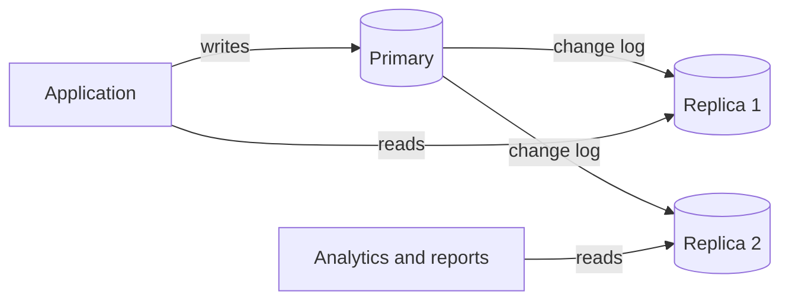
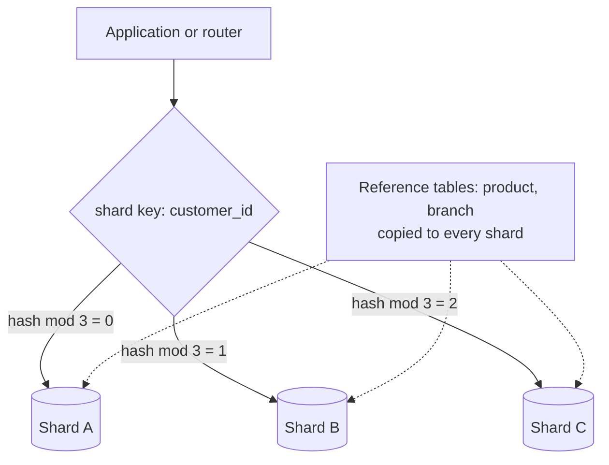

# Clustering, sharding and big data

> **Before this lesson:** you should understand partitioning, partition keys and pruning ([Partitioning](#/lesson/sql/partitioning)), transactions and ACID ([Transactions, ACID and isolation levels](#/lesson/sql/acid-isolation)), indexes ([Indexes and query plans](#/lesson/sql/indexes)), and why averages and distinct counts cannot be combined by adding them up ([Aggregate functions and GROUP BY](#/lesson/sql/group-by)).

## In plain words

Partitioning splits a table into pieces, but all the pieces still live on **one computer**: one set of processors, one pool of memory, one disk system. A computer that runs a database for other programs is called a **server**. When the work outgrows the largest server you can buy, or when the failure of a single machine would be unacceptable, the database has to be spread over several machines.

An everyday picture: a restaurant that has become too popular.

- First you try a bigger kitchen with more stoves. That is buying a bigger server.
- Then you hire extra waiters who all carry the same menu, so more guests can be *told* what is on offer at once, while one chef still does all the cooking. That is **replication**: several copies of the data for reading, one place for writing.
- Finally you open branches in other parts of town, and each customer goes to the branch for their district. Each branch has its own kitchen and its own customers. That is **sharding**: the data itself is divided among machines.

Every step adds capacity, and every step adds trouble. A dish invented at one branch does not appear on the others' menus instantly. A party whose guests are spread over three branches is hard to cater for. The database versions of those problems are the subject of this lesson.

The lesson is a survey. The aim is that you recognise the designs, know their vocabulary, and understand how they change the behaviour of a query. Only one query on this page can be run, because one browser tab cannot be a cluster of machines.

**Why it matters for a job.** System-design interviews for backend and data roles revolve around these ideas: replicas, shards, consistency, and the difference between a database that serves an application and one that serves analysts. And most analytical SQL today is written against "big data" systems whose rules differ from those of the databases used so far.

## Scaling up versus scaling out

Increasing a system's capacity is called **scaling**.

- **Scaling up (vertical scaling):** a bigger server, with more processors, more memory and faster disks. It needs no change to the application, and modern machines are enormous. It is always the first move. Its limits: cost rises faster than capacity, there is a ceiling, and one machine is one thing that can fail.
- **Scaling out (horizontal scaling):** more servers. In principle there is no ceiling, and one machine can fail without stopping everything. But the data is now spread out, and joins, transactions and consistency all become harder.

Most systems first add capacity for reading (replication) and divide the data among machines (sharding) only when the volume of writes or of data demands it.

## Replication

**Replication** keeps copies of the same data on several servers. The usual arrangement has one **primary** and several **replicas**. All writes go to the primary, which sends its list of changes to the replicas, and each replica applies them.



What replication gives you:

- **More capacity for reading.** Reports and read-heavy pages query the replicas.
- **High availability.** If the primary dies, a replica is promoted to take its place. The switch is called **failover**.
- **Separation of workloads.** A long analytical query runs on a replica and cannot disturb the application's transactions.

What it does not give you: more capacity for **writing**, because every replica has to apply every write, and no extra room, because every server holds everything.

The subtle point is **replication lag**. With *asynchronous* replication, the primary confirms a commit before the replicas have received it, so a replica is always slightly behind. A user who changes their profile and immediately reads from a replica may see the old value. With *synchronous* replication the primary waits for a replica to confirm, which is slower and gives the guarantee. When your query reads from a replica, "the latest data" means "the latest data that replica has".

## Clustering

A **cluster** is a group of servers that act together as one database. Each server in it is called a **node**. There are two broad designs:

- **Shared-disk clusters** (Oracle RAC is the well-known example): several database programs on different machines read and write the **same storage**. Any node can answer any query, and if one fails the others continue. The shared storage and the coordination between nodes limit how far this can grow, and it is expensive.
- **Shared-nothing clusters**: each node has its own processors, memory and disk and holds its own slice of the data. Nodes talk to one another only over the network. This design scales much further and underlies sharding and most modern distributed databases.

## Sharding

**Sharding** is partitioning *across servers*. Each **shard** is a separate database holding part of the rows, chosen by a **shard key**. A partitioned table hides its pieces inside one server; shards are independent machines.



In the diagram, a **router** (part of the application, or a separate service) looks at the customer id in each request, applies a hash function, and sends the request to the one shard that holds that customer.

### Choosing a shard key

The shard key decides everything. A good one:

- appears in **almost every query**, so that a query can be sent to a single shard;
- spreads data and work **evenly**: many different values, none of them dominant;
- keeps rows that are used together **on the same shard**. For a bank, all of a customer's accounts and transactions. For software sold to companies, everything belonging to one customer company (a **tenant**).

The strategies mirror the partitioning methods:

- **Hash sharding**: `hash(key) mod N`. An even spread. But changing N moves almost every key to a different shard, so real systems use a refinement called **consistent hashing**, or a fixed number of small buckets that are assigned to servers.
- **Range sharding**: a continuous range of keys per shard. Good for range queries; but if the key is a timestamp or an increasing number, all new rows land on the last shard, which becomes a **hot spot**.
- **Directory sharding**: a lookup table records which shard holds each tenant. Flexible, since one large tenant can be moved alone; the lookup table is one more thing that must never be unavailable.

Small tables that rarely change, such as products or countries, are called **reference tables** and are usually copied to every shard so that joins to them stay local.

### What sharding does to your SQL

Sharding is where SQL's promise of "ask for anything" begins to cost.

| Operation | One server | Sharded |
|---|---|---|
| Query that includes the shard key | normal | sent to one shard: fast |
| Query without the shard key | index or scan | **scatter-gather**: sent to all shards, results merged |
| Join on the shard key | normal | done inside each shard |
| Join across shards | normal | expensive: data is shipped between nodes, or joined in the application |
| `GROUP BY`, or `ORDER BY ... LIMIT`, over all shards | normal | each shard computes partial results; a coordinator combines them |
| Unique values, automatic ids | easy | needs ids that are unique across all shards (random UUIDs, or ids built from a timestamp and a shard number) |
| Transaction touching several rows | ACID | within one shard: fine; across shards: needs a slow coordination protocol |
| Foreign keys across shards | enforced | generally not enforced |

Aggregation across shards shows the "combine partial results" idea and why some aggregates are harder than others. `COUNT`, `SUM`, `MIN` and `MAX` combine directly: add the counts, add the sums, take the smallest of the minimums. `AVG` must travel as a pair, a sum and a count. `COUNT(DISTINCT ...)` and medians cannot be rebuilt from per-shard answers at all.

You can see this with the shop data by pretending that each country is a shard:

```sql-run dataset=shop
WITH per_shard AS (                         -- what each shard would return
  SELECT c.country AS shard,
         COUNT(*) AS n_orders,
         SUM(o.shipping_fee) AS sum_fee,
         AVG(o.shipping_fee) AS avg_fee,
         COUNT(DISTINCT o.order_date) AS distinct_days
  FROM orders o JOIN customers c ON c.customer_id = o.customer_id
  GROUP BY c.country
)
SELECT ROUND(SUM(sum_fee) / SUM(n_orders), 4) AS correct_avg_from_sum_and_count,
       ROUND(AVG(avg_fee), 4)                 AS wrong_avg_of_avgs,
       SUM(distinct_days)                     AS wrong_sum_of_distincts,
       (SELECT COUNT(DISTINCT order_date) FROM orders) AS true_distinct_days
FROM per_shard;
```

The `WITH` part produces one row per country, as a shard would report it. The main query then plays the coordinator and combines those rows four ways:

- Total of the sums divided by total of the counts gives the true average shipping fee: 4.9057.
- The average of the per-country averages gives 4.9011. It is wrong, because the countries have different numbers of orders and a small country counts as much as a large one.
- The sum of the per-country distinct-day counts gives 219. The true number of different order dates is 168. A date on which three countries had orders was counted three times.

Distributed databases do the combining for you. But this explains why `COUNT(DISTINCT ...)` is slow on large systems, and why they offer approximate versions such as `APPROX_COUNT_DISTINCT`.

### Costs and alternatives

Sharding multiplies the operational work: every change of table structure on every shard, moving data when shards fill unevenly, backups, monitoring, reports that span shards. The standard advice is to put it off. Tune queries and indexes, scale up, add replicas, add a cache, archive or partition old data, and shard only when those are exhausted.

**Distributed SQL** databases (Google Spanner, CockroachDB, YugabyteDB, TiDB; Vitess for MySQL and Citus for PostgreSQL) do the sharding, the moving of data and the cross-shard transactions inside the database, and present ordinary SQL. They remove much of the burden from the application. The underlying facts remain: a query that stays on one node is fast, and a query that spans many is slower.

## Consistency trade-offs

Once data lives on several machines joined by a network that can fail, a system cannot have everything. The **CAP theorem** concerns three properties: **c**onsistency (every read sees the latest write), **a**vailability (every request gets an answer) and tolerance of network **p**artitions (the system keeps working when some machines cannot reach others; this "partition" has nothing to do with table partitioning). The theorem says that while the network is split, a system must give up either consistency or availability.

Systems that choose availability offer **eventual consistency**: the copies agree in the end, but a read may briefly return old data. Many non-relational stores (Cassandra, DynamoDB) work this way by default. Distributed SQL systems typically choose consistency.

For you as the writer of queries, two practical questions follow, which never arose on a single server: *can this query see old data?* and *are these two tables updated together, or can one be ahead of the other?*

## Big data: systems built for analysis

A database behind an application and a database for analysis do such different work that they are built differently. The first kind of work is called **OLTP** (online transaction processing), the second **OLAP** (online analytical processing).

| | OLTP | OLAP |
|---|---|---|
| Typical query | fetch or change a few rows by key | read millions of rows and aggregate |
| Users | applications, many at once | analysts, dashboards, data pipelines |
| Table design | normalized (each fact stored once) | wide tables with repeated values |
| Storage | row by row | **column by column** |
| Examples | PostgreSQL, MySQL, Oracle, SQL Server | Snowflake, BigQuery, Redshift, ClickHouse, DuckDB |

An analytics database of this kind is often called a **data warehouse**.

### Columnar storage

A **row store** keeps the values of each row together on disk, which is ideal for "give me this order". A **column store** keeps the values of each *column* together. A query such as `SELECT country, SUM(amount)` over a table of 100 columns then reads **two columns** and ignores the other 98. And because one column holds similar values (many repeats of the same few countries), it compresses very well. Together these make large scans ten to a hundred times faster. The cost: inserting or changing single rows is slow, so data arrives in batches.

What follows for the SQL you write on a warehouse:

- **`SELECT *` is expensive**, because it reads every column. Select what you need.
- **Indexes mostly disappear.** Speed comes from partition pruning, from keeping the data sorted by a chosen key, and from the smallest and largest value recorded for each block of data, which lets whole blocks be skipped.
- **Wide tables with repeated values are fine.** Unused columns cost nothing when a query runs.
- **Joining two huge tables** is the costly operation. Pipelines often join or aggregate in advance.

### Parallel warehouses, and storage separated from compute

A **massively parallel processing (MPP)** warehouse is a shared-nothing cluster built for analysis. A coordinator splits a query into fragments; worker nodes scan their slices at the same time, pass rows to one another for joins and grouping, and return partial results. Cloud warehouses go a step further and **separate storage from compute**: the data sits in cheap file storage, and groups of machines that do the computing are started, resized and stopped independently.

### Data lakes

A **data lake** keeps data as files in cheap storage and lets separate tools process them. Today the files are usually in a column-oriented format called **Parquet**. Table formats such as **Delta Lake** and **Apache Iceberg** add transactions and a history of versions on top of the files. SQL engines (Spark SQL, Trino, Athena, DuckDB) query those files where they lie. Some engines, Apache Drill among them, can query files, document stores and relational databases together with one dialect of SQL.

The remarkable constant is the language. Whatever lies underneath (one SQLite file, a fleet of MySQL shards, a Spark cluster of 500 nodes), you describe the result you want in SQL, and everything in this track applies: joins, grouping, window functions, CTEs.

### NoSQL in one paragraph

Stores that are not relational give up SQL's generality in exchange for scale or flexibility in one specific way of accessing data. **Key-value** stores (Redis, DynamoDB) look things up by key. **Document** stores (MongoDB) hold nested records whose shape can vary. **Wide-column** stores (Cassandra) absorb enormous volumes of writes for queries known in advance. **Graph** databases (Neo4j) follow relationships. **Vector** stores find items similar to a given one. Designing for them starts from the queries you will run, and data is duplicated instead of joined.

## Where machine-learning systems fit

A typical machine-learning platform uses several of these at once:

- an **OLTP** database for the application and for the record of experiments and models (like the `mlops` dataset);
- an append-only log of predictions and feedback;
- a **warehouse or data lake** in which training data is built with SQL, partitioned by date;
- an **online feature store**, a key-value store that returns a customer's latest figures in milliseconds when a prediction is needed;
- a **vector index** for similarity search.

Knowing which system a query runs on tells you which rules apply: transactions and indexes on the OLTP side; scans, partitions and cost on the analytical side.

> [!INTERVIEW]
> "How would you scale this database?" Answer in order of increasing cost: tune queries and indexes; scale up; add read replicas (and mention lag); cache; partition; shard last, and name the shard key and what it makes hard (cross-shard joins, transactions, unique ids). For analytics, say that you would move reporting to a column store and filter on the partition key. Giving the order, and the price of each step, is the whole answer.

## Pitfalls

- **Sharding too early.** It is the most expensive scaling step to undo.
- **A shard key that queries do not use**, or one that is skewed by a single giant tenant.
- **Reading from a replica and expecting the newest data.**
- **Averaging averages, or adding distinct counts,** across shards or partitions.
- **`SELECT *` on a column store**, and scans of warehouse tables with no filter on the partition key.
- **Assuming cross-shard transactions and foreign keys** behave as on one server.

## Summary

- Scale **up** first; scale **out** with replication (reading, availability) and then with sharding (writing, volume).
- Replication copies data from a primary to replicas, with possible lag. A cluster makes several servers act as one, with shared disks or with nothing shared.
- **Sharding** divides rows among servers by a shard key. Queries for one shard are fast; joins, aggregates, uniqueness and transactions across shards are hard.
- Distributed systems trade consistency against availability (the CAP theorem; eventual consistency).
- Analytical systems use **columnar storage**, parallel execution and partition pruning; data lakes are files queried by SQL engines. SQL remains the common language.

## Glossary

- **Server / node** — a computer running a database / one server in a cluster.
- **Scaling up / scaling out** — using a bigger machine / using more machines.
- **Replication** — keeping copies of the same data on several servers.
- **Primary / replica** — the server that accepts writes / a copy that follows it and serves reads.
- **Failover** — promoting a replica when the primary fails.
- **Replication lag** — how far a replica is behind the primary.
- **Cluster** — several servers acting together as one database.
- **Shared-disk / shared-nothing** — cluster designs in which nodes share storage / share nothing but the network.
- **Sharding / shard** — dividing rows among separate servers / one of those servers' databases.
- **Shard key** — the column whose value decides which shard holds a row.
- **Tenant** — one customer organisation in a system that serves many.
- **Scatter-gather** — sending a query to every shard and merging the answers.
- **Hot spot** — a shard or partition that receives far more work than the others.
- **Reference table** — a small, rarely changing table copied to every shard.
- **CAP theorem** — during a network split, a distributed system must give up consistency or availability.
- **Eventual consistency** — copies agree in the end, but a read may briefly see old data.
- **OLTP / OLAP** — work made of many small transactions / work made of large analytical queries.
- **Data warehouse** — a database built for analysis.
- **Row store / column store** — storage that keeps each row together / each column together.
- **MPP** — massively parallel processing: many nodes working on one query at once.
- **Data lake** — data kept as files in cheap storage and queried by separate engines.
- **Parquet** — a widely used column-oriented file format.
- **NoSQL** — a family of non-relational data stores.

```quiz
[
  {"q": "What does primary-replica replication mainly add capacity for?", "options": ["Writing", "Reading, and availability", "Storage per table", "Changes to table structure"], "answer": 1, "explain": "All writes still go through the primary; replicas serve reads and can take over if it fails."},
  {"q": "What is replication lag?", "options": ["Slow queries on the primary", "The delay before a replica has applied changes committed on the primary", "Network delay to clients", "The time needed to create an index"], "answer": 1, "explain": "With asynchronous replication a replica can briefly return old data."},
  {"q": "How does sharding differ from partitioning?", "options": ["Sharding splits columns", "Shards live on separate servers; partitions are pieces inside one server", "Partitioning requires hashing", "There is no difference"], "answer": 1, "explain": "Sharding is partitioning across machines."},
  {"q": "A query on a sharded database does not include the shard key. What happens?", "options": ["It fails", "It is sent to every shard and the results are merged (scatter-gather)", "It runs on a randomly chosen shard", "It uses the primary key instead"], "answer": 1, "explain": "Without the key the router cannot tell which shard holds the rows."},
  {"q": "Why can't the AVG values reported by each shard be averaged to get the overall average?", "options": ["AVG is not allowed on shards", "Shards have different numbers of rows; sums and counts must be combined instead", "Averages are always whole numbers", "They can"], "answer": 1, "explain": "The correct overall average is the total of the sums divided by the total of the counts."},
  {"q": "Why are column stores fast for analytics?", "options": ["They keep more indexes", "A query reads only the columns it needs, and columns compress well", "They store less data", "They avoid SQL"], "answer": 1, "explain": "Aggregates touch a few columns of many rows; storing columns together keeps the reading to a minimum."},
  {"q": "Which statement about the CAP theorem is correct?", "options": ["A system can always have consistency, availability and partition tolerance together", "While the network is split, a system must choose between consistency and availability", "It applies only to single-server databases", "It says SQL cannot scale"], "answer": 1, "explain": "Network splits happen; the design choice is what to give up while one lasts."},
  {"q": "Which is usually the LAST step when scaling a database that serves an application?", "options": ["Adding indexes", "Buying a bigger server", "Adding read replicas", "Sharding"], "answer": 3, "explain": "Sharding adds the most operational work and is the hardest to undo, so it comes after tuning, scaling up, replicas and partitioning."}
]
```

> **Source:** Beaulieu, *Learning SQL*, 3rd ed., ch. 17 "Working with Large Databases" (clustering, sharding, big data) and ch. 18 "SQL and Big Data", restated in original wording. Background: Kleppmann, *Designing Data-Intensive Applications*, ch. 5-6.
