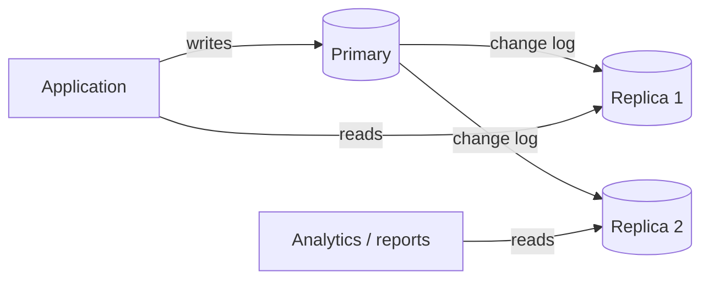
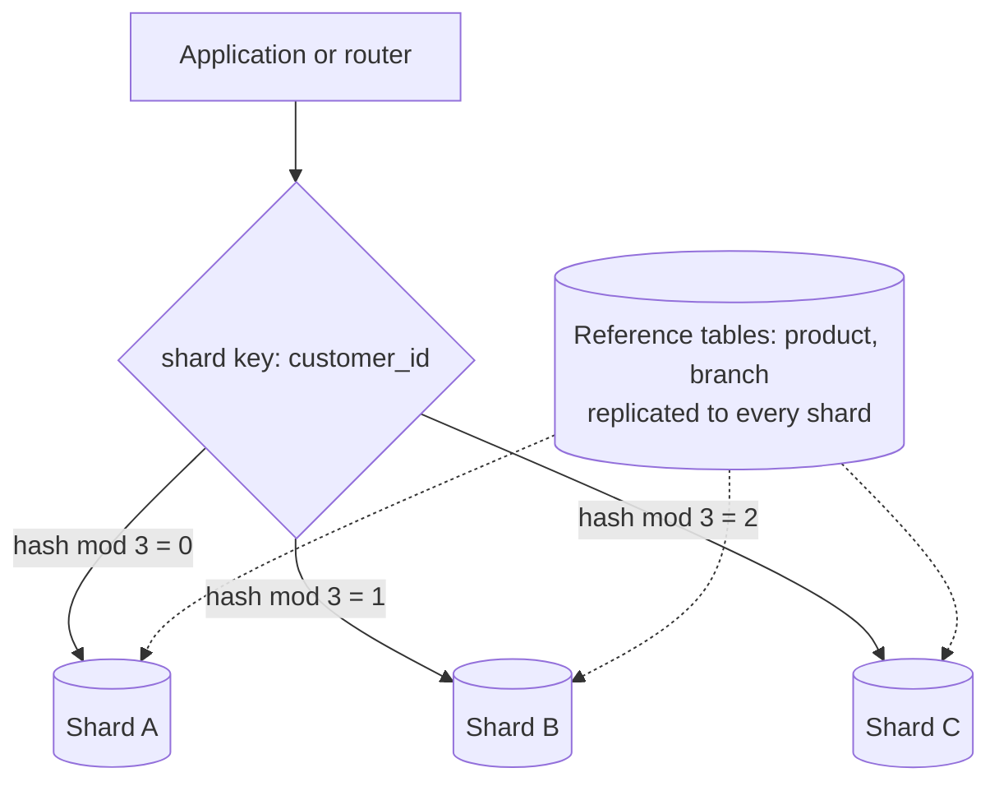

# Clustering, sharding and big data

Partitioning divides a table, but all the partitions still live on **one server** with one set of CPUs, one pool of memory and one write path. When a workload outgrows the biggest machine you can buy — or when a single machine failing is unacceptable — the database itself has to spread across machines. This lesson surveys how: **replication** and **clustering**, **sharding**, the trade-offs distributed systems force on you (and on your SQL), and the **big-data** systems — columnar warehouses, data lakes, query engines — where most analytical SQL is written today. It is an overview: the goal is that you recognise the architectures, know their vocabulary, and understand how they change the way queries behave.

## Scaling up versus scaling out

- **Vertical scaling (scale up):** a bigger server — more cores, memory, faster disks. Simple, no application changes, and modern machines are enormous. Always the first move. Limits: cost grows faster than capacity, there is a ceiling, and one machine is one point of failure.
- **Horizontal scaling (scale out):** more servers. Potentially unlimited and fault-tolerant, but now the data is distributed and everything gets harder: joins, transactions, consistency.

Most systems scale reads first (replication), then partition data across nodes (sharding) only when writes or data volume demand it.

## Replication

**Replication** keeps copies of the same data on several servers. The usual arrangement is **primary–replica** (leader–follower): all writes go to the primary, which ships its change log to replicas that apply it.



What replication gives you:

- **Read scaling** — reports and read-heavy endpoints query replicas.
- **High availability** — if the primary dies, a replica is promoted (*failover*).
- **Isolation of workloads** — the long analytical query from the locking lesson runs on a replica and cannot disturb transactions.

What it does not give you: more **write** capacity (every replica must apply every write), or more storage per dataset.

The key subtlety is **replication lag**. With *asynchronous* replication the primary confirms a commit before replicas have it, so a replica is slightly behind. A user who updates their profile and immediately reads from a replica may see the old value — a *read-your-writes* violation. *Synchronous* replication waits for a replica to confirm, trading latency for the guarantee. When your query reads from a replica, "the latest data" means "the latest data that replica has".

## Clustering

The book's third edition uses **clustering** for configurations in which several servers act as one database. Two broad designs:

- **Shared-disk clusters** (e.g. Oracle RAC): several database instances on different machines access the **same storage**. Any node can serve any query; if a node fails, others carry on. Scales CPU and availability, but the shared storage and the coordination between nodes are bottlenecks, and it is expensive.
- **Shared-nothing clusters**: each node has its own CPU, memory and disk and owns a slice of the data. Nodes communicate only over the network. This scales much further and is the basis of sharding, MPP warehouses and most modern distributed databases.

## Sharding

**Sharding** is horizontal partitioning *across servers*: each **shard** is a separate database holding a subset of the rows, chosen by a **shard key**. Where a partitioned table hides its pieces inside one server, shards are independent machines.



### Choosing a shard key

The shard key decides everything. A good one:

- appears in **almost every query**, so that a query can be routed to a single shard;
- distributes data and load **evenly** (high cardinality, no dominant values);
- keeps rows that are used together **on the same shard** — for a bank, all of a customer's accounts and transactions; for a SaaS product, everything belonging to one tenant.

Strategies mirror partitioning methods:

- **Hash sharding** — `hash(key) mod N`. Even spread; but changing N remaps almost every key, so real systems use **consistent hashing** or a fixed number of virtual buckets mapped to servers.
- **Range sharding** — contiguous key ranges per shard. Supports range scans, risks **hot spots** (all new rows land on the last shard if the key is a timestamp or sequence).
- **Directory (lookup) sharding** — a table maps each key (tenant) to a shard. Flexible, lets you move big tenants individually; the directory is one more thing to keep available.

Small, rarely changing **reference tables** (products, branches, countries) are typically replicated to every shard so they can be joined locally.

### What sharding does to your SQL

Sharding is where SQL's "ask for anything" promise starts to cost:

| Operation | Single server | Sharded |
|---|---|---|
| Query with the shard key | — | routed to one shard: fast |
| Query without the shard key | index or scan | **scatter-gather**: sent to all shards, results merged |
| Join on the shard key | normal | local to each shard |
| Join across shards | normal | expensive: data shipped between nodes, or done in the application |
| `GROUP BY` / `ORDER BY … LIMIT` across shards | normal | each shard computes partials; a coordinator combines them |
| Unique constraint / auto-increment id | easy | needs global id generation (UUIDs, Snowflake-style ids, sequences per shard) |
| Multi-row transaction | ACID | within a shard: fine; across shards: two-phase commit or sagas |
| Foreign keys across shards | enforced | generally not enforced |

Aggregation across shards illustrates the "combine partial results" idea, and why some aggregates are harder than others. `COUNT`, `SUM`, `MIN`, `MAX` combine directly (sum the counts, sum the sums, min of mins). `AVG` must be shipped as `(sum, count)` pairs. `COUNT(DISTINCT)` and medians cannot be combined from per-shard answers at all — the same non-additivity noted in the grouping module. You can see it with the shop data, treating each country as a "shard":

```sql-run dataset=shop
WITH per_shard AS (                         -- what each shard would return
  SELECT c.country AS shard,
         COUNT(*) AS n_orders,
         SUM(o.shipping_fee) AS sum_fee,
         AVG(o.shipping_fee) AS avg_fee,
         COUNT(DISTINCT o.order_date) AS distinct_days
  FROM orders o JOIN customers c ON c.customer_id = o.customer_id
  GROUP BY c.country
)
SELECT ROUND(SUM(sum_fee) / SUM(n_orders), 4) AS correct_avg_from_sum_and_count,
       ROUND(AVG(avg_fee), 4)                 AS wrong_avg_of_avgs,
       SUM(distinct_days)                     AS wrong_sum_of_distincts,
       (SELECT COUNT(DISTINCT order_date) FROM orders) AS true_distinct_days
FROM per_shard;
```

The average of averages is wrong because shards have different sizes; the sum of distinct counts overcounts days that appear in several shards. Distributed engines handle this for you — but it explains why `COUNT(DISTINCT …)` is slow or approximate (`APPROX_COUNT_DISTINCT`, HyperLogLog) on big systems.

### Costs and alternatives

Sharding multiplies operational work: schema changes on every shard, rebalancing when shards fill unevenly, backups, monitoring, cross-shard reporting. The standard advice is to postpone it: optimise queries and indexes, scale up, add replicas, add caching, archive or partition old data — and shard only when those are exhausted.

**Distributed SQL** ("NewSQL") databases — Google Spanner, CockroachDB, YugabyteDB, TiDB, Vitess and Citus for MySQL/PostgreSQL — do the sharding, rebalancing and distributed transactions inside the database and present ordinary SQL. They remove much of the application burden, though the physics remains: queries that stay on one node are fast, queries spanning many are slower.

## Consistency trade-offs

Once data lives on several machines connected by a network that can fail, a system cannot have everything. The **CAP theorem** says that during a network **p**artition a distributed store must choose between **c**onsistency (every read sees the latest write) and **a**vailability (every request gets an answer). Systems that choose availability offer **eventual consistency**: replicas converge, but a read may briefly return stale data. Many NoSQL stores (Cassandra, DynamoDB) default this way and offer **BASE** semantics (basically available, soft state, eventually consistent) in place of ACID; distributed SQL systems typically choose consistency.

For you as a query writer the practical questions are: *can this query see stale data?* and *are these two tables updated atomically?* — neither of which you had to ask on a single ACID server.

## Big data: analytical systems

Transactional (OLTP) and analytical (OLAP) workloads differ so much that they are served by different architectures.

| | OLTP | OLAP |
|---|---|---|
| Typical query | fetch/update a few rows by key | scan millions of rows, aggregate |
| Users | applications, many concurrent | analysts, dashboards, pipelines |
| Schema | normalized | denormalized star schemas |
| Storage | row-oriented | **column-oriented** |
| Examples | PostgreSQL, MySQL, Oracle, SQL Server | Snowflake, BigQuery, Redshift, ClickHouse, DuckDB |

### Columnar storage

A row store keeps each row's values together — ideal for "give me this order". A **column store** keeps each column's values together. An aggregate such as `SELECT country, SUM(amount)` over a 100-column table then reads **two columns** instead of everything, and since a column holds similar values it compresses extremely well (dictionary and run-length encoding). Combined with vectorised execution, this makes scans 10–100× faster for analytics. The cost: writing or updating single rows is slow, so data arrives in batches.

Consequences for how you write SQL on a warehouse:

- **`SELECT *` is expensive** — it reads every column. Select only what you need.
- **Indexes mostly disappear**; performance comes from partition pruning, clustering/sort keys and min/max statistics per data block.
- **Wide, denormalized tables are fine** — unused columns cost nothing at query time.
- **Joins of two huge tables** are the costly operation; pre-join or pre-aggregate in pipelines.

### MPP warehouses and separation of storage and compute

**Massively parallel processing (MPP)** warehouses are shared-nothing clusters built for analytics: a coordinator splits a query into fragments, workers scan their slices in parallel, shuffle rows between nodes for joins and group-bys, and return partial results. Cloud warehouses go a step further by **separating storage from compute**: data sits in cheap object storage and compute clusters are started, resized and stopped independently.

### Data lakes and SQL-on-anything

The Hadoop era introduced storing raw files cheaply and processing them with clusters (MapReduce, then **Spark**). Today's **data lake / lakehouse** keeps data as columnar files (**Parquet**, ORC) in object storage, with table formats (**Delta Lake**, **Apache Iceberg**, Hudi) adding transactions, schema evolution and time travel. SQL engines — Spark SQL, Trino/Presto, Athena, Dremio, DuckDB — query those files in place. The book's third edition closes with **Apache Drill** as an example of this: one SQL dialect over files, document stores and relational databases at once.

The remarkable constant is the language. Whatever sits underneath — one SQLite file, a sharded MySQL fleet, a 500-node Spark cluster — you describe the result in SQL, and everything from this track applies: joins, grouping, window functions, CTEs.

### NoSQL in one paragraph

Non-relational stores trade SQL's generality for scale or flexibility in a specific access pattern: **key-value** (Redis, DynamoDB) for lookups by key; **document** (MongoDB) for nested, schema-flexible records; **wide-column** (Cassandra, Bigtable) for enormous write volumes with known query paths; **graph** (Neo4j) for relationship traversal; **vector** stores for embedding similarity. Data modelling there starts from the queries you will run, with denormalization and duplication instead of joins.

## Where ML systems fit

A typical ML platform uses several of these at once:

- an **OLTP** database for the application and the model registry/experiment tracker (like the `mlops` dataset);
- an event stream or append-only log for predictions and feedback;
- a **warehouse or lakehouse** where features and training sets are built with SQL (partitioned by date, point-in-time joins);
- an **online feature store** — a key-value store for millisecond lookups at serving time — kept in sync with the **offline** store;
- a **vector index** for retrieval.

Knowing which system a query runs on tells you which rules apply: transactions and indexes on the OLTP side; scans, partitions and cost on the analytical side.

## Pitfalls

- **Sharding too early** — it is the most expensive scaling step to undo.
- **A shard key that queries don't use**, or that is skewed (one giant tenant).
- **Reading from replicas and expecting fresh data.**
- **Averaging averages / summing distinct counts** across shards or partitions.
- **`SELECT *` on a column store**; unfiltered scans of unpartitioned warehouse tables.
- **Assuming cross-shard transactions and foreign keys** behave as on one server.

## Summary

- Scale **up** first; scale **out** with replication (reads, availability), then sharding (writes, volume).
- Replication copies data (primary → replicas) with possible lag; clustering makes several servers act as one, shared-disk or shared-nothing.
- **Sharding** splits rows across servers by a shard key: single-shard queries are fast; cross-shard joins, aggregates, uniqueness and transactions are hard.
- Distributed systems trade consistency against availability (CAP; eventual consistency).
- Analytical systems use **columnar storage**, MPP execution and partition pruning; lakes query Parquet files with SQL engines. SQL remains the common language.

```quiz
[
  {"q": "What does primary-replica replication primarily scale?", "options": ["Write throughput", "Read throughput and availability", "Storage per table", "Schema changes"], "answer": 1, "explain": "All writes still go through the primary; replicas serve reads and provide failover."},
  {"q": "What is replication lag?", "options": ["Slow queries on the primary", "The delay before a replica has applied changes committed on the primary", "Network latency to clients", "Time to create an index"], "answer": 1, "explain": "With asynchronous replication a replica can briefly return stale data."},
  {"q": "How does sharding differ from partitioning?", "options": ["Sharding splits columns", "Shards live on separate servers; partitions are pieces within one server", "Partitioning requires hashing", "There is no difference"], "answer": 1, "explain": "Sharding is horizontal partitioning across machines."},
  {"q": "A query on a sharded database does not include the shard key. What happens?", "options": ["It fails", "It is sent to every shard and the results are merged (scatter-gather)", "It runs on a random shard", "It uses the primary key instead"], "answer": 1, "explain": "Without the key the router cannot pick a shard."},
  {"q": "Why can't per-shard AVG values simply be averaged?", "options": ["AVG is not allowed on shards", "Shards have different row counts; you must combine sums and counts", "Averages are always integers", "They can"], "answer": 1, "explain": "The correct global average is total sum divided by total count."},
  {"q": "Why are column stores fast for analytics?", "options": ["They keep more indexes", "Queries read only the needed columns, which compress well and scan quickly", "They store less data", "They avoid SQL"], "answer": 1, "explain": "Aggregates touch a few columns of many rows; columnar layout minimises I/O."},
  {"q": "Which statement about the CAP theorem is correct?", "options": ["A system can always have consistency, availability and partition tolerance", "During a network partition a system must choose between consistency and availability", "It applies only to single-server databases", "It says SQL cannot scale"], "answer": 1, "explain": "Partitions happen; the design choice is what to sacrifice while one lasts."}
]
```

> **Source:** Beaulieu, *Learning SQL*, 3rd ed., ch. 17 "Working with Large Databases" (clustering, sharding, big data: Hadoop, NoSQL and document databases, cloud computing) and ch. 18 "SQL and Big Data" (Apache Drill). Background: Kleppmann, *Designing Data-Intensive Applications*, ch. 5-6.
